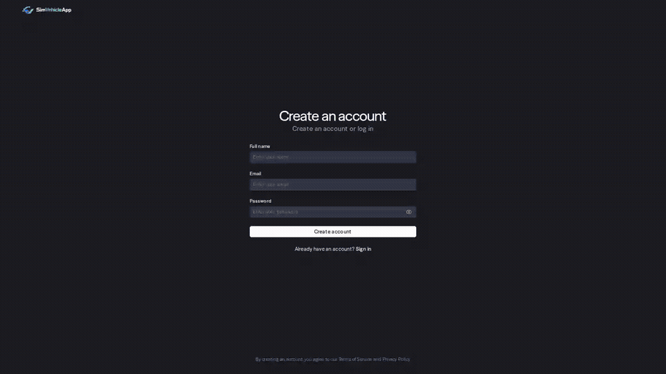
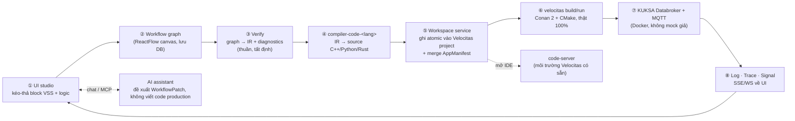
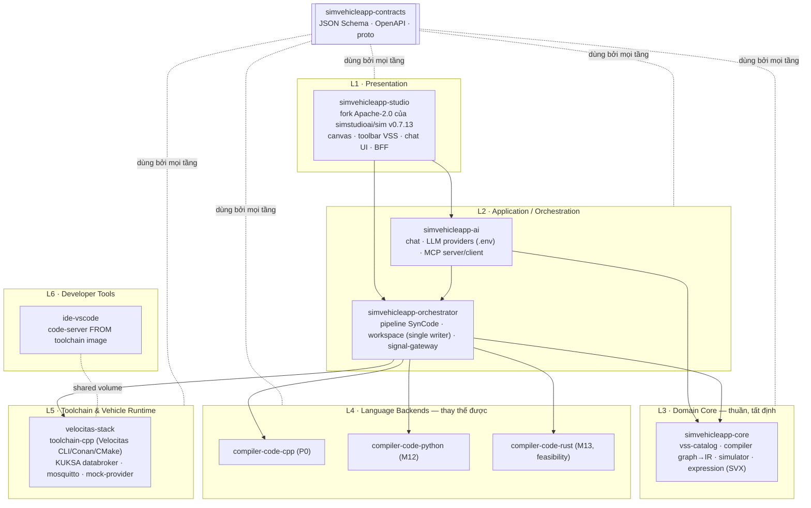

# SimVehicleApp — Vehicle No-Code Toolchain

> Kéo-thả block tín hiệu xe (VSS) thành workflow → biên dịch **tất định** (không qua LLM) sang Eclipse Velocitas Vehicle App (C++, Python hoặc Rust) → build/run thật trên KUKSA Databroker trong Docker → xem log/trace/tín hiệu realtime trên UI.
> Drag-and-drop vehicle-signal (VSS) blocks into a workflow → compile it **deterministically** (no LLM in the code path) into an Eclipse Velocitas Vehicle App (C++, Python or Rust) → build & run it for real on a KUKSA Databroker inside Docker → watch logs/traces/live signals back in the UI.

---

## Demo



**Video full luồng** (720p, 116 s, có chú thích từng bước; quay 2026-10-25 trên bản mới nhất): [docs/media/full-flow.mp4](docs/media/full-flow.mp4).
- Video được quay tự động bởi E2E `modules/simvehicleapp-studio/e2e/tests/m15-full-flow.spec.ts` chạy trên stack thật.
- Tái tạo bằng một lệnh: `scripts/sv demo-video`. Cần stack đang chạy với `SV_AI_PROVIDER=fake`; khoảng chờ build được cắt tự động.

Các chặng:
1. Đăng ký.
2–6. Kéo thả workflow **6 block có rẽ nhánh**: When Vehicle.Speed changes → If > 120.
   - Nhánh *then*: Stable for 2 s → Set Hazard = true → thông báo HMI "Overspeed".
   - Nhánh *else*: Set Hazard = false.
7. Block gọn hiện câu tóm tắt (WHEN / IF / DO / SEND); cạnh có nhãn `then` / `else` / `stable`; lint sạch. **Logic** đọc cả workflow thành câu, bấm câu chọn block.
8. Tab **Test** (dock Problems · Test · Live): Simulate trên đồng hồ ảo: 100 ⇒ tắt, 130 trong 2 s ⇒ bật + HMI, 90 ⇒ tắt. Công tắc **Timeline / Flow** hiện kết quả theo lần chạy (nhánh đã rẽ kèm giá trị điều kiện). **Generate tests** sinh test case từ chính workflow; mỗi case thành một test của app khi SynCode; case không đạt có khung **Why the case failed**.
9–10. Bấm **SynCode**: workflow chưa có app nên hộp thoại hỏi tên một lần. App được chuẩn bị rồi SynCode tự chạy: graph → IR → C++ → build → test (không LLM). Pill hiện `Built ✓`, **Run** thành nút chính.
11–13. Run trên KUKSA databroker, tab **Live**: inject tốc độ (ô nhập theo kiểu tín hiệu), đèn hazard bật kèm cảnh báo HMI (Messages), rồi tắt khi giảm tốc. Pane **Flow** hiện lần chạy do giá trị bạn inject gây ra (`you injected`), nhánh `else` và giá trị app đã ghi; Run console viết trace thành câu. **Deploy**: cùng app lên databroker của xe/bench (tín hiệu thật, inject bị tắt) hoặc thành container image — Test connection.
14. Trang **Vehicle apps** (dung lượng, quota, Clean / Delete / Repair) và **System status** (đĩa, app, hàng đợi).
15. Export zip.
16. Open IDE (code-server).
17–18. Trợ lý AI (provider giả lập offline) đề xuất patch; duyệt rồi Accept.
19. Restart stack: workflow, app và code sinh vẫn còn.

Video ngắn hơn theo tutorial "Overspeed warning" (55 s, quay 2026-10-25): [docs/media/demo.mp4](docs/media/demo.mp4) (`scripts/sv demo-video --tutorial`). Làm theo:
[tutorial](docs/user-guide/tutorial.md) · Tài liệu: [docs/README.md](docs/README.md).

---

## 1. Luồng end-to-end / End-to-end flow



| Bước | Dịch vụ sở hữu | Hợp đồng dữ liệu |
|---|---|---|
| ①→② | `simvehicleapp-studio` | `WorkflowGraph v1` |
| ③ | `simvehicleapp-core` (compiler) | `IR v1` + `Diagnostics v1` |
| ④ | `compiler-code-<lang>` | `GeneratedFileSet v1` |
| ⑤ | `simvehicleapp-orchestrator` (workspace) | Velocitas `AppManifest v3` (merge idempotent) |
| ⑥ | `velocitas-stack` (toolchain) | `Toolchain API v1` (`/jobs`) |
| ⑦→⑧ | `velocitas-stack` + `signal-gateway` | `TraceEvent/LogLine/SignalUpdate v1` |

---

## 2. Kiến trúc phân tầng / Layered architecture



**Nguyên tắc cốt lõi:** mỗi khối ở trên là **một module độc lập** (`modules/<tên>`; thư mục trong dev, tách repo khi release theo ADR-0009), chỉ phụ thuộc `@simvehicleapp/contracts`, giao tiếp qua HTTP/SSE/WS — không import code chéo module. Đổi ngôn ngữ sinh code = đổi 1 module `compiler-code-<lang>`, không đụng tới studio/core/orchestrator. Chi tiết: [analysis/02-layers-and-modules.md](analysis/02-layers-and-modules.md).

---

## 3. Overview (English)

| | |
|---|---|
| **What it is** | A no-code / low-code studio that turns drag-and-drop logic over **COVESA VSS** vehicle signals into a real, buildable **Eclipse Velocitas** Vehicle App — not a toy simulation. |
| **Golden rule** | `workflow → deterministic compiler → canonical IR → language backend → source code`. LLMs may only *suggest* a `WorkflowPatch` for a human to review; they never touch the code-generation path. |
| **UI foundation** | Fork of [`simstudioai/sim`](https://github.com/simstudioai/sim) `v0.7.13` (Apache-2.0) — keeps the ReactFlow canvas, block registry, auth (Better Auth), realtime collab; drops the AI-agent/SaaS-integration surface (273 stock blocks → 221 deleted, 47 reviewed individually, see [11b](analysis/11b-block-inventory-and-migration.md)) and the proprietary Copilot backend. |
| **Vehicle target** | [Eclipse Velocitas](https://eclipse.dev/velocitas/) `vehicle-app-cpp-template` + `vehicle-app-cpp-sdk 0.7.1`, built with Conan 2 + CMake via the real `velocitas` CLI — no shortcuts, no mocked build. |
| **Signal model** | [COVESA VSS](https://covesa.github.io/vehicle_signal_specification/) v4.0 (1 197 signals: 287 branches, 425 actuators, 379 sensors, 106 attributes), loaded dynamically — changing the VSS release never requires a frontend rebuild. |
| **Runtime** | [Eclipse KUKSA Databroker](https://github.com/eclipse-kuksa/kuksa-databroker) `0.5.0` + Mosquitto MQTT, running for real in Docker; a custom `simvehicleapp-runtime` library (strand-based, no locks in generated code) handles timers, subscriptions, cancellation. |
| **Block catalog** | 9 groups — Trigger, Sensor, Actuator, Attribute, Logic & Math, Flow Control, State, Communication, Composite — 41 new `sv_*` block types, each mapped to a verified-real VSS path and (where relevant) to the Sim UI mechanism it was modelled after. |
| **Execution model** | **Hybrid compile-first**: the same canonical IR drives both a TypeScript **Simulator** (sub-second feedback, virtual clock) and the **native Velocitas binary** (real build/run) — a parity test suite keeps both in lock-step. |
| **Dev environment** | Docker Compose only — no VS Code Dev Container is required to run the studio or build vehicle apps (though an *exported* project still works with one). A `toolchain-cpp` image replays what the Velocitas devcontainer would do, with an offline-capable wheel/Conan/SDK cache. |
| **IDE** | Optional `code-server` (web VS Code) built `FROM` the same toolchain image — open it only when you want to hand-edit generated code or debug. |
| **AI assistant** | A chat panel (not the old Copilot) wired to your own LLM key from `.env` (Anthropic/OpenAI/Gemini/Ollama/OpenAI-compatible) plus an MCP server/client — it proposes workflow patches, it does not write production C++. |
| **Architecture record** | 47 ADRs (`analysis/adr/`), each re-verified against real upstream source (GitHub, npm registry, actual `.clang-format`/schema files) rather than assumption — see the 2026-10-01 review log in the ADR index. |
| **Status (2026-10-25)** | M0–M10 gates passed; C++, Python and Rust backends pass parity 7/7 on KUKSA; M16 done (vehicle app lifecycle, host capacity limits, stateful action bar, focused UI, block summaries). M17–M18 (run sandboxes, test cases, Test/Live tabs, Deploy) pass their technical gates; the PO accepted every ADR on 2026-10-25. M19 (PO request of 2026-10-24) adds the execution Flow shared by Simulate, Test and Live: every decision says why it went its way, every signal says where it came from, a failed case says where it went wrong ([ADR-0062](analysis/adr/ADR-0062-execution-flow-trace-and-signal-testing.md)). M20: the same workflow can also become a WebAssembly app in C++ or Rust, run by `sv-wasm-host` with memory, time and signal limits — conformance 52/52 and parity 7/7 for both ([ADR-0061](analysis/adr/ADR-0061-wasm-targets-cpp-rust-and-host-runtime.md), [guide](docs/user-guide/wasm.md)). Live tracking: [docs/ROADMAP.md](docs/ROADMAP.md). |
| **License** | SimVehicleApp's own code: Apache-2.0. Built on Apache-2.0 upstream (Sim, Eclipse Velocitas, Eclipse KUKSA) and MPL-2.0 (COVESA VSS data). The Sim Enterprise (`ee/`) surface and anything AGPL (Scratch) are explicitly excluded — see [ADR-0004](analysis/adr/ADR-0004-license-compliance.md). |

---

## 4. Tổng quan (Tiếng Việt)

| | |
|---|---|
| **Là gì** | Một studio no-code/low-code biến thao tác kéo-thả logic trên tín hiệu xe **COVESA VSS** thành một **Vehicle App Eclipse Velocitas** thật, build/chạy được — không phải mô phỏng cho vui. |
| **Nguyên tắc tối thượng** | `workflow → compiler tất định → IR chuẩn → backend theo ngôn ngữ → mã nguồn`. LLM chỉ được phép *đề xuất* một `WorkflowPatch` để người dùng duyệt; không bao giờ chạm vào đường sinh code. |
| **Nền UI** | Fork từ [`simstudioai/sim`](https://github.com/simstudioai/sim) tag `v0.7.13` (Apache-2.0) — giữ canvas ReactFlow, cơ chế đăng ký block, auth (Better Auth), cộng tác realtime; bỏ toàn bộ bề mặt AI-agent/tích hợp SaaS (273 block gốc → xoá 221, xét riêng 47, xem [11b](analysis/11b-block-inventory-and-migration.md)) và backend Copilot độc quyền. |
| **Đích sinh code** | [Eclipse Velocitas](https://eclipse.dev/velocitas/) `vehicle-app-cpp-template` + `vehicle-app-cpp-sdk 0.7.1`, build bằng Conan 2 + CMake qua đúng CLI `velocitas` thật — không rút gọn, không giả lập build. |
| **Mô hình tín hiệu** | [COVESA VSS](https://covesa.github.io/vehicle_signal_specification/) v4.0 (1 197 tín hiệu: 287 nhánh, 425 actuator, 379 sensor, 106 attribute), nạp động — đổi bản VSS không cần build lại frontend. |
| **Runtime** | [Eclipse KUKSA Databroker](https://github.com/eclipse-kuksa/kuksa-databroker) `0.5.0` + Mosquitto MQTT, chạy thật trong Docker; thư viện `simvehicleapp-runtime` tự viết (dựa strand, code sinh ra không có lock) quản lý timer/subscription/huỷ. |
| **Catalog block** | 9 nhóm — Trigger, Sensor, Actuator, Attribute, Logic & Math, Flow Control, State, Communication, Composite — 41 loại block `sv_*` mới, mỗi loại gắn với 1 path VSS đã verify thật và (nếu có) cơ chế UI của Sim được tham khảo. |
| **Mô hình thực thi** | **Hybrid compile-first**: cùng một IR chuẩn vừa chạy **Simulator** TypeScript (phản hồi dưới 1 giây, đồng hồ ảo) vừa build ra **binary Velocitas thật** — có bộ test "semantic parity" giữ hai bên luôn khớp nhau. |
| **Môi trường dev** | Chỉ Docker Compose — không cần VS Code Dev Container để chạy studio hay build vehicle app (dù project **export ra** vẫn mở được bằng devcontainer). Image `toolchain-cpp` tái hiện đúng những gì devcontainer Velocitas làm, có cache offline (wheel/Conan/SDK). |
| **IDE** | `code-server` (VS Code chạy trên web) tuỳ chọn, build `FROM` cùng image toolchain — chỉ mở khi cần sửa tay code đã sinh hoặc debug. |
| **AI assistant** | Khung chat (thay Copilot cũ) gắn API key LLM riêng từ `.env` (Anthropic/OpenAI/Gemini/Ollama/OpenAI-compatible) cộng MCP server/client — chỉ đề xuất patch workflow, không viết C++ production. |
| **Hồ sơ kiến trúc** | 47 ADR (`analysis/adr/`), mỗi cái đã verify lại bằng source thật (GitHub, npm registry, file `.clang-format`/schema thật) thay vì suy đoán — xem log review 2026-10-01 trong mục lục ADR. |
| **Trạng thái (2026-10-25)** | Gate M0–M10 PASS; backend C++, Python, Rust đều parity 7/7 trên KUKSA. M16 xong (vòng đời vehicle app, giới hạn dung lượng host, thanh hành động có trạng thái, UI tập trung, câu tóm tắt block). M17–M18 (sandbox mỗi run, test case, tab Test/Live, Deploy) PASS gate kỹ thuật; PO chấp thuận toàn bộ ADR ngày 2026-10-25. M19 (yêu cầu PO 2026-10-24) thêm Flow chung cho Simulate, Test và Live: mỗi quyết định nói vì sao rẽ nhánh, mỗi tín hiệu nói đến từ đâu, case không đạt chỉ ra chỗ sai ([ADR-0062](analysis/adr/ADR-0062-execution-flow-trace-and-signal-testing.md)). M20: cùng workflow còn có thể thành app WebAssembly bằng C++ hoặc Rust, chạy trong `sv-wasm-host` có giới hạn bộ nhớ, thời gian và tín hiệu — conformance 52/52 và parity 7/7 cho cả hai ([ADR-0061](analysis/adr/ADR-0061-wasm-targets-cpp-rust-and-host-runtime.md), [hướng dẫn](docs/user-guide/wasm.md)). Tiến độ sống: [docs/ROADMAP.md](docs/ROADMAP.md). |
| **License** | Code riêng của SimVehicleApp: Apache-2.0. Dựa trên upstream Apache-2.0 (Sim, Eclipse Velocitas, Eclipse KUKSA) và MPL-2.0 (dữ liệu COVESA VSS). Bề mặt Sim Enterprise (`ee/`) và mọi thứ AGPL (Scratch) đều bị loại trừ tường minh — xem [ADR-0004](analysis/adr/ADR-0004-license-compliance.md). |

---

## 5. Cấu trúc thư mục / Repository layout

```
.
├── README.md  AGENTS.md  CLAUDE.md          # anh/chị đang đọc file này; AGENTS.md = luật cho AI coding agent
├── .claude/skills/                          # nguồn chung 15 skill (xem AGENTS.md §3)
├── .agents/skills/                          # Codex: symlink tới cùng skill, không copy
├── analysis/                                # ~100 file: nghiên cứu, kiến trúc, 47 ADR, kế hoạch 17 milestone (M0–M16)
│   ├── 00…16-*.md                           # research → requirements → architecture → … → roadmap → risks
│   ├── 11b-block-inventory-and-migration.md # kiểm kê 268 block Sim thật, giữ/xoá/tham khảo
│   ├── adr/ADR-0001…0055-*.md               # quyết định kiến trúc, mỗi cái có Context/Decision/Verification
│   ├── modules/*.md                         # đặc tả từng repo con
│   └── phases/M00…M16-*.md                  # task chi tiết + acceptance gate mỗi milestone
├── docs/
│   ├── BASELINE.md                          # SHA/digest mọi thành phần upstream đã pin
│   ├── ROADMAP.md                           # tracking sống theo feature/milestone
│   ├── DEPLOY.md                            # cài trên máy chỉ để chạy, dung lượng & quota
│   ├── user-guide/                          # tutorial, danh mục block, kịch bản, VSS tuỳ biến
│   ├── reports/M00…M16.md                   # báo cáo hoàn thành từng milestone
│   └── spikes/M0-spikes-report.md           # kết quả 6 spike kỹ thuật đã verify thật
├── docker-compose.yml                       # entrypoint duy nhất — chỉ include fragment từng module
├── modules/                                 # mỗi thư mục = 1 "repo" độc lập (xem ADR-0009)
│   ├── simvehicleapp-studio/                # fork Sim v0.7.13 (snapshot thật, 12 226 file)
│   ├── simvehicleapp-core/ · simvehicleapp-orchestrator/ · simvehicleapp-ai/ · simvehicleapp-contracts/
│   ├── compiler-code-cpp/ · compiler-code-python/ · compiler-code-rust/
│   ├── velocitas-stack/                     # toolchain image + template Velocitas vendored + databroker/mqtt
│   └── ide-vscode/                          # code-server FROM toolchain
├── scripts/sv                               # init | build | up | pull | refresh | smoke | vss | apps | demo-video
└── vehicle_no_code_studio_master_plan_v2.md # master plan gốc (tham chiếu lịch sử)
```

## 6. Bắt đầu / Getting started

```bash
scripts/sv init                 # tạo .env từ .env.example, sinh secret / create .env with fresh secrets
scripts/sv build                # build image theo thứ tự phụ thuộc / build images in dependency order
scripts/sv up                   # docker compose up -d
scripts/sv smoke                # kiểm nhanh: project offline → build → app ↔ databroker/MQTT
```

Mở studio tại `SV_STUDIO_URL` (mặc định http://localhost:3000), đăng ký tài khoản đầu tiên.

Máy cấu hình thấp hoặc chỉ để chạy: dùng image dựng sẵn của release (`scripts/sv pull <tag>`) thay cho `sv build`. Chi tiết, cấu hình tối thiểu và quota dung lượng: [`docs/DEPLOY.md`](docs/DEPLOY.md).

### Dùng SimVehicleApp / Using it

1. **Workflows → New workflow.** Kéo tín hiệu từ panel **Vehicle** (vd. `Vehicle.Speed`) hoặc block từ **Toolbar**, rồi nối các block.
   - Mỗi block hiện một câu tóm tắt (WHEN / IF / DO…). Cạnh rẽ nhánh có nhãn `then` / `else` / `stable`….
   - Lỗi hiện ngay trên block và trong tab **Problems**.
2. **Verify / Simulate:** kiểm và chạy thử workflow trên đồng hồ ảo, không cần build. Scenario đã lưu sẽ thành unit test của app.
3. **SynCode:** sinh code C++/Python/Rust, build và test.
   - Workflow chưa có vehicle app ⇒ hộp thoại hỏi tên và ngôn ngữ một lần. App sẵn sàng thì SynCode tự chạy.
   - Release VSS lấy theo workflow.
4. **Run:** chạy app thật trên KUKSA databroker. Tab **Live**: bảng Signals để inject/xem tín hiệu; **Run console** xem log và trace viết thành câu (công tắc Raw); **Flow** xem từng lần chạy: cái gì kích hoạt (và từ đâu: inject, playback, app, xe), nhánh đã rẽ kèm giá trị điều kiện, app đã ghi gì. Bấm **Make test case from this run** để khoá hành vi đó thành test case ([hướng dẫn](docs/user-guide/test-signals.md)).
5. **Open IDE / Export:** mở code-server đúng project, hoặc tải zip build được ngoài SimVehicleApp.
6. **Menu workflow (…) → Download workflow (.json):** tải workflow kèm release VSS và scenario. **Import** khôi phục cả hai; **Duplicate** cũng copy cả hai.

Thanh hành động cho biết bước nên làm tiếp (nút đậm), đang dùng app nào (chip app) và trạng thái hiện tại (pill: `Building · step 3/7`, `Running 00:42`…). Khi một nút chưa bấm được, dòng chữ trên thanh nói lý do.

**Lưu ý cho người dùng và quản trị (M16, [ADR-0053](analysis/adr/ADR-0053-vehicle-app-lifecycle-and-capacity.md)):**
- **Trang Vehicle apps** (thanh bên): liệt kê app của workspace kèm dung lượng.
  - **Clean** xoá thư mục build, giữ mã nguồn.
  - **Delete** xoá hẳn app; phải gõ tên để xác nhận.
  - **Repair** chuẩn bị lại app bị lỗi.
- **Giới hạn mặc định:** 10 app/workspace, 100 app/máy, 20 workflow/app, hàng đợi 20 SynCode. Chỉnh trong `.env`.
- **Ngưỡng đĩa:** dưới 10 GB thì cảnh báo, dưới 5 GB thì chặn tạo app, dưới 2 GB thì tạm dừng SynCode. Trang **System status** hiện dung lượng đĩa, số app và hàng đợi.
- **Tự dọn mỗi giờ:** app lỗi quá 7 ngày bị xoá; app không dùng quá 14 ngày bị clean.
- **Quản trị viên:** `scripts/sv apps list` và `scripts/sv apps prune [--apply]` (mặc định chỉ in ra) để dọn app không ai dùng.
- **Trợ lý AI** (tab cạnh Toolbar): đề xuất thay đổi workflow để bạn duyệt rồi Accept; không viết code production.
  - Cấu hình provider trong `.env` (`SV_AI_PROVIDER`). `fake` = offline, không cần key.
- **VSS tuỳ biến:** `scripts/sv vss add|use` ([hướng dẫn](docs/user-guide/custom-vss.md)).
- **App WebAssembly** (profile `wasm`): khi tạo app chọn **Runtime → WebAssembly** cho C++ hoặc Rust; app chạy trong `sv-wasm-host` ([hướng dẫn](docs/user-guide/wasm.md)).
- **Nhiều app nói chuyện qua MQTT** (standalone service): mỗi service là một app; `SV_RUN_SANDBOX=1` để chạy cùng lúc ([hướng dẫn](docs/user-guide/multiple-apps.md)).
- **UI tập trung:**
  - Studio đã ẩn các module của Sim không dùng cho toolchain xe: Tables, Files, Knowledge base, Logs, Scheduled tasks.
  - Từ M17 cũng ẩn Chat của workflow và "Run from/until block". Logic xe chỉ chạy qua **Simulate** và **Run** ([ADR-0056](analysis/adr/ADR-0056-sim-execution-surfaces-and-workflow-menu.md)).

**Lưu ý M17 — nhiều người cùng Run ([ADR-0057](analysis/adr/ADR-0057-shared-vehicle-runtime-run-slot.md)):**
- Đặt `SV_RUN_SANDBOX=1` trong `.env` để mỗi run có databroker riêng. Như vậy nhiều người, và nhiều app, chạy cùng lúc mà không lẫn tín hiệu.
  - Mặc định `0`: cả máy một run, như trước.
- **Quota:** `SV_MAX_RUNS_PER_USER` = 2, `SV_MAX_RUNS_TOTAL` = 20.
- **Thời hạn:** run tự dừng sau `SV_RUN_MAX_MINUTES` = 30 phút. Khi còn 5 phút, nút **Extend** hiện ra (tối đa 3 lần).
- **My runs (n)** trên thanh hành động liệt kê các app bạn đang chạy, ở mọi workspace, kèm Stop/Extend.
  - Bấm Run khi đang chạy app khác ⇒ hộp thoại hỏi *Stop … and run* hoặc *Run both*.
- **Quản trị viên:** `scripts/sv runs list` và `scripts/sv runs stop <id>|--all`. System status có thẻ **Vehicle runtime**.
- **Trợ lý** hiện *Thinking…*, thời gian chờ và từng bước nó làm (✓/✕); nút **Stop** huỷ lượt.
- **API databroker (M14 #5, [ADR-0047](analysis/adr/ADR-0047-kuksa-val-v2-migration.md)):**
  - app C++/Python/Rust mặc định chạy trên `kuksa.val.v2`; signal-gateway làm provider các actuator app ghi;
  - trên bảng Signals, giá trị app ghi hiện ở cột **hiện tại**;
  - quay về API cũ: `SV_DATABROKER_API=*=sdv.databroker.v1`.

Hướng dẫn từng bước: [tutorial](docs/user-guide/tutorial.md) · kiểm logic bằng tín hiệu (UI, curl, kuksa-client): [test-signals](docs/user-guide/test-signals.md) · danh mục block: [blocks](docs/user-guide/blocks.md) · kịch bản: [scenarios](docs/user-guide/scenarios.md) · chạy app trên databroker của xe/bench: [deploy](docs/user-guide/deploy.md) · app WebAssembly: [wasm](docs/user-guide/wasm.md) · nhiều app qua MQTT: [multiple-apps](docs/user-guide/multiple-apps.md).

## 7. Đọc tiếp / Where to go next

| Vai trò | Đọc |
|---|---|
| Người dùng | [tutorial](docs/user-guide/tutorial.md) · [DEPLOY](docs/DEPLOY.md) · [vận hành](docs/dev/OPERATIONS.md) |
| Muốn hiểu toàn bộ hệ thống | [`analysis/README.md`](analysis/README.md) — bản đồ tài liệu |
| Muốn xem kế hoạch triển khai | [`analysis/13-implementation-roadmap.md`](analysis/13-implementation-roadmap.md) + [`analysis/phases/`](analysis/phases/README.md) — M0→M16 |
| Muốn xem **tiến độ thật** (tracking, cập nhật liên tục) | [`docs/ROADMAP.md`](docs/ROADMAP.md) — từng feature ☐/🔄/✔ theo milestone + ADR |
| Muốn xem mọi quyết định kiến trúc | [`analysis/adr/README.md`](analysis/adr/README.md) — 47 ADR + cây phụ thuộc |
| AI coding agent | [`AGENTS.md`](AGENTS.md) — luật cứng + quy trình + skill |

## 8. License

SimVehicleApp's own code is licensed **Apache-2.0** unless a module states otherwise. It builds on Apache-2.0 upstream software from Sim Studio, Inc. (`simstudioai/sim`), the Eclipse Velocitas and Eclipse KUKSA projects, and MPL-2.0 data from COVESA VSS. See each module's `NOTICE` file for full attribution; see [ADR-0004](analysis/adr/ADR-0004-license-compliance.md) for the license-compliance policy (no Sim Enterprise code, no AGPL/Scratch code, Open VSX-only editor extensions).
