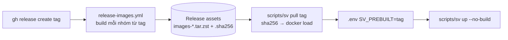

# ADR-0051: Phân phối image dựng sẵn qua GitHub Release và chế độ triển khai cho máy cấu hình thấp

- **Status:** Proposed
- **Date:** 2026-10-13
- **Level:** L0 System
- **Deciders:** PO (yêu cầu 2026-10-13: "pull images deploy cũng phải đầy đủ chức năng mà phải tiết kiệm tài nguyên, máy cấu hình thấp vẫn deploy được"); agent đề xuất
- **Related:** ADR-0009 (một repo dev), ADR-0025 (toolchain headless), ADR-0032 (vận hành), NFR-02, [docs/DEPLOY.md](../../docs/DEPLOY.md)

## Context
Dữ kiện đo ngày 2026-10-13 trên stack dev (WSL, 20 CPU, 11 GB RAM):
- **Build từ source là phần nặng nhất.** `toolchain-cpp` chạy `velocitas init` + Conan và build SDK lúc build image
  (nightly để timeout 300 phút). Studio cần swap trên runner 7 GB. Máy yếu gần như không build được.
- **Chạy thì nhẹ.** Khi rảnh cả stack dùng ~0,9 GB RAM. Peak khi `sv smoke` build app C++ là **1,84 GB**
  (`toolchain-cpp` 893 MB). Build dùng Ninja với số job mặc định = CPU + 2, nên máy nhiều nhân mà ít RAM dễ OOM.
- **Kích thước image** (`docker save | zstd -6`, layer chung trong một nhóm chỉ tính một lần):
  core 44 MB · studio 381 MB · cpp 1,49 GB · python 1,05 GB · rust 574 MB.
  Bộ tối thiểu core + studio + cpp khi giải nén chiếm 6,07 GB.
- **Repo private** (Blinkthor/sim-vehicle-app): GHCR và artifact Actions bị tính vào hạn mức 500 MB.
  Asset của GitHub Release thì không (giới hạn 2 GiB mỗi file).
- **Đĩa tăng theo số project.** Velocitas tạo một venv Python cho mỗi project ở
  `~/.velocitas/projects/md5(<đường dẫn>)/pyvenv` (C++ ~200 MB, Python ~150 MB), dù mọi project pin cùng package
  với seed. Thực tế 52 project chiếm 11 GB volume `sv-velocitas`.
- **Compose v5 dựng lại build context `service:`.** Lệnh `up` dựng lại các context này (devcontainer → toolchain)
  ngay cả khi image đã có, nên máy chỉ có image tải về cũng bị build.

## Decision
1. Mỗi release **PHẢI** có thể kèm image dựng sẵn. Workflow `.github/workflows/release-images.yml` chạy khi
   release được publish (hoặc chạy tay với tag). Nó build từng nhóm trong `deploy/image-groups.txt` từ đúng tag,
   lưu thành `images-<nhóm>.tar.zst` (`docker save | zstd -10`, cắt 1900 MB khi vượt 2 GiB) kèm `images-<nhóm>.sha256`,
   rồi đính vào release. Workflow **KHÔNG ĐƯỢC** chạy theo push.
2. `deploy/image-groups.txt` **PHẢI** phủ đúng mọi image mà compose tự build, mỗi image thuộc đúng một nhóm.
   CI kiểm bằng `scripts/ci/image_groups.py` (job repo-checks). Image công khai (databroker, mosquitto, pgvector)
   vẫn để compose pull từ registry gốc.
3. Lệnh `scripts/sv pull [<tag>] [--groups …]` tải asset bằng `gh`, kiểm sha256 **trước** khi `docker load`, rồi ghi
   `SV_PREBUILT=<tag>` vào `.env`. Khi biến này được đặt, `scripts/sv up` **PHẢI** chạy với `--no-build`.
   Nhóm mặc định là core, studio, cpp; python và rust được thêm theo `COMPOSE_PROFILES`.
4. Số job build song song chỉnh được qua `SV_BUILD_JOBS`, map sang `CMAKE_BUILD_PARALLEL_LEVEL` cho toolchain-cpp và
   ide-cpp. Để trống thì giữ hành vi cũ. Phía Rust đã có sẵn `SV_CARGO_JOBS`.
5. `velocitas init` của toolchain agent (C++ và Python) và `sv-new-project` **PHẢI** link venv của project tới venv
   seed đã có trong image, trừ khi project đã có venv riêng. Venv seed không bị ghi (đã đo kích thước trước/sau).
6. Không đặt `mem_limit` cứng. Build C++ bị OOM-kill thì người dùng chỉ thấy "build lỗi" khó hiểu; giảm số job và tự
   chọn profile là đủ (xem số đo).

## Diagram

## Alternatives considered
| Phương án | Ưu | Nhược | Vì sao loại |
|---|---|---|---|
| GHCR private | `docker pull` chuẩn, pull theo layer | Tính vào hạn mức 500 MB package của repo private, bộ đầy đủ ~3,5 GB | Tốn phí, vượt hạn mức ngay |
| GHCR public | Miễn phí | Lộ sản phẩm khi repo đang private | Là quyết định của PO, không tự làm |
| Artifact Actions (giống `sv refresh`) | Đã có sẵn | Hết hạn, tính vào 500 MB, workflow chỉ giữ 1 image | Không hợp để phát hành |
| Build trên máy đích | Không cần phân phối | Mất hàng giờ, cần RAM lớn | Chính là vấn đề cần giải |
| `mem_limit` cho mọi service | Chặn tràn RAM | OOM-kill build/IDE khó chẩn đoán | Thay bằng giới hạn job và số đo |
| Venv per-project (giữ Velocitas mặc định) | Không đụng gì | ~200 MB mỗi project | Lãng phí, link đã verify an toàn |

## Consequences
- **Tích cực:**
  - Máy yếu triển khai bằng tải về ~1,9 GB (core + studio + cpp) thay vì build hàng giờ.
  - Mỗi project chỉ thêm vài MB cache Velocitas, cộng thư mục build (~136 MB với app mẫu).
  - Release có checksum.
- **Tiêu cực:**
  - Mỗi release tốn thêm phút runner (đặc biệt nhóm cpp phải build toolchain).
  - Máy đích cần `gh` đã đăng nhập (repo private) và `zstd`.
  - Image tải về chỉ khớp compose của đúng tag; `sv pull` cảnh báo khi HEAD khác tag.
- **Module bị ảnh hưởng:**
  - velocitas-stack: agent `SHARE_SEED_VENV`, `sv-new-project`, compose (`SV_BUILD_JOBS`).
  - ide-vscode: compose.
  - Script `sv`/`sv-pull`, CI.

## Implementation
| Task | Module | Milestone |
|---|---|---|
| `deploy/image-groups.txt` + `scripts/ci/image_groups.py` + test | repo/CI | M11 (vận hành) |
| `release-images.yml` | CI | M11 |
| `scripts/sv pull`, `sv up --no-build` khi `SV_PREBUILT` | scripts | M11 |
| `SV_BUILD_JOBS` → `CMAKE_BUILD_PARALLEL_LEVEL` | velocitas-stack, ide-vscode | M11 |
| Venv dùng chung (`SHARE_SEED_VENV`, `sv-new-project`) | velocitas-stack | M11 |
| [docs/DEPLOY.md](../../docs/DEPLOY.md) | docs | M11 |

## Verification
- `python3 -m unittest discover -s scripts/ci/tests`: lớp `ImageGroups` có ca thiếu, trùng và lạ.
  `scripts/ci/image_groups.py` PASS trên compose thật.
- Agent `bun test`: link được tạo đúng hash `md5(path)`; giữ venv riêng; không có seed thì không làm gì; plan init
  chạy snippet ngay trước `velocitas init`.
- Trên stack thật (2026-10-13):
  - `sv smoke` S-1/S-2/S-3 PASS và `sv smoke live` (cổng M7 + M8) PASS với toolchain đã build lại.
  - Project tạo qua agent có cache 3,9 MB (trước đây 200 MB). Project Python thủ công 12 KB (trước đây 148 MB).
- Release đầu tiên có image: chạy `release-images.yml`, rồi chạy `sv pull` trên máy sạch (ghi kết quả vào Notes).

## Notes / Deviations
- 2026-10-13: viết theo uỷ quyền PO 2026-10-06 — chờ PO xác nhận.
- 2026-10-14: release đầu tiên có image [baseline-2026-10-14](https://github.com/Blinkthor/sim-vehicle-app/releases/tag/baseline-2026-10-14) (workflow run 38492369078). `scripts/sv pull baseline-2026-10-14 --groups core`: tải + sha256 + load 9 image trong 12 s; `scripts/sv up` với `SV_PREBUILT` không build gì (0 dòng "Building"); `scripts/sv smoke live` (cổng M7 + M8) PASS trên image tải về.
