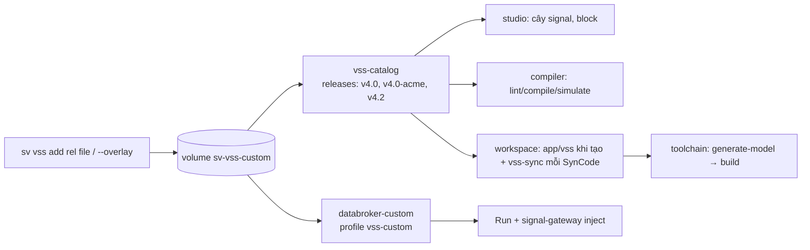

# ADR-0052: Mô hình VSS tuỳ biến (`vX.Y-<name>`): file riêng hoặc overlay, dùng xuyên suốt từ catalog tới databroker

- **Status:** Proposed
- **Date:** 2026-10-14
- **Level:** L0 System
- **Deciders:** PO yêu cầu 2026-10-13 ("đổi thêm tín hiệu hoặc file khác nó có flexible theo không"); agent đề xuất và triển khai theo uỷ quyền PO 2026-10-06 — chờ PO xác nhận
- **Related:** ADR-0010 (VSS catalog), ADR-0024 (databroker theo release), ADR-0026 (workspace), [ADR-0050](ADR-0050-kanto-ide-proxy-vss-overlay.md) #10 (hoãn → làm ở đây), contracts `workflow-graph`, `scenario`, openapi `vss-catalog`/`workspace`/`orchestrator`/`signal-gateway`

## Context
Các tầng đã gắn với VSS như sau (rà soát source ngày 2026-10-13):
- **Nguồn sự thật là vss-catalog.** Compiler (S3 + `modelHash`), studio (cây signal, danh sách release) và workspace
  (copy `GET /vss` vào `app/vss/` của project) đều đọc từ catalog. Toolchain sinh vehicle model Velocitas từ file VSS
  của project. Như vậy codegen C++/Python/Rust **không** phụ thuộc release cụ thể.
- **Điểm cứng 1:** tên release bị khoá `^vX.Y$` trong contracts (schema graph/scenario, 4 openapi) và trong 6 validator
  (catalog, parser, workspace, orchestrator, signal-gateway, studio).
- **Điểm cứng 2:** catalog chỉ nạp release từ image (`/opt/sv/vss`), nên thêm signal là phải build lại image.
- **Điểm cứng 3:** mỗi release cần một databroker nạp đúng file của nó (`databroker`, `databroker-v4-2`).
- **Lỗi tiềm ẩn khi model đổi sau khi project đã tạo** (lộ ra khi chạy gate):
  - file VSS của project không được cập nhật;
  - `generate-model` xuất một revision Conan mới, nhưng CMake vẫn trỏ package cũ (deps bị bỏ qua) → lỗi compile C++;
  - signal-gateway cache metadata theo release → từ chối signal mới;
  - orchestrator giữ kết nối keep-alive tới service vừa restart → "socket connection was closed unexpectedly".

## Decision
1. **Tên release.** Release **PHẢI** khớp `^v[0-9]+\.[0-9]+(-[a-z0-9]([a-z0-9-]{0,30}[a-z0-9])?)?$`. Dạng `vX.Y` là
   COVESA, dạng `vX.Y-<name>` là mô hình tuỳ biến. Thứ tự sắp xếp: `v4.0 < v4.0-acme < v4.2`. Đây là thay đổi nới
   (additive) contracts, đồng bộ ở mọi validator.
2. **Kho mô hình tuỳ biến.** Mô hình tuỳ biến nằm trong volume `sv-vss-custom`, catalog đọc ở `/var/lib/sv-vss-custom`
   (`SV_VSS_CUSTOM_DIR`), layout giống seed. Thư mục này **KHÔNG ĐƯỢC** che release COVESA: tên không có hậu tố bị bỏ
   qua và ghi log. Thư mục chưa tồn tại cũng không sao.
3. **Lệnh `scripts/sv vss`.**
   - `add <rel> <file.json>`: thêm một file VSS JSON hoàn chỉnh (ví dụ do vss-tools xuất từ `.vspec` của OEM).
   - `add <rel> --overlay <overlay.json>`: trộn overlay lên COVESA `vX.Y` đã seed. Trộn tất định: thuộc tính overlay
     thắng, children trộn theo tên, node mới theo thứ tự trong overlay. Node mới phải có `type` hợp lệ, `description`,
     và `datatype` nếu là leaf.
   - Sau khi add, lệnh restart catalog và **PHẢI** để catalog parse thử; nếu lỗi thì báo đúng lý do từ log catalog.
   - `use <rel>`: bật profile `vss-custom` (`databroker-custom` nạp file đó) và thêm `<rel>=databroker-custom:55555`
     vào `SV_DATABROKERS`. Chỉ recreate các service đang chạy và có đọc biến này, **KHÔNG** build.
   - `remove <rel>`: gỡ mô hình. Tại mỗi thời điểm chỉ một mô hình tuỳ biến được nối databroker để Run; catalog vẫn phục
     vụ tất cả.
4. **Model đổi sau khi project đã tạo.**
   - Bước `write` của SynCode **PHẢI** gọi workspace `POST /projects/{slug}/vss-sync` trước khi commit. File VSS của
     project được ghi lại bằng temp + rename khi tài liệu catalog khác (so sánh JSON, bỏ qua định dạng). Release COVESA
     không đổi nên bước này là no-op.
   - Build C++ chạy lại `./install_dependencies.sh` khi `generate-model` vừa sinh model mới.
   - signal-gateway nạp lại metadata của release khi gặp path chưa biết, tối đa 5 giây một lần cho mỗi release.
5. **Retry khi kết nối keep-alive chết.** Client của orchestrator gửi lại **một lần** khi kết nối keep-alive chết
   (ECONNRESET), chỉ với gọi idempotent: compile, generate, createProject (lặp lại thì nhận 409), commit (theo
   generationId), vss-sync, đọc workspace, mirror. Tạo job toolchain **KHÔNG** retry.

## Diagram

## Alternatives considered
| Phương án | Ưu | Nhược | Vì sao loại |
|---|---|---|---|
| Thay file v4.0 trong image bằng file OEM | Không đổi contracts | Lẫn với COVESA, phải build lại image, mất `modelHash` chuẩn | Che release chuẩn |
| Overlay `.vspec` qua vss-tools trong toolchain | Đúng định dạng OEM | Cần bộ vspec nguồn của release (repo chỉ vendor JSON) | Chấp nhận file JSON do vss-tools xuất sẵn bên ngoài |
| Bind mount thư mục host vào catalog | Đơn giản | Vi phạm compose lint (mount ngoài module) | Dùng volume + `docker compose cp` |
| Một databroker cho mọi mô hình | Ít service | KUKSA nạp một cây; trộn release dễ sai kiểu | Một databroker-custom, chọn bằng `use` |
| Mỗi mô hình tuỳ biến một databroker | Chạy song song | Compose tĩnh không sinh service động (cần docker.sock) | Giữ luật cứng 10 |
| Upload VSS qua UI studio | Tiện | Thêm API ghi và quyền admin | Làm sau nếu PO cần |

## Consequences
- **Tích cực:**
  - Thêm hoặc đổi signal không phải build lại image.
  - Toàn bộ pipeline dùng được signal riêng: block, lint, simulate, SynCode C++/Python/Rust, Run, inject.
  - Project cũ tự cập nhật theo model mới.
- **Tiêu cực:**
  - Một mô hình tuỳ biến live tại một thời điểm.
  - Đổi model cần restart catalog (thao tác của `sv vss add`).
  - Project tạo bằng release đã bị `remove` vẫn giữ bản copy file, nhưng SynCode sẽ báo catalog không có release.
- **Module bị ảnh hưởng:**
  - contracts: pattern, op `syncProjectVss`.
  - core: vss sources/parse, catalog.
  - orchestrator: workspace vss-sync, pipeline, clients retry, signal-gateway.
  - velocitas-stack: build plan, `databroker-custom`.
  - studio: validator.
  - scripts: `sv vss`.

## Implementation
| Task | Module | Milestone |
|---|---|---|
| Nới pattern release (contracts + 6 validator), `compareReleases` | contracts, core, orchestrator, studio | M14 #10 |
| `LocalFileSource.fromDirectory(dir, {custom})`, catalog `SV_VSS_CUSTOM_DIR`, volume `sv-vss-custom` | core | M14 #10 |
| `databroker-custom` (profile `vss-custom`) | velocitas-stack | M14 #10 |
| workspace `vss-sync` + pipeline write stage | orchestrator | M14 #10 |
| C++ build: deps lại sau khi model sinh lại | velocitas-stack agent | M14 #10 |
| signal-gateway `signalsWith` (nạp lại khi thiếu path) | orchestrator | M14 #10 |
| clients retry một lần cho gọi idempotent | orchestrator | M14 #10 |
| `scripts/sv vss` + ví dụ `docs/examples/vss/overlay-acme.json` + hướng dẫn | scripts, docs | M14 #10 |
| Gate `gate/vss-custom-gate.sh` (nightly, C++) | orchestrator | M14 #10 |

## Verification
- **Unit test:**
  - core: `compareReleases` với hậu tố; custom dir chỉ nhận `vX.Y-<name>`; catalog HTTP phục vụ `v4.0-acme`
    (tree/nodes/vss), hậu tố sai → 400.
  - workspace: vss-sync ghi khi đổi, không ghi khi chỉ khác định dạng, 502 khi catalog lỗi.
  - pipeline: log khi đổi, lỗi sync làm hỏng bước write.
  - agent: deps chạy lại chỉ khi model vừa sinh lại.
  - signal-gateway: nạp lại khi thiếu path, có giới hạn tần suất.
  - clients: retry đúng một lần, không retry job.
  - `scripts/ci/tests` lớp `SvVss`: merge, tên release, sửa `.env`.
- **Gate trên stack thật (2026-10-14), `modules/simvehicleapp-orchestrator/gate/vss-custom-gate.sh`: PASS.**
  - Phase 1 (C++, Python, Rust):
    - lint: signal riêng chỉ có trong `v4.0-acme`;
    - simulate: `WarningLevel` = [1000→2, 2000→0];
    - SynCode: 4/4 passed;
    - Run trên databroker-custom: inject `DrowsinessLevel` 2 → `WarningLevel` target 2; inject 1 → 0.
  - Phase 2: thêm `Vehicle.Acme.Hmi.Chime` vào model → cùng project SynCode workflow dùng Chime PASS (log "VSS … changed
    in the catalog") → Run: Chime true/false.
- Hồi quy: `scripts/sv smoke live` (cổng M7 + M8 trên v4.0) PASS.

## Notes / Deviations
- 2026-10-14: thực hiện mục #10 của ADR-0050 theo hướng "release mới `<base>-<name>`". Overlay ở dạng JSON thay vì
  `.vspec` (lý do ở Alternatives).
