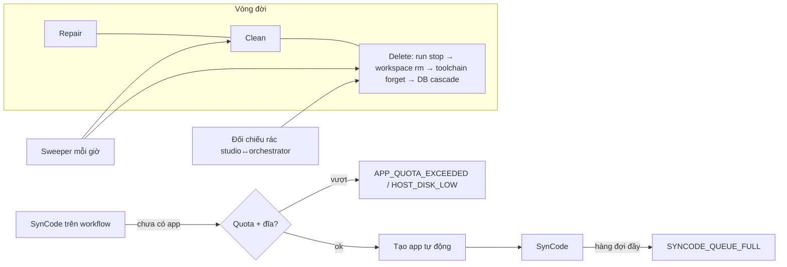

# ADR-0053: Vehicle app tự cấp phát, có vòng đời đầy đủ, và kiểm soát tài nguyên host

- **Status:** Proposed
- **Date:** 2026-10-14
- **Level:** L0 System
- **Deciders:** PO yêu cầu 2026-10-14; agent đề xuất theo uỷ quyền PO 2026-10-06, chờ PO xác nhận
- **Related:** ADR-0026 (workspace), ADR-0025 (toolchain headless), ADR-0046 (per-run stack, hoãn), ADR-0051 (deploy máy yếu), ADR-0052 (VSS tuỳ biến); thiết kế [M16](../../docs/design/M16-ux-and-capacity.md)

## Context
Đối chiếu source ngày 2026-10-14:
- **Phải tạo project thủ công.** Muốn SynCode thì người dùng phải tạo project ở trang "Vehicle projects" rồi tick workflow. Người mới không biết trang này để làm gì.
- **Không thể xoá project ở bất kỳ tầng nào.** Studio BFF, orchestrator (`/projects/{id}` chỉ có GET), workspace, toolchain đều không có thao tác xoá. Project `failed` không có cách sửa hay thử lại.
- **Mỗi project tốn đĩa và tốn build:** ≈ 140 MB thư mục build + ~4 MB cache Velocitas (sau ADR-0051) + 10 generation lưu lại. Mỗi SynCode chiếm worker build duy nhất.
- **Không có giới hạn nào:**
  - không quota số project;
  - không kiểm tra dung lượng trống;
  - hàng đợi generation không giới hạn (một worker FIFO): một người bấm SynCode liên tục là chặn mọi người.
- **Rác mồ côi:** xoá workspace thì xoá `sv_projects` (cascade bên studio), nhưng project trong orchestrator và thư mục trên đĩa vẫn còn.
- **Không quan sát được tài nguyên:** `/metrics` không có số liệu đĩa. Volume Docker driver `local` không giới hạn dung lượng.
- **Đã có sẵn:** DB orchestrator đã `ON DELETE CASCADE` (project → workflow, generation, run, event).

## Decision

### A. Vehicle app (đổi tên hiển thị "project" thành "Vehicle app")
1. **Tự cấp phát.** SynCode trên workflow chưa thuộc app nào mở hộp thoại một bước tạo app cho riêng workflow đó:
   - tên = tên workflow;
   - VSS = release của workflow;
   - ngôn ngữ = mặc định (C++).

   Sau đó SynCode tự chạy khi app `ready`. Trang "Vehicle apps" chỉ còn là chỗ quản lý nâng cao: nhóm nhiều workflow vào một app, xem dung lượng, xoá.
2. **Vòng đời.** Orchestrator là nơi duy nhất điều phối; workspace là nơi duy nhất ghi đĩa (luật cứng 3).
   - `DELETE /projects/{id}` (orchestrator):
     - trả 409 khi đang có SynCode `queued/running` của app;
     - dừng run đang chạy (SIGINT rồi SIGKILL);
     - gọi workspace `DELETE /projects/{slug}` (xoá thư mục, `.sv/generations/<slug>`, backup) và toolchain `POST /projects/{slug}/forget` (xoá `~/.velocitas/projects/md5(path)`);
     - xoá hàng DB (cascade).

     Thao tác **idempotent**: phần nào đã mất thì bỏ qua.
   - `POST /projects/{id}/repair`: chỉ cho app `failed`. Xoá thư mục, init lại từ đầu, giữ danh sách workflow và cài đặt.
   - `POST /projects/{id}/clean`: xoá bản build (`build*/`), giữ mã nguồn; lần build sau tự làm lại.
   - Studio BFF có route tương ứng (kiểm quyền `write`/`admin` trên workspace) và xoá dòng `sv_projects`.

### B. Kiểm soát tài nguyên (cấu hình bằng `.env`, kiểm ở orchestrator)
3. **Quota, kiểm ở đúng nơi biết dữ liệu:**
   - **Studio BFF** kiểm `SV_MAX_APPS_PER_WORKSPACE` (10) bằng cách đếm `sv_projects` của workspace, vì chỉ studio biết workspace. Không cần thêm field vào contract, không cần migrate project cũ.
   - **Orchestrator** kiểm `SV_MAX_APPS_TOTAL` (100) và `SV_MAX_WORKFLOWS_PER_APP` (20). Đây là giới hạn toàn host, áp cho cả AI (`project_syncode`), MCP và gate.
   - Vượt quota thì trả 409 kèm diagnostic **`APP_QUOTA_EXCEEDED`** (`data.limit`, `data.scope` = workspace | host).
4. **Ngưỡng đĩa theo dung lượng trống thật** của volume `sv-workspace` (workspace đo bằng `statfs`, có `GET /capacity`):
   - dưới `SV_DISK_LOW_GB` (10): chỉ cảnh báo;
   - dưới `SV_DISK_HIGH_GB` (5): **chặn tạo/repair app**;
   - dưới `SV_DISK_FLOOD_GB` (2): **chặn SynCode**. Run/Stop/xem/Clean/Delete vẫn chạy được để người dùng tự giải phóng.

   Lỗi trả diagnostic **`HOST_DISK_LOW`**, có `data.freeGb` và `data.level`.
5. **Hàng đợi.**
   - Mỗi app tối đa **một** generation `queued`: yêu cầu mới thay yêu cầu cũ (cái cũ thành `cancelled`).
   - Tổng hàng đợi tối đa `SV_MAX_QUEUED_GENERATIONS` (20), vượt thì trả 429 kèm diagnostic **`SYNCODE_QUEUE_FULL`**.
6. **Thu hồi tự động** (orchestrator sweeper, chạy mỗi giờ, đồng hồ inject được để test):
   - build của app không có SynCode/Run trong `SV_IDLE_CLEAN_DAYS` (14) ngày ⇒ **clean**;
   - app `failed` quá `SV_FAILED_TTL_DAYS` (7) ngày ⇒ **delete**;
   - số generation lưu `SV_KEEP_GENERATIONS` (10, trước là hằng số).
7. **Đối chiếu rác:**
   - studio so `sv_projects` của mọi workspace với danh sách orchestrator; app không còn workspace ⇒ delete;
   - chạy khi tải trang Vehicle apps (tối đa một lần mỗi giờ mỗi tiến trình) và khi admin bấm "Reclaim".
8. **Quan sát:**
   - `/metrics`: `sv_workspace_free_bytes`, `sv_apps_total`, `sv_generation_queue_length`;
   - System status: thanh dung lượng, mức ngưỡng hiện tại, số app/quota;
   - trang Vehicle apps: kích thước từng app (workspace `GET /projects/{slug}/size`).
9. **Bộ nhớ đệm dùng chung có trần:**
   - **ccache:** `CCACHE_MAXSIZE` = `SV_CCACHE_MAX` (mặc định 2G); ccache tự dọn LRU.
   - **Cache Velocitas mồ côi:** `~/.velocitas/projects/<md5>` không ứng với project nào còn tồn tại. Toolchain có `POST /gc` nhận danh sách đường dẫn project còn sống; orchestrator gọi trong sweeper.
   - **Thư mục build và `target` Rust** dùng chung có kích thước bị chặn bởi số app.
10. **Các nguồn tạo app khác phải dọn sau mình:**
    - gate/smoke (`m7`, `m8`, `m9`, `parity-p3`, `vss-custom`, `bench`) xoá app đã tạo khi kết thúc, kể cả khi FAIL (`trap`); mỗi lần chạy từng để lại một app, máy dev 2026-10-14 có 89 app, 9,1 GB;
    - E2E Playwright xoá app trong teardown.
11. **Workflow bị xoá:** studio bỏ workflow khỏi các app khi nó không còn tồn tại (đối chiếu lúc SynCode và reconcile). SynCode không được hỏng chỉ vì một workflow đã xoá. App hết workflow thì hiện "unused" và được đề xuất xoá.
12. **Dọn dữ liệu cũ một lần** (bước triển khai): script `scripts/sv apps prune --dry-run|--apply`:
    - liệt kê và xoá app của gate/test (theo tiền tố slug) và app mồ côi;
    - chạy `gc` cache;
    - in dung lượng trả lại.

    Mặc định `--dry-run`.
13. **Hạ tầng (tài liệu DEPLOY):** đặt `sv-workspace` trên phân vùng riêng hoặc dùng quota XFS. Cảnh báo theo `/metrics`. Không dùng `docker.sock` (luật cứng 10).

## Diagram

## Alternatives considered
| Phương án | Ưu | Nhược | Vì sao loại |
|---|---|---|---|
| Giữ tạo project thủ công, chỉ thêm nút xoá | Ít việc | Người mới vẫn không hiểu; rác vẫn tăng | Không giải quyết gốc |
| Ẩn hẳn khái niệm project (1 workflow = 1 app cố định) | Đơn giản nhất | Mất khả năng nhiều workflow trong một app (ADR-0044) | Giữ nhóm cho người dùng nâng cao |
| Giới hạn dung lượng bằng quota volume Docker | Cứng | Driver `local` không hỗ trợ; cần `docker.sock` hoặc quyền host | Trái luật cứng 10; chỉ để thành khuyến nghị hạ tầng |
| Chỉ thu hồi khi đầy | Không phải cấu hình | Sự cố xảy ra lúc đang dùng thật | PO muốn chặn từ trước |
| Hàng đợi theo người dùng (fair queue) | Công bằng hơn | Phức tạp; một worker | Gộp theo app + giới hạn tổng là đủ ở quy mô hiện tại; xem lại cùng ADR-0046 |

## Consequences
- **Tích cực:**
  - Người mới chỉ cần bấm SynCode.
  - Dung lượng có trần, có cảnh báo và tự thu hồi.
  - Lỗi rõ ràng, kèm hành động gợi ý.
- **Tiêu cực:**
  - Thêm 3 mã diagnostic, nhiều route mới, và một sweeper chạy nền.
  - Sau khi clean, lần build đầu chậm hơn (~build lại từ đầu).
- **Module bị ảnh hưởng:**
  - contracts: openapi orchestrator/workspace/toolchain, diagnostics catalog;
  - orchestrator;
  - workspace;
  - toolchain agent;
  - studio (BFF, trang Vehicle apps, hộp thoại SynCode, System status).

## Implementation
| Task | Module | Milestone |
|---|---|---|
| Contracts: DELETE/repair/clean, `/capacity`, `/size`, toolchain `forget` + `gc`, 3 mã diagnostic | contracts | M16-T02 |
| Workspace delete/clean/size/capacity | orchestrator/workspace | M16-T02 |
| Toolchain `forget` | velocitas-stack agent | M16-T02 |
| Orchestrator lifecycle + quota + ngưỡng đĩa + hàng đợi + sweeper + metrics | orchestrator | M16-T03 |
| Studio BFF + Vehicle apps (xoá/repair/clean/dung lượng) + hộp thoại tự tạo app + reconcile + System status | studio | M16-T04, T05 |
| DEPLOY.md mục dung lượng; `sv apps prune`; gate/E2E tự dọn; ccache cap | docs, scripts, gates | M16-T05, T10 |

## Verification
- **Unit:**
  - workspace: xoá đúng thư mục, từ chối slug sai, idempotent;
  - toolchain: forget;
  - orchestrator: 409 khi đang SynCode, dừng run, quota, 3 mức ngưỡng (đĩa giả), gộp hàng đợi, sweeper (đồng hồ giả), cascade;
  - studio: route kiểm quyền, reconcile chỉ xoá app mồ côi.
- **Gate trên stack (`gate/m16-capacity.sh`):**
  - tạo app tới quota thì lần kế tiếp `APP_QUOTA_EXCEEDED`;
  - Delete/Clean đo bằng `du` trả lại dung lượng;
  - repair app `failed` ⇒ `ready`.
- **E2E:** SynCode trên workflow mới ⇒ hộp thoại tạo app ⇒ build xanh ⇒ Delete ⇒ app biến mất.
