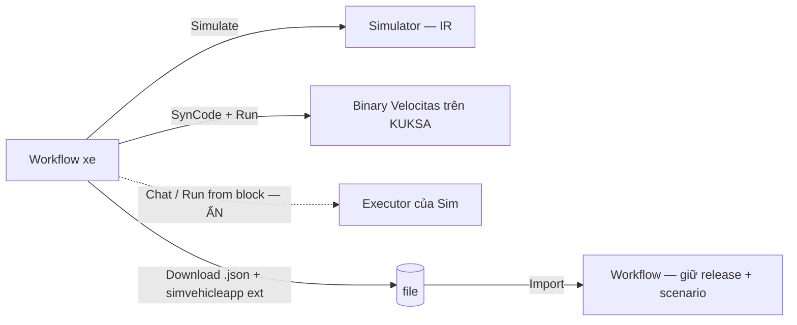

# ADR-0056: Ẩn các bề mặt chạy workflow bằng executor của Sim; menu workflow giữ dữ liệu xe

- **Status:** Proposed (theo uỷ quyền PO 2026-10-06 — chờ PO xác nhận)
- **Date:** 2026-10-15
- **Level:** L2 Component (studio editor)
- **Deciders:** PO; Claude Code (đề xuất)
- **Related:** ADR-0008 (fork Sim, ẩn bằng cấu hình), ADR-0017/0020 (simulator + binary dùng chung IR), ADR-0030 (trợ lý AI), ADR-0054 (UI tập trung), M11-T03 (gỡ Deploy/Run của Sim), [design M17 §1–2](../../docs/design/M17-editor-leftovers-and-run-slot.md)

## Context
- PO hỏi về khung **Chat** và menu **"…"** của editor (2026-10-15).
- **Khung Chat** (`components/chat/chat.tsx`) là chat thử workflow của Sim:
  - tin nhắn thành input của Start/Chat trigger;
  - workflow chạy bằng executor của Sim (`useWorkflowExecution`).

  Executor không có handler cho `sv_*`: `GenericBlockHandler.canHandle` luôn `true`, nên block xe chạy sai nghĩa so với IR. Đường vào: nút cạnh menu "…", "Open Chat" ở menu canvas, phím tắt. M11-T03 đã gỡ Deploy/Run của Sim nhưng còn sót khung này.
- **"Run from block" / "Run until block"** (menu block, thanh nút trên block) cũng gọi executor của Sim.
- **Menu "…"** có Auto layout, Variables, Lock, Export workflow, Duplicate, Delete:
  - "Export workflow" tải JSON nội bộ Sim nhưng **không kèm** release VSS và scenario (bảng `sv_workflow_settings`, `sv_workflow_scenarios`). Import chỉ khôi phục release khi file là WorkflowGraph v1.
  - Route duplicate không copy hai bảng đó (kiểm bằng đọc source 2026-10-15).
  - Hậu quả: workflow v4.2 nhân bản/import rơi về release mặc định, mất scenario (= mất test sinh ra).

## Decision
1. Studio **KHÔNG ĐƯỢC** cho chạy workflow bằng executor của Sim. Ẩn bằng cấu hình (một danh sách `lib/sv/hidden-surfaces.ts`, như `hidden-routes` của M16):
   - khung Chat, nút mở nó, "Open/Close Chat" ở menu canvas, phím tắt;
   - "Run from block", "Run until block" ở menu block và thanh nút trên block.

   BFF trả 404 cho `api/workflows/[id]/chat*` và `api/workflows/[id]/execute` khi gọi từ studio. Không xoá file Sim (ADR-0008).
2. Logic xe chỉ chạy qua **Simulate** (simulator, IR) và **Run** (binary Velocitas). Thử bằng lời dùng **Assistant**.
3. Menu "…" giữ: Auto layout, Variables, Lock/Unlock, Duplicate, Delete, và mục tải workflow.
4. "Export workflow" đổi tên thành **"Download workflow (.json)"** để không nhầm với **Export** (zip app) trên thanh hành động. File tải **PHẢI** có phần mở rộng `simvehicleapp: { vssRelease, scenario }`, và import **PHẢI** khôi phục cả hai.
5. **Duplicate PHẢI** copy release VSS và scenario sang workflow mới.

## Diagram

## Alternatives considered
| Phương án | Ưu | Nhược | Vì sao loại |
|---|---|---|---|
| Giữ Chat, dạy executor Sim chạy `sv_*` | Có "chạy thử" ngay trong chat | Con đường thực thi thứ ba, lệch IR; nhân đôi simulator | Trái nguyên tắc một IR (ADR-0017) |
| Biến Chat thành giao diện inject tín hiệu | Tận dụng UI | Tab Signals đã làm việc này, có kiểu/khoảng giá trị | Trùng chức năng |
| Xoá hẳn file Chat của Sim | Code gọn | Diff upstream lớn, khó đồng bộ Sim | ADR-0008: ẩn trước, xoá ở đợt cleanup |
| Bỏ "Export workflow" | Bớt nhầm | Mất sao lưu/chuyển workspace kèm toạ độ | Có ích, chỉ cần đổi tên + sửa dữ liệu |
| Export dạng WorkflowGraph v1 thay JSON Sim | Định dạng chuẩn, dùng chung với project export | Mất toạ độ, note, chú thích canvas | Giữ JSON Sim (không mất gì) + phần mở rộng; WorkflowGraph vẫn import được |

## Consequences
- **Tích cực:** chỉ còn hai cách chạy, đều theo IR. Không còn nút gây hiểu nhầm. Sao lưu, chuyển workspace và nhân bản giữ đúng release và test.
- **Tiêu cực / nợ kỹ thuật:** file Chat của Sim vẫn nằm trong cây (chờ cleanup). File `.json` cũ (trước M17) import vẫn rơi về release mặc định, nhưng có cảnh báo khi import.
- **Ảnh hưởng tới module:** chỉ studio (panel, canvas-menu, block-menu, action-bar của block, import-export, duplicate route, BFF chặn route). Contracts không đổi.

## Implementation
| Task | Module | Milestone |
|---|---|---|
| Danh sách bề mặt ẩn + ẩn Chat, Run from/until block + chặn route | studio | M17-T02 |
| Download workflow có phần mở rộng; import khôi phục; cảnh báo file cũ | studio | M17-T03 |
| Duplicate copy release + scenario | studio | M17-T03 |

## Verification
- Vitest danh sách bề mặt ẩn; route chat/execute 404.
- Vitest export/import round-trip kèm `vssRelease` + scenario; duplicate copy đủ.
- E2E: không còn Chat / "Open Chat" / "Run from block". Workflow v4.2 có scenario ⇒ Duplicate và Download→Import ⇒ vẫn v4.2, Simulate cho cùng kết quả.
- Full luồng `@live` + cập nhật README (AGENTS §4 bước 7).

## Notes / Deviations
