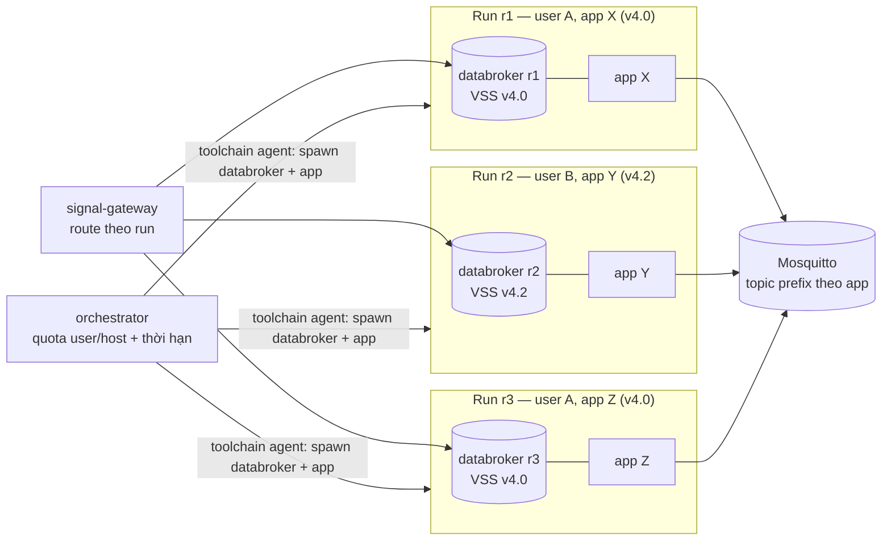

# ADR-0057: Runtime xe cho nhiều người dùng — mỗi run có sandbox riêng, giới hạn bằng quota + thời hạn

- **Status:** Proposed (theo uỷ quyền PO 2026-10-06 — chờ PO xác nhận)
- **Date:** 2026-10-15 (sửa cùng ngày sau câu hỏi multi-user của PO, xem Notes)
- **Level:** L1 Subsystem (orchestrator runs, toolchain agent, signal-gateway, studio)
- **Deciders:** PO; Claude Code (đề xuất)
- **Related:** ADR-0024/0027 (live run, observability), ADR-0052 (databroker theo release, VSS tuỳ biến), ADR-0053 (quota/dung lượng host), AGENTS §2.10 (không mount `docker.sock`), [design M17 §3](../../docs/design/M17-editor-leftovers-and-run-slot.md)

## Context
**Sự cố dẫn tới ADR:** 2026-10-15 PO bấm Run trên `sample-test` và nhận "Another project is running on the vehicle stack". Lúc đó run của `demo-overspeed` (agent bật để PO kiểm tín hiệu) vẫn chạy.

**Hiện trạng (đọc source 2026-10-15):**
- `runs.ts` từ chối mọi run mới khi **bất kỳ** run nào đang hoạt động trên **cả host** (`repo.runs({ active: true, limit: 1 })` ⇒ `RunConflict`).
- Hệ quả: cả bản deploy chỉ một người được Run tại một thời điểm, bất kể user, workspace hay release. **Bản deploy nhiều người dùng không dùng được.**
- Không có thời hạn chạy (chỉ có timeout khởi động 30 s).
- Người bị chặn không biết ai đang chạy, không có cách giải phóng.

**Vì sao trước đây khoá toàn host:**
- Mọi app dùng chung **một databroker cho mỗi release** (`SV_DATABROKERS`).
- Hai app trên một databroker cùng đọc/ghi một bộ tín hiệu VSS ⇒ ghi đè actuator của nhau, trace và Signals lẫn lộn.

**Số đo thật trên máy dev (2026-10-15, `docker stats` / `ps`):**

| Thành phần | RAM |
|---|---|
| KUKSA databroker 0.5.0, mỗi instance | **3,8–5,9 MB**, CPU ~0 % khi rỗi |
| App C++ sinh ra (`demo-overspeed`, đang chạy) | **~14 MB RSS** |
| Signal-gateway (dùng chung) | 48 MB |
| Mosquitto (dùng chung) | 1,2 MB |

Một sandbox (databroker + app) tốn khoảng 20 MB, nên **cô lập từng run là rẻ**.

**Cách app chạy hiện nay:**
- toolchain agent khởi động app dưới dạng **tiến trình** (`Bun.spawn(["setsid", …])`) bên trong container toolchain (không phải container riêng);
- app được truyền `SDV_VEHICLEDATABROKER_ADDRESS`.

Image databroker là một binary duy nhất (distroless). ⇒ Databroker riêng cho mỗi run có thể chạy **dưới dạng tiến trình** cạnh app, **không cần Docker API**, nên không vi phạm luật cấm `docker.sock` (AGENTS §2.10).

## Decision
1. **Mỗi run có sandbox riêng (mặc định):**
   - một tiến trình **KUKSA databroker riêng**, nạp đúng release VSS của app (catalog chuẩn, v4.2 hay mô hình tuỳ biến), cổng cấp phát động;
   - **namespace MQTT riêng**: topic prefix theo app (`settings.mqttTopicPrefix` đã có trong contract project) trên Mosquitto dùng chung;
   - app nhận địa chỉ databroker của sandbox;
   - Run kết thúc (Stop, hết hạn, crash) ⇒ dừng cả app lẫn databroker của nó; không giữ trạng thái giữa các run.
2. **Signal-gateway định tuyến theo run:** Signals, inject, mirror (target→current) và phát scenario dùng địa chỉ databroker của **run đang theo dõi**, không còn bảng `SV_DATABROKERS` cố định. Databroker theo release dùng chung chỉ còn phục vụ Signals khi chưa có run, và các gate cũ.
3. **Giới hạn bằng quota, không bằng khoá:**
   - `SV_MAX_RUNS_PER_USER` (mặc định 2), `SV_MAX_RUNS_TOTAL` (mặc định 20);
   - vượt quota ⇒ 409 `RUN_QUOTA_EXCEEDED` (mã mới) kèm danh sách run đang giữ chỗ **của chính người gọi**;
   - của người khác chỉ báo số lượng, không lộ tên app.
4. **Thời hạn:**
   - `expiresAt = runningAt + SV_RUN_MAX_MINUTES` (mặc định 30; `0` = tắt, chỉ cho máy một người);
   - hết hạn ⇒ dừng như Stop, `stopReason: expired`;
   - **Extend** (`POST /runs/{rid}/extend`) tối đa `SV_RUN_MAX_EXTENSIONS` (mặc định 3);
   - UI cảnh báo 5 phút trước khi hết hạn.
5. **Cùng user bấm Run khi đang có run khác:** không chặn câm.
   - hộp thoại "App *X* đang chạy (12 phút, hết hạn hh:mm)" với **Dừng X và chạy Y** / **Chạy song song** (khi còn quota) / Huỷ;
   - chạy lại **cùng app** đang chạy ⇒ hỏi **Khởi động lại** (Stop + Run bản build mới nhất).
6. **Thấy rõ run đang chạy:**
   - thanh hành động có **"My runs (n)"**: mỗi run có app, release, thời gian, hết hạn, nút Stop;
   - pill trên editor chỉ trạng thái run của app đang mở;
   - trang Vehicle apps đánh dấu app đang chạy;
   - System status có thẻ **Vehicle runtime**: số run/quota toàn host, RAM của các sandbox.
7. **Quản trị:** `scripts/sv runs list|stop <id>`. Run không gắn workspace (gate, script) có owner `system`.
8. **Contracts chỉ thêm:**
   - `Run.expiresAt`, `Run.extensions`, `Run.stopReason` (`user | expired | admin | crashed`);
   - `Run.sandbox` (địa chỉ databroker nội bộ, chỉ trong mạng service);
   - `POST /runs/{rid}/extend`; mã `RUN_QUOTA_EXCEEDED`.

   Không đổi/xoá mã diagnostic cũ.
9. **Chế độ "chung xe" (tuỳ chọn, backlog):** nhiều app chủ động chạy trên cùng một databroker để tương tác (app A ghi, app B đọc). Chỉ bật khi người dùng chọn rõ, nằm ngoài M17.

## Diagram

## Alternatives considered
| Phương án | Ưu | Nhược | Vì sao loại |
|---|---|---|---|
| Giữ khoá toàn host (hiện trạng) | Đơn giản | Cả deploy chỉ một người Run | Không dùng được cho nhiều người |
| Một run mỗi databroker dùng chung theo release (bản đầu của ADR này) | Thay đổi nhỏ | Mỗi release vẫn chỉ một người; v4.0 là release mặc định nên gần như vẫn khoá toàn host | Không giải quyết multi-user — thay sau câu hỏi của PO |
| Nhiều run trên cùng databroker dùng chung | Không ai chờ | Ghi đè actuator, trace lẫn lộn | Sai về bản chất (chỉ hợp lệ khi chủ động "chung xe") |
| Databroker riêng mỗi run dưới dạng **container** (Docker API) | Cô lập mức OS | Orchestrator phải có Docker API ⇒ trái luật `docker.sock`; khởi động chậm hơn | Tiến trình đủ cô lập ở mức cổng/bộ nhớ, rẻ, không cần Docker |
| Hàng đợi run | Công bằng | Phải chờ mà không biết bao lâu | Sandbox + quota cho phép chạy ngay |

## Consequences
- **Tích cực:**
  - nhiều người, nhiều app chạy song song, kể cả cùng release;
  - mỗi run sạch, không bị trạng thái tín hiệu của run trước ảnh hưởng;
  - người dùng thấy và quản lý được run của mình;
  - không còn run bị quên giữ chỗ.
- **Tiêu cực / rủi ro:**
  - toolchain image (hoặc một image runtime riêng) phải chứa binary databroker (Apache-2.0, ghi NOTICE);
  - signal-gateway phải định tuyến động;
  - mỗi run trên một release tuỳ biến phải nạp đúng file VSS từ vss-catalog;
  - tài nguyên tăng tuyến tính theo số run (~20 MB + CPU khi build không đổi), nên quota là bắt buộc;
  - gate parity/live dùng databroker cố định phải chuyển sang sandbox hoặc giữ chế độ cũ có kiểm soát.
- **Ảnh hưởng tới module:**
  - contracts (additive);
  - orchestrator: runs, quota, thời hạn, cấp cổng;
  - velocitas-stack: toolchain agent spawn databroker, image có binary;
  - signal-gateway: route theo run;
  - studio: "My runs", hộp thoại cùng user, System status;
  - scripts: `sv runs`;
  - gate; AI tool `run`.

## Implementation
| Task | Module | Milestone |
|---|---|---|
| **Spike:** chạy databroker dạng tiến trình trong toolchain (binary từ image kuksa 0.5.0), đo thời gian khởi động/RAM, nạp VSS tuỳ biến, 5 run song song cùng release | velocitas-stack | M17-T04a |
| Contracts + orchestrator: sandbox mỗi run, quota user/host, thời hạn, extend, `stopReason`, `RUN_QUOTA_EXCEEDED` | contracts, orchestrator, velocitas-stack | M17-T04 |
| Signal-gateway định tuyến theo run; Studio "My runs", hộp thoại cùng user, cảnh báo hết hạn, thẻ Vehicle runtime; `scripts/sv runs`; gate | signal-gateway, studio, scripts, gate | M17-T05 |

## Verification
- **Spike:** 5 run song song cùng v4.0, inject vào run 1 không làm đổi tín hiệu run 2; số đo khởi động và RAM ghi vào ADR Notes.
- **Unit orchestrator:**
  - quota user/host;
  - hết hạn (đồng hồ giả); extend tới giới hạn;
  - stop người khác ⇒ 403;
  - restart orchestrator giữ hạn và dọn sandbox mồ côi.
- **Gate trên stack:** hai user cùng v4.0 chạy song song, mỗi người inject và nhận đúng output của mình; hết hạn tự dừng; quota chặn đúng.
- **E2E:**
  - cùng user Run app thứ hai ⇒ hộp thoại dừng/chạy song song;
  - "My runs" hiện đủ, Stop được.
- **Full luồng `@live` + README** (AGENTS §4 bước 7).

## Notes / Deviations
- 2026-10-15 — bản đầu của ADR này (cùng ngày) chọn "một run mỗi databroker dùng chung + thời hạn". Lý do loại phương án databroker riêng mỗi run lúc đó là "tốn RAM/CPU", **chưa đo**.
- Sau câu hỏi của PO về multi-user, đã đo lại: databroker 3,8–5,9 MB, app ~14 MB. Lý do loại đó sai, và phương án cũ không cho nhiều người dùng chạy (mỗi release một người). Decision đổi sang sandbox mỗi run; phương án cũ chuyển xuống Alternatives.
