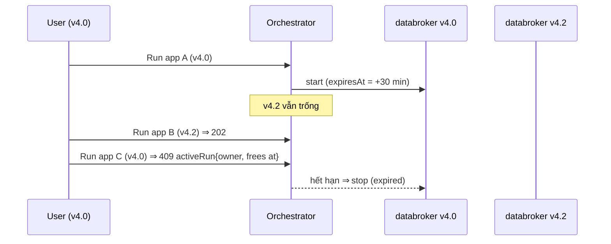

# ADR-0057: Runtime xe dùng chung — một run trên mỗi databroker, có thời hạn, minh bạch và giải phóng được

- **Status:** Proposed (theo uỷ quyền PO 2026-10-06 — chờ PO xác nhận)
- **Date:** 2026-10-15
- **Level:** L1 Subsystem (orchestrator runs, signal-gateway, studio)
- **Deciders:** PO; Claude Code (đề xuất)
- **Related:** ADR-0024/0027 (live run, observability), ADR-0052 (databroker theo release, VSS tuỳ biến), ADR-0053 (quota/dung lượng host), [design M17 §3](../../docs/design/M17-editor-leftovers-and-run-slot.md)

## Context
- 2026-10-15 PO bấm Run trên `sample-test` và nhận "Another project is running on the vehicle stack". Lúc đó run của `demo-overspeed` (agent bật để PO kiểm tín hiệu) vẫn chạy.
- `runs.ts` từ chối mọi run mới khi **bất kỳ** run nào đang hoạt động trên host (`repo.runs({ active: true, limit: 1 })`). Không có thời hạn chạy, chỉ có timeout khởi động 30 s.
- Mỗi release VSS đã có databroker riêng (`SV_DATABROKERS`: v4.0, v4.2, tuỳ biến), nên khoá toàn host là quá rộng.
- Người bị chặn không biết run nào đang chiếm. Không có cách dừng ngoài API nội bộ.
- Chạy hai app trên **cùng** databroker thì sai về bản chất: chúng ghi đè actuator của nhau, trace và Signals lẫn lộn.

## Decision
1. **Khoá theo databroker:** tối đa **một run đang hoạt động trên mỗi databroker** (theo release của app). Run trên databroker khác không chặn nhau.
2. **Thời hạn:**
   - mỗi run có `expiresAt = runningAt + SV_RUN_MAX_MINUTES` (mặc định 30; `0` = không giới hạn, chỉ dành cho máy một người dùng);
   - hết hạn: orchestrator dừng run như Stop thường (`state: stopped`, `stopReason: expired`);
   - chủ run hoặc người cùng workspace có quyền write được **Extend** (`POST /runs/{rid}/extend`), tối đa `SV_RUN_MAX_EXTENSIONS` lần (mặc định 3);
   - UI cảnh báo 5 phút trước khi hết hạn.
3. **Minh bạch:**
   - 409 khi chỗ đã có người dùng **PHẢI** kèm `activeRun` với `release`, `runningAt`, `expiresAt`, và `owner`:
     - `same-workspace` + tên app nếu cùng workspace;
     - `other-workspace` nếu khác workspace, không lộ tên app hay người dùng;
     - `system` nếu app không gắn workspace (gate, script).
   - BFF và UI hiện: "Vehicle stack v4.0 busy — <app> since hh:mm, frees at hh:mm". Nút Run chuyển trạng thái bận thay vì chỉ toast.
   - System status có thẻ **Vehicle runtime**: từng databroker đang trống hay bận, và đến khi nào.
4. **Giải phóng:**
   - người cùng workspace có quyền write được Stop run đang chiếm (`same-workspace`);
   - khác workspace thì **KHÔNG ĐƯỢC** Stop (403);
   - quản trị viên host dùng `scripts/sv runs list|stop <id>`.
5. **Gate/script:** gate live chờ databroker trống (tối đa `SV_GATE_RUN_WAIT_S`, mặc định 600) thay vì fail ngay, và luôn Stop run của mình khi thoát (trap, như `sv_delete_apps`).
6. Contracts chỉ **thêm**: `Run.expiresAt`, `Run.extensions`, `Run.stopReason` (`user | expired | admin`; schema `Run` hiện chưa có trường lý do), `POST /runs/{rid}/extend`, trường `owner` trong `activeRun` của 409. Không đổi mã diagnostic cũ.

## Diagram

## Alternatives considered
| Phương án | Ưu | Nhược | Vì sao loại |
|---|---|---|---|
| Giữ khoá toàn host | Đơn giản | Chặn cả release khác; host nhiều người dùng kẹt | Quá rộng, không cần thiết |
| Nhiều run trên cùng databroker | Không ai phải chờ | Ghi đè actuator, trace lẫn lộn, kết quả "chạy thật" vô nghĩa | Sai về bản chất |
| Databroker riêng cho từng run (ephemeral) | Cô lập hoàn toàn, nhiều người chạy song song | +RAM/CPU mỗi run, khởi động chậm, signal-gateway/mirror phải theo run, quota phức tạp | Đưa vào backlog: chế độ "lab nhiều người" (ADR sau) |
| Hàng đợi run | Công bằng | Người dùng chờ không biết bao lâu; run đang chiếm vẫn có thể vô hạn | Thời hạn + minh bạch + Stop giải quyết gốc vấn đề |

## Consequences
- **Tích cực:** không còn run bị quên giữ chỗ mãi. Người dùng biết vì sao bị chặn và khi nào được chạy. Các release khác nhau chạy song song.
- **Tiêu cực:** demo dài hơn 30 phút phải Extend hoặc đặt env. Thêm trạng thái `expired` mà UI và AI phải hiểu.
- **Ảnh hưởng tới module:** contracts (additive), orchestrator (runs, timer hết hạn, extend, 409), studio (BFF, nút Run, System status, cảnh báo), scripts (`sv runs`), gate (chờ chỗ, trap stop), AI tool `run` (đọc 409 mới thành câu dễ hiểu).

## Implementation
| Task | Module | Milestone |
|---|---|---|
| Contracts + orchestrator: khoá theo databroker, `expiresAt`, hết hạn, extend, 409 `owner` | contracts, orchestrator | M17-T04 |
| Studio: trạng thái bận, Stop/Extend, cảnh báo, thẻ Vehicle runtime; `scripts/sv runs`; gate chờ chỗ + trap stop | studio, scripts, gate | M17-T05 |

## Verification
- **Unit orchestrator:**
  - v4.0 bận + start v4.2 ⇒ 202; cùng v4.0 ⇒ 409 với `owner` đúng theo workspace;
  - hết hạn (đồng hồ giả) ⇒ `expired`; extend tới giới hạn rồi 409;
  - stop khác workspace ⇒ 403.
- **Gate trên stack:** hai release chạy song song; `SV_RUN_MAX_MINUTES` nhỏ ⇒ run tự dừng.
- **E2E (mock):** 409 ⇒ nút Run bận "frees at", có Stop khi cùng workspace.
- **Full luồng `@live`** + README cập nhật (AGENTS §4 bước 7).

## Notes / Deviations
