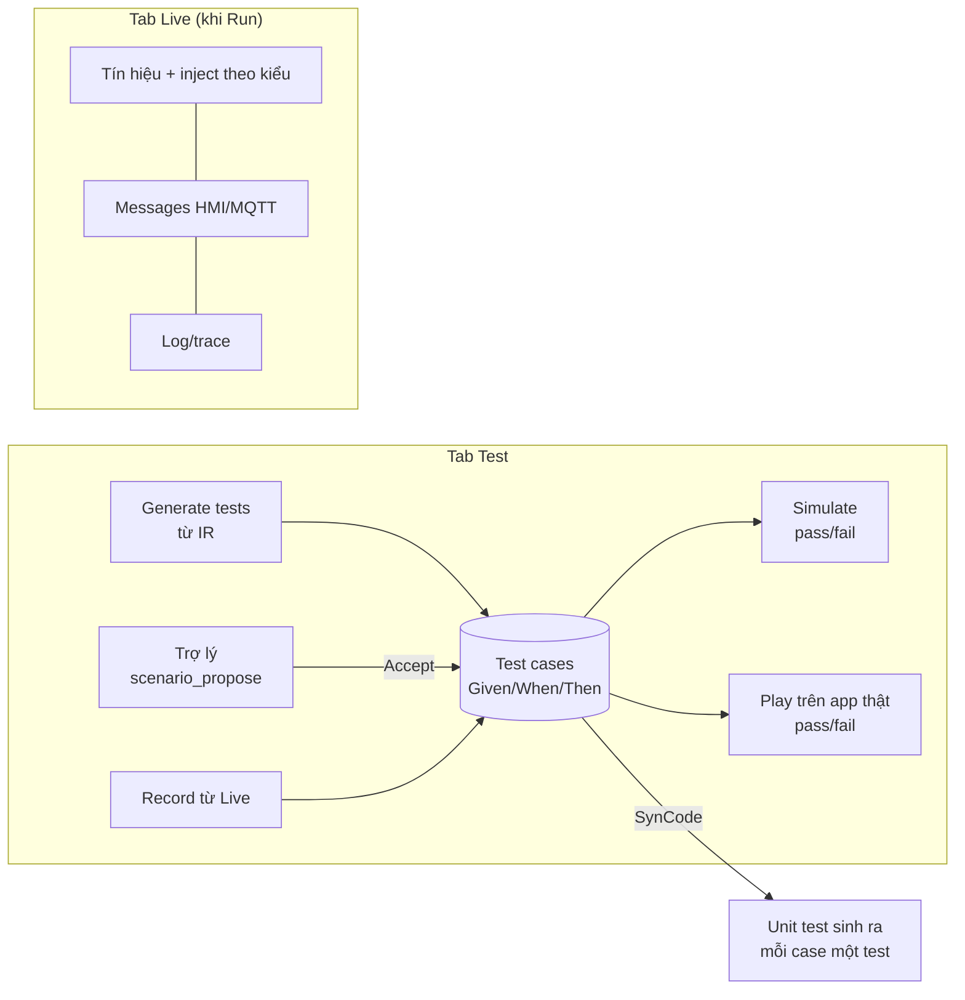

# ADR-0058: Bàn thử nghiệm — scenario thành nhiều test case có kỳ vọng; dock gộp thành Test / Live; trợ lý soạn test

- **Status:** Accepted (PO chấp thuận toàn bộ 2026-10-25)
- **Date:** 2026-10-15
- **Level:** L1 Subsystem (contracts scenario/generate, simulator, backends, studio, AI)
- **Deciders:** PO; Claude Code (đề xuất)
- **Related:** ADR-0017 (simulator), ADR-0022 §8 (scenario ⇒ test sinh ra), ADR-0027 (Run/Signals), ADR-0030 (trợ lý chỉ đề xuất), ADR-0054 (thanh hành động), ADR-0057 (sandbox mỗi run), [design M18 §1–4](../../docs/design/M18-test-workbench-readability-deploy.md)

## Context
- PO (2026-10-15) thấy tab Simulation timeline và Signals rối: không biết tạo scenario thế nào để test luồng.
- PO hỏi Record dùng thế nào, và có dùng trợ lý để soạn kịch bản test được không.
- Ô "Vehicle.Cabin…" phải gõ đúng path rồi Enter.
- PO hỏi các ô Inject có cần hết không.

**Đọc source:**
- **Scenario:** một scenario/workflow (`sv_workflow_scenarios`, PK `workflow_id`), soạn bằng YAML. Schema có `expect` (writes, publishes, trace) nhưng UI không soạn được kỳ vọng.
- **Record:** ghi đè scenario duy nhất.
- **Play:** phát lên databroker thật nhưng không chấm đúng/sai.
- **Generator** (`compiler-code-cpp/generator/src/project.ts`) giữ một scenario mỗi workflow (`Map` theo `workflowId`).
- **Signals:**
  - mọi dòng có ô chữ tự do + `value/target`, kể cả sensor (không có target);
  - danh sách chỉ từ prop `path` (thiếu `<Vehicle.…>` trong biểu thức);
  - thêm tay phải gõ đúng path, và mất khi tải lại trang.
- **Trợ lý** có `workflow_simulate` (nhận scenario) nhưng không có tool soạn/lưu scenario.
- **Dock** có 5 tab; Build log thường trực dù chỉ dùng khi SynCode.

## Decision
1. **Test case:** mỗi workflow có **nhiều** test case. Mỗi case gồm:
   - `name`;
   - `initial` (Given);
   - `inputs` theo thời gian (When);
   - `expect` (Then): tín hiệu ghi ra, publish/HMI, có dung sai thời gian.

   Lưu ở bảng mới `sv_workflow_test_cases` (id, workflow_id, name, scenario, order). Scenario cũ được migrate thành case "Default".
2. **Contracts (additive):**
   - `generateRequest.scenarios[]` cho phép **nhiều** phần tử cùng `workflowId`, thêm `caseName`;
   - orchestrator `startGeneration.scenarios` tương tự.

   Ba backend sinh **một test mỗi case**; tên test lấy từ `caseName`. Conformance C01…C45 và golden **không đổi byte**.
3. **Dock gộp:** Problems · **Test** · **Live**.
   - Build log thành drawer mở khi SynCode chạy hoặc lỗi, mở lại từ pill.
   - Mã E2E dựa trên `data-sv-tab` được cập nhật cùng đợt.
4. **Tab Test:**
   - danh sách case;
   - trình soạn dạng bảng từng bước (YAML là chế độ nâng cao);
   - nút **Simulate** (một case / tất cả) cho pass/fail từng kỳ vọng;
   - **Play on vehicle stack** khi app đang Run: chấm kỳ vọng từ luồng tín hiệu thật;
   - **Kết quả:** timeline, kỳ vọng ✓/✕, tua lại trên canvas;
   - trạng thái rỗng dẫn dắt: *Generate tests / Ask the assistant / Record from a live run*.
5. **Generate tests** (tất định, từ IR):
   - mỗi trigger và mỗi nhánh một case;
   - giá trị biên lấy từ điều kiện so sánh;
   - hiện **độ phủ nhánh**.
6. **Tab Live** (khi Run): bảng tín hiệu + **Messages** (HMI/MQTT theo topic prefix) + log/trace.
   - Danh sách tín hiệu tự gồm `path` và mọi `<Vehicle.…>` trong biểu thức/template; danh sách theo dõi lưu theo workflow.
   - Thêm tín hiệu bằng **ô tìm kiếm có gợi ý** (dùng `vss_search` của catalog) hoặc **kéo từ panel Vehicle**.
   - Ô nhập theo catalog:
     - sensor/attribute chỉ "value"; actuator mặc định "request (target)", "simulate feedback (current)" ở menu phụ;
     - boolean = công tắc; enum = dropdown giá trị cho phép; số = ô số có đơn vị, min/max;
     - Enter = Set.
   - Gợi ý: trigger "rises: false → true"; tín hiệu chưa có giá trị ghi rõ.
7. **Record** tạo **case mới**, không ghi đè. Khi lưu, đề xuất kỳ vọng từ các lần ghi/publish quan sát được.
8. **Trợ lý:**
   - tool mới `scenario_list`, `scenario_propose` (đề xuất case, xem trước trong tab Test ⇒ Accept/Reject; không tự lưu), `scenario_run` (Simulate một case, trả pass/fail);
   - câu "test workflow này" ⇒ trợ lý mở tab Test, đề xuất case phủ các nhánh và chạy Simulate;
   - tab Test có nút "Ask the assistant" điền sẵn yêu cầu.

9. **Ngữ nghĩa kỳ vọng — scenario v1.1, additive** (bổ sung 2026-10-16, design M18 §9.3):
   - `write`/`publish` thêm `within` (ms; thiếu `within` thì giữ nghĩa cũ là đúng `t`, nên conformance không đổi);
   - kỳ vọng phủ định `never: [{path, from, to}]`;
   - kỳ vọng là **tập con** (ghi thêm không fail, trừ `never`);
   - Simulate mặc định `within: 0`; Play trên app thật mặc định `within: 300` ms, có báo độ lệch thực tế;
   - bump `scenarioVersion` lên `1.1.0` vì schema `additionalProperties: false`.
10. **Generate tests** theo thuật toán tất định ở design M18 §9.4: đường đi theo nhánh từ IR, giá trị biên `c`/`c ± bước`, giữ đủ / phá trước hạn cho Stable for và Wait until, `false → true` cho "rises". Kỳ vọng lấy từ simulator, người dùng duyệt trước khi lưu, UI ghi rõ đây là "chốt hành vi hiện tại".

## Diagram

## Alternatives considered
| Phương án | Ưu | Nhược | Vì sao loại |
|---|---|---|---|
| Giữ 5 tab, chỉ sửa chữ | Ít đổi | Gốc rối vẫn còn (hai nơi "test", soạn YAML) | Không giải quyết |
| Một scenario/workflow + thêm expect | Không đổi contract | Không phủ được nhiều nhánh; Record vẫn ghi đè | Test không đủ |
| Test case chỉ chạy simulator | Đơn giản | Không kiểm app thật | Play trên stack là giá trị riêng của SimVehicleApp |
| Trợ lý tự lưu test | Nhanh | Trái ADR-0030 (người dùng duyệt) | Giữ đề xuất ⇒ Accept |

## Consequences
- **Tích cực:**
  - người dùng có một chỗ duy nhất để kiểm logic, có pass/fail rõ ràng;
  - test sinh ra phủ nhiều nhánh;
  - trợ lý giúp soạn test;
  - Signals dễ dùng, đúng loại tín hiệu.
- **Tiêu cực / nợ:**
  - đổi contract generate (additive) và 3 backend;
  - migrate dữ liệu scenario;
  - cập nhật nhiều spec E2E (tab đổi);
  - quay lại video, viết lại user guide.
- **Ảnh hưởng module:** contracts, compiler-code-cpp/python/rust (generator), core simulator (chấm kỳ vọng đã có), orchestrator (chuyển scenarios), studio (DB, BFF, tab Test/Live), signal-gateway (Messages MQTT), AI (tool mới, eval).

## Implementation
| Task | Module | Milestone |
|---|---|---|
| Contracts + DB test case + migrate + BFF | contracts, studio | M18-T02 |
| Generator 3 backend: nhiều test/workflow; conformance/golden giữ nguyên | compiler-code-* | M18-T03 |
| Tab Test (soạn bảng, Simulate pass/fail, Generate tests, độ phủ, Play chấm điểm) | studio, core | M18-T04 |
| Tab Live (ô nhập theo catalog, tìm kiếm gợi ý, kéo thả, tín hiệu từ biểu thức, Messages) + Build log drawer | studio, signal-gateway | M18-T05 |
| Trợ lý: tool scenario_* + eval | ai | M18-T06 |

## Verification
- Unit: test case CRUD + migrate; generator nhiều case (golden mới); conformance 3 backend không đổi; Generate tests phủ đủ nhánh của 7 golden.
- Vitest: ô nhập theo kiểu/loại; tìm kiếm; Messages.
- E2E: tạo case bằng bảng ⇒ Simulate pass/fail; Generate tests; Record ⇒ case mới; trợ lý (fake) đề xuất case ⇒ Accept ⇒ Simulate.
- Live: full luồng `@live` với Play chấm kỳ vọng trên app thật. Eval trợ lý với model thật của PO.

## Notes / Deviations
- 2026-10-24 — **Sửa lỗi Play (tìm ra khi chạy kịch bản ADAS live):**
  - Lỗi: playback chuyển sang `done` ngay sau input cuối, và `observe` dừng ghi sau đó 1 s. Mọi write của app sau thời điểm đó, dù vẫn trước `until`, đều bị bỏ mất. Ví dụ C44: input cuối ở 6000, app ghi Hazard ở 7000, gateway ghi được 0 write. Studio chấm điểm khi playback `done`, nên cũng bỏ sót các write này.
  - Sửa: playback giữ trạng thái `playing` tới `until` của scenario (`player.ts`), có test hồi quy.
  - Bằng chứng: gate mới `gate/adas-live.sh` (SynCode workflow ADAS kèm scenario làm test case ⇒ Run ⇒ Play `observe` ⇒ mọi write kỳ vọng phải thấy trong 300 ms):
    - C43 PASS với C++ (lệch 2–28 ms) và Python;
    - C44 PASS với C++ và Rust (7 ms), sau khi sửa.
- 2026-10-24 — **T06** (PO xác nhận 2026-10-24: thẻ đề xuất trong panel trợ lý; được phép chạy eval với model thật):
  - Ba tool `scenario_*` đều SAFE: `scenario_propose` không lưu gì, chỉ validate (scenario 1.1) và Simulate từng case trên bản nháp graph, rồi trả `structured.testCases`.
  - Đề xuất hiện thành thẻ trong panel trợ lý (Add to Test tab / Reject), không phải bản xem trước trong tab Test: không cần trạng thái "case nháp" trong DB hay store tab Test. Accept tạo case qua BFF CRUD sẵn có, chọn case đầu, đưa tab Test lên trước.
  - Contract studio `svAiEventSchema.tool_result` thêm `structured` (optional); service đã gửi trường này từ M10 nhưng zod của studio bỏ đi.
  - BFF gửi `workflow.testCases` (tên + scenario) để trợ lý biết các case hiện có.
  - Eval `modules/simvehicleapp-ai/eval/tests-eval.ts`: 7 workflow golden, đạt khi `scenario_propose` có ≥ 2 case hợp lệ; mục tiêu ≥ 80 %. Lần chạy 2026-10-24 không đo được (endpoint của PO trả 500: LiteLLM không tìm thấy model `qwen3.8:27b`).
  - Fake provider chỉ thấy tên/kiểu block, không thấy props, nên đề xuất theo câu hỏi ("test speed above 120" ⇒ 121 và 120); eval model thật chưa chạy.
- 2026-10-24 — **T05** (theo uỷ quyền PO — chờ PO xác nhận):
  - Build log là tab đóng được, tự hiện khi SynCode chạy hoặc lỗi, không phải drawer nổi (ít đổi layout).
  - Messages subscribe `<mqttTopicPrefix>/#` của app; nhiều run cùng prefix sẽ thấy tin của nhau, nên tách namespace MQTT theo run vẫn là việc còn mở (M17-T05).
  - Record đề xuất kỳ vọng từ thay đổi actuator khi đang ghi; giá trị do chính người dùng inject bị bỏ qua.
- 2026-10-24 — **T04 implement** (theo uỷ quyền PO — chờ PO xác nhận):
  - Tab giữ id `simulation` (mã E2E cũ không đổi), nhãn đổi thành **Test**.
  - Case đầu tiên chính là scenario của workflow: editor của nó giữ draft riêng, nên khi refetch không mất chữ đang gõ.
  - Generate tests chạy trên WorkflowGraph JSON ở studio, không chạy trên IR, vì studio không được import core (luật cứng 2). Thuật toán bám design §9.4; kỳ vọng chốt kèm `never` cho các actuator case không ghi.
  - Play chấm điểm: gateway ghi thay đổi target/current của các path cần quan sát; giá trị do chính playback đặt (±250 ms) và giá trị có trước playback bị bỏ qua.
- 2026-10-17 — **Implement T02/T03** (Claude Code, theo uỷ quyền PO — chờ PO xác nhận):
  - Version 1.1 nhận ra theo `scenarioVersion` ≥ 1.1. `run_scenario` của runtime ghi `scenarioVersion` vào kết quả, nên lời gọi `checkExpectations(result, expect)` trong code sinh ra **không đổi**, golden giữ nguyên byte.
  - Một case không tên ⇒ sinh như cũ (`scenarioMeetsItsExpectations` / `test_<wf>_scenario_meets_its_expectations`). Nhiều case ⇒ tên test từ `caseName`: C++ PascalCase, Python/Rust snake_case, trùng tên thêm số.
  - Bảng cũ `sv_workflow_scenarios` không còn được ghi (giữ một release, rồi bỏ). Route `/scenario` đọc/ghi case đầu tiên, để trình soạn scenario và Record hiện tại chạy tiếp tới khi có tab Test (T04).
  - Giới hạn 50 case mỗi workflow (409).
- 2026-10-16: đọc `checkExpectations` (`simulator/src/scenario.ts`): so đúng `t`. Không đủ cho Play trên app thật ⇒ thêm quyết định 9 (`within`, `never`, tập con, scenario 1.1) và 10 (thuật toán Generate tests).
- M17-T08 (Signals thiếu tín hiệu trong biểu thức, Messages) được gộp vào quyết định 6 của ADR này (2026-10-15).
- **2026-10-27 (M21, thấy trong video showcase) — Messages:**
  - **Vấn đề:** khung chỉ nghe `<prefix>/#`, nên topic chính app publish ngoài tiền tố (ví dụ `fleet/telemetry`) không bao giờ hiện. Nó cũng chỉ bắt đầu nghe khi mở khung, nên mất tin gửi trước đó.
  - **Sửa:**
    - BFF đọc đồ thị đã lưu của các workflow bật trong app (và workflow hàm chúng gọi), lấy topic chính xác của `sv_mqtt_publish`/`sv_on_mqtt` (bỏ wildcard, tối đa 20), gửi `topics=` cho signal-gateway. Contract additive.
    - Danh sách tính phía server, nên người dùng không đọc được topic của app khác.
    - Khung Messages nghe suốt khi tab Live mở, ẩn khi chọn khung khác.

