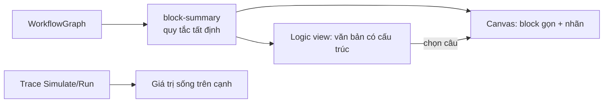

# ADR-0059: Workflow dễ đọc v2 — block gọn, Logic view, làn theo trigger, giá trị sống, "Data from earlier blocks"

- **Status:** Proposed (theo uỷ quyền PO 2026-10-06 — chờ PO xác nhận)
- **Date:** 2026-10-15
- **Level:** L2 Component (studio canvas/editor)
- **Deciders:** PO; Claude Code (đề xuất)
- **Related:** ADR-0055 (câu tóm tắt, nhãn cổng/cạnh — M16-T08/T09), ADR-0054, ADR-0017 (trace replay), [design M18 §5–6](../../docs/design/M18-test-workbench-readability-deploy.md)

## Context
- Sau M16 (câu tóm tắt, màu vai trò, nhãn nhánh, chip "uses:"), PO (2026-10-15) vẫn thấy workflow chưa thể hiện logic một cách hình ảnh: nhìn các block kết hợp, người dùng vẫn chưa nắm được logic.
- PO cũng không hiểu khung **Connections** ở góc phải dưới.

**Phân tích:**
- **Chi tiết kỹ thuật lấn át:** mỗi block còn nhiều dòng key/value (Signal, Fire When, Severity, Error…), làm câu tóm tắt chìm.
- **Thiếu cách nhìn tổng thể:** không có cách đọc **cả** workflow thành câu; nhiều trigger không tách thành luồng.
- **Không thấy dữ liệu chảy:** lúc Simulate/Run không thấy giá trị qua từng bước.
- **Connections** (component của Sim): liệt kê block nối **vào** block đang chọn và output của chúng để tham chiếu `<block.output>`. Không có lời giải thích; trigger thì trống mà không nói vì sao.

## Decision
1. **Block gọn mặc định:** icon + tên + câu tóm tắt + cổng có nhãn.
   - Các dòng key/value chỉ hiện khi chọn block hoặc bật **Details** (toggle trên canvas, lưu theo người dùng).
   - Handle vẫn neo đỉnh/đáy, nên kéo/nối/chọn không đổi.
2. **Logic view:** nút chuyển Canvas ⇄ Logic.
   - Logic là văn bản có cấu trúc, sinh **tất định** từ graph (cùng quy tắc `block-summary`, không LLM):
     - mỗi trigger một đoạn "Khi …";
     - nhánh lồng nhau "Nếu … ⇒ … Ngược lại ⇒ …";
     - chuỗi hành động "rồi …".
   - Bấm một câu ⇒ chọn/căn giữa block trên canvas. Lỗi lint hiện ngay trong câu tương ứng.
   - Có bản tiếng Anh và tiếng Việt theo ngôn ngữ UI.
3. **Làn theo trigger:**
   - auto layout xếp mỗi trigger thành một hàng trái → phải; nhánh then/stable/ok lên, else/broken/timeout xuống;
   - vùng nền nhạt có tên trigger bao mỗi luồng;
   - chỉ áp dụng khi người dùng bấm Auto layout, không tự di chuyển block.
4. **Giá trị sống:**
   - khi tua kết quả Simulate hoặc đang Run, cạnh hiện giá trị vừa đi qua (`Speed = 60`);
   - nhánh vừa chạy sáng, nhánh không chạy mờ;
   - dùng trace đã có (ADR-0017, ADR-0027), không đổi IR.
5. **"Data from earlier blocks"** thay tiêu đề Connections, có dòng giải thích.
   - Mỗi output: kiểu, đơn vị, giá trị mẫu từ lần chạy gần nhất; bấm để chèn vào ô biểu thức đang sửa.
   - Trigger: "This block starts the workflow — it has no inputs".
   - Thêm mục **"Used by"** (block nào dùng output của block này).
6. **"Explain this workflow"** (trợ lý) là phần bổ sung, không thay Logic view.

## Diagram

## Alternatives considered
| Phương án | Ưu | Nhược | Vì sao loại |
|---|---|---|---|
| Chỉ tinh chỉnh màu/biểu tượng | Ít đổi | Gốc vấn đề (chi tiết lấn át, không thấy tổng thể) còn nguyên | Không đủ |
| Logic view bằng LLM | Văn phong tự nhiên | Không tất định, có thể sai, tốn token | Trái nguyên tắc tất định; LLM chỉ ở "Explain" |
| Thay canvas bằng editor dạng khối lồng nhau (kiểu Scratch) | Rất trực quan | Viết lại toàn bộ editor; Scratch AGPL không được dùng (luật 4) | Ngoài phạm vi, rủi ro license |
| Ẩn Connections | Gọn | Mất cách xem/chèn dữ liệu block trước | Có ích, chỉ cần giải thích |

## Consequences
- **Tích cực:** đọc được logic trong vài giây; dữ liệu chảy thấy được; người mới hiểu Connections.
- **Tiêu cực:** thêm một view phải giữ đồng bộ với 41 BlockSpec (test bảo đảm); E2E dựa vào dòng key/value phải bật Details.
- **Ảnh hưởng module:** chỉ studio (canvas, editor panel, `lib/sv`). Graph, IR và code không đổi.

## Implementation
| Task | Module | Milestone |
|---|---|---|
| Block gọn + Details toggle | studio | M18-T07 |
| Logic view (`lib/sv/logic-view.ts`) + chọn câu ⇒ block | studio | M18-T07 |
| Làn theo trigger trong Auto layout | studio | M18-T08 |
| Giá trị sống trên cạnh/nhánh | studio | M18-T08 |
| "Data from earlier blocks" + "Used by" | studio | M18-T08 |

## Verification
- Vitest Logic view: tất định (chạy 2 lần cùng kết quả), đủ 41 BlockSpec, văn bản đúng cho 7 golden.
- E2E:
  - block gọn ⇄ Details;
  - chọn câu ⇒ block được chọn;
  - giá trị sống khi tua Simulate;
  - Connections mới với trigger và block giữa luồng.
- Golden graph-adapter/IR không đổi; full luồng `@live` + video.

## Notes / Deviations
- 2026-10-24 — **T08 implement** (Claude Code, theo uỷ quyền PO — chờ PO xác nhận):
  - Làn: Auto layout của workflow xe (mọi block là `sv_*` hoặc Loop/Parallel) chạy **ở client** (`laneLayout`), không gọi API layout chung của Sim; workflow khác vẫn dùng API cũ. Block trong Loop/Parallel giữ vị trí tương đối trong container.
  - "Vùng nền" là **khung viền đứt** có tên trigger, vẽ trên canvas và không bắt chuột. React Flow v11 không có lớp nằm dưới node, nên không tô nền để khỏi phủ màu lên block. Chỉ hiện khi workflow có ≥ 2 trigger và các vùng không chồng nhau.
  - Giá trị sống dùng trace sẵn có: `exit.data.handle` cho nhánh, `trigger.data.outputs.value` cho giá trị. Biểu thức tính toán được inline (ADR-0013) nên không có giá trị trung gian trên cạnh; M19 (`data.eval`) bổ sung.
  - "Data from earlier blocks": giá trị mẫu chỉ có cho output có trong trace (output của trigger). **Đơn vị** chưa hiện (cần tra catalog theo output); để lại.
  - Bấm một output ⇒ chèn tham chiếu vào ô văn bản của panel Editor được sửa gần nhất (setter gốc + sự kiện `input`, để ô controlled của React nhận).
- 2026-10-24 — **T07 implement** (Claude Code, theo uỷ quyền PO — chờ PO xác nhận):
  - Logic view là **panel nổi trên canvas** (nút **Logic** trên thanh hành động), không thay hẳn canvas. Như vậy vừa đọc câu vừa thấy block được căn giữa khi bấm.
  - Chỉ có câu **tiếng Anh**: UI của studio chưa có tiếng Việt, và câu tóm tắt block (ADR-0055) cũng tiếng Anh. Tiếng Việt làm cùng lúc với i18n UI.
  - **Details** lưu theo trình duyệt (zustand `persist`, chỉ trường `details`), chưa theo tài khoản.
  - Block chỉ còn câu tóm tắt, chip dữ liệu và nhãn nhánh. Các dòng cài đặt hiện khi block được chọn, khi bật Details, hoặc trong bản xem trước (diff của trợ lý).
  - Nhánh hội tụ (hai nhánh cùng tới một block) chỉ viết block đó một lần; lần sau là "↺ continues at …". Vòng lặp kết thúc bằng tham chiếu, không lặp vô hạn. Block không trigger nào chạy tới nằm ở đoạn cuối "Not run by any trigger".
