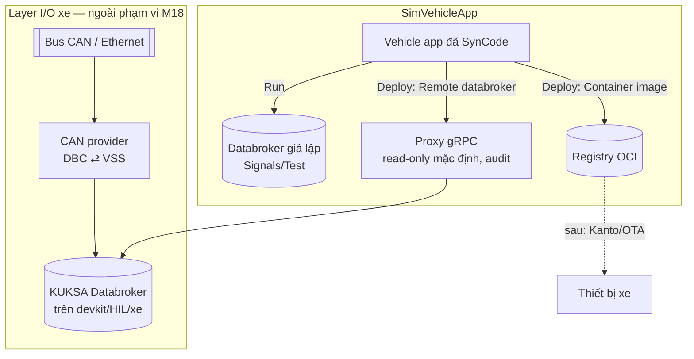

# ADR-0060: Deploy — target ngoài stack giả lập (databroker từ xa, image, Kanto) và ranh giới VSS với layer I/O xe (CAN)

- **Status:** Accepted (PO chấp thuận toàn bộ 2026-10-25)
- **Date:** 2026-10-15
- **Level:** L0 System
- **Deciders:** PO; Claude Code (đề xuất)
- **Related:** ADR-0024 (databroker API), ADR-0028/0031 (IDE, export, license), ADR-0047 (kuksa.val.v2), ADR-0050 #8 (Kanto, hoãn), ADR-0052 (VSS tuỳ biến), ADR-0057 (sandbox run), `analysis/01-requirements.md` (ngoài phạm vi v1: firmware ECU/CAN thật, OTA thật), [design M18 §7](../../docs/design/M18-test-workbench-readability-deploy.md)

## Context
- PO (2026-10-15) muốn ngoài Test/Run trên UI có chức năng **deploy**, để workflow lấy **dữ liệu thật từ các layer phía dưới**: CAN mapping, phần cứng, qua các layer khác nhau. PO chưa yêu cầu làm layer CAN, nhưng cần nghĩ đến nút/luồng Deploy cho phù hợp.

**Hiện trạng:**
- **Run** chạy app trên databroker giả lập trong stack; giá trị đến từ người dùng (Signals/Test).
- **Export** = zip Velocitas build được bằng `app/Dockerfile`.
- Không có khái niệm target. Kanto (OTA) hoãn ở ADR-0050 #8.

**Kiến trúc SDV thật:** bus CAN/Ethernet → **CAN provider** (ánh xạ DBC ⇄ VSS, vd. dự án eclipse-kuksa CAN provider) → **KUKSA Databroker trên thiết bị** → **vehicle app** (Velocitas, gRPC).
- App chỉ biết đường dẫn VSS.
- ⇒ **VSS là ranh giới hợp đồng**: cùng một app chạy được với dữ liệu thật khi phía dưới có provider ánh xạ đúng tín hiệu, không cần sinh lại code.

**Rủi ro tương thích:** databroker bản mới trên thiết bị có thể chỉ phục vụ `kuksa.val.v2`; app sinh ra hiện dùng API v1 (ADR-0047 có lộ trình chuyển).

## Decision
0. **Định nghĩa Run và Deploy (PO chốt 2026-10-15):**
   - **Run** = chạy app; giá trị tín hiệu VSS mà app nhận được **giả lập để test**: inject từ UI (tab Live/Signals), scenario/test case (Play), Record. Như hiện nay.
   - **Deploy** = cũng chạy app (cùng bản build), nhưng giá trị tín hiệu VSS đến từ **các layer khác** (phần cứng, CAN mapping… — các layer này chưa bàn tới).

   Ở Deploy, mọi cơ chế giả lập **KHÔNG hoạt động**, và orchestrator/signal-gateway **PHẢI từ chối** chúng ở server, không chỉ ẩn nút trên UI:
   - inject tín hiệu (`POST /signals`);
   - Play scenario / test case;
   - Record;
   - mirror target→current giả lập xe.

   UI hiện "Deployed — signals come from <target>; test inputs are disabled". Tab Live chỉ quan sát (giá trị, Messages, log/trace).
1. **Deploy là hành động riêng với Run:**
   - Run = thử trên stack giả lập;
   - Deploy = đưa **bản build đã SynCode** tới một **target** nơi dữ liệu đến từ layer khác.

   Nút **Deploy** nằm ở nhóm "Mở/xuất" của thanh hành động (cạnh Export), mở hộp thoại chọn target. Target được khai báo ở Settings → **Deploy targets** (quyền admin workspace).
2. **Target, theo giai đoạn:**

   | Target | Làm gì | Giai đoạn |
   |---|---|---|
   | **Local stack** | = Run hiện nay | có sẵn |
   | **Remote databroker** | Chạy app (sandbox ADR-0057) nối tới databroker **bên ngoài** do người dùng khai báo (URL gRPC, TLS CA, token JWT, phiên bản API). Dữ liệu thật đi lên từ provider phía dưới. Tab Live đọc từ databroker đó | **M18** |
   | **Container image** | Build image OCI của app (`app/Dockerfile`), kèm AppManifest + license/notice, đẩy lên registry đã cấu hình | M18 (sau Remote) |
   | **Kanto / OTA** | Triển khai lên thiết bị qua Eclipse Kanto container-management | Hoãn (ADR-0050 #8); mở lại khi có thiết bị và nhu cầu |

3. **An toàn (bắt buộc):**
   - Target mới mặc định **read-only**: proxy gRPC của SimVehicleApp chặn mọi `set` actuator. Bật ghi phải xác nhận rõ, liệt kê các actuator app sẽ ghi, kèm banner ASIL.
   - Mỗi deploy ghi **audit log**: ai, target, generation, thời điểm, chế độ đọc/ghi.
   - Deploy chỉ dùng generation đã **SynCode pass** (đủ test); lệch release VSS giữa app và target ⇒ từ chối.
   - Token/TLS của target lưu ở kho Secrets (mã hoá), không hiện lại.
4. **Mô hình Deployment** gắn với vehicle app: `{id, appId, targetId, generationId, state, mode: read-only|read-write, startedAt, stoppedAt, by}`.
   - Trang Vehicle apps hiện app đang deploy ở đâu.
   - Dừng/rollback về generation trước.
   - Contracts chỉ thêm.
5. **Layer I/O xe (CAN, DBC, provider phần cứng): ngoài phạm vi M18.**
   - Module tương lai "vehicle-io", có ADR riêng khi có phần cứng và nhu cầu.
   - M18 chỉ cung cấp target Remote databroker để nối với provider có sẵn.
   - VSS tuỳ biến (ADR-0052) mô tả tín hiệu riêng của OEM khớp DBC.
6. **Kiểm tương thích trước khi deploy:** nút **Test connection** kiểm kết nối, TLS/token, phiên bản API (v1/v2), release VSS của target (metadata), và path mà app dùng có tồn tại ở target.
7. **Kiến trúc chạy Deploy** (bổ sung 2026-10-16, design M18 §9.1–9.2):
   - **App chạy trong SimVehicleApp** (sandbox tiến trình, ADR-0057); `SDV_VEHICLEDATABROKER_ADDRESS` trỏ tới **vehicle-gateway**, service mới trong compose.
   - **vehicle-gateway** là proxy gRPC/HTTP2 theo deployment: TLS + token tới target (app không cần biết), lọc **theo method** (mặc định từ chối), audit.
     - Read-only: cho phép `Get*`/`Subscribe`/`GetMetadata`/`GetServerInfo`; chặn `sdv.databroker.v1.Broker/SetDatapoints` và `kuksa.val.v1.VAL/Set|StreamedUpdate`.
     - Read-write: chỉ cho ghi các path actuator đã khai báo của app.
     - `Collector/*` (vai trò provider) luôn bị chặn.
   - Tab Live subscribe qua vehicle-gateway, chỉ method đọc.
   - Deployment **không tự hết hạn**: giới hạn `SV_MAX_DEPLOYMENTS_PER_WORKSPACE` (mặc định 2), dừng thủ công. Một app có thể vừa Run vừa Deploy (khác generation, khác nguồn tín hiệu).
8. **Ràng buộc API:** app C++ sinh ra (Velocitas SDK 0.7.1) dùng **`sdv.databroker.v1`**; databroker 0.5.0 của stack chạy `--enable-databroker-v1`.
   - Target phải phục vụ API này, hoặc chờ chuyển API theo ADR-0047.
   - Test connection báo rõ nếu không tương thích.

## Diagram

## Alternatives considered
| Phương án | Ưu | Nhược | Vì sao loại |
|---|---|---|---|
| Không có Deploy, chỉ Export zip | Đơn giản | Người dùng tự lo mọi bước; không thấy app chạy với dữ liệu thật trong studio | Không đáp ứng yêu cầu PO |
| Gộp Deploy vào Run (chọn databroker trong Run) | Ít nút | Nhầm lẫn thử nghiệm với dữ liệu thật; khó áp an toàn riêng | Tách rõ để áp read-only/audit |
| Làm luôn CAN provider/DBC mapping | Trọn luồng | Cần phần cứng, DBC thật; ngoài phạm vi v1 | Module riêng sau, VSS làm ranh giới |
| Kanto ngay | OTA thật | Cần thiết bị, quyền điều khiển container; ADR-0050 hoãn | Giữ hoãn |

## Consequences
- **Tích cực:** đường đi rõ từ thử nghiệm tới dữ liệu thật; app không phải sinh lại; an toàn mặc định.
- **Tiêu cực / nợ:** proxy gRPC và quản lý target là thành phần mới cần bảo mật kỹ; phụ thuộc ADR-0047 cho databroker v2.
- **Ảnh hưởng module:**
  - contracts (Deployment, DeployTarget);
  - orchestrator (deploy, proxy/read-only);
  - velocitas-stack (build image);
  - studio (nút Deploy, Settings → Deploy targets, Vehicle apps);
  - docs (DEPLOY, user guide, README).

## Implementation
| Task | Module | Milestone |
|---|---|---|
| Contracts Deployment/DeployTarget + Settings → Deploy targets + Test connection | contracts, orchestrator, studio | M18-T09 |
| Deploy Remote databroker (sandbox + proxy read-only + audit) | orchestrator, velocitas-stack | M18-T09 |
| Deploy Container image (build + push) | velocitas-stack, orchestrator | M18-T10 |
| Kanto, vehicle-io (CAN) | — | hoãn, ADR riêng |

## Verification
- Unit:
  - ở Deploy, inject/Play/Record/mirror bị server từ chối (409 `SIMULATED_INPUT_DISABLED`, mã mới);
  - proxy chặn `set` khi read-only;
  - deploy từ chối generation chưa pass / lệch release;
  - token không lộ qua API;
  - audit ghi đủ.
- **Gate:** một "databroker ngoài" (service riêng trong compose, có feeder giả lập đẩy giá trị như CAN provider) ⇒ deploy Remote ⇒ app nhận dữ liệu và chạy logic mà không cần ai inject; read-only chặn ghi actuator; bật ghi thì actuator đổi.
- E2E: thêm target ⇒ Test connection ⇒ Deploy ⇒ Vehicle apps hiện trạng thái ⇒ Stop.
- Full luồng `@live` + README.

## Notes / Deviations
- 2026-10-24 — **Gate image PASS** (`gate/m18-image.sh`, stack dev; registry `registry:2` trên `sv-internal`):
  - C++ GW-A: build Release + đẩy trong 25 s, image nén 8,1 MB (8 file), 19,8 MB khi giải nén.
  - Rust GW-A: 1 s, 2,6 MB nén, 5,4 MB.
  - Pull theo digest rồi `docker run` với databroker của stack ⇒ app phát `app.started`. So sánh: image toolchain-cpp hơn 4 GB; Dockerfile của template cũng dựng `FROM scratch`.
- 2026-10-24 — **Thiết kế T10 Container image** (theo uỷ quyền PO — chờ PO xác nhận):
  - Không gọi `docker build`: luật cứng 10 cấm mount `docker.sock`, và Dockerfile của template cần Docker daemon.
  - Toolchain agent có thêm job `image`:
    1. build Release;
    2. dựng rootfs `FROM scratch` gồm binary `/app`, các thư viện động mà `ldd` liệt kê (spike: app C++ chỉ cần libstdc++, libm, libc, libgcc_s, ld-linux; thư viện Conan đã tĩnh), `/AppManifest.json` và `/licenses/` (NOTICE);
    3. tự viết image OCI (layer tar.gz, config `Cmd ["/app"]`, manifest) và **đẩy bằng HTTP API OCI distribution** (upload blob monolithic, PUT manifest). Không cần daemon, không cần quyền đặc biệt.
  - Image giống Dockerfile của template: chạy từ `scratch`, `WORKDIR /tmp`.
  - v1 hỗ trợ C++ và Rust. Python cần pyinstaller + staticx (template Python) mà toolchain chưa có, nên trả lỗi rõ ràng (`IMAGE_LANGUAGE_UNSUPPORTED` trong log job, chưa có mã diagnostic).
  - Orchestrator: `POST /projects/{id}/images {reference host:port/repo:tag, insecure?, username?, password?}` chạy job, trả `{reference, digest, bytes}`. Studio: hộp thoại Deploy có mục **Container image**.
  - Gate: registry `registry:2` trong mạng `sv-internal`. Image được đẩy lên rồi `docker run` trên host với databroker của stack, app phải phát `app.started`.
- 2026-10-24 — **UI Deploy (studio)** (theo uỷ quyền PO — chờ PO xác nhận):
  - Target được quản lý **ngay trong hộp thoại Deploy** (chọn, thêm, Test connection), chưa có trang Settings → Deploy targets riêng. Như vậy không phải sửa điều hướng Settings của Sim; một trang quản lý (xoá, sửa) có thể thêm sau.
  - Phân quyền ở BFF: xem target là thành viên; thêm/xoá target là admin; Test connection và deploy read-only là người có quyền ghi; read-write là admin.
  - Run/Stop chỉ tác động lên Run thử. Deployment dừng từ hộp thoại Deploy. Dock theo dõi Run nếu có, không thì theo deployment. Pill hiện `Deployed · <target> · <mode>`. Tab Live có banner, tắt Set/Record/Play; tab Test tắt Play.
- 2026-10-24 — **Gate deploy PASS** (`gate/m18-deploy.sh`, stack dev):
  - Target là databroker thứ hai trên `sv-internal`, kèm feeder Speed và provider cho Hazard, đóng vai các layer của xe.
  - Test connection báo đúng path thiếu.
  - Read-only: app đọc Speed của target qua route; `BatchActuate` của app (C++ SDK 0.7.1 ghi bằng BatchActuate) bị route chặn và audit; Hazard không đổi.
  - Inject và Play trả 409 `SIMULATED_INPUT_DISABLED`.
  - Read-write: provider của target nhận lệnh, Hazard bật, write được audit.
  - Stop đóng route; xoá target.
  - **Lệch so với thiết kế:** tab Live của signal-gateway đọc qua `kuksa.val.v1` (`Get`, `Subscribe`, `GetServerInfo`), nên route cho phép ba method đọc v1 này. `Set`/`StreamedUpdate` của v1 luôn bị chặn. Target chỉ có v2 thì tab Live chưa đọc được; chuyển reader của signal-gateway sang v2 là việc sau.
- 2026-10-24 — **Thiết kế triển khai T09** (Claude Code, theo uỷ quyền PO — chờ PO xác nhận):
  - **Deployment là một Run có trường `deploy`** `{targetId, targetName, mode: read-only|read-write}`. Dùng lại RunManager, console, trace, My runs và sandbox tiến trình (ADR-0057). Khác Run ở ba điểm:
    - không có `expiresAt`;
    - quota riêng `SV_MAX_DEPLOYMENTS_PER_WORKSPACE`;
    - databroker của app là một **route của vehicle-gateway** (`vehicle-gateway:<port>`).
  - **vehicle-gateway** (service mới trong module orchestrator, dựa trên spike):
    - mỗi deployment một cổng h2c, nối TLS/token tới target;
    - allowlist method `kuksa.val.v2` theo mode;
    - `Actuate`/`BatchActuate` (read-write) chỉ cho path actuator đã khai báo của app, giải mã protobuf request;
    - `PublishValue`/`OpenProviderStream` luôn bị chặn;
    - audit mỗi lời gọi bị chặn hoặc ghi (method, path, deployment, thời điểm).
  - **signal-gateway** nhận `sandbox = vehicle-gateway:<port>` như nguồn **chỉ đọc**: `POST /signals`, `/play` và `PUT /mirror` trả 409 `SIMULATED_INPUT_DISABLED` (mã diagnostic mới, chỉ thêm). `GET /signals` và `/messages` vẫn chạy (tab Live chỉ xem). Đây là lớp chặn thứ hai, sau vehicle-gateway.
  - **DeployTarget** lưu ở orchestrator theo workspace: `{id, workspaceId, name, address host:port, tls, token (chỉ ghi, mã hoá AES-GCM bằng khoá từ INTERNAL_API_SECRET), apiVersion kuksa.val.v2, vssRelease}`. **Test connection** gọi `GetServerInfo` + `ListMetadata` (path app dùng có tồn tại) qua chính route.
  - Gate dùng một databroker "ngoài" chạy trong compose (`external-databroker`, profile gate) cùng một feeder giả lập (provider `kuksa.val.v2` publish Speed): app deploy phải nhận Speed và bật Hazard mà không qua Signals; read-only chặn ghi; read-write cho ghi.
- 2026-10-24 — **Spike vehicle-gateway PASS** ([docs/spikes/vehicle-gateway.md](../../docs/spikes/vehicle-gateway.md)): Bun `node:http2` proxy h2c chuyển `kuksa.val.v2` tới databroker 0.5.0. Read-only chặn `Actuate` bằng `PERMISSION_DENIED`; `Subscribe` stream qua proxy; status lỗi của upstream (trailers-only) được truyền nguyên vẹn; client huỷ stream không làm crash proxy. App mặc định đã là `kuksa.val.v2` (ADR-0047), nên allowlist dùng method v2: đọc = GetValue/GetValues/Subscribe/SubscribeById/ListMetadata/GetServerInfo; ghi = Actuate/BatchActuate; PublishValue/OpenProviderStream luôn bị chặn.
- 2026-10-16:
  - thêm quyết định 7 (vehicle-gateway, lọc method theo proto đã vendored, Live qua gateway, deployment không hết hạn) và 8 (ràng buộc `sdv.databroker.v1`; đọc `compiler-code-cpp/runtime/src/Velocitas.cpp` và `velocitas-stack/compose.yaml`);
  - spike proxy HTTP/2 trong Bun/Node trước khi code (M18-T09).
- 2026-10-15 — PO bổ sung định nghĩa Run (tín hiệu giả lập để test) và Deploy (tín hiệu từ layer khác, giá trị test không hoạt động) ⇒ thêm quyết định 0 và mã `SIMULATED_INPUT_DISABLED`.
