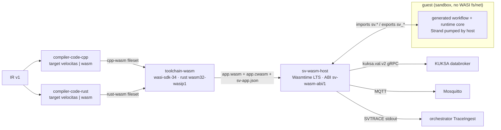

# ADR-0061: Target WebAssembly cho backend C++ và Rust, chạy trên một host runtime WASM chung (`sv-wasm-host`)

- **Status:** Accepted (PO chấp thuận toàn bộ 2026-10-25)
- **Date:** 2026-10-24
- **Level:** L1 Subsystem
- **Deciders:** PO; Claude Code (đề xuất)
- **Related:** ADR-0012 (ngữ nghĩa thực thi), ADR-0020/0021/0022 (backend plugin, runtime C++, chiến lược sinh code), ADR-0027 (trace), ADR-0040/0041 (Python, Rust), ADR-0047 (`kuksa.val.v2`), ADR-0057 (sandbox mỗi run), ADR-0060 (deploy target), ADR-0062 (luồng thực thi), [design M20](../../docs/design/M20-wasm-targets.md), [phase M20](../phases/M20-wasm-targets.md)

## Context
Yêu cầu PO ngày 2026-10-24 gồm hai mục:
- "thêm compiler ngôn ngữ cho CPP+wasm+wasmruntime";
- "thêm compiler ngôn ngữ cho rust+wasm+wasmruntime".

Hiện app sinh ra là app Velocitas native: C++ (SDK `vehicle-app-cpp-sdk`), Python, hoặc Rust (`kuksa-rust-sdk`). Mỗi app là một tiến trình native nối thẳng tới KUKSA databroker và MQTT.

**Dữ kiện đã kiểm (2026-10-24, GitHub API / raw, xem [design M20 §2](../../docs/design/M20-wasm-targets.md)):**

| Thành phần | Bản | License | Ghi chú |
|---|---|---|---|
| Wasmtime | v50.0.0 (2026-10-20) mới nhất; **v48 là LTS** (mỗi bản bội số của 12 là LTS, hỗ trợ 24 tháng; v48.0.7 ngày 2026-10-19) | Apache-2.0 | crate Rust nhúng được; có C/C++ API (`wasmtime.hh`); fuel/epoch interruption, giới hạn bộ nhớ, biên dịch trước `.cwasm` |
| WAMR (`wasm-micro-runtime`) | WAMR-2.4.5 (2026-06-29) | Apache-2.0 | `iwasm` + AOT `wamrc`, nhỏ, hướng thiết bị nhúng/ECU |
| WasmEdge | 0.18.1 (2026-10-22) | Apache-2.0 | phương án thứ ba |
| wasi-sdk (C/C++) | wasi-sdk-34 (2026-08-25) | Apache-2.0 | Exception C++ **tắt mặc định**; bật thì cần `-fwasm-exceptions` + `-lunwind` và runtime phải hỗ trợ wasm EH. `<mutex>`/`<thread>` biên dịch được trên mọi target, nhưng **không spawn được thread** (trừ `wasm32-wasip1-threads`, thử nghiệm) |
| Rust | target `wasm32-wasip1`, `wasm32-wasip2`, `wasm32-wasip3` đều **Tier 2** (rustc platform-support) | MIT/Apache-2.0 | |
| wasm-tools / wit-bindgen | v1.262.0 / v0.63.0 | Apache-2.0 | validate, strip; WIT cho component model |

- Không tìm thấy SDK WASM chính thức nào của Velocitas hay KUKSA (tìm GitHub 2026-10-24). Vì vậy app WASM **không dùng được Velocitas SDK**: phải có một host làm cầu nối tới databroker.
- Source hiện có thuận lợi cho việc này:
  - Runtime Rust tách lõi (`serde_json`, không tokio) khỏi feature `host` (tokio, tonic, `kuksa-rust-sdk`, rumqttc).
  - Runtime C++ và Rust có port `VehicleAccess` / `PubSub` / `ITraceSink` / clock.
  - `Strand` có `popDue`, nên host gọi được từng bước.
- Cản trở phía C++: `Strand::run()` chờ bằng `std::condition_variable` (chặn mãi trên wasip1 không thread), và runtime có 7 chỗ `throw`.
- Contract `backend-capabilities.v1`: `language ∈ {cpp, python, rust}` và `toolchain.template` + `templateSha` bắt buộc trỏ template Velocitas. Orchestrator có `Project.language: "cpp" | "python" | "rust"`.

## Decision
1. **Target, không phải ngôn ngữ mới.** C++ và Rust mỗi ngôn ngữ có thêm target `wasm`. Backend id là `cpp-wasm` và `rust-wasm`, do chính service generator `compiler-code-cpp` / `compiler-code-rust` phục vụ (base URL riêng, ví dụ `http://codegen-cpp:4110/wasm`). Emitter workflow **PHẢI** dùng chung với target native: cùng IR ⇒ cùng logic sinh ra, chỉ khác adapter, entry point và template. KHÔNG được fork generator.
2. **ABI `sv-wasm-abi/1`** (đặc tả trong contracts, `abi/sv-wasm-abi.v1.md`):
   - Guest là một **core module wasm `wasm32-wasip1` kiểu reactor**.
   - Guest import các hàm của module `sv`:
     - `now_ms`, `log`, `trace`;
     - `vdb_subscribe`, `vdb_get`, `vdb_set`, `vdb_current`;
     - `mqtt_subscribe`, `mqtt_publish`.
   - Guest export: `sv_alloc`, `sv_free`, `sv_init(config)`, `sv_on_event(event)`, `sv_step(now_ms) -> next_due_ms`, `sv_stop`, `sv_run_tests`.
   - Giá trị truyền dạng **JSON UTF-8 qua bộ nhớ tuyến tính**, cùng mã hoá với IR/scenario: int64/uint64 là chuỗi thập phân (ADR-0018).
   - Sự kiện bất đồng bộ (giá trị signal, kết quả get/set, tin MQTT, stop) đi vào guest qua `sv_on_event`. Strand chạy một luồng trong guest, do host gọi `sv_step`.
   - Thêm hàm chỉ bằng bump minor; đổi chữ ký là `/2`.
3. **Một host runtime chung `sv-wasm-host`** (module mới `modules/wasm-host`, Rust):
   - nhúng **Wasmtime LTS v48.x** (pin ở spike M20-T01);
   - kết nối KUKSA `kuksa.val.v2` (mặc định, ADR-0047) và MQTT;
   - in `SVTRACE {…}` ra stdout thay guest (thêm `ts` và `app`), nên TraceIngest và signal-gateway không đổi;
   - chạy được trong sandbox của run (ADR-0057) giống app native.
   - Host **PHẢI**:
     - không cấp preopen file/socket WASI và chỉ cho các biến env đã khai báo;
     - kiểm path VSS và topic MQTT theo `sv-app.json` sinh ra (allowlist);
     - giới hạn bộ nhớ guest (mặc định 64 MiB) và CPU mỗi lần gọi (epoch deadline). Quá giới hạn ⇒ trace `error` với `reason: "wasm_limit"`.
4. **Không dùng component model / WASI p2 ở v1.** Lý do: core module + wasip1 chạy được trên Wasmtime, WAMR và WasmEdge; hỗ trợ component model giữa các runtime chưa đều (WAMR chưa kiểm). File WIT chỉ để tài liệu hoá ABI và chuẩn bị `/2`.
5. **C++ guest:**
   - Biên dịch bằng wasi-sdk-34, `-fno-exceptions` (mặc định). Runtime có cờ `SV_RT_NO_EXCEPTIONS`: các chỗ `throw` chuyển sang trả lỗi + trace `error`, ngữ nghĩa không đổi.
   - `Strand` có chế độ host bơm (`pump(now) -> nextDue`), không chờ `condition_variable`.
   - Adapter `WasmVehicleAccess` / `WasmPubSub` / `WasmTraceSink` thay `Velocitas*`. Không link Velocitas SDK.
6. **Rust guest:**
   - Lõi runtime (không `host`) cộng feature mới `wasm` (khai báo `extern "C"` import của ABI).
   - `crate-type = ["cdylib"]`, target `wasm32-wasip1`. Không tokio trong guest.
7. **Toolchain `toolchain-wasm`** (image mới, profile compose `wasm`, tuỳ chọn như `python`/`rust`):
   - gồm wasi-sdk-34, Rust stable + `wasm32-wasip1`, wasm-tools, `sv-wasm-host`;
   - plan `build` ra `app.wasm` (validate + strip) và `app.cwasm` (biên dịch trước cho host);
   - plan `test` gọi `sv_run_tests` trong host: guest tự chạy test case của workflow với MockVehicle + VirtualClock, tất định;
   - plan `run` chạy `sv-wasm-host app.wasm`.
8. **Thay đổi contract (minor, additive):**
   - `backend-capabilities` thêm `target` (optional) = `{kind: "velocitas" | "wasm", triple, abi, host: {name, version}}`. Khi `kind = "wasm"`, `toolchain.template` / `templateSha` trỏ template riêng của SimVehicleApp (`templates/wasm-app-<lang>`) thay vì template Velocitas.
   - `generation-manifest` ghi `target`.
   - Project (orchestrator/studio) có thêm `target`, mặc định `velocitas`. Project cũ không đổi.
9. **Deploy (ADR-0060):** target "container image" của app WASM là `FROM simvehicleapp/wasm-host` + `app.wasm`/`app.cwasm` + `sv-app.json`. Host trên ECU bằng WAMR (C host, AOT `wamrc`) là **hướng tiếp theo**, không thuộc v1. Spike T01 chỉ kiểm guest nạp được bằng `iwasm`.
10. **Gate (M20):**
    - Conformance C01–C45 PASS cho `cpp-wasm` và `rust-wasm` (qua `sv_run_tests`).
    - Parity P3 live 7/7 với simulator trên `kuksa.val.v2`.
    - Golden sinh ra tất định (chạy 2 lần cùng byte). `app.wasm` tái lập được với cùng toolchain image.
    - Đo và ghi kích thước wasm, RSS của host, độ trễ trigger → write so với native.

## Diagram

## Alternatives considered
| Phương án | Ưu | Nhược | Vì sao loại |
|---|---|---|---|
| Ngôn ngữ mới `compiler-code-cpp-wasm`, `compiler-code-rust-wasm` (module riêng) | tách biệt hẳn | nhân đôi emitter, golden, conformance; lệch ngữ nghĩa dần | vi phạm "cùng IR ⇒ cùng logic"; tốn bảo trì gấp đôi |
| Guest tự nói gRPC/MQTT qua `wasi:sockets` (WASI p2) | không cần host riêng | cần p2 + HTTP/2 + TLS trong guest, kích thước lớn; runtime nhúng (WAMR) chưa chắc hỗ trợ; khó áp allowlist | phức tạp, kém an toàn, kém di động |
| Component model + WIT ngay từ v1 | kiểu dữ liệu mạnh, binding sinh tự động | hỗ trợ không đều giữa runtime; toolchain C++ cho component còn non | để `/2`, khi spike chứng minh WAMR/WasmEdge chạy được |
| Host C++ nhúng Wasmtime C++ API hoặc WAMR | gần ECU hơn | phải viết lại client KUKSA v2 + MQTT bằng C++ | Rust đã có client KUKSA v2 trong repo (vendored); WAMR host để sau |
| Wasmtime mới nhất (v50) | tính năng mới | chỉ hỗ trợ 2 tháng | chọn LTS v48 (24 tháng) cho ổn định |
| Bật C++ exceptions (wasm EH) | không sửa runtime | cần runtime hỗ trợ EH; binary lớn hơn | `-fno-exceptions` di động hơn; 7 chỗ throw sửa được |
| ABI nhị phân (struct/Value packed) thay JSON | nhanh hơn | khó debug, dễ lệch giữa C++ và Rust | JSON đủ nhanh cho tần suất signal (≤ 1 kHz), trùng format SVTRACE/IR; xét lại ở `/2` nếu đo thấy chậm |

## Consequences
- **Tích cực:**
  - một artifact `app.wasm` chạy trên mọi host có ABI; sandbox mạnh hơn app native (allowlist VSS/MQTT, giới hạn bộ nhớ/CPU);
  - image deploy nhỏ;
  - cùng nền cho ECU (WAMR AOT) về sau.
- **Tiêu cực / nợ kỹ thuật:**
  - thêm một module (host) và một toolchain image (RAM/đĩa, nên đặt sau profile tuỳ chọn);
  - runtime C++ có thêm chế độ không exception và Strand bơm;
  - app WASM không dùng tính năng riêng của Velocitas SDK (AppManifest Velocitas, `velocitas` CLI); IDE/export cho project WASM khác project Velocitas.
- **Ảnh hưởng tới module:**
  - contracts (ABI, capabilities v1.1, manifest);
  - `compiler-code-cpp` và `compiler-code-rust` (target, adapter, template, golden);
  - `modules/wasm-host` (mới);
  - velocitas-stack (`toolchain-wasm`, agent plan);
  - orchestrator (`Project.target`, chọn backend, run);
  - studio (chọn target khi tạo project, nhãn, export);
  - E2E.

## Implementation
| Task | Module | Milestone |
|---|---|---|
| Spike: guest reactor C++ (wasi-sdk-34, `-fno-exceptions`) và Rust (`wasm32-wasip1`) gọi import, chạy trên Wasmtime v48 và `iwasm` 2.4.5; đo kích thước/thời gian | spikes | M20-T01 |
| ABI `sv-wasm-abi/1` + capabilities v1.1 (`target`) + manifest + Project.target | contracts, orchestrator | M20-T02 |
| `sv-wasm-host` (Wasmtime, KUKSA v2, MQTT, SVTRACE, allowlist, giới hạn, `--test`) | wasm-host | M20-T03 |
| Runtime C++: `SV_RT_NO_EXCEPTIONS`, Strand bơm, adapter Wasm; generator target `wasm` + template + golden | compiler-code-cpp | M20-T04 |
| Runtime Rust: feature `wasm`; generator target `wasm` + template + golden | compiler-code-rust | M20-T05 |
| `toolchain-wasm` + plan build/test/run + profile compose | velocitas-stack | M20-T06 |
| Studio/orchestrator: chọn target, Run, Export, Deploy image | studio, orchestrator | M20-T07 |
| Conformance C01–C45, parity P3, đo hiệu năng | các backend, gate | M20-T08 |
| Gate + E2E `@live` + video + README/hướng dẫn + báo cáo | toàn bộ | M20-T09 |

## Verification
- **Gate M20:**
  - conformance C01–C45 trên `cpp-wasm` và `rust-wasm`;
  - parity P3 7/7 trên stack (`kuksa.val.v2`);
  - golden chạy 2 lần cùng byte; `app.wasm` tái lập được;
  - host từ chối path ngoài allowlist (test);
  - vượt giới hạn bộ nhớ/CPU ⇒ trace `error` `wasm_limit`, host không crash;
  - E2E `@live`: tạo project target WASM → SynCode → Run → inject → hazard bật; Flow view (ADR-0062) hiện đủ luồng.

## Notes / Deviations
- 2026-10-25 — **T08** (Claude Code): conformance 52/52 cho `cpp-wasm` và `rust-wasm`, parity P3 7/7 cho cả hai trên `kuksa.val.v2`. Build tái lập byte. Bảng kích thước/RSS/image ở phase M20 §T08. RSS của app native chưa đo riêng (app native chạy trong container toolchain).
- 2026-10-25 — **T07, chạy thật** (Claude Code): app WASM C++ và Rust qua toàn bộ luồng orchestrator (tạo → SynCode → Run → Play) đạt gate ADAS C43 trên stack dev.
  - Test của app WASM in dòng kiểu gtest (`[ RUN ]`, `[ OK ]`, `[ FAILED ]`, tổng kết), giống test sinh ra của mọi backend, nên bước test của pipeline và `testDiagnostics` dùng chung.
  - Backend dưới `/wasm` chỉ trả user hooks trong overlay, vì entry của app WASM nằm trong template (`MainWasm.cpp`/`lib.rs` + `wasm_app!`).
- 2026-10-25 — **T06** (Claude Code, theo uỷ quyền PO — chờ PO xác nhận):
  - Một image `toolchain-wasm` phục vụ cả C++ và Rust; agent đọc `.velocitas.json` (`target: wasm`) của project. Template wasm có `.velocitas.json` như template Rust, nên workspace/agent nhận ra project như mọi project khác.
  - Khoá backend/toolchain: `cpp-wasm`, `rust-wasm`, cùng trỏ một agent :4240.
  - Header nlohmann/json nằm ở thư mục riêng (`/opt/sv/include`), để header của host không lẫn vào bản build wasm.
  - wasi-sdk 34 đổi tên toolchain file thành `wasi-sdk-p1.cmake`.
- 2026-10-25 — **T05, Rust** (Claude Code, theo uỷ quyền PO — chờ PO xác nhận): Rust không có static initializer nên app không tự đăng ký như C++. Macro `simvehicleapp_runtime::wasm_app!` sinh các export `sv_*` ngay trong crate app (template `lib.rs` gọi nó với `generated::wasm::app(hooks)`), tránh phụ thuộc vào việc cdylib có export `#[no_mangle]` của crate phụ thuộc hay không. App Rust nhỏ hơn C++ khoảng 3 lần (345 KB so với 1 MB sau strip).
- 2026-10-25 — **T04, runtime C++ dạng guest** (Claude Code, theo uỷ quyền PO — chờ PO xác nhận):
  - ABI thêm event `start`. `sv_init` chỉ bind workflow và subscribe tín hiệu; host chờ giá trị đầu rồi gửi `start`; guest đọc baseline bằng `vdb_current` rồi mới `Runtime::start()`. Thứ tự giống prefetch ⇒ start của app native, nên `previous` của trigger đúng.
  - Giữ exception của runtime C++ (`-fwasm-exceptions`, đề xuất từ spike T01), không viết lại thành mã lỗi. Chưa xác nhận với `iwasm`.
- 2026-10-25 — **T03b** (Claude Code, theo uỷ quyền PO — chờ PO xác nhận):
  - ABI thêm `initial: true` cho giá trị đầu của mỗi subscription. Guest coi đó là baseline (như prefetch của host native) để trigger không chạy khi app vừa khởi động.
  - Host in `vdb.connected`/`app.started`; guest in `app.stopping`.
  - App WASM chỉ dùng `kuksa.val.v2`: đặt `SV_DATABROKER_API` khác thì host báo lỗi.
  - Image host build độc lập từ module (build context trong module, luật cứng 2). Đưa vào compose/release ở T06.
- 2026-10-25 — **T03 chia T03a/T03b** (Claude Code):
  - T03a là lõi host: Wasmtime, ABI, giới hạn, `--test`, `--precompile`, test bằng guest WAT, không cần toolchain wasm.
  - T03b là databroker/MQTT/run/image. Dùng `kuksa-rust-sdk =0.2.2` (cùng pin với runtime Rust) cho `kuksa.val.v2`, không vendor proto riêng: ít mã phải giữ hơn, cùng nguồn đã kiểm license.
  - Module mới `modules/wasm-host` (L5) với job CI riêng (`wasm_host` trong `scripts/ci/changes.py`).
  - Wasmtime 48 có kiểu lỗi riêng (`wasmtime::Error`). Bật feature `anyhow` để chuyển lỗi; trap được nhận diện trước khi chuyển.
- 2026-10-25 — **T02: contract** (Claude Code, theo uỷ quyền PO — chờ PO xác nhận):
  - ABI chốt dạng nháp ở `contracts/abi/sv-wasm-abi.v1.md`; khoá khi T08 PASS.
  - So với bản phác trong design §3.1, thêm:
    - mã lỗi import (`-1` chưa có, `-2` forbidden, `-3` đối số sai, `-4` host mất kết nối);
    - `_initialize` của reactor được host gọi trước `sv_init`;
    - trace `wasm_trap` bên cạnh `wasm_limit`;
    - EH của wasm cho guest C++ (theo spike T01, vẫn chờ PO).
  - Chọn backend bằng khoá `<language>-wasm` trong `SV_BACKENDS` (vd. `cpp-wasm=http://codegen-cpp:4110/wasm`). Project `wasm` khi stack chưa có backend đó ⇒ 422 `BACKEND_UNAVAILABLE` (mã có sẵn, không thêm mã mới).
- 2026-10-24 — **Spike T01** ([báo cáo](../../docs/spikes/M20-wasm-spike.md), Claude Code, theo uỷ quyền PO — chờ PO xác nhận):
  - ABI tối thiểu chạy được với guest C++ (reactor, wasi-sdk-34) và Rust (`wasm32-wasip1`) trên Wasmtime v48.0.7. Pin wasi-sdk-34, Wasmtime v48.0.7, wasm-tools v1.262.0 đã kiểm sha256.
  - `.cwasm` phải do host biên dịch bằng đúng cấu hình engine lúc chạy: `.cwasm` của CLI bị engine C API từ chối vì khác GC collector.
  - Runtime C++ chỉ vướng `try`/`throw` (25 lỗi, đều ở `Runtime.cpp`). Với `-fwasm-exceptions` + `-lunwind`, mọi file biên dịch sạch và guest bắt exception đúng trên Wasmtime. Đề xuất đổi quyết định "`SV_RT_NO_EXCEPTIONS`" thành dùng exception-handling của wasm. Hệ quả: host cần bật EH; `iwasm` trên ECU chưa kiểm. **Chờ PO xác nhận** trước T04.
  - `iwasm` 2.4.5 chưa chạy trong spike (dời sang quyết định ở T04).
- 2026-10-24: viết ADR từ yêu cầu PO. Các con số ở Context là dữ kiện tra ngày 2026-10-24. Bản pin cuối cùng ghi ở `analysis/00-research-findings.md` §1 sau spike M20-T01.
