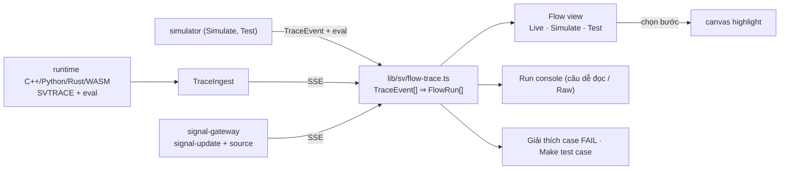

# ADR-0062: Luồng thực thi (Flow) — một mô hình chung cho Simulate, Test và Run, kèm lý do rẽ nhánh và nguồn tín hiệu

- **Status:** Proposed (yêu cầu PO 2026-10-24; quyết định chi tiết theo uỷ quyền PO 2026-10-06 — chờ PO xác nhận)
- **Date:** 2026-10-24
- **Level:** L1 Subsystem
- **Deciders:** PO; Claude Code (đề xuất)
- **Related:** ADR-0017 (simulator), ADR-0024 (signal-gateway), ADR-0027 (trace, run console), ADR-0042 (parity), ADR-0058 (test case, tab Test/Live), ADR-0059 §4 (giá trị sống trên cạnh), ADR-0061 (WASM), [design M19](../../docs/design/M19-execution-flow-and-signal-testing.md), [phase M19](../phases/M19-execution-flow-and-signal-testing.md)

## Context
Yêu cầu PO ngày 2026-10-24: "các chỗ dùng simulate tín hiệu test workflow … làm chỉn chu lại, **log tracking show luồng**; phần đã có làm chuẩn chỉnh chính xác hơn, phần chưa có thì thêm mới".

**Đã có (kiểm trong source 2026-10-24):**

| Nơi | Có gì | Thiếu gì |
|---|---|---|
| Simulate (`sim/simulation-timeline.tsx`, M05-T10) | timeline input/trigger/write/log/publish theo thời gian ảo, con trỏ tua, badge trên block | không gom theo từng lần chạy của trigger; không nói *vì sao* rẽ nhánh |
| Tab Test (`sim/test-tab.tsx`, M18-T04) | case Given/When/Then, Simulate pass/fail, Generate tests, độ phủ nhánh, Play chấm điểm | case FAIL chỉ có danh sách `problems`, không chỉ chỗ luồng bắt đầu lệch |
| Tab Live (`run/signals-panel.tsx`, `run/messages-panel.tsx`, M18-T05) | inject có kiểu theo catalog, gợi ý trigger, Record ⇒ test case, Messages MQTT/HMI | giá trị inject không xuất hiện trong log Run; không biết giá trị đến từ đâu |
| Run console (`run/run-console.tsx`, M08-T08) | log + trace, lọc level/chữ, ảo hoá 5 000 dòng | dòng trace là JSON thô (`▸ n3 exit · If {"handle":"then"}`), danh sách phẳng, không gom theo lần chạy |
| Trace (`trace-event.v1`, simulator + 3 runtime) | `trigger` (outputs), `enter`, `exit` (`handle`), `value` (log/mqtt), `write`, `error`, `cancel`, `run` = số lần chạy | `exit` của block quyết định không kèm giá trị toán hạng điều kiện; không có thời lượng bước |
| `signal-update.v1` (gateway SSE) | `path, ts, value, field` | không có nguồn (`inject` / `playback` / `app` / `vehicle`) |

Vì vậy cùng một lần chạy lại hiện theo ba cách khác nhau (timeline, kết quả Test, console), và không cách nào trả lời trọn câu "**vì sao** app làm (hoặc không làm) việc này".

## Decision
1. **Mô hình Flow chung** trong `apps/sim/lib/sv/flow-trace.ts`:
   - Hàm thuần, tất định: `TraceEvent[]` (+ signal updates) ⇒ `FlowRun[]`.
   - Một `FlowRun` = một lần chạy `(wf, run)` của trigger. Gồm:
     - `trigger` (block, ts, outputs);
     - `cause`: tín hiệu/tin nhắn/timer đã kích hoạt, kèm `source`;
     - `steps[]`: `enter → exit`, `handle`, thời lượng, giá trị, write, log, publish, lỗi;
     - `outcome`: `done | cancelled | error | running`.
   - Simulate, tab Test (kết quả từng case, Play) và Run live **PHẢI** dùng chung mô hình và component hiển thị này. KHÔNG được có bộ phân tích trace riêng ở mỗi nơi.
2. **Lý do rẽ nhánh trong trace:**
   - Sự kiện `exit` của block quyết định (`sv_if`, `sv_switch`, `sv_stable_for`, `sv_wait_until`, bộ so sánh trong trigger `crosses_*`) thêm `data.eval = {refs: {"<path|ref>": value}, result}`.
   - Giới hạn: tối đa 8 ref; chuỗi cắt ở 120 ký tự; int64 là chuỗi.
   - Chỉ ở trace level `node`.
   - Đây là thay đổi additive trong `data` (schema `data: object` không đổi). Nhưng simulator, runtime C++/Python/Rust (và WASM, ADR-0061) **PHẢI** phát giống nhau: conformance và parity so cả `eval`.
3. **Nguồn tín hiệu:**
   - `signal-update.v1` thêm `source` (optional) ∈ {`inject`, `playback`, `mirror`, `app`, `vehicle`} và `actor` (optional, id người inject).
   - Gateway tự biết giá trị nào do chính nó đặt (inject/playback, cửa sổ ±250 ms như Play), nên gắn được nguồn.
   - Run console và Flow hiện input cùng dòng thời gian với trace.
   - Bump minor contract + CHANGELOG.
4. **Flow view (UI):**
   - Danh sách các lần chạy, mới nhất trên, gom theo trigger. Mỗi bước là một câu dễ đọc, ví dụ: `12:01:03.120 Speed = 121 km/h (bạn inject) → If Speed > 120: then (121 > 120) → Set Hazard = true ✓ 4 ms`.
   - Bấm một bước ⇒ chọn và căn giữa block (dùng `canvas-highlight`).
   - Lọc theo trigger/block/kết quả; tạm dừng follow; tải JSONL.
   - Có trong tab Live (pane thứ ba cạnh Run console / Messages), trong kết quả Simulate và trong mỗi case của tab Test.
5. **Run console dễ đọc:**
   - Dòng trace hiện dạng câu (tên block, nhánh, giá trị có đơn vị), không còn JSON thô.
   - Chế độ "Raw" giữ cho debug.
   - Input inject/playback hiện thành dòng `input`.
6. **Giải thích case FAIL:**
   - Với mỗi kỳ vọng không đạt, chỉ ra **điểm lệch đầu tiên**: lần chạy và bước gần thời điểm mong đợi, nhánh thực tế so với nhánh cần, giá trị `eval`.
   - "Make test case from this run": một `FlowRun` của Live/Simulate ⇒ test case. Gồm initial = giá trị trước, input = `cause`, expectations = các write của lần chạy, `within` 300 ms như Record.
7. **Giới hạn:**
   - Flow tính ở client trên tối đa 5 000 sự kiện mới nhất (như console).
   - Run dài thì Flow ghi rõ "chỉ hiện N lần chạy gần nhất".
   - Mô hình chạy ≤ 50 ms cho 5 000 sự kiện (test hiệu năng).
8. **Gate (M19):**
   - Flow của `expected.trace.json` GW-A…G là snapshot tất định (chạy 2 lần cùng kết quả).
   - Conformance có `eval` cho 3 runtime; parity P3 vẫn 7/7.
   - E2E `@live`: inject ⇒ Flow hiện đúng nguồn, nhánh, giá trị; case FAIL chỉ đúng điểm lệch.
   - Video và hướng dẫn cập nhật.

## Diagram

## Alternatives considered
| Phương án | Ưu | Nhược | Vì sao loại |
|---|---|---|---|
| Sửa từng màn hình riêng (timeline, console, Test) | ít thay đổi | ba cách hiểu trace, lệch nhau dần | trái mục tiêu "chuẩn chỉnh, chính xác" |
| Gom Flow ở orchestrator (server) | đỡ client | Simulate/Test chạy ở core/studio, không qua orchestrator; thêm API | client đủ nhanh với 5 000 sự kiện; xét lại nếu đo chậm |
| Suy lý do rẽ nhánh ở UI từ IR + giá trị signal đang có | không đổi runtime | sai khi giá trị đổi giữa chừng, khi dùng biến/biểu thức, thiếu ref trung gian | chỉ runtime biết giá trị lúc đánh giá |
| Thêm kiểu sự kiện mới `branch` | rõ ràng | đổi enum contract, phải đổi TraceIngest/schema/UI cũ | `exit` đã có `handle`; thêm `data.eval` là additive |
| OpenTelemetry trace | chuẩn ngành | nặng, thêm collector/stack | ngoài phạm vi; định dạng JSONL tải về đủ cho debug |

## Consequences
- **Tích cực:**
  - một cách đọc luồng ở mọi nơi;
  - trả lời được "vì sao";
  - từ một lần chạy thật có thể làm thành test case ngay;
  - nền cho giá trị sống trên cạnh (ADR-0059 §4).
- **Tiêu cực:**
  - runtime phát thêm dữ liệu ở level `node` (tốn băng thông; sampling của ADR-0027 §5 vẫn áp dụng);
  - phải cập nhật conformance của 3 runtime (và WASM).
- **Ảnh hưởng tới module:**
  - contracts (`signal-update` + CHANGELOG, tài liệu `eval`);
  - core simulator;
  - compiler-code-cpp / python / rust runtime;
  - orchestrator signal-gateway;
  - studio (lib, Live/Test/Simulate, console);
  - E2E.

## Implementation
| Task | Module | Milestone |
|---|---|---|
| Kiểm kê lại + contract `signal-update.source`, đặc tả `data.eval` | contracts | M19-T01 |
| `eval` trong simulator và 3 runtime + conformance/parity | core, compiler-code-* | M19-T02 |
| `lib/sv/flow-trace.ts` + snapshot GW-A…G + hiệu năng | studio | M19-T03 |
| Flow view (Live, Simulate, Test) + chọn block + lọc + tải JSONL | studio | M19-T04 |
| Gateway gắn `source`; console dạng câu + Raw + dòng input | orchestrator, studio | M19-T05 |
| Giải thích case FAIL + "Make test case from this run" | studio | M19-T06 |
| Gate + E2E `@live` + video + README/hướng dẫn + báo cáo | toàn bộ | M19-T07 |

## Verification
Xem Decision 8. Thêm:
- test đơn vị cho câu dễ đọc (đơn vị, enum, int64);
- test gateway: inject ⇒ `source: inject`, app write ⇒ `source: app`, playback ⇒ `playback`.

## Notes / Deviations
- 2026-10-24: viết ADR từ yêu cầu PO, dựa trên kiểm kê source ở Context.
