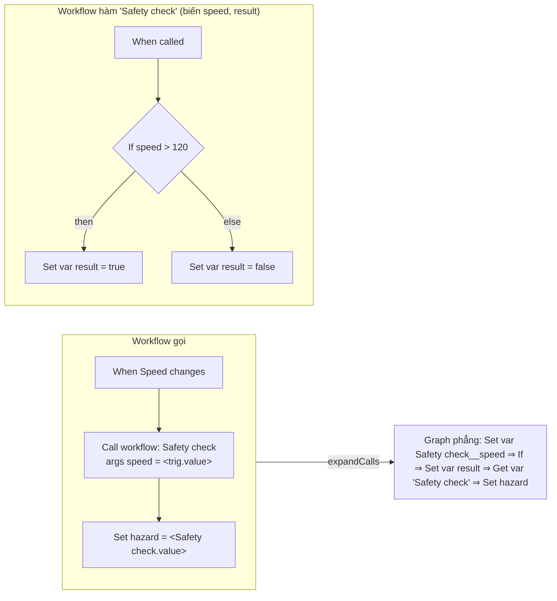

# ADR-0063: Sub-workflow = một workflow gọi workflow khác, inline lúc compile

- **Status:** Accepted (theo uỷ quyền PO 2026-10-25: "tự quyết định")
- **Date:** 2026-10-25
- **Level:** L1 Subsystem
- **Deciders:** Claude Code (uỷ quyền PO)
- **Related:** [ADR-0049](ADR-0049-filter-state-machine-subworkflow.md) §4 (điều kiện), [ADR-0012](ADR-0012-execution-semantics.md) (biến workflow), [ADR-0014](ADR-0014-ir-v1.md), [ADR-0042](ADR-0042-semantic-parity-testing.md), M14 #7, M21 D13

## Context
- Workflow lớn lặp lại cùng một đoạn logic. Ví dụ "kiểm điều kiện an toàn rồi báo HMI" dùng ở nhiều trigger hoặc nhiều app. Hôm nay phải chép tay từng block.
- ADR-0049 §4 hoãn sub-workflow, với điều kiện có ADR riêng cho các việc sau:
  - compile nhiều graph;
  - inline có giới hạn độ sâu, cấm đệ quy;
  - tham số và kết quả có kiểu;
  - UI chọn workflow.
- Ràng buộc:
  - **Luật cứng 1:** không LLM trong đường sinh code.
  - **Luật cứng 5:** tất định.
  - **Luật cứng 8:** mã diagnostic chỉ thêm.
  - IR v1 không có khái niệm hàm.
  - Mỗi backend (C++/Python/Rust, WASM) và simulator phải giữ parity ([ADR-0042](ADR-0042-semantic-parity-testing.md)).
- Đã kiểm source compiler (`packages/compiler/src/compile.ts`):
  - một graph ⇒ một IR, qua lint (S0–S3) rồi `Builder`;
  - biến workflow đọc và ghi qua block `sv_var_get`/`sv_var_set` (prop `name`);
  - tham chiếu output dạng `<tên_block.output>`.

## Decision
1. **Block mới:**
   - `sv_on_call` "When called": trigger của **workflow hàm**. Không prop, handle ra `source`.
   - `sv_call_workflow` "Call workflow":
     - props `workflowId` (workflow hàm cùng workspace) và `args` (map `tên biến của workflow hàm → biểu thức`);
     - handle vào `target`, handle ra `source` (như `sv_wait`);
     - output `value`, là giá trị cuối của biến `result` của workflow hàm nếu nó có biến đó.
2. **Tham số và kết quả là biến của workflow hàm**, có kiểu ([ADR-0012](ADR-0012-execution-semantics.md)):
   - biến có trong `args` được gán lại ở **mỗi** lần gọi;
   - biến khác giữ giá trị giữa các lần gọi, như biến workflow thường;
   - biến `result` (nếu có) là kết quả.
3. **Inline lúc compile, trước lint.** `expandCalls(graph, callees)` PHẢI thay mỗi `sv_call_workflow` bằng:
   1. một `sv_var_set` cho mỗi arg;
   2. thân workflow hàm: mọi block trừ `sv_on_call`, id `<idGọi>-<idHàm>`, tên `<tên gọi> <tên hàm>`; biến đổi tên thành `<tênGọi>__<biến>` và được khai báo trong graph người gọi với giá trị đầu của hàm;
   3. một `sv_var_get` mang **tên của block gọi**, đọc biến `result` (hoặc không có, nếu hàm không có `result`), rồi đi `source` của block gọi.

   Thêm các quy tắc:
   - Mọi handle ra không phải `error` còn trống của block mức trên cùng trong thân hàm đều nối tới bước (iii).
   - Sau khi thay, lint/typer/Builder chạy trên graph phẳng. IR, simulator và codegen không đổi cơ chế. Parity có sẵn vì mọi backend chỉ thấy IR.
4. **Giới hạn và lỗi**, gồm các mã diagnostic mới, chỉ thêm:
   - `SUBWORKFLOW_NOT_FOUND`: workflow hàm không có trong `callees`, hoặc không có trigger `sv_on_call`;
   - `SUBWORKFLOW_RECURSIVE`: gọi vòng, trực tiếp hoặc gián tiếp;
   - `SUBWORKFLOW_TOO_DEEP`: lồng quá 4 cấp;
   - `SUBWORKFLOW_ARG_UNKNOWN`: arg không phải biến của hàm.

   Diagnostic của một block trong thân hàm PHẢI trỏ về block gọi (`blockId` = id gọi), message có tên workflow hàm. Một workflow chỉ có trigger `sv_on_call`, compile riêng ⇒ cảnh báo, không sinh trigger nào.
5. **Contract, chỉ thêm:**
   - compiler `/compile` và `/simulate` nhận `callees: WorkflowGraph[]`;
   - orchestrator `createGeneration` nhận `callees`;
   - BFF studio gom các workflow hàm được gọi (đệ quy, tối đa 4 cấp) từ DB rồi gửi kèm.
6. **Tất định:** `expandCalls` chỉ phụ thuộc graph và `callees`. Cùng input ⇒ cùng graph phẳng ⇒ cùng IR (`irHash`). Thứ tự block mới theo thứ tự block của graph gọi rồi của hàm.

## Diagram

## Alternatives considered
| Phương án | Ưu | Nhược | Vì sao loại |
|---|---|---|---|
| Opcode IR `call`/`return` + hàm trong runtime | Code sinh gọn hơn | IR v2, sửa simulator + 3 runtime + WASM, parity mới | Chi phí lớn, rủi ro parity |
| Inline ở studio (BFF) | Compiler không đổi | Logic compile nằm ngoài compiler, lặp lại cho orchestrator/gate | Trái ADR-0007 (compiler là nguồn duy nhất) |
| Tham số là output động của block | Gần ngôn ngữ lập trình | BlockSpec output tĩnh, block-parity UI↔spec vỡ | Biến workflow đã có kiểu và UI |

## Consequences
- **Tích cực:**
  - tái dùng logic giữa các trigger và các workflow;
  - không thay đổi IR, runtime hay backend;
  - parity giữ tự động.
- **Tiêu cực:**
  - code sinh lặp thân hàm ở mỗi lần gọi, nên kích thước tăng theo số lần gọi;
  - biến không phải arg của hàm có trạng thái riêng cho **mỗi chỗ gọi**: mỗi lần inline đổi tên khác nhau;
  - trace/Flow hiện các block của hàm với tên có tiền tố tên block gọi.
- **Module:** core (compiler, block specs), contracts (compiler/orchestrator openapi, diagnostics catalog), compiler service, orchestrator, studio (2 BlockConfig, BFF gom callees).

## Implementation
| Việc | Module | Milestone |
|---|---|---|
| `expandCalls` + test (thân, args, kết quả, đệ quy, độ sâu, map diagnostic, tất định) | core/compiler | M21 D13 |
| BlockSpec `sv_on_call`, `sv_call_workflow` + semantics | core/blocks | M21 D13 |
| `callees` ở `/compile`, `/simulate`, `createGeneration` | contracts, compiler, orchestrator | M21 D13 |
| BlockConfig + BFF gom callees + E2E | studio | M21 D13 |
| Conformance case có workflow hàm (simulator + C++/Python/Rust) | contracts fixtures | M21 D13 |

## Verification
- Unit `expandCalls`, golden IR GW-A…G không đổi byte.
- Conformance C46 PASS simulator + C++/Python/Rust.
- E2E: tạo workflow hàm, gọi nó, Simulate, SynCode.

## Notes / Deviations
- **2026-10-26 — sửa sau khi chạy thử trên UI (kịch bản demo M21):**
  - Khối trong hàm lồng được gắn với lời gọi **trong** hàm, nên chẩn đoán trỏ vào một id không có trên canvas. Nay mọi khối inline gắn với lời gọi của graph đang compile; tên workflow ghi theo chuỗi `A › B`.
  - Lời gọi chưa nối trigger sinh một `BLOCK_UNREACHABLE` cho mỗi khối inline, mang tên nội bộ (`check_arg_speed`…). Nay chỉ còn **một** cảnh báo trên khối gọi, mang tên khối gọi; chẩn đoán trùng bị bỏ.
  - Câu tóm tắt khối chỉ đếm tham số có tên (bảng luôn giữ một dòng trống).
  - Test: `subworkflow.test.ts` (2 test mới), `block-summary.test.ts`.
- **2026-10-26 — trợ lý AI (thấy khi quay video showcase):** trợ lý kiểm mỗi đề xuất bằng `/compile` nhưng không gửi `callees`, nên mọi đề xuất trên một workflow có Call workflow đều báo `SUBWORKFLOW_NOT_FOUND`, kể cả khi thay đổi đúng.
  - **Sửa:** BFF đưa `callees` vào `ChatContext.workflow` (contract ai-assistant, additive); dịch vụ AI gửi chúng ở mọi lần compile (`workflow_propose_patch`, `workflow_validate`, mô phỏng test case).
  - **Test:** `ai.test.ts`.
- **2026-10-26 — runtime C++:** publish MQTT lỗi khi app đang dừng làm app chết (exception paho). Nay ghi log rồi đi tiếp, như Python/Rust (semantics `sv_mqtt_publish`).
- **2026-10-27 — sau khi xem kỹ video showcase:**
  - **Workflow hàm mở trong editor ⇒ cảnh báo mới `SUBWORKFLOW_FUNCTION`**, và thân hàm được lint như workflow thường; trước đó nó hiện lỗi đỏ vĩnh viễn. Compile hoặc build riêng ⇒ `SUBWORKFLOW_ONLY_CALLED` vẫn là **lỗi**, không sinh IR. Không đổi mức độ của mã cũ: `diagnostics-guard` chặn việc đó (luật cứng 8); mã mới chỉ thêm vào.
  - **Chọn workflow bằng `workflow-selector` của Sim** (thay dropdown tự lấy danh sách): canvas hiện tên workflow thay vì id, loại workflow đang mở, đánh dấu workflow đã xoá.
  - **SynCode bỏ qua workflow hàm được tick vào app:** chúng vào app qua các lời gọi. App chỉ có workflow hàm ⇒ 400 có lời giải thích.
  - Lịch sử catalog: `SUBWORKFLOW_ONLY_CALLED` lần lượt là error (`0d35eefe`), warning (`a6c59e82`), rồi error (`4549a103`). Cả ba commit đều chưa phát hành. Trạng thái chốt là error, và từ đây không đổi nữa. `diagnostics-guard` báo đỏ CI ở hai lần đổi (40494067429, 40496619059), đúng như luật cứng 8.

