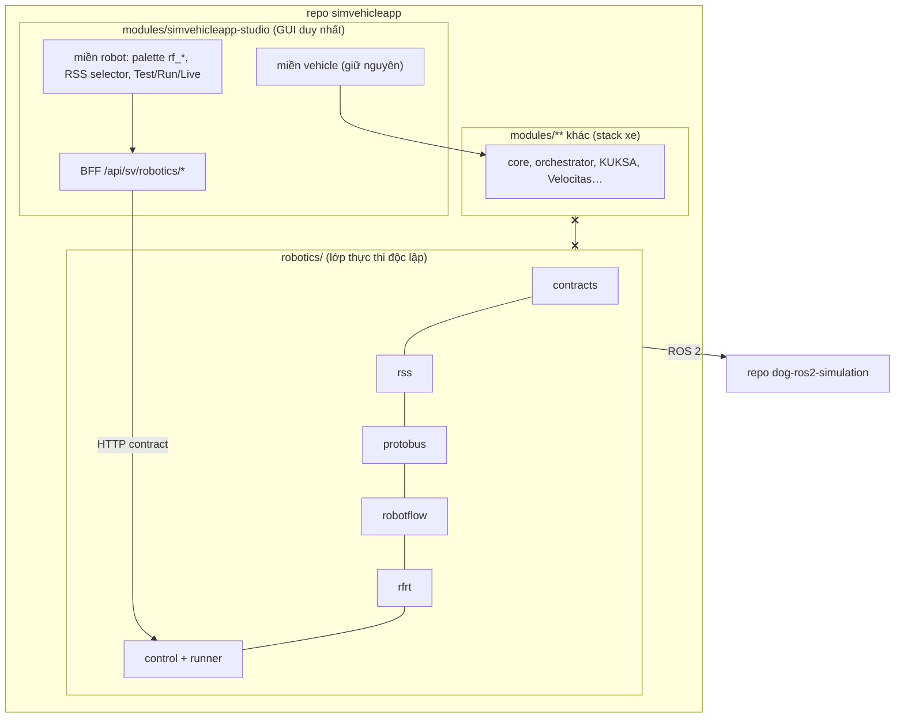

# ADR-0064: Robotics dùng GUI SimVehicleApp hiện có; các lớp thực thi (RSS, Protobus, RobotFlow, runtime) độc lập trong `robotics/`

- **Status:** Accepted — PO cho phép thực hiện theo tài liệu này ngày 2026-11-01
- **Date:** 2026-11-01
- **Level:** L0 System
- **Deciders:** PO; Claude Code (đề xuất)
- **Related:** ADR-0065 (RSS), ADR-0066 (Protobus), ADR-0067 (RobotFlow), ADR-0068 (GUI), ADR-0069 (an toàn), ADR-0070 (hiệu năng), ADR-0071 (nghiệm thu/video); ADR-0009 (một repo nhiều module); [design robotics](../../docs/design/robotics/README.md)

## Context

**Yêu cầu PO (2026-10-27, nhắc lại 2026-11-01):**

- compiler riêng, ngôn ngữ dễ trước, runtime để kết nối robot;
- workflow kéo thả có log và kịch bản;
- RSS tương tự VSS;
- Protobus độc lập tương tự KUKSA, mapping RSS ↔ ROS 2;
- kéo thả workflow điều khiển dog robot qua RSS → Protobus → ROS 2.

**Lịch sử phải ghi để không lặp lại** (bản thử lưu ở tag `archive/robotics-attempt-2026-11-01`, gỡ khỏi `main` ngày 2026-11-01):

| Ngày | Sự kiện | Hệ quả |
|---|---|---|
| 2026-10-27 | Plan bản 1: robot là miền thứ hai trong stack xe, **dùng KUKSA** làm broker | Trái "protobus độc lập" |
| 2026-10-28 | PO: "luồng mới này là độc lập không dùng lại cái gì hiện có… tham khảo thôi" | Agent viết lại thành stack riêng **kể cả GUI riêng** (*Robot Studio*) |
| 2026-10-29 → 11-01 | Code ~69 nghìn dòng, Robot Studio web riêng, video | Trái "chưa cần thực hiện code" của yêu cầu gốc |
| 2026-11-01 | PO đính chính: dùng **GUI SimVehicleApp hiện có**; Robot Studio và video bị bác | Reset `main` về `0c342cd4` + 3 bản sửa xe; plan lại từ đầu |

**Diễn giải thống nhất** hai chỉ đạo:

- "độc lập" = **lớp thực thi robotics** không phụ thuộc stack xe (không KUKSA/Velocitas/VSS/compiler xe);
- "dùng GUI hiện có" = **một sản phẩm, một giao diện soạn**.

**Ràng buộc:**

- một repo nhiều module (ADR-0009);
- máy dev 11 GB RAM;
- luật cứng AGENTS §2 (tất định, không LLM trong đường sinh code, Compose, port 127.0.0.1).

## Decision

1. **GUI.**
   - Studio hiện có (`modules/simvehicleapp-studio/apps/sim`) là **giao diện duy nhất** để soạn, test, build, deploy, chạy và quan sát workflow robot.
   - **KHÔNG ĐƯỢC** tạo web app, editor, portal hay iframe soạn thảo thứ hai cho robot.
   - Robotics là **miền** `robot` cạnh `vehicle` (ADR-0068).
2. **Lớp thực thi độc lập.**
   - RSS, Protobus, RobotFlow compiler, runtime `rfrt`, control API, runner nằm trong thư mục gốc `robotics/`. Mỗi module chỉ phụ thuộc `robotics/contracts`.
   - **KHÔNG ĐƯỢC** import, copy hay vendor code từ `modules/**` vào `robotics/**` và ngược lại.
   - **KHÔNG ĐƯỢC** dùng KUKSA, Velocitas, VSS hay compiler/IR/simulator xe cho robot.
3. **Ranh giới GUI ↔ robotics** chỉ qua HTTP contract có version:
   - BFF `/api/sv/robotics/*` của studio gọi `robotics/control` và `robotics/robotflow`;
   - snapshot block registry/catalog trong studio được CI so khớp với nguồn `robotics/`, như `block-parity` của xe;
   - trợ lý AI chỉ đề xuất WorkflowPatch.
4. **Robot dog là repo riêng** (`dog-ros2-simulation`).
   - Giao tiếp chỉ qua ROS 2.
   - Thay đổi phía dog (kênh lệnh workflow, động tác mới, pin mô phỏng) được lập kế hoạch và ADR trong repo dog (R4, dog ADR-0019/0020). Không sửa dog từ repo này.
5. **Hạ tầng chạy:**
   - compose project riêng `sr` (`robotics/compose.yaml`), network/volume/port riêng;
   - studio gia nhập network `sr-gui` qua overlay tuỳ chọn;
   - CI workflow riêng `robotics.yml` lọc theo `robotics/**`, cộng với CI studio hiện có cho phần GUI.
6. **Quy trình:**
   - Milestone **M22 → M28** với gate tuần tự (luật cứng 7).
   - Kế hoạch này chỉ là tài liệu. **Code bắt đầu khi PO cho phép rõ ràng.**
7. **Luật thêm vào AGENTS.md §2** (chờ PO xác nhận):
   - (11) `robotics/` và `modules/` không import nhau; robot không dùng KUKSA/Velocitas/VSS;
   - (12) không tạo GUI soạn thảo thứ hai cho robotics;
   - (13) chỉ gửi lệnh cấp cao cho robot qua kênh được dog cho phép; không bao giờ `cmd_vel`/motor.

## Diagram

## Alternatives considered

| Phương án | Ưu | Nhược | Vì sao loại |
|---|---|---|---|
| Robot là miền thứ hai dùng KUKSA + compiler xe (plan 2026-10-27) | Ít code mới | Trái R1/R3 (compiler riêng, protobus độc lập); khoá robot vào VSS/Velocitas | PO bác 2026-10-28 |
| Stack robot độc lập **kèm GUI riêng** (bản thử 2026-10-28 → 11-01) | Tách tuyệt đối | Hai sản phẩm, hai giao diện; làm lại canvas/auth/persistence/AI; PO bác | PO bác 2026-11-01 |
| Repo robotics riêng | Tách tuyệt đối | Mất GUI chung, CI/ROADMAP/quy trình chung | `robotics/` tách được sau bằng `git subtree split` |
| Node-RED/n8n làm workflow | Có UI sẵn | Không sinh code tất định, không có RSS/an toàn | Không đạt R1 |

## Consequences

- **Tích cực:**
  - một sản phẩm, người dùng học một GUI;
  - lớp thực thi robot thiết kế đúng cho robot (setpoint TTL, command lifecycle, Stop riêng);
  - stack xe không bị ràng buộc.
- **Tiêu cực / nợ kỹ thuật:**
  - studio phải phân nhánh theo miền ở palette, lint, Test, Run, AI;
  - CI phải chạy cả hồi quy xe khi sửa studio;
  - khối lượng broker, compiler, runtime viết mới vẫn lớn (RR7).
- **Ảnh hưởng module:**
  - `simvehicleapp-studio` thêm miền robot;
  - `simvehicleapp-ai` thêm tool theo miền;
  - module xe khác không đổi;
  - thêm `robotics/**`.

## Implementation

| Task | Module | Milestone |
|---|---|---|
| Khung `robotics/`, `robotics/AGENTS.md`, compose `sr`, CLI `robotics/scripts/sr`, CI `robotics.yml`, guard import chéo | robotics | M22-T01 |
| Contracts v1 | robotics/contracts | M22–M25 |
| Miền robot trong studio + AI | simvehicleapp-studio, simvehicleapp-ai | M26 |

## Verification

- **Guard CI:**
  - không file `robotics/**` tham chiếu `modules/`, `kuksa`, `velocitas`, `vss-tools`;
  - không file `modules/**` import `robotics/` (trừ script snapshot ở `scripts/` và CI).
- `docker compose -f robotics/compose.yaml config -q` hợp lệ độc lập; compose root xe không đổi.
- **Gate M26:**
  - E2E chứng minh workflow robot được soạn và chạy **trong GUI studio**;
  - không có service web soạn thảo nào khác trong `robotics/compose.yaml`.
- Toàn bộ CI/E2E xe hiện có PASS.

## Notes / Deviations

- 2026-11-01: thay hoàn toàn ADR-0064…0089 của bản thử (chỉ còn trong tag archive). Số ADR bắt đầu lại từ 0064 trên `main`.
