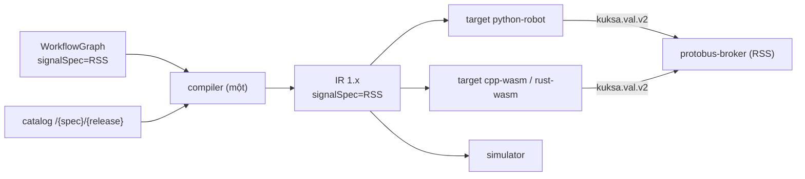

# ADR-0064: Robot là miền thứ hai (`signalSpec: RSS`) trong cùng studio/compiler/IR, không phải sản phẩm riêng

- **Status:** Proposed — chờ PO xác nhận
- **Date:** 2026-10-27
- **Level:** L0 System
- **Deciders:** PO; Claude Code (đề xuất)
- **Related:**
  - ADR-0010 (VSS catalog), ADR-0014/0015 (IR, compiler), ADR-0020 (backend plugin), ADR-0052 (VSS tuỳ biến), ADR-0061 (WASM);
  - ADR-0065 (RSS), ADR-0066 (Protobus), ADR-0067 (target robot), ADR-0068 (block robot);
  - [design](../../docs/design/M22-robotics-extension.md).

## Context
PO (2026-10-27) muốn:
- một compiler/runtime để điều khiển **robot** (trước mắt robot chó Unitree Go2 mô phỏng trong repo `dog-ros2-simulation`);
- một đặc tả tín hiệu **RSS** tương tự VSS;
- một **protobus** nối RSS sang ROS 2;
- workflow kéo thả cho robot giống workflow cho xe.

Dữ kiện source (design §2.2):
- **IR v1 gần như trung lập spec.** Path có pattern chung, opcode `vehicle.*` không gắn gốc `Vehicle`. Chỉ có hai chỗ giả định gốc `Vehicle`: regex template `<Vehicle.…>` trong `compile.ts` và kiểu `VehicleLookup`.
- **Mã model** `vX.Y(-name)` (ADR-0052) không mang thông tin "spec nào".
- **Compiler, simulator, Test tab, Flow, trace, golden/parity, AI patch** đều làm việc trên tín hiệu + điều khiển luồng, không trên ngữ nghĩa xe.

## Decision
1. **Một sản phẩm, hai miền.**
   - Miền là thuộc tính của **project/app**: `signalSpec ∈ {"VSS", "RSS"}`, mặc định `"VSS"`.
   - Mỗi app thuộc **đúng một** miền. Trộn path hai miền trong một workflow là lỗi `SIGNAL_SPEC_MISMATCH`.
2. **Tổng quát hoá theo kiểu thêm, không phá contract:**
   - Thêm trường tuỳ chọn `signalSpec` vào WorkflowGraph, Scenario, IR document, Project (orchestrator) và catalog API. Contracts bump **minor**; IR giữ `irVersion` 1.x.
   - Catalog phục vụ `GET /catalog/{spec}/{release}/…`; các route cũ là alias của `VSS`. Release RSS dùng cùng pattern `vX.Y(-name)` của ADR-0052.
   - Compiler: `VehicleLookup` ⇒ `SignalLookup(spec, release, paths)`. Regex template lấy gốc theo spec (`Vehicle` | `Robot`). `modelHash` tính trên JSON của đúng spec + release.
   - **Opcode `vehicle.*` giữ nguyên tên** (IR là API công khai). Tài liệu hoá lại là "thao tác kho tín hiệu", dùng cho mọi spec.
   - Mã diagnostic cũ giữ nguyên (luật cứng 8); mã mới chỉ thêm.
3. **"Trình biên dịch riêng" = target + runtime riêng cho robot** (ADR-0067). Không tạo compiler graph→IR thứ hai: một compiler duy nhất giữ tất định và parity.
4. **Đường tín hiệu robot đi qua Protobus** (ADR-0066). App robot chỉ nói `kuksa.val.v2` với `protobus-broker`, **không** nói ROS 2 trực tiếp.
5. **Studio:**
   - chọn miền khi tạo app;
   - toolbar, catalog, block nhóm Robot theo miền;
   - signal-gateway trỏ broker của miền (databroker xe hoặc protobus-broker).

## Diagram

## Alternatives considered
| Phương án | Ưu | Nhược | Vì sao loại |
|---|---|---|---|
| Sản phẩm robot riêng (fork studio + compiler) | Tự do đặt tên, không sợ phá xe | Hai compiler, hai simulator, parity phải làm lại; gấp đôi bảo trì | Mất toàn bộ tài sản M0–M21 |
| IR v2 đổi tên opcode `signal.*`, bỏ `vehicle.*` | Tên đẹp | Breaking IR công khai, mọi backend/golden đổi | Không có lợi ích chức năng |
| Biên dịch workflow thẳng thành node ROS 2 (rclpy) | Ít thành phần | Bỏ qua RSS/protobus (trái yêu cầu PO); app phụ thuộc ROS distro; mất parity | Trái mục tiêu kiến trúc |
| Nhồi RSS vào tên release (`v0.1-rss`) | Không đổi schema | Nhập nhằng với VSS tuỳ biến của ADR-0052; catalog không biết gốc | Dễ sai, khó kiểm |

## Consequences
- **Tích cực:**
  - dùng lại compiler, simulator, Test/Flow, trace, AI, golden/parity;
  - backend nào đã có (Python, WASM) đều chạy được robot sau khi có adapter/target.
- **Tiêu cực:**
  - tên opcode `vehicle.*` hơi lệch nghĩa với robot (chấp nhận, tài liệu hoá);
  - mọi validator phải nhận thêm `signalSpec`.
- **Ảnh hưởng module:** contracts, core (catalog, compiler, simulator, units), orchestrator (Project, run, signal-gateway target), studio (chọn miền, toolbar), ai (catalog tool).

## Implementation
| Task | Module | Milestone |
|---|---|---|
| `signalSpec` trong schema graph/scenario/IR/openapi + test tương thích ngược | contracts | M22-T05 |
| Catalog đa spec `/{spec}/{release}` + alias VSS | core | M22-T04 |
| `SignalLookup`, regex template theo gốc, `SIGNAL_SPEC_MISMATCH` | core | M24-T01 |
| Project `signalSpec`, signal-gateway chọn broker theo miền | orchestrator | M25-T04 |
| Chọn miền khi tạo app, toolbar theo miền | studio | M26-T01 |

## Verification
- Golden IR GW-A..G **không đổi một byte** sau khi thêm `signalSpec`.
- Golden robot RW-A..RW-D tất định ×2.
- Test: graph cũ không có `signalSpec` ⇒ VSS.
- Test: trộn `Vehicle.*` và `Robot.*` ⇒ `SIGNAL_SPEC_MISMATCH`.

## Notes / Deviations
—
