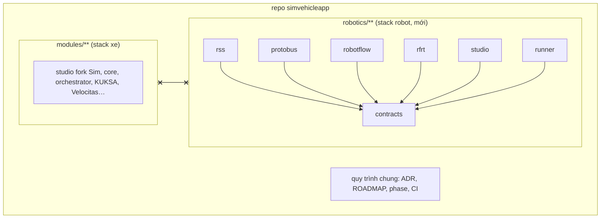

# ADR-0064: Robotics là một stack độc lập trong `robotics/`, viết từ đầu, không dùng lại code, contract hay hạ tầng của stack xe

- **Status:** Accepted — PO authorized implementation 2026-10-29; acceptance gates remain open
- **Date:** 2026-10-27, viết lại 2026-10-28 theo đính chính của PO
- **Level:** L0 System
- **Deciders:** PO; Claude Code (đề xuất)
- **Related:** ADR-0065 (RSS), ADR-0066 (Protobus), ADR-0067 (RobotFlow), ADR-0068 (Robot Studio); ADR-0009 (một repo, nhiều module); [design](../../docs/design/M22-robotics-extension.md) §1, §13

## Context
- **Yêu cầu PO 2026-10-27.** Robot là mục tiêu thứ hai ngoài xe, cần:
  - compiler, runtime;
  - đặc tả tín hiệu RSS;
  - một "protobus" ánh xạ RSS ↔ ROS 2;
  - workflow kéo thả có log và kịch bản.
- **Bản ADR đầu tiên (2026-10-27)** đặt robot làm "miền thứ hai" (`signalSpec: RSS`) trong studio fork Sim, compiler/IR/simulator core, runtime Python hiện có, và dùng KUKSA databroker làm broker.
- **Đính chính PO 2026-10-28:** "luồng mới này là độc lập không dùng lại cái gì hiện có cả… trước đó tôi bảo là tham khảo thôi… thực hiện từ đầu và riêng biệt". ⇒ Bản đầu sai ở gốc. ADR này thay toàn bộ nội dung cũ (ADR chưa từng Accepted).
- **Ràng buộc vẫn giữ:**
  - một repo nhiều module (ADR-0009);
  - máy dev 11 GB RAM, build image trên CI;
  - các luật kỹ thuật chung của repo: tất định, không LLM trong đường sinh code, Compose là mode chạy duy nhất, không docker.sock, port 127.0.0.1, ADR khi đổi kiến trúc, mã diagnostic là API công khai.

## Decision
1. **Vị trí và ranh giới.**
   - Toàn bộ robotics nằm trong thư mục gốc `robotics/` với các module `contracts`, `rss`, `protobus`, `robotflow`, `rfrt`, `studio`, `runner`.
   - Module trong `robotics/` chỉ phụ thuộc `robotics/contracts`, giao tiếp qua gRPC/HTTP/WS theo contract.
   - Build context của mỗi module không trỏ ra ngoài thư mục module (riêng `robotics/contracts` được copy vào lúc build qua script của `robotics/`).
2. **KHÔNG ĐƯỢC** import, copy, vendor, symlink code, schema, fixture hay asset từ `modules/**`, `scripts/**`, `e2e` của stack xe, và ngược lại.
   - Cụ thể: không dùng studio fork Sim, core compiler/IR/simulator/blocks/units, contracts xe, orchestrator, workspace, signal-gateway, wasm-host, AI, compiler-code-*, `scripts/sv`, helper Playwright hiện có.
   - Cũng **không dùng KUKSA databroker, Velocitas, VSS, vss-tools**.
3. **Được** đọc stack xe để **tham khảo** ý tưởng (ghi "tham khảo: …" trong ADR/design nếu có), dùng chung git repo, GitHub Actions và quy trình (ADR, ROADMAP, phase, gate, report).
4. **Tách hạ tầng chạy:**
   - compose project `sr` (`robotics/compose.yaml`), network/volume/port riêng (`SR_*`);
   - CLI riêng `robotics/scripts/sr`;
   - CI workflow riêng `.github/workflows/robotics.yml`, lọc theo `robotics/**`.
   - Không include vào compose root của stack xe.
5. **Contract riêng.** `robotics/contracts` chứa:
   - `protobus.v1.proto`;
   - JSON Schema `rss-spec.v1`, `rss-catalog.v1`, `mapping.v1`, `robotflow.v1`, `rfir.v1`, `scenario.v1`, `block.v1`;
   - catalog lỗi `diagnostics.v1.json` (mã `RF*`, `PB*`).

   Mã công khai chỉ thêm. Đổi contract ⇒ bump version + ADR.
6. **Luật riêng của stack robot** ghi trong `robotics/AGENTS.md` (tạo ở M22-T01). Đề xuất thêm vào AGENTS §2 gốc — **chờ PO xác nhận:**
   - (11) `robotics/` và `modules/` không phụ thuộc nhau;
   - (12) bridge robot chỉ được publish giao diện điều khiển cấp cao mà robot cho phép (dog: `control/request`), không bao giờ lệnh motor/`cmd_vel`.
7. **Ngôn ngữ:** Python 3.12 cho toolchain, broker và app đầu tiên; TypeScript cho web (ADR-0067 §1).
8. Tách thành repo riêng sau này bằng `git subtree split --prefix robotics`, không phải sửa code. **Chờ PO:** giữ chung repo (đề xuất) hay tách ngay.

## Diagram

## Alternatives considered
| Phương án | Ưu | Nhược | Vì sao loại |
|---|---|---|---|
| Robot là miền thứ hai trong stack xe (bản 2026-10-27) | Ít code mới, dùng lại studio/compiler/KUKSA | Trái yêu cầu PO; ghép chặt hai sản phẩm; ràng buộc VSS/KUKSA/Velocitas vào robot | PO bác 2026-10-28 |
| Repo mới ngay từ đầu | Tách tuyệt đối | Mất bảng ROADMAP/ADR/quy trình chung; thêm chi phí CI/quyền | Để PO quyết; `robotics/` tách được bất kỳ lúc nào |
| Dùng framework workflow có sẵn (Node-RED, n8n) | Nhanh có UI | Không kiểm soát được sinh code tất định, RSS, an toàn | Không đạt mục tiêu "compiler riêng" |
| Dùng broker có sẵn (Zenoh, MQTT, KUKSA) làm Protobus | Ít code | PO muốn protobus độc lập, tự định nghĩa; không có kind setpoint/command, lease, TTL | Xem ADR-0066 |

## Consequences
- **Tích cực:**
  - hai sản phẩm phát triển, phát hành, tách repo độc lập;
  - RSS/Protobus/RobotFlow được thiết kế đúng cho robot: lệnh có vòng đời, setpoint có TTL, lease;
  - không đổi một byte nào của stack xe (golden, contract, diagnostic xe không bị đụng).
- **Tiêu cực:**
  - khối lượng lớn: studio, compiler, runtime, broker đều viết mới (RR7);
  - hai giao diện người dùng khác nhau;
  - một số ý tưởng được làm lại hai lần (tất định, diagnostics, E2E).
- **Ảnh hưởng module:** không module xe nào đổi. Thêm `robotics/**` và một workflow CI.

## Implementation
| Task | Module | Milestone |
|---|---|---|
| Khung `robotics/`, `AGENTS.md`, `README.md`, compose `sr`, CLI `sr`, CI `robotics.yml`, guard "không import chéo" | robotics | M22-T01 |
| Contracts v1 (schema + proto + catalog lỗi) | robotics/contracts | M22-T02, M23-T01, M25-T01 |
| Các module còn lại | xem ADR-0065..0068 | M22–M27 |

## Verification
- **Guard CI** (`sr precheck`):
  - không file nào trong `robotics/**` tham chiếu `modules/`, `scripts/sv`, `kuksa`, `velocitas`, `vss-tools`;
  - không file nào ngoài `robotics/**` tham chiếu `robotics/` (trừ README, ROADMAP, analysis, CI workflow);
  - đọc import Python/TS và Dockerfile `COPY`/`FROM`.
- `docker compose -f robotics/compose.yaml config -q` hợp lệ độc lập; compose root của stack xe không đổi.
- Golden/contract/diagnostic stack xe không đổi (CI xe hiện có).

## Notes / Deviations
- 2026-10-28: viết lại toàn bộ theo đính chính PO (bản 2026-10-27: "Robot là miền thứ hai `signalSpec: RSS`"). Đổi tên file từ `ADR-0064-robotics-domain-signal-spec.md`.

## Integration authorization 2026-10-29

The user authorized implementation across simvehicleapp and dog-ros2-simulation, sequential gates, complex workflow deployment, launch from Robot Zoo, actual ROS/simulation evidence and final E2E video. ADR-0069 defines the required review corrections and takes precedence over conflicting details above. This is architecture authorization, not runtime acceptance.
