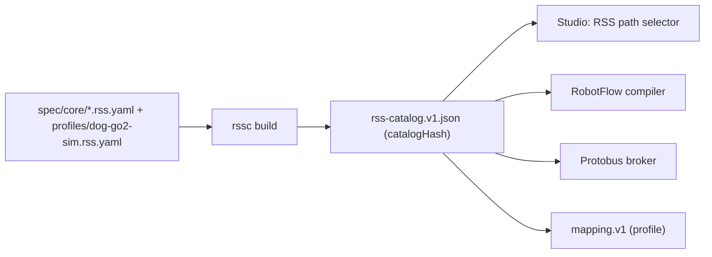

# ADR-0065: RSS — đặc tả tín hiệu robot dạng cây `Robot.*`, có kind setpoint/command, độ tươi bắt buộc và profile theo robot

- **Status:** Accepted — PO cho phép thực hiện theo tài liệu này ngày 2026-11-01
- **Date:** 2026-11-01
- **Level:** L1 Subsystem
- **Deciders:** PO; Claude Code (đề xuất)
- **Related:** ADR-0064, ADR-0066, ADR-0067; [rss-v0.1.md](../../docs/design/robotics/rss-v0.1.md); dog `contracts/ros2/topics.json` @ `35c45ee`

## Context

- **Yêu cầu R2:**
  - RSS path tương tự VSS path, định nghĩa chuẩn chỉnh, đầy đủ tín hiệu robot;
  - trước mắt cho dog robot, tham khảo repo `dog-ros2-simulation`.
- **VSS không đủ cho robot:**
  - không có điều khiển liên tục có TTL;
  - không có lệnh có vòng đời và kết quả vật lý;
  - không có độ tươi bắt buộc.
- **Robot dog (đọc code 2026-11-01):**
  - 48 topic ROS 2 trong `/dog1`; Brain là trọng tài duy nhất;
  - mode `DISARMED/MANUAL/AUTO/MOTION/SAFE_STOP`;
  - động tác `crouch, bow, tilt, lift_fl, jump`;
  - kẹp vận tốc 0,5 m/s và 0,65 rad/s;
  - route tối đa 20 điểm;
  - pin hằng số 92 %.

## Decision

1. **Định dạng.**
   - **Nguồn:** YAML theo `rss-spec.v1`, đặt ở `robotics/rss/spec/core/*.rss.yaml` + `profiles/<id>.rss.yaml`.
   - **Đầu ra:** JSON `rss-catalog.v1` phẳng, đã mở rộng instance, kèm `catalogHash` sha256 tất định.
   - **Tool:** `rssc` (`validate`, `build`, `docs`, `diff`).
2. **Path:**
   - gốc `Robot`, PascalCase;
   - instance kiểu VSS (`Leg[FrontLeft,…]`);
   - boolean `Is*/Has*`;
   - đơn vị chỉ trong metadata;
   - **KHÔNG ĐƯỢC** chứa tên topic/middleware.
3. **Kind:**
   - `branch`, `attribute`;
   - `sensor`: bắt buộc `maxAgeMs`; mẫu có `captureTime` và `quality`;
   - `setpoint`: `fields`, `ttlMs`, `refreshHz`, `safeValue`;
   - `command`: `args`, `timeoutMs`, `results`;
   - `event`.
4. **Kiểu và đơn vị:**
   - kiểu: `bool, int32, int64, uint32, float32, float64, string, enum`;
   - đơn vị: tập đóng trong `units.yaml`, đơn vị SI theo REP-103.
5. **Profile.**
   - Catalog `core` + profile robot, ví dụ `dog-go2-sim`.
   - Profile chọn tập con và chỉ được **thu hẹp** giới hạn, không nới.
   - Profile v0.1 phản ánh đúng giới hạn thực của dog.
6. **Không điều khiển cấp khớp/motor trong v0.1.** Khớp chỉ là sensor.
7. **Không truyền ảnh/point cloud qua RSS.** Chỉ tín hiệu dẫn xuất.
8. **Phiên bản:**
   - thêm node = minor;
   - đổi kiểu, đơn vị hay xoá = major + ADR;
   - workflow ghi `rss.version` + `catalogHash` + `profile`.

## Diagram

## Alternatives considered

| Phương án | Ưu | Nhược | Vì sao loại |
|---|---|---|---|
| Dùng VSS + nhánh `Vehicle.Robot` tự chế | Dùng lại vss-tools | Thiếu setpoint/command/độ tươi; trái R2/R3 và ADR-0064 | Không đủ ngữ nghĩa |
| Dùng thẳng tên topic ROS 2 | Không cần mapping | Workflow khoá vào middleware và robot cụ thể | Trái mục tiêu "chuẩn hoá" |
| Định dạng JSON thuần cho nguồn | Không cần parser YAML | Khó đọc, khó review | YAML cho người, JSON cho máy |

## Consequences

- **Tích cực:**
  - workflow độc lập với ROS;
  - thêm robot mới bằng profile + mapping;
  - GUI có cây tín hiệu có kiểu và đơn vị.
- **Tiêu cực:**
  - phải giữ profile đồng bộ với contract dog (gate đối chiếu);
  - tín hiệu cần dog W1/W2/W3 chưa dùng được trên ROS cho tới khi dog xong.
- **Ảnh hưởng module:** `robotics/rss`, `robotics/contracts`; studio đọc catalog qua BFF.

## Implementation

| Task | Module | Milestone |
|---|---|---|
| Schema `rss-spec.v1`/`rss-catalog.v1`, `units.yaml` | robotics/contracts, rss | M22-T02 |
| Spec `core` + profile `dog-go2-sim` theo [rss-v0.1](../../docs/design/robotics/rss-v0.1.md) | robotics/rss | M22-T03 |
| `rssc validate/build/docs/diff` + tài liệu tham chiếu | robotics/rss | M22-T04 |
| Đối chiếu profile với `topics.json` + hằng số Brain (pin commit dog) | robotics/rss | M22-T05 |

## Verification

- Test schema chấp nhận/từ chối (≥ 20 ca).
- `rssc build` ×2 cho bytes giống hệt.
- **Gate đối chiếu dog:**
  - mọi topic nguồn tồn tại và đúng type;
  - giới hạn profile ≤ hằng số Brain.

## Notes / Deviations

- Tín hiệu đánh dấu W1/W2/W3 phụ thuộc kế hoạch R4 của repo dog; compiler báo `RF1010` nếu workflow dùng tín hiệu profile đánh dấu "chưa sẵn có" trên mode `ros-sim`.
- 2026-11-01 (M22): catalog `dog-go2-sim` 101 lá, `catalogHash sha256:57ca55e9…5de3`. Thêm `spec/profiles/dog-go2-sim.sources.json` (nguồn ROS từng tín hiệu) + `rss/check_dog_profile.py` đối chiếu repo dog bằng `git show` tại commit ghim. Mã lỗi `RS1001…RS1015` trong `contracts/diagnostics.v1.json`. Số command thực tế là 10 (gồm `Robot.Simulation.Battery.SetLevel`, `Robot.Navigation.Cancel`).
