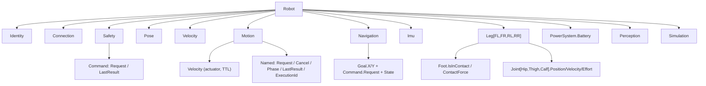

# ADR-0065: RSS (Robotic Signal Specification) v0.1: định dạng vspec của VSS, gốc `Robot`, đơn vị SI REP-103, quy ước lệnh Request/Phase/Result

- **Status:** Proposed — chờ PO xác nhận
- **Date:** 2026-10-27
- **Level:** L1 Subsystem
- **Deciders:** PO; Claude Code (đề xuất)
- **Related:** ADR-0010 (VSS catalog), ADR-0018 (kiểu, mảng, int64), ADR-0052 (overlay), ADR-0064, ADR-0066; [design §4](../../docs/design/M22-robotics-extension.md#4-rss-v01-chi-tiết-adr-0065)

## Context
- **Mục tiêu.** PO cần một đặc tả tín hiệu robot "chuẩn chỉnh, đầy đủ tín hiệu cần thiết", giống VSS cho xe, trước mắt cho robot chó Go2 của repo `dog-ros2-simulation`.
- **Topic robot dog.** Đã kiểm ở SHA `9adea9be` (design §2.1):
  - IMU 100 Hz, khớp 50 Hz, odom 50 Hz, tiếp xúc chân 50 Hz, pin 1 Hz, scan 10 Hz, detection 5 Hz;
  - trạng thái JSON (`brain/state`, `motion/state`);
  - đường lệnh qua `control/request`, có ack và vòng đời động tác.
- **VSS không có khái niệm "lệnh có vòng đời".** Trong VSS chỉ có sensor/actuator/attribute.
- **KUKSA databroker 0.7.1 nạp cây gốc tuỳ ý.** Nó cũng hỗ trợ `allowed`/`min`/`max`/`unit` (`vss.rs`).
- **vss-tools.** COVESA vss-tools v4.1.1 (MPL-2.0) biên dịch vspec ra JSON và hỗ trợ overlay cùng thuộc tính mở rộng.

## Decision
1. **Định dạng.**
   - RSS viết bằng **vspec** (YAML) theo đúng ngữ pháp VSS 4.x: `branch`/`sensor`/`actuator`/`attribute`, `datatype`, `unit`, `min`/`max`, `allowed`, `instances`, `description`, `comment`, `deprecation`.
   - Biên dịch ra `rss_vX.Y.json` bằng **vss-tools ghim tag** (chỉ là tool lúc build, không phân phối kèm sản phẩm).
   - JSON sinh ra **PHẢI** tất định: build hai lần cùng bytes.
2. **Gốc** là `Robot`. Path RSS theo pattern `vssPath` hiện có.
3. **Đơn vị và quy ước.**
   - SI theo ROS REP-103: `m`, `m/s`, `m/s^2`, `rad`, `rad/s`, `N`, `Nm`, `V`, `A`, `percent`, `s`.
   - Trục thân: x tiến, y trái, z lên. Góc Euler roll/pitch/yaw (rad). Frame pose là `odom` trừ khi leaf ghi khác (`Navigation.Goal`: frame `map`).
   - Thêm `rad`, `rad/s` vào bảng đơn vị core (additive).
4. **Tổng quát, không theo một hãng.**
   - Path mô tả robot 4 chân/di động chung: `Leg.{FrontLeft,FrontRight,RearLeft,RearRight}` với `instances`, `Joint.{Hip,Thigh,Calf}`.
   - Tên topic, tên joint và action của hãng/robot **không** nằm trong RSS mà nằm trong **overlay mapping** của Protobus (ADR-0066).
   - Robot không có một leaf ⇒ leaf đó "unmapped" trong profile, compiler báo lỗi khi workflow dùng nó (ADR-0068).
5. **Quy ước lệnh (command pattern).** Mọi thao tác có vòng đời là một nhánh có:
   - `Request`: actuator, `string` có `allowed`. Mỗi lần **Actuate** là một lệnh mới, kể cả cùng giá trị (dựa vào ngữ nghĩa Actuate của `kuksa.val.v2`).
   - `Cancel`: actuator `boolean`, nếu lệnh huỷ được.
   - `LastResult.IsAccepted` (`boolean`) và `LastResult.Reason` (`string`): robot nhận hay từ chối lệnh.
   - `Phase` hoặc `State`: sensor `string` có `allowed`, gồm các giá trị kết thúc khai báo trong `comment` (`terminal: SUCCEEDED, CANCELLED, FAILED, REJECTED`).
   - `ExecutionId`: sensor `string` để đối chiếu.
6. **Ngoài phạm vi RSS:**
   - Luồng lớn (ảnh, point cloud, map) chỉ có giá trị rút gọn, ví dụ `Perception.Obstacle.MinDistance`, `Perception.Marker.Count`.
   - Không có leaf điều khiển motor/torque.
7. **Phiên bản và quản trị.**
   - Release `v0.1` (thử nghiệm, có thể đổi). Từ `v1.0` theo SemVer như VSS: chỉ thêm ở minor, xoá phải qua `deprecation` một minor.
   - Nguồn ở `modules/rss-spec/spec/` (module mới, Apache-2.0, viết từ đầu, không chép VSS).
8. **Cây v0.1:** như bảng ở design §4 (≈ 75 leaf, 14 nhánh). File vspec đầy đủ là sản phẩm của M22-T02.

## Diagram

## Alternatives considered
| Phương án | Ưu | Nhược | Vì sao loại |
|---|---|---|---|
| Định dạng riêng (JSON Schema tự viết) | Có kiểu "command" thật | Phải viết parser, catalog, tool; KUKSA không nạp được | Mất tái sử dụng broker/catalog |
| Dùng thẳng tên topic ROS 2 làm path | Không cần mapping | Gắn chặt một robot/hãng, đổi topic là vỡ workflow | Trái mục tiêu "chuẩn hoá" |
| Kiểu `struct` của VSS 4.x cho lệnh (goal x,y trong một giá trị) | Ghi nguyên tử | Hỗ trợ struct ở KUKSA/SDK chưa đều; khó hiển thị trong Signals panel | Dùng nhiều actuator + `vehicle.write_many` + `Request` kích hoạt |
| Mô hình hoá lệnh bằng RPC/service riêng ngoài broker | Ngữ nghĩa rõ | Thêm API thứ hai cho app; block/simulator/trace phải học kênh mới | Command pattern trên tín hiệu dùng lại toàn bộ IR |

## Consequences
- **Tích cực:**
  - catalog, toolbar, Signals panel, simulator và KUKSA dùng ngay;
  - mapping tách khỏi spec nên một workflow chạy được trên robot khác cùng RSS.
- **Tiêu cực:**
  - command pattern là quy ước, không phải kiểu dữ liệu; block robot (ADR-0068) phải che chi tiết;
  - phải duy trì một spec mới.
- **Ảnh hưởng module:** `rss-spec` (mới), core (units, catalog), contracts (fixture RSS).

## Implementation
| Task | Module | Milestone |
|---|---|---|
| Spike S-R2 vss-tools + overlay `ros2` | rss-spec | M22-T01 |
| Viết vspec RSS v0.1 + build tất định `rss_v0.1.json` | rss-spec | M22-T02 |
| Đơn vị `rad`, `rad/s` | core/units | M22-T03 |
| Tài liệu RSS (cây, quy ước lệnh, cách đề xuất thêm leaf) | docs | M22-T07 |

## Verification
- Build ×2 cùng bytes.
- KUKSA 0.7.1 nạp được (S-R1).
- Mọi leaf có `description`, đơn vị hợp lệ.
- Mọi nhánh lệnh đủ bộ `Request`/`Phase|State`/`LastResult`.
- Bảng truy vết: mỗi topic dog trong design §2.1 ⇒ leaf RSS hoặc "ngoài phạm vi" có lý do.

## Notes / Deviations
—
