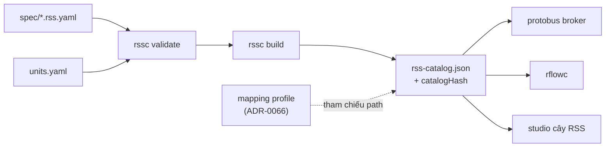

# ADR-0065: RSS (Robotic Signal Specification) v0.1: định dạng `*.rss.yaml` riêng, gốc `Robot`, kind `setpoint`/`command` hạng nhất, đơn vị SI REP-103, tool `rssc`

- **Status:** Accepted — PO authorized implementation 2026-10-29; acceptance gates remain open
- **Date:** 2026-10-27, viết lại 2026-10-28
- **Level:** L1 Subsystem
- **Deciders:** PO; Claude Code (đề xuất)
- **Related:** ADR-0064 (stack độc lập), ADR-0066 (Protobus), ADR-0067 (RobotFlow); [design §4](../../docs/design/M22-robotics-extension.md#4-rss-v01-adr-0065)

## Context
- **Mục tiêu.** PO cần đặc tả tín hiệu robot "chuẩn chỉnh, đủ dùng", giống vai trò VSS cho xe. Trước mắt cho robot chó Go2 của `dog-ros2-simulation` @ `9adea9be`.
- **Robot dog** (design §2.1):
  - **Tần số topic:** IMU 100 Hz; khớp, odom và tiếp xúc chân 50 Hz; pin 1 Hz; scan 10 Hz; detection 5 Hz.
  - **Trạng thái:** Brain/motion/sim là JSON trong `std_msgs/String`.
  - **Lệnh:**
    - qua envelope `control/request`, có ack;
    - kết quả thật ở `motion/state`;
    - lệnh vận tốc `manual` phải làm mới liên tục.
- **Bản đầu (2026-10-27)** dùng vspec + vss-tools. PO yêu cầu độc lập (ADR-0064), nên **không dùng định dạng hay tool của VSS**; chỉ tham khảo ý tưởng cây path có chấm.
- **Khi tự định nghĩa định dạng**, ta sửa được điểm yếu của mô hình sensor/actuator cho robot:
  - lệnh có vòng đời (nhận → chạy → kết quả);
  - vận tốc là **struct nguyên tử** phải hết hạn nếu không làm mới.

  Trong VSS phải mô phỏng bằng nhiều leaf rời và quy ước.

## Decision
1. **Định dạng nguồn** `robotics/rss/spec/*.rss.yaml`, schema `rss-spec.v1` (JSON Schema trong `robotics/contracts`). Gốc `Robot`. Path chấm, PascalCase.
   - **Instances** cho phần lặp: `Leg[FrontLeft,FrontRight,RearLeft,RearRight]`, `Joint[Hip,Thigh,Calf]`.
   - **Kind:**
     - `branch`;
     - `attribute` (tĩnh trong phiên);
     - `sensor`: robot→app. **PHẢI** có `maxAgeMs`;
     - `setpoint`: app→robot, struct `fields`. **PHẢI** có `ttlMs`, `refreshHz`, `safeValue`, min/max mỗi field;
     - `command`: app→robot. Có `args`, **PHẢI** có `timeoutMs` mặc định, kèm `preconditions` dạng văn bản.
   - **Kiểu:** `bool`, `int32`, `int64`, `uint8`, `uint32`, `float32`, `float64`, `string`, `enum(values)`. `int64` mã hoá chuỗi thập phân trong JSON.
   - **Đơn vị** từ bảng riêng `robotics/rss/units.yaml`: SI theo REP-103 gồm m, rad, s, ms, m/s, rad/s, m/s², N, N·m, V, A, %, °C. Mỗi đơn vị có chiều (dimension) để compiler kiểm.
   - **Frame:** `base_link`, `odom`, `map`. Trục `x` tiến, `y` trái, `z` lên; góc Euler roll/pitch/yaw.
2. **Vòng đời lệnh chuẩn**, chung mọi robot: `PENDING → ACCEPTED | REJECTED → RUNNING → SUCCEEDED | FAILED | CANCELLED | TIMED_OUT`.
   - `rssc` tự sinh cho mỗi command 3 sensor: `<cmd>.Status.Phase` (enum), `<cmd>.Status.ExecutionId` (string), `<cmd>.Status.Reason` (string).
   - Adapter robot chịu trách nhiệm ánh xạ phase riêng của robot về vòng đời này (ADR-0066).
3. **Tool `rssc`** (Python 3.12, `robotics/rss/tools`):
   - `validate` (schema + luật ngữ nghĩa: min ≤ max, `safeValue` trong khoảng, đơn vị có trong bảng, path không trùng);
   - `build` → `rss-catalog.json` (instances đã nở, node sinh tự động, khoá sắp xếp, `catalogHash = sha256(canonical JSON không có trường hash)`);
   - `docs` → Markdown tham chiếu;
   - `diff` giữa hai bản (thêm/xoá/đổi kiểu).

   Tất định: hai lần build cùng bytes.
4. **Spec không chứa chi tiết hãng.** Topic, tên khớp, tên action ở **mapping profile** của Protobus (ADR-0066). Spec v0.1 tổng quát cho robot 4 chân.
5. **Không mang luồng lớn** (ảnh, point cloud, bản đồ). Chỉ mang giá trị rút gọn (khoảng cách nhỏ nhất, số marker).
6. **Cây v0.1** đúng như design §4: ≈ 80 sensor/attribute, 1 setpoint, 7 command.
   - Setpoint:
     - `Robot.Motion.Velocity {LinearX ±0,5 m/s, AngularZ ±0,65 rad/s}`;
     - `Robot.Motion.Velocity.LinearY` để dành, dog chưa hỗ trợ ⇒ không có trong v0.1.
   - Command:
     - `Robot.Safety.Arm`, `Disarm`, `ResetStop`;
     - `Stop`, cờ `priority: emergency`;
     - `Robot.Motion.Perform {Name: CROUCH|BOW|TILT|LIFT_FRONT_LEFT|JUMP}`;
     - `Robot.Navigation.GoTo {X, Y}`;
     - `Robot.Navigation.FollowRoute {RouteId}`.
   - `Robot.Connection.*` do Protobus tạo, không đến từ robot.
7. **Version:**
   - `rss: "0.x"` theo semver;
   - thêm node = minor;
   - đổi kiểu, đơn vị hoặc xoá node = major + ADR;
   - `catalogHash` gắn vào workflow, IR và app, để phát hiện lệch.

## Diagram

## Alternatives considered
| Phương án | Ưu | Nhược | Vì sao loại |
|---|---|---|---|
| vspec + vss-tools (bản 2026-10-27) | Có tool sẵn | Trái yêu cầu độc lập; không có kind setpoint/command; MPL-2.0 tool | PO bác |
| Dùng thẳng message ROS 2 (`.msg`) làm spec | Không cần ánh xạ | Gắn chặt ROS và từng robot; không có path tín hiệu cho workflow | Mất mục tiêu "RSS path" |
| JSON thay YAML | Không cần parser YAML | Khó viết tay, không có comment | YAML cho nguồn, JSON cho catalog |
| Lệnh = actuator string + leaf kết quả (kiểu VSS) | Mô hình đơn giản | Không nguyên tử, không có timeout/execution id chuẩn | Kind `command` rõ hơn |

## Consequences
- **Tích cực:**
  - spec đúng bản chất robot;
  - compiler và broker kiểm được TTL, timeout, khoảng giá trị ngay từ catalog;
  - thêm robot mới chỉ cần mapping profile mới.
- **Tiêu cực:**
  - tự duy trì tool và schema;
  - không tương thích với hệ sinh thái VSS (chấp nhận theo ADR-0064).
- **Module:** `robotics/rss`, `robotics/contracts`.

## Implementation
| Task | Module | Milestone |
|---|---|---|
| Schema `rss-spec.v1`, `rss-catalog.v1` | contracts | M22-T02 |
| `rssc` validate/build/docs/diff + test tất định | rss | M22-T03 |
| `units.yaml` | rss | M22-T04 |
| RSS v0.1 Go2 | rss | M22-T05 |
| Ma trận truy vết topic dog ↔ RSS (100 % topic: có node hoặc "ngoài phạm vi" có lý do) | rss | M22-T06 |
| Tài liệu tham chiếu RSS | rss, docs | M22-T08 |

## Verification
- `rssc build` hai lần ⇒ cùng bytes, cùng `catalogHash`.
- **Test "cố ý sai":**
  - path trùng;
  - đơn vị lạ;
  - `safeValue` ngoài khoảng;
  - setpoint thiếu `ttlMs`;
  - command thiếu `timeoutMs`;
  - sensor thiếu `maxAgeMs`.

  Mỗi lỗi ra đúng mã.
- Ma trận truy vết M22-T06 đủ 100 %.

## Notes / Deviations
- 2026-10-28: viết lại. Bản 2026-10-27 dùng vspec + vss-tools, quy ước `Request/LastResult/Phase`; đã bỏ theo ADR-0064.

## Integration authorization 2026-10-29

The user authorized implementation across simvehicleapp and dog-ros2-simulation, sequential gates, complex workflow deployment, launch from Robot Zoo, actual ROS/simulation evidence and final E2E video. ADR-0069 defines the required review corrections and takes precedence over conflicting details above. This is architecture authorization, not runtime acceptance.
