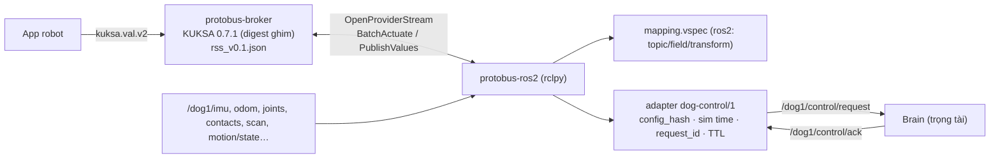

# ADR-0066: Protobus: stack độc lập gồm broker KUKSA (nạp RSS, không sửa) + provider ROS 2 theo overlay mapping khai báo + adapter từng robot, có luật an toàn bắt buộc

- **Status:** Proposed — chờ PO xác nhận
- **Date:** 2026-10-27
- **Level:** L0 System
- **Deciders:** PO; Claude Code (đề xuất)
- **Related:** ADR-0047 (`kuksa.val.v2`), ADR-0057 (sandbox/run slot), ADR-0060 (deploy, IO layers), ADR-0064, ADR-0065, ADR-0067; [design §5](../../docs/design/M22-robotics-extension.md#5-protobus-chi-tiết-adr-0066)

## Context
- **Yêu cầu PO.** Có một "protobus độc lập giống KUKSA của Velocitas", ánh xạ tín hiệu RSS sang ROS 2 để giao tiếp với robot.
- **Kiến trúc Velocitas.** App ↔ KUKSA databroker ↔ **provider** (CAN feeder, mock…). Provider claim actuator và publish giá trị sensor (`kuksa.val.v2` `OpenProviderStream`).
- **Robot dog (design §2.1):**
  - ROS 2 Humble, CycloneDDS unicast peer theo tên service, domain 42;
  - lệnh chỉ qua envelope JSON schema-1 `/dog1/control/request`: `config_hash`, `issued_at_ns` theo sim time, `request_id`, ack riêng;
  - Brain là trọng tài an toàn duy nhất; `manual` cần làm mới (tuổi ≤ 0,25 s, watchdog 0,2 s).
- **KUKSA 0.7.1** nạp được cây gốc `Robot` (`vss.rs`); đã ghim digest trong BASELINE. signal-gateway và runtime Python/C++/Rust/WASM đều đã nói `kuksa.val.v2`.

## Decision
1. **Thành phần** (module mới `modules/protobus`, tầng L5, compose profile `robot`):
   - **`protobus-broker`:**
     - image KUKSA databroker **đúng digest đã ghim trong BASELINE, không fork, không patch**, chạy `--vss /rss/rss_vX.Y.json`;
     - API cho app và signal-gateway: `kuksa.val.v2`;
     - port chỉ bind `127.0.0.1`.
   - **`protobus-ros2`:**
     - provider viết bằng Python (rclpy), image `FROM` **cùng digest ROS 2 của robot đích** (dog: `ros:humble-ros-base-jammy@sha256:566b87e6…`);
     - build kèm message tuỳ biến của robot (dog: `dog_interfaces` từ repo dog đúng SHA, Apache-2.0).
2. **Overlay mapping** (`modules/protobus/profiles/<robot>/mapping.vspec`): overlay vspec lên RSS với thuộc tính mở rộng `ros2`.
   - **Sensor:**
     - `topic`, `type`, `field` (đường dẫn trường), `qos` (`sensor_data` | `reliable` | `transient_local`), `maxRateHz`;
     - `transform` thuộc **danh sách đóng**: `identity`, `scale`, `offset`, `quaternion_to_roll|pitch|yaw`, `min_finite`, `sector_min`, `array_index`, `select`, `json`, `enum`, `count`, `bool_from`. Không có code tuỳ ý, không `eval`.
   - **Actuator:** `adapter` + `command` + `field` (+ `enum`, `refreshHz`, `ttlMs`).
   - **Không mapping:** leaf RSS không có mapping là **unmapped**. Provider công bố danh sách leaf được hỗ trợ (`capabilities.json`) để compiler/orchestrator kiểm trước khi build/run (ADR-0068).
3. **Adapter từng robot** là plugin Python có version (`dog-control/1`), đóng gói theo profile. Adapter dog **PHẢI**:
   - học `config_hash` từ telemetry JSON của robot, và đặt `Robot.Connection.IsHandshakeComplete=true` chỉ sau khi đã học;
   - đóng dấu `issued_at_ns` theo `/clock` của robot (`use_sim_time`);
   - sinh `request_id` UUID mỗi lệnh, chờ `control/ack` (timeout 1 s), rồi publish `LastResult.IsAccepted/Reason`;
   - ánh xạ giá trị `Request` qua bảng `enum` của mapping, từ chối giá trị không có trong bảng.
4. **Luật an toàn (PHẢI / KHÔNG ĐƯỢC).** Đề xuất đưa vào AGENTS §2 thành luật cứng 11 — chờ PO.
   1. Protobus **chỉ** dùng giao diện điều khiển cấp cao robot cho phép (dog: `control/request` qua Brain). **KHÔNG ĐƯỢC** publish `cmd_vel*`, LowCmd/torque, `motion/request`, `sim/request` hay gọi API motor.
   2. **Vận tốc có TTL.**
      - Target `Robot.Motion.Velocity.*` chỉ có hiệu lực `ttlMs` (mặc định 300 ms) kể từ lần Actuate cuối.
      - Còn hạn: adapter làm mới `manual` ở `refreshHz` (20 Hz).
      - Hết hạn hoặc app ngắt: gửi vận tốc 0 **một lần** rồi ngừng, để deadman của Brain dừng robot.
   3. **STOP** (`Robot.Safety.Command.Request=STOP`) luôn chuyển ngay, bỏ qua hàng đợi và TTL. STOP được phép kể cả khi app không giữ lease.
   4. **ARM** từ workflow chỉ khi profile `allowRemoteArm: true`. Mặc định SIM `true`, REAL `false`.
   5. **Lease:** mỗi robot một lease điều khiển, do orchestrator cấp cho đúng một run (giống run slot ADR-0057).
      - Actuate (trừ STOP) từ app không giữ lease bị từ chối. Ngoại lệ cần thêm: KUKSA không biết lease, nên lease áp ở provider qua token trong metadata của app — **kiểm ở spike S-R5**. Nếu không khả thi thì lease áp ở orchestrator: chỉ một run robot chạy trên một broker.
      - Lease hết hạn khi run dừng.
   6. Backend REAL **ngoài phạm vi** cho tới khi repo dog commissioning phần cứng (Phase 2 của repo dog) và có ADR riêng.
5. **Mạng và triển khai.**
   - `protobus-ros2` tham gia **external network** của stack robot (`SV_ROBOT_NETWORK`), dùng `ROS_DOMAIN_ID` và file CycloneDDS riêng có peer tới các service robot.
   - Không mount docker.sock. Không mở port DDS ra host.
   - Nếu robot cần biết peer `protobus-ros2` (multicast tắt) ⇒ thay đổi đó thuộc repo robot, ghi thành yêu cầu, không sửa repo robot từ đây.
6. **Quan sát:**
   - provider in log `SVTRACE`-tương thích cho mỗi lệnh (path, giá trị, request_id, accepted, reason, latency);
   - metrics: tần số publish thực, tuổi dữ liệu, số lệnh bị từ chối;
   - `Robot.Connection.IsOnline=false` khi telemetry quá `sensor_timeout` (dog 0,6 s).

## Diagram

## Alternatives considered
| Phương án | Ưu | Nhược | Vì sao loại |
|---|---|---|---|
| Viết broker riêng hoàn toàn (Rust/TS, proto riêng) | Lệnh có vòng đời "thật", lease/auth theo ý | Làm lại subscribe, actuator, auth, hiệu năng của KUKSA; mọi runtime phải có client mới | Tốn nhiều, rủi ro cao, không thêm giá trị cho v0.1. Giữ làm phương án nếu S-R1/S-R5 FAIL. |
| rosbridge (WebSocket JSON) làm protobus | Có sẵn | Không có RSS/kiểu/đơn vị; app phải biết topic ROS; an toàn khó kiểm | Không đạt mục tiêu chuẩn hoá |
| App gọi rclpy trực tiếp | Ít hop | App phụ thuộc distro/DDS; bỏ qua RSS; không parity | Trái ADR-0064 |
| Mapping bằng code Python tuỳ ý | Linh hoạt | Không kiểm được, có thể vượt luật an toàn | Danh sách transform đóng + adapter có review |
| Fork KUKSA thêm lease/RPC | Một tiến trình | Lệch upstream, phải tự vá bảo mật | Trái chính sách không sửa upstream (ADR-0003 tinh thần) |

## Consequences
- **Tích cực:**
  - mọi runtime hiện có (Python, C++/Rust WASM) nói được với robot;
  - Signals panel/Live/Flow dùng lại;
  - thêm robot mới = thêm profile mapping + adapter, không đổi app.
- **Tiêu cực:**
  - hai hop (app → broker → provider) thêm độ trễ, cần đo ở S-R5, mục tiêu p95 < 20 ms trong máy;
  - lease phải giải bằng cơ chế ngoài KUKSA;
  - phụ thuộc phiên bản ROS 2 của robot.
- **Ảnh hưởng module:** `protobus` (mới), velocitas-stack (không đổi), orchestrator (lease, run robot), contracts (schema `capabilities.json`, mapping overlay).

## Implementation
| Task | Module | Milestone |
|---|---|---|
| S-R1 broker nạp RSS; S-R3 DDS; S-R5 provider Python; S-R6 `dog_interfaces` | protobus | M22-T06, M23-T01..T03 |
| Engine mapping + transform đóng + test fixture JSON thật | protobus | M23-T04 |
| Adapter `dog-control/1` + S-R4 | protobus | M23-T05 |
| Luật an toàn (TTL, STOP, allowRemoteArm, lease) + fault test | protobus, orchestrator | M23-T06, M25-T05 |
| Compose profile `robot`, network ngoài, healthcheck | protobus, meta | M23-T07 |

## Verification
- **Live trên dog sim:**
  - đọc ≥ 20 leaf RSS khớp topic gốc (sai số theo transform);
  - `ARM` ⇒ Mode MANUAL;
  - Velocity 0,3 m/s ⇒ robot đi; ngừng Actuate ⇒ robot dừng ≤ 0,5 s;
  - `Named.Request=BOW` ⇒ Phase SUCCEEDED;
  - STOP giữa động tác ⇒ Mode SAFE_STOP.
- **Fault test:** robot tắt, `config_hash` sai, ack timeout, broker restart, provider restart ⇒ không có lệnh "ma", `IsOnline=false`.
- **Kiểm tĩnh:** test khẳng định provider không tạo publisher nào ngoài allowlist (`control/request` + topic đọc).

## Notes / Deviations
—
