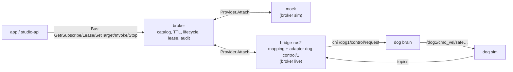

# ADR-0066: Protobus là bus tín hiệu tự viết theo RSS (giao thức `protobus.v1`), gồm broker, bridge ROS 2 theo mapping profile + adapter robot, và provider mock; luật an toàn bắt buộc

Implementation clarification 2026-10-30: Subscribe remains on-change, as decided
below. A constant healthy mode/battery value need not emit each new capture.
Consumers requiring current capture metadata/freshness must refresh with Get
and honor explicit quality/clock/epoch; they must not infer frozen transport
from the absence of value-change events or compare ROS time to host monotonic.
M24 soak counts unique captures from Get while maintaining four on-change
subscriptions. This clarifies existing semantics; no wire/version change.

- **Status:** Accepted — PO authorized implementation 2026-10-29; acceptance gates remain open
- **Date:** 2026-10-27, viết lại 2026-10-28
- **Level:** L0 System
- **Deciders:** PO; Claude Code (đề xuất)
- **Related:** ADR-0064, ADR-0065, ADR-0067; [design §5](../../docs/design/M22-robotics-extension.md#5-protobus-adr-0066)

## Context
- **Yêu cầu PO.** Một "protobus độc lập tương tự như KUKSA" ánh xạ tín hiệu RSS sang ROS 2.
- **Đính chính 2026-10-28.** Không được dùng KUKSA, chỉ tham khảo vai trò. Bản đầu dùng KUKSA databroker 0.7.1 và `kuksa.val.v2`; bản này thay toàn bộ.
- **Robot dog** (design §2.1, `9adea9be`):
  - lệnh chỉ đi qua `/dog1/control/request` (JSON schema-1, `config_hash`, `issued_at_ns` sim time, `request_id`), Brain là trọng tài;
  - `manual` cần làm mới ≤ 0,25 s;
  - ACK chỉ là đã nhận, kết quả ở `motion/state`;
  - DDS: CycloneDDS, multicast tắt, peer cố định theo tên service, network compose `robot`.
- **Robot cần thứ mà bus kiểu "kho giá trị" không có sẵn:**
  - **setpoint hết hạn:** mất làm mới ⇒ dừng;
  - **lệnh có vòng đời và timeout;**
  - **một người điều khiển tại một lúc** (lease);
  - **STOP ưu tiên tuyệt đối.**

  Tự viết thì đặt được các bất biến này ngay trong broker, không phụ thuộc app tự giác.

## Decision
1. **Giao thức `protobus.v1`** (gRPC + protobuf, `robotics/contracts/protobus/v1/protobus.proto`):
   - `service Bus`:
     - `Describe`, `Get`, `Subscribe` (on-change, `minIntervalMs`);
     - `AcquireLease` / `RenewLease` / `ReleaseLease`;
     - `SetTarget`, `Invoke` (stream `CommandUpdate`), `Cancel`;
     - `Stop` (không cần lease).
   - `service Provider`: `Attach` stream hai chiều.
     - Provider gửi `Hello{providerId, profileId, catalogHash, claims}`, `Samples` theo lô, `CommandUpdate`.
     - Broker gửi `SetTargetDispatch`, `InvokeDispatch`, `CancelDispatch`, `StopDispatch`, `SafeValueDispatch`.
   - **Giá trị và thời gian:**
     - giá trị kiểu `oneof` theo kiểu RSS; struct cho setpoint;
     - mỗi sample có `sourceTimeNs`, `brokerTimeNs`, `quality` (OK/STALE/NONE).
   - **Lỗi:** mã `PB_*` công khai, chỉ thêm, trong `diagnostics.v1.json`.
2. **Broker** (`robotics/protobus/broker`, Python 3.12 asyncio + `grpcio`), mỗi broker phục vụ **một robot**. Broker **PHẢI**:
   1. nạp `rss-catalog.json`; kiểm path/kind/kiểu/khoảng/enum của mọi ghi;
   2. từ chối provider hoặc app có `catalogHash` khác (`PB_CATALOG_MISMATCH`);
   3. đánh dấu `STALE` khi sensor quá `maxAgeMs`;
   4. setpoint hết `ttlMs` mà không làm mới ⇒ gửi `SafeValueDispatch` một lần;
   5. giữ state machine vòng đời lệnh (ADR-0065 §2) và timeout: `TIMED_OUT` ⇒ `CancelDispatch`;
   6. **một lease** mỗi robot. Lease hết hạn hoặc client mất kết nối ⇒ safeValue mọi setpoint + Cancel mọi lệnh của lease;
   7. `Stop` đi thẳng tới provider trước mọi hàng đợi, kể cả khi không có lease;
   8. provider offline ⇒ lệnh mới `REJECTED(PROVIDER_OFFLINE)`, `Robot.Connection.IsOnline=false`;
   9. ghi audit JSONL mọi SetTarget/Invoke/Cancel/Stop/lease;
   10. không lưu trạng thái ra đĩa: khởi động lại ⇒ trạng thái rỗng, mọi lease mất.
3. **Hiệu năng:**
   - mục tiêu ≥ 5 000 sample/s vào, 4 subscriber, p95 trễ trong broker < 5 ms, 30 phút ổn định (spike S-R4);
   - không đạt ⇒ ADR mới viết lại broker bằng Rust **cùng `.proto`**.
4. **Bridge ROS 2** (`robotics/protobus/bridge-ros2`):
   - rclpy, image `FROM ros:humble-ros-base-jammy@sha256:566b87e6…` (cùng digest robot), build `dog_interfaces` từ repo dog đúng SHA (Apache-2.0, NOTICE);
   - kết nối broker live làm provider.
   - **Mapping profile** `robotics/protobus/profiles/<id>/mapping.yaml`, schema `mapping.v1`:
     - `sensors`: topic, type, field/json, transform, qos, `maxRateHz`;
     - `setpoints`: command, ánh xạ field;
     - `commands`: command, ánh xạ args, nguồn kết quả;
     - khối `ros` (domainId, namespace, useSimTime).
   - **Transform** là danh sách đóng, tất định, không chạy code tuỳ ý: `identity`, `scale`, `offset`, `quaternion_to_roll|pitch|yaw`, `min_finite`, `sector_min`, `array_index`, `select`, `json`, `enum`, `count`, `compare`.
   - **Adapter có version** cho phần riêng robot. `dog-control/1`:
     - học `config_hash` từ `brain/state`;
     - `issued_at_ns` theo `/clock`;
     - `request_id` UUID, đối chiếu `control/ack`;
     - làm mới `manual` 20 Hz trong hạn TTL;
     - ánh xạ phase `motion/state`/`mission` về vòng đời chuẩn.
   - Mạng: vào external network `robot` của dog (`SR_ROBOT_NETWORK`), CycloneDDS cấu hình theo kết luận spike S-R1.
5. **Provider mock** (`robotics/protobus/mock`), Python thuần:
   - cùng giao thức Provider;
   - động học unicycle + pin;
   - profile vòng đời lệnh khai báo (điều kiện nhận, thời lượng phase lấy từ số đo dog thật S-R3);
   - API kịch bản (đặt sensor theo mốc thời gian, ép REJECTED/FAILED);
   - `timeScale`.

   Simulate/Test/CI dùng mock trên **broker sim riêng**, không bao giờ nối robot.
6. **Luật an toàn (PHẢI):**
   1. Bridge chỉ được publish `control/request` (allowlist). **KHÔNG ĐƯỢC** publish `cmd_vel*`, LowCmd, `motion/request`, `sim/request`. Có test tĩnh.
   2. Hết TTL ⇒ safeValue (vận tốc 0).
   3. `Stop` ưu tiên tuyệt đối.
   4. `Arm` từ app chỉ khi profile `allowRemoteArm: true`. SIM mặc định true (**chờ PO**), REAL luôn false.
   5. Một lease mỗi robot.
   6. Backend REAL ngoài phạm vi v0.1.
7. **CLI `pbctl`** để thao tác tay: get/subscribe/stop/invoke/lease. Dùng cho spike, debug, fault test.
8. **Triển khai:**
   - service `protobus-sim` + `protobus-mock`, và `protobus-live` + `protobus-ros2` (compose profile `live`) trong compose `sr`;
   - port chỉ bind 127.0.0.1, không docker.sock, healthcheck mỗi service.

## Diagram

## Alternatives considered
| Phương án | Ưu | Nhược | Vì sao loại |
|---|---|---|---|
| KUKSA databroker + provider (bản 2026-10-27) | Có sẵn, đã ghim | PO yêu cầu độc lập; không có lease/TTL/lifecycle trong broker | PO bác |
| Zenoh / MQTT làm bus | Nhanh, phổ biến | Không có kiểu RSS, TTL, lease, lifecycle; vẫn phải viết hết logic | Chỉ còn là transport, không giảm việc chính |
| rosbridge (WebSocket JSON) cho app | Có sẵn | App phụ thuộc topic/ROS; mất RSS; an toàn kém | Trái mục tiêu RSS path |
| App gọi rclpy trực tiếp | Không cần bus | Bỏ qua lớp an toàn, app gắn chặt robot | Loại |
| Broker viết bằng Rust ngay | Nhanh | Chậm ra bản đầu; PO muốn dễ trước | Chỉ làm nếu S-R4 FAIL |

## Consequences
- **Tích cực:**
  - an toàn nằm ở broker, không phụ thuộc app;
  - Simulate và Run dùng cùng app, chỉ khác provider;
  - thêm robot = mapping profile + adapter.
- **Tiêu cực:**
  - tự duy trì broker, proto, bridge;
  - Python có thể giới hạn tần số (RR4);
  - mock không mô phỏng vật lý.
- **Module:** `robotics/protobus`, `robotics/contracts`.

## Implementation
| Task | Module | Milestone |
|---|---|---|
| Spike S-R1 DDS, S-R2 `dog_interfaces`, S-R3 envelope | protobus (spike) | M22-T07 |
| `protobus.v1.proto`, `mapping.v1`, mã `PB_*` | contracts | M23-T01 |
| Spike S-R4 hiệu năng | protobus | M23-T02 |
| Broker: store/subscribe/validate/stale | protobus | M23-T03 |
| Lease + TTL + safeValue | protobus | M23-T04 |
| Lifecycle + Stop + audit | protobus | M23-T05 |
| Provider mock + API kịch bản | protobus | M23-T06 |
| `pbctl` + compose `protobus-sim` + fault test | protobus | M23-T07, T08 |
| Image Humble + `dog_interfaces` | protobus | M24-T01 |
| Engine mapping + transform | protobus | M24-T02 |
| Adapter `dog-control/1` | protobus | M24-T03 |
| Luật an toàn + allowlist | protobus | M24-T04 |
| Compose `live` + external network | protobus | M24-T05 |
| Gate live dog sim | all | M24-T06 |

## Verification
- **Unit/fault test** cho từng bất biến §2:
  - sai kiểu;
  - `catalogHash` lệch;
  - stale;
  - TTL;
  - timeout;
  - mất lease;
  - Stop khi hàng đợi đầy;
  - provider offline;
  - broker restart.
- **Perf S-R4** đạt ngưỡng §3.
- **Live trên dog sim** (M24 gate):
  - ≥ 20 sensor khớp topic gốc theo sai số transform;
  - Arm ⇒ Mode MANUAL;
  - Velocity 0,3 m/s ⇒ robot đi; ngừng làm mới ⇒ dừng ≤ 0,5 s (đo ở `/dog1/cmd_vel/safe`);
  - Perform BOW / LIFT_FRONT_LEFT / JUMP ⇒ SUCCEEDED;
  - Stop giữa động tác ⇒ dừng;
  - 30 phút không rò bộ nhớ.
- Test tĩnh: bridge không tạo publisher nào ngoài allowlist.

## Notes / Deviations
- 2026-10-28: viết lại. Bản 2026-10-27 dùng KUKSA databroker 0.7.1 (`kuksa.val.v2`, overlay vspec thuộc tính `ros2`); đã bỏ theo ADR-0064. Dữ kiện KUKSA trong `00-research-findings.md` §6b đánh dấu "không dùng".

## Integration authorization 2026-10-29

The user authorized implementation across simvehicleapp and dog-ros2-simulation, sequential gates, complex workflow deployment, launch from Robot Zoo, actual ROS/simulation evidence and final E2E video. ADR-0069 defines the required review corrections and takes precedence over conflicting details above. This is architecture authorization, not runtime acceptance.
