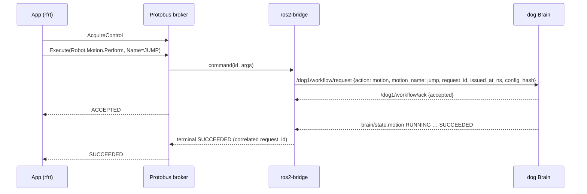

# ADR-0066: Protobus — broker tín hiệu RSS độc lập (gRPC `protobus.v1`) với provider ROS 2 bridge theo mapping khai báo

- **Status:** Accepted — PO cho phép thực hiện theo tài liệu này ngày 2026-11-01
- **Date:** 2026-11-01
- **Level:** L1 Subsystem
- **Deciders:** PO; Claude Code (đề xuất)
- **Related:** ADR-0064, ADR-0065, ADR-0069, ADR-0070; [protobus.md](../../docs/design/robotics/protobus.md); dog ADR-0019 (kênh `workflow/request`)

## Context

- **Yêu cầu R3:**
  - Protobus độc lập, vai trò như KUKSA Databroker của Velocitas;
  - mapping tín hiệu RSS sang ROS 2 để giao tiếp với robot qua ROS 2.
- **Robot dog (đọc code 2026-11-01):**
  - **Lệnh:** đi qua JSON schema-1 trên `std_msgs/String`, gồm `request_id`, `issued_at_ns` theo đồng hồ sim ROS, và `config_hash`.
  - **Brain từ chối request cũ:** quá 1 s, riêng `manual` quá 0,25 s.
  - **Watchdog manual 0,2 s.**
  - **Một publisher cho `control/request`:** chỉ `/dog_gateway` được publish vào topic này.
  - **CycloneDDS unicast:** peers cố định, `AllowMulticast=false`.
  - **Kết quả động tác** chỉ đáng tin từ `motion/state` hoặc `brain/state.motion`, không từ ACK.

## Decision

1. **Broker riêng `protobus-broker`.**
   - Python 3.12 asyncio + grpcio.
   - Proto riêng `protobus.v1` với các service:
     - `Broker`: `GetCatalog`, `Get`, `Subscribe`, `AcquireControl/Renew/Release`, `SetSetpoint`, `Execute`, `Cancel`;
     - `SafetyLane`: `Stop`, `StopState`, chạy trên listener và thread pool riêng;
     - `Provider.Attach`.
2. **Ngữ nghĩa bắt buộc:**
   - **Setpoint:**
     - cần lease điều khiển;
     - broker tự ghi `safeValue` khi hết `ttlMs`;
     - mất lease thì về an toàn ngay.
   - **Command:**
     - terminal `SUCCEEDED/FAILED/REJECTED/CANCELLED/TIMED_OUT`;
     - provider chứng minh kết quả từ trạng thái vật lý;
     - mất provider ⇒ `FAILED` + yêu cầu Stop.
   - **Sensor:** quá `maxAgeMs` ⇒ `STALE`; broker không bịa giá trị.
   - **Subscribe:** giới hạn tần số theo subscriber, latest-wins; subscriber chậm bị đánh dấu `lagged`.
3. **Provider.**
   - Mỗi path có đúng một provider chủ.
   - v0.1 có hai provider:
     - `protobus-mock`: động học đơn giản + API scenario;
     - `protobus-ros2`: rclpy trên ROS 2 Humble, cùng distro với dog.
4. **Mapping khai báo `mapping.v1` theo profile.**
   - Bridge không chứa logic riêng cho robot, chỉ thực thi mapping + tập transform đóng.
   - Thêm transform = đổi contract + ADR.
5. **Kênh ROS 2 với dog:**
   - telemetry đọc các topic trong [protobus.md §4.2](../../docs/design/robotics/protobus.md);
   - lệnh và setpoint publish lên `/dog1/workflow/request`, nhận `/dog1/workflow/ack` (dog ADR-0019);
   - **KHÔNG ĐƯỢC** publish `control/request`, `cmd_vel*`, `motion/request`, `unitree/*` hay lệnh motor;
   - `issued_at_ns` lấy từ `/clock`;
   - `config_hash` học từ JSON của dog, sai ⇒ từ chối gửi.
6. **Downsample tại bridge** theo `maxRateHz` của mapping. Subscription ROS lười: không ai cần path ⇒ không giải mã topic.
7. **Mã lỗi `PB1xxx`** công khai, chỉ thêm.

## Diagram

## Alternatives considered

| Phương án | Ưu | Nhược | Vì sao loại |
|---|---|---|---|
| KUKSA Databroker | Có sẵn, Rust nhanh | Trái R3 ("độc lập"); không có setpoint TTL/command lifecycle/lease; mô hình VSS | PO bác |
| Zenoh / MQTT làm broker | Nhẹ, có sẵn | Không có kiểu RSS, lease, TTL, làn Stop; vẫn phải tự viết lớp ngữ nghĩa | Lớp ngữ nghĩa mới là phần chính |
| App gọi rclpy trực tiếp (không broker) | Ít thành phần | App khoá vào ROS; không có mock; không có điểm Stop độc lập | Trái R3 |
| Viết broker bằng Rust ngay | Hiệu năng cao | Toolchain nặng, chậm vòng lặp | Chỉ làm nếu spike S-R2 FAIL (ADR mới) |

## Consequences

- **Tích cực:**
  - app robot không biết ROS;
  - chạy được trên mock không cần ROS;
  - Stop có đường riêng;
  - thêm robot bằng profile + mapping.
- **Tiêu cực:**
  - thêm một hop (app → broker → bridge → ROS), phải đo trễ;
  - Python có giới hạn throughput, nên mới cần S-R2 và downsample.
- **Ảnh hưởng module:** `robotics/protobus/*`, `robotics/contracts`. Repo dog cần kênh `workflow/request` (W1).

## Implementation

| Task | Module | Milestone |
|---|---|---|
| Proto `protobus.v1` + catalog lỗi `PB*` | robotics/contracts | M23-T01 |
| Broker: store, subscribe, lease, TTL, command, SafetyLane, audit | robotics/protobus | M23-T02…T05 |
| Provider mock + scenario API | robotics/protobus | M23-T06 |
| `pbctl` CLI chẩn đoán | robotics/protobus | M23-T07 |
| Bridge ROS 2 + mapping `dog-go2-sim` | robotics/protobus | M24 |

## Verification

- **M23:**
  - TTL → safeValue (đo deadline), lease mất → safe;
  - command lifecycle đủ terminal;
  - Stop p99 < 50 ms khi broker bão hoà telemetry;
  - subscriber chậm không làm chậm broker;
  - benchmark S-R2 đạt ADR-0070.
- **M24, trên dog sim thật:**
  - ≥ 30 path so khớp giá trị ROS;
  - Arm → Velocity → Stop; JUMP + LIFT_FRONT_LEFT SUCCEEDED vật lý;
  - request cũ bị Brain từ chối;
  - giết bridge ⇒ robot dừng do watchdog;
  - soak 30 phút.

## Notes / Deviations

- 2026-11-01 (M22 S-R1): bridge ngoài compose dog nhận odom 50,04 Hz qua CycloneDDS unicast với peer list riêng; không cần sửa peer phía dog cho node đang chạy (kiểm lại chiều writer→Brain ở M24).
- 2026-11-01 (M22 S-R2): broker Python asyncio + grpcio 1.84.1, 1 CPU: p95 2,43 ms, 0,198 core, 41,8 MiB ⇒ giữ Python. Làn Stop: service `SafetyLane` riêng; provider giữ stream `AttachProvider` riêng để lệnh dừng không đi qua `Provider.Attach`.
- 2026-11-01 (M23): **SafetyLane chuyển sang server gRPC đồng bộ** (thread pool riêng) — `grpc.aio` trên loop thứ hai vẫn phụ thuộc loop chính (treo khi loop chính bị chặn). Stop dưới tải container p99 15,5 ms. Lease: mọi lần dùng hợp lệ gia hạn; client phải renew (TTL 1 s). Lease hết ⇒ command `CANCELLED PB1406` ngay, robot nhận cancel bất đồng bộ. `Events` RPC chưa dùng ở v0.1 (UNIMPLEMENTED); sự kiện đi dưới dạng sample.
