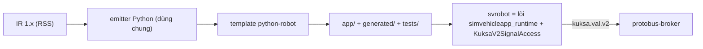

# ADR-0067: Target robot đầu tiên là Python (`python-robot`, runtime `svrobot` không Velocitas); C++/Rust đi sau qua target WASM rồi native

- **Status:** Proposed — chờ PO xác nhận
- **Date:** 2026-10-27
- **Level:** L1 Subsystem
- **Deciders:** PO; Claude Code (đề xuất)
- **Related:** ADR-0020 (backend plugin), ADR-0040 (Python), ADR-0047 (`kuksa.val.v2`), ADR-0061 (WASM), ADR-0064, ADR-0066; [design §6](../../docs/design/M22-robotics-extension.md#6-compiler-ir-và-target-adr-0064-0067)

## Context
- **Yêu cầu PO.** "Tạo một trình biên dịch riêng, ngôn ngữ nào cũng được, ngôn ngữ nào dễ trước, mục đích là tạo thêm một runtime để kết nối robotic."
- **Dữ kiện source (design §2.2):**
  - Runtime Python `simvehicleapp_runtime` có lõi `runtime.py` (1 306 dòng), `strand.py`, `values.py` **không import Velocitas**. Lõi giao tiếp qua port `VehicleAccess`/`PubSub`/trace sink. Velocitas chỉ nằm trong `velocitas.py` (adapter + `SimVehicleApp(VehicleApp)`).
  - Đã có client `kuksa_v2` (pb2) trong runtime.
  - Target WASM (`cpp-wasm`, `rust-wasm`) chạy trên `sv-wasm-host`, nói thẳng `kuksa.val.v2`, allowlist path theo `sv-app.json`.
- **Bối cảnh robot.** Hệ sinh thái ROS dùng Python nhiều (repo dog là Python/rclpy). Người dùng robot đọc code Python dễ.

So sánh ngôn ngữ cho target robot đầu tiên:

| Tiêu chí | Python | C++ native | Rust native | C++/Rust WASM |
|---|---|---|---|---|
| Code mới cần viết | adapter + template (nhỏ) | runtime không-Velocitas + CMake/Conan template (lớn) | tương tự C++ | gần như 0 (config host) |
| Thời gian build | 0 (không biên dịch) | phút (Conan) | phút | giây–phút |
| Đọc/sửa code sinh ra | dễ nhất | trung bình | khó với người mới | khó (guest) |
| Parity đã có | 7/7 (M12) | 7/7 | 7/7 | 7/7 ×2 (M20) |
| Phù hợp robot/ROS | cao | cao | trung bình | trung bình |

## Decision
1. **Target đầu tiên: `python-robot`.**
   - Do module `compiler-code-python` phục vụ: service `codegen-python-robot`, cùng emitter IR→Python, backend id `python-robot`.
   - `backend.yaml` khai báo `signalSpec: [RSS]` và opcode hỗ trợ (giống `python`).
2. **Runtime `svrobot`:**
   - gói Python thuần, gồm lõi `simvehicleapp_runtime` (dùng chung, không fork) + adapter `KuksaV2SignalAccess` không kế thừa Velocitas + `MqttPubSub` (paho, tuỳ chọn) + entrypoint `python -m app`;
   - đọc `SV_SIGNAL_BROKER_ADDRESS` (mặc định `protobus-broker:55555`), `SV_LEASE_TOKEN` (ADR-0066 §4.5).
3. **Template project robot:**
   - Python thuần: `pyproject.toml`, `app/`, `app/generated/`, `tests/`, `Dockerfile` `FROM python:3.12-slim@sha256:<ghim ở M25-T01>`;
   - **không** có `.velocitas.json`/AppManifest (luật cứng 6 không áp vì không có Velocitas);
   - test sinh ra chạy bằng pytest như M12.
4. **Toolchain/run:**
   - dùng `toolchain-python` hiện có để chạy test và app. Nếu image đó kéo Velocitas không cần thiết thì tách image `toolchain-python-robot` nhẹ — quyết ở M25-T01 theo số đo;
   - run app robot trong sandbox (ADR-0057) nối `protobus-broker` thay databroker xe.
5. **Sau Python:**
   - (a) xác nhận `cpp-wasm`/`rust-wasm` chạy với protobus chỉ bằng cấu hình host (M25-T07, mục tiêu phụ);
   - (b) target native `cpp-robot`/`rust-robot` chỉ khi có nhu cầu đo được (hiệu năng, triển khai trên Jetson) — ADR riêng.
6. **Không sinh node ROS 2.** App robot không import rclpy (ADR-0064 §4).

## Diagram

## Alternatives considered
| Phương án | Ưu | Nhược | Vì sao loại |
|---|---|---|---|
| C++ native trước | Hiệu năng, gần ROS C++ | Phải viết runtime không-Velocitas + build template; build chậm | Không phải "dễ trước" |
| Chỉ dùng WASM (không Python) | Gần như không code | Code guest khó đọc/debug cho người làm robot | Giữ làm đường thứ hai, không làm đường chính |
| Python qua Velocitas SDK | Có sẵn | Velocitas gắn khái niệm "vehicle", kéo SDK v1, nặng | Không cần cho robot |
| Ngôn ngữ mới (Go/TS) | — | Thêm emitter + runtime + parity từ đầu | Tốn nhiều nhất |

## Consequences
- **Tích cực:**
  - target robot nhỏ nhất có thể; parity Python đã có nền;
  - cùng emitter nên sửa một chỗ có lợi cho cả xe lẫn robot.
- **Tiêu cực:**
  - hiệu năng Python giới hạn tần số vòng điều khiển, nhưng app chỉ ra lệnh cấp cao ≤ 20 Hz và an toàn nằm ở Brain;
  - thêm một backend id phải giữ trong ma trận test.
- **Ảnh hưởng module:** compiler-code-python (target, template, runtime adapter), orchestrator (backend id, run nối protobus), velocitas-stack (có thể thêm image `toolchain-python-robot`), contracts (`backend-capabilities` thêm `signalSpec`).

## Implementation
| Task | Module | Milestone |
|---|---|---|
| Ghim image Python, quyết toolchain image | compiler-code-python, velocitas-stack | M25-T01 |
| Adapter `KuksaV2SignalAccess` + test với broker thật | compiler-code-python | M25-T02 |
| Template + target `python-robot` + golden RW-A..RW-D | compiler-code-python | M25-T03 |
| Orchestrator: backend id, run robot, lease | orchestrator | M25-T04, T05 |
| Parity simulator ↔ app (protobus + provider mock) | contracts/tests | M25-T06 |
| Kiểm WASM với protobus (phụ) | wasm-host | M25-T07 |

## Verification
- Golden Python robot tất định ×2.
- Parity RW-A..RW-D: trace simulator ≡ app trên protobus với provider mock (cùng kịch bản), lệch thời gian ≤ 3 ms như M12.
- `@live` RW-A..RW-D trên dog sim.

## Notes / Deviations
—
