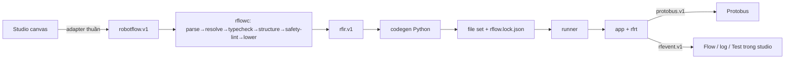

# ADR-0067: RobotFlow — compiler riêng viết bằng Python, sinh app Python chạy trên runtime `rfrt`; không dùng compiler/IR xe

- **Status:** Proposed — chờ PO xác nhận
- **Date:** 2026-11-01
- **Level:** L1 Subsystem
- **Deciders:** PO; Claude Code (đề xuất)
- **Related:** ADR-0064, ADR-0065, ADR-0066, ADR-0068; [robotflow.md](../../docs/design/robotics/robotflow.md); ADR-0062 (mô hình Flow xe, chỉ tham khảo)

## Context

- **Yêu cầu R1:**
  - "trình biên dịch riêng, ngôn ngữ nào cũng được, ngôn ngữ nào dễ trước";
  - runtime để kết nối robot;
  - workflow kéo thả có log và kịch bản.
- **Compiler xe (`simvehicleapp-core`, TypeScript) không dùng được:** sinh app Velocitas trên VSS/KUKSA, trái ADR-0064 §2.
- **Workflow robot có nhu cầu riêng:**
  - lệnh có kết quả vật lý;
  - setpoint làm mới 20 Hz;
  - điều kiện có độ tươi;
  - an toàn (Arm, xử lý thất bại).

## Decision

1. **Ngôn ngữ v0.1: Python 3.12** cho compiler `rflowc`, runtime `rfrt` và app sinh ra.
   - C++/Rust là backlog. Mở bằng ADR mới khi có nhu cầu hiệu năng đo được.
2. **Định dạng nguồn `robotflow.v1`.**
   - Node giữ id block của studio; cạnh `(node, port) → (node, port)`; biến có kiểu.
   - Không có vị trí UI trong nguồn.
3. **Block registry `block.v1`** (YAML trong `robotics/robotflow/blocks/`):
   - là nguồn duy nhất cho compiler, palette studio (qua snapshot + parity) và tài liệu;
   - v0.1 gồm khoảng 25 block, liệt kê ở [robotflow.md §3](../../docs/design/robotics/robotflow.md).
4. **Compiler** chạy 7 stage: parse → resolve → typecheck → structure → safety-lint → lower (`rfir.v1`) → codegen.
   - Diagnostics `RF1xxx`–`RF6xxx`, trỏ `nodeId` + `prop`; mã công khai chỉ thêm.
   - Biểu thức: parser Pratt tự viết, kiểm đơn vị, **không `eval`**.
   - Đầu ra là file set + `rflow.lock.json`; compiler **không ghi đĩa, không chạy code**.
   - **Tất định:** cùng input ⇒ cùng bytes.
5. **Runtime `rfrt`** (wheel):
   - asyncio, mỗi trigger là một behavior, chính sách kích hoạt lại `queue/drop/restart`;
   - client Protobus: lease, setpoint timer 20 Hz;
   - trace JSON lines `rfevent.v1` cho Flow, log, kiểm toán;
   - kiểm hash khi khởi động; giới hạn RAM/log.
6. **Kịch bản:**
   - `scenario.v1` (timeline đặt giá trị + kỳ vọng log/tín hiệu/lệnh) chạy trên provider mock, thời gian thực;
   - không tiêm giá trị giả vào ROS.
7. **Không LLM trong đường sinh code** (luật cứng 1). Trợ lý chỉ đề xuất WorkflowPatch.

## Diagram

## Alternatives considered

| Phương án | Ưu | Nhược | Vì sao loại |
|---|---|---|---|
| Mở rộng compiler xe (TS) cho RSS | Dùng lại IR/lint | Trái ADR-0064; ghép chặt hai miền | PO yêu cầu compiler riêng |
| Thông dịch graph trực tiếp (không codegen) | Nhanh làm | Không có artifact bất biến để deploy/kiểm toán; khó export | R1 yêu cầu "trình biên dịch" |
| Sinh C++ trước | Nhanh hơn khi chạy | Toolchain nặng, build chậm trên máy yếu | "dễ trước" + ADR-0070 |
| Compiler TS chạy trong browser | Lint tức thì | Hai nơi định nghĩa ngữ nghĩa; vi phạm "không chạy hành vi robot trong browser" | Lint qua HTTP đủ nhanh (p95 < 400 ms) |

## Consequences

- **Tích cực:**
  - một toolchain Python cho robotics;
  - artifact bất biến, export được;
  - code sinh ra đọc được.
- **Tiêu cực:**
  - Python không hợp với vòng điều khiển nhanh. Không sao, vì vòng điều khiển thật nằm trong Brain/sim của dog; app chỉ ra quyết định ≤ 20 Hz.
- **Ảnh hưởng module:** `robotics/robotflow`, `robotics/rfrt`, `robotics/contracts`.

## Implementation

| Task | Module | Milestone |
|---|---|---|
| Schema `robotflow.v1`, `block.v1`, `rfir.v1`, `rfevent.v1`, `scenario.v1`, `rflow-lock.v1`, catalog `RF*` | robotics/contracts | M25-T01 |
| Registry + 25 block | robotics/robotflow | M25-T02 |
| Biểu thức + đơn vị | robotics/robotflow | M25-T03 |
| Stage compiler + IR | robotics/robotflow | M25-T04 |
| Codegen Python + lock | robotics/robotflow | M25-T05 |
| Runtime `rfrt` | robotics/rfrt | M25-T06 |
| Scenario runner trên mock + conformance RW-A…F | robotics/robotflow, rfrt | M25-T07 |
| HTTP service `/lint` `/build` `/blocks` `/rss/catalog` | robotics/robotflow | M25-T08 |

## Verification

- Golden IR + golden code cho RW-A…F; build ×2 bytes giống nhau.
- Ca lỗi cho từng mã `RF*`.
- Conformance chạy hai lần liên tiếp trên mock, tất cả PASS.
- Runtime từ chối artifact bị sửa một byte.

## Notes / Deviations
