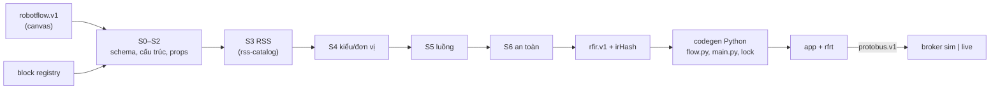

# ADR-0067: RobotFlow: workflow `robotflow.v1`, block registry, IR `rfir.v1`, compiler `rflowc` và runtime `rfrt` viết mới bằng Python; app đầu tiên sinh ra Python

- **Status:** Accepted — PO authorized implementation 2026-10-29; acceptance gates remain open
- **Date:** 2026-10-27, viết lại 2026-10-28
- **Level:** L1 Subsystem
- **Deciders:** PO; Claude Code (đề xuất)
- **Related:** ADR-0064, ADR-0065, ADR-0066, ADR-0068; [design §6](../../docs/design/M22-robotics-extension.md#6-robotflow-ngôn-ngữ-compiler-runtime-adr-0067)

## Context
- **Yêu cầu PO.** "Tạo một trình biên dịch riêng, ngôn ngữ nào cũng được, ngôn ngữ nào dễ trước… thêm một runtime để kết nối robotic… workflow kéo thả, có log, có kịch bản."
- **Đính chính 2026-10-28.** Không dùng lại compiler/IR/simulator/runtime của stack xe (ADR-0064). Bản đầu dùng compiler core + target `python-robot` + runtime `simvehicleapp_runtime`; bản này thay toàn bộ.
- **Workflow robot có đặc thù riêng:**
  - phần lớn thời gian là **chờ**: chờ điều kiện, chờ lệnh xong, chờ timeout;
  - nhiều nhánh chạy song song, ví dụ tuần tra song song canh vật cản;
  - mọi lệnh có kết quả nhiều nhánh: xong / thất bại / bị từ chối / quá giờ.

  ⇒ Mô hình "behavior bất đồng bộ + lệnh có vòng đời" hợp hơn mô hình dataflow thuần.

## Decision
1. **Ngôn ngữ "dễ trước": Python 3.12** cho compiler, runtime và app sinh ra.
   - Lý do: `asyncio` có sẵn cho chờ/timeout/song song, không cần bước build, cùng ngôn ngữ với bridge ROS 2, viết parser và type check nhanh (bảng so sánh ở design §6.1).
   - Backend thứ hai (C++ hoặc Rust) để sau v0.1: một emitter + một runtime nói `protobus.v1`. IR và block giữ nguyên.
2. **Định dạng workflow `robotflow.v1`** (JSON):
   - `rss{version, catalogHash}`, `profile`, `vars`, `nodes[{id, block, v, props, ui}]`, `edges[{from:[node,port], to:[node,port]}]`;
   - `ui` (toạ độ canvas) không vào IR, không vào hash.
3. **Block registry** `robotics/robotflow/blocks/<id>.block.yaml`, schema `block.v1`. Đây là **nguồn duy nhất** cho compiler và palette của studio.
   - Mỗi block có: `id` (`rf.*`), `version`, `category`, tiêu đề vi/en, cổng vào/ra, props có kiểu, `semantics`, quy tắc lowering, `migrations`.
   - Bộ v0.1 gồm khoảng 25 block, liệt kê ở design §6.3.
   - Mọi block ra lệnh robot **PHẢI** có timeout và đủ cổng kết quả.
4. **Biểu thức:**
   - ngữ pháp riêng: literal có đơn vị, path RSS, biến, số học, so sánh, logic, `abs/min/max/clamp`;
   - parser Pratt viết tay; kiểm kiểu và chiều đơn vị theo `units.yaml`;
   - **không `eval`**.
5. **Compiler `rflowc`** (`robotics/robotflow/compiler`):
   - Stage S0–S6 (design §6.5): schema → cấu trúc → props/migration → RSS → kiểu/đơn vị → luồng → an toàn.
   - Mode `lint` (S0–S4 + một phần S5) và `build`.
   - Hàm thuần: I/O duy nhất là catalog RSS và block registry, inject được trong test.
   - Trả **file set**, không ghi đĩa.
6. **IR `rfir.v1`:**
   - behaviors `{id, trigger, concurrency: queue|drop|restart, body}`;
   - trigger: `start`, `change(path)`, `condition(expr, forMs)`, `every(ms)`, `event(name)`;
   - câu lệnh: `log`, `wait`, `wait_until{timeout}`, `set_target`, `hold{path, value, ms}`, `invoke{path, args, timeoutMs, on:{succeeded, failed, rejected, cancelled, timed_out}}`, `cancel`, `stop`, `if`, `loop{count|forever}`, `parallel{all|any}`, `assign`, `read`;
   - mỗi câu lệnh có `src.nodeId`;
   - ID tất định (duyệt DFS từ trigger, hoà theo `nodeId`); `irHash = sha256(canonical(IR \ irHash))`; không timestamp.
7. **Codegen Python** tất định:
   - sinh `app/flow.py` (mỗi behavior một coroutine), `app/main.py`, `rflow.lock.json` (`catalogHash`, `irHash`, phiên bản `rfrt`, `profile`);
   - định dạng do emitter tự quyết, không chạy formatter ngoài.
8. **Runtime `rfrt`** (`robotics/rfrt`, Python 3.12), thành phần nêu ở design §6.6:
   - `BusClient` (stub sinh từ `.proto`);
   - behavior engine, `Hold` setpoint;
   - lệnh có timeout ⇒ Cancel;
   - lease tự gia hạn;
   - trace JSON lines;
   - sự kiện qua stdin;
   - tắt máy an toàn.

   Runtime **KHÔNG ĐƯỢC** import ROS.
9. **Diagnostics** `RF1xxx`…`RF6xxx` trong `robotics/contracts/diagnostics.v1.json`. Mỗi mã có severity, stage, `blockId`/`field`, message vi/en theo `code + data`. Mã công khai, chỉ thêm.
10. **Không LLM** trong đường graph → IR → source.

## Diagram

## Alternatives considered
| Phương án | Ưu | Nhược | Vì sao loại |
|---|---|---|---|
| Dùng compiler/IR core + target `python-robot` (bản 2026-10-27) | Ít code | Trái yêu cầu độc lập | PO bác |
| Thông dịch IR trực tiếp, không sinh code | Không cần codegen | PO muốn "trình biên dịch"; app không export được để chạy độc lập | App sinh ra là sản phẩm |
| Sinh ROS 2 node (rclpy) | Gần ROS | Bỏ qua Protobus và lớp an toàn; gắn chặt robot | Trái ADR-0066 |
| Sinh C++ trước | Hiệu năng | Build chậm, khó, không cần cho 20–50 Hz | Để sau |
| Behavior tree (BT.CPP / py_trees) làm IR | Chuẩn robotics | Thêm phụ thuộc, mô hình khó với người dùng kéo thả; vẫn cần lớp RSS | Tham khảo khái niệm (parallel, fallback), không dùng thư viện |
| Simulator riêng thông dịch IR | Phản hồi nhanh | Hai đường thực thi ⇒ phải kiểm parity | Simulate = app thật + mock (ADR-0068) |

## Consequences
- **Tích cực:**
  - một đường thực thi duy nhất (app sinh ra) cho Simulate, Test, Run;
  - IR ngắn, sát nghĩa robot;
  - thêm backend không đổi block.
- **Tiêu cực:**
  - tự viết parser, type checker, codegen, runtime;
  - Test chạy thời gian thực (có `timeScale`), không tua theo bước. Lockstep để v0.2.
- **Module:** `robotics/robotflow`, `robotics/rfrt`, `robotics/contracts`.

## Implementation
| Task | Module | Milestone |
|---|---|---|
| Schema `robotflow.v1`, `rfir.v1`, `block.v1`, mã `RF*` | contracts | M25-T01 |
| Block registry v0.1 + `semantics` | robotflow | M25-T02 |
| Biểu thức + kiểu/đơn vị | robotflow | M25-T03 |
| Compiler S0–S6 + IR + hash | robotflow | M25-T04 |
| Codegen Python + golden RW-A..D | robotflow | M25-T05 |
| Runtime `rfrt` | rfrt | M25-T06 |
| Conformance trên broker sim + mock | robotflow, rfrt | M25-T07 |
| CLI `sr build`/`sr run` headless; RW-A..D trên dog sim | scripts | M25-T08 |

## Verification
- Golden IR + source RW-A..RW-D: chạy hai lần cùng bytes; snapshot review.
- Test "cố ý sai" cho mỗi mã `RF*`. Perf: 200 node lint < 300 ms.
- **Conformance C-R01..C-R12** (app thật + broker sim + mock):
  - trigger condition `forMs`;
  - chính sách đồng thời;
  - Hold refresh + safeValue khi thoát;
  - lệnh SUCCEEDED/FAILED/REJECTED/TIMED_OUT;
  - Stop giữa chừng;
  - parallel any/all;
  - mất lease;
  - SIGTERM;
  - event;
  - trace đủ `nodeId`.
- RW-A..RW-D chạy headless trên dog sim đúng hành vi.

## Notes / Deviations
- 2026-10-28: viết lại; đổi tên file từ `ADR-0067-robot-app-target-python-first.md`. Bản 2026-10-27: target `python-robot` trong `compiler-code-python`, runtime `svrobot`, C++/Rust qua `sv-wasm-host`; đã bỏ theo ADR-0064.

## Integration authorization 2026-10-29

The user authorized implementation across simvehicleapp and dog-ros2-simulation, sequential gates, complex workflow deployment, launch from Robot Zoo, actual ROS/simulation evidence and final E2E video. ADR-0069 defines the required review corrections and takes precedence over conflicting details above. This is architecture authorization, not runtime acceptance.
