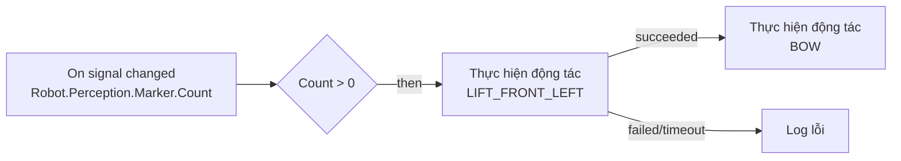

# ADR-0068: Block robot cấp cao, lowering về opcode IR có sẵn; simulator giả lập vòng đời lệnh; kiểm mapping trước build; mẫu kịch bản RW-A..RW-D

- **Status:** Proposed — chờ PO xác nhận
- **Date:** 2026-10-27
- **Level:** L1 Subsystem
- **Deciders:** PO; Claude Code (đề xuất)
- **Related:** ADR-0011/0012 (block, ngữ nghĩa thực thi), ADR-0017 (simulator), ADR-0058 (test case), ADR-0062 (Flow), ADR-0063 (sub-workflow), ADR-0064..0067; [design §7](../../docs/design/M22-robotics-extension.md#7-block-kịch-bản-và-mẫu-workflow-adr-0068)

## Context
Mục tiêu cuối của PO: kéo thả workflow để:
- nhận tín hiệu rồi điều khiển robot di chuyển;
- thiết kế "pilot" cho robot;
- cho robot nhảy, chào bằng cách giơ chân.

Tín hiệu phải đi đúng path RSS, qua protobus sang ROS 2.

Theo command pattern của RSS (ADR-0065), một động tác cần ba bước:
1. ghi `Request`;
2. chờ `LastResult`;
3. chờ `Phase` kết thúc, có timeout.

Làm bằng block cấp thấp thì dài và dễ sai. Thêm vào đó:
- IR đã có `control.repeat`, `control.wait_until`, `control.branch`, `vehicle.write_many`;
- sub-workflow (ADR-0063) inline lúc compile.

## Decision
1. **Block robot** (nhóm "Robot", chỉ hiện ở miền RSS; BlockSpec `sv_robot_*`, version 1):

| Block | Props | Handle ra | Lowering |
|---|---|---|---|
| `sv_robot_safety` (Arm/Disarm/Dừng khẩn/Reset dừng) | `command` enum | `done`, `rejected` | `vehicle.write Robot.Safety.Command.Request` ⇒ `wait_until(LastResult cập nhật, 1 s)` ⇒ branch `IsAccepted` |
| `sv_robot_move` (Di chuyển) | `linear` (m/s), `angular` (rad/s), `duration` | `done`, `error` | `control.repeat` mỗi 100 ms trong `duration`: `vehicle.write_many(Motion.Velocity.Linear.X, Angular.Z)`; kết thúc ghi 0 |
| `sv_robot_go_to` (Đi tới điểm) | `x`, `y` (m, frame map), `timeout` | `arrived`, `failed`, `timeout` | `write_many(Goal.X, Goal.Y)` ⇒ `write Navigation.Command.Request=GO_TO_GOAL` ⇒ `wait_until(State ∈ terminal, timeout)` ⇒ `control.switch State` |
| `sv_robot_motion` (Thực hiện động tác) | `motion` enum theo `allowed` của RSS, `timeout` | `succeeded`, `failed`, `timeout` | `write Motion.Named.Request` ⇒ chờ `LastResult` ⇒ nếu từ chối ⇒ `failed`; `wait_until(Phase ∈ terminal, timeout)` ⇒ switch |
| `sv_robot_cancel` (Huỷ động tác/đi) | `what` enum | `done` | `write …Cancel=true` / `Navigation.Command.Request=CANCEL` |

   - Đọc trạng thái và trigger dùng lại block có sẵn với path `Robot.*`: `sv_read_signal`, `sv_on_signal_changed`, `sv_on_condition`, `sv_stable_for`.
   - Danh sách `motion` lấy từ `allowed` của leaf `Robot.Motion.Named.Request`, giao với `capabilities.json` của profile robot đích. Động tác không hỗ trợ không hiện trong dropdown.
2. **Không opcode mới.** Mọi block robot lowering về opcode IR có sẵn. Backend nào chạy được IR thì chạy được block robot.
3. **Timeout bắt buộc** ở mọi block chờ (mặc định: go_to 120 s, motion 30 s, safety 1 s). Không có chờ vô hạn.
4. **Simulator: profile vòng đời lệnh.** File `robot-sim-profile.json` khai báo, mỗi lệnh có:
   - **điều kiện nhận:** ví dụ `Safety.Mode == MANUAL`, ngược lại `LastResult.IsAccepted=false` + `Reason`;
   - **chuỗi phase** có thời lượng: DISPATCHED +50 ms ⇒ RUNNING ⇒ SUCCEEDED +thời lượng của động tác;
   - **hiệu ứng lên tín hiệu:** ARM ⇒ Mode MANUAL; STOP ⇒ Mode SAFE_STOP.

   Simulator **không mô phỏng vật lý**. Profile chỉ để Simulate/Test có nghĩa khi không có robot. Kịch bản (scenario) có thể ghi đè để thử nhánh lỗi: REJECTED, FAILED, timeout.
5. **Diagnostic mới** (chỉ thêm, catalog contracts):
   - `SIGNAL_SPEC_MISMATCH` (error, S3): workflow trộn path hai spec;
   - `ROBOT_SIGNAL_UNMAPPED` (error, build/run): leaf dùng trong workflow không có trong `capabilities.json` của robot đích. Kiểm ở orchestrator trước SynCode/Run, giống S7 kiểm backend;
   - `ROBOT_MOTION_UNSUPPORTED` (error, S2): giá trị `motion` không nằm trong `allowed`;
   - `ROBOT_COMMAND_TIMEOUT_REQUIRED` (warning, S2): timeout = 0;
   - lý do trace runtime (không phải diagnostic compile): `robot_command_rejected`, `robot_command_timeout`.
6. **Mẫu workflow** (template studio + golden RW-A..RW-D, xem design §7):
   - RW-A Chào khi thấy marker;
   - RW-B Pilot tuần tra 3 điểm, dừng khi vật cản < 0,5 m;
   - RW-C Nhảy theo lệnh MQTT;
   - RW-D Pin yếu ⇒ dừng + ngồi.
7. **Log và kịch bản:**
   - Dùng lại `sv_log`, Run console, Flow (ADR-0062) và Test tab (ADR-0058).
   - Test case robot là scenario RSS (inject `Robot.*` + ghi đè vòng đời lệnh) + kỳ vọng ghi (`expect.writes` trên `Robot.Motion.Named.Request`…).

## Diagram

## Alternatives considered
| Phương án | Ưu | Nhược | Vì sao loại |
|---|---|---|---|
| Opcode IR mới `robot.command` (await) | Ngữ nghĩa trực tiếp | Mọi backend + simulator + parity phải thêm | Lowering về opcode có sẵn đủ |
| Chỉ dùng block cấp thấp (Set + Wait until) | Không thêm block | Người dùng phải biết command pattern; dễ quên timeout | Trái mục tiêu "kéo thả dễ" |
| Mô phỏng vật lý robot trong simulator | Simulate giống thật | Trùng việc repo dog (MuJoCo), rất lớn | Vật lý thuộc repo dog; simulator chỉ mô phỏng logic |

## Consequences
- **Tích cực:**
  - người dùng kéo thả một block cho mỗi hành động;
  - nhánh lỗi/timeout rõ ràng; Test/Flow hiểu ngay.
- **Tiêu cực:**
  - lowering sinh nhiều node IR hơn (Flow cần gộp hiển thị theo block, đã có `src.blockId`);
  - profile vòng đời giả lập có thể lệch robot thật. Ghi rõ nhãn "simulated lifecycle" trong Flow.
- **Ảnh hưởng module:** core (blocks, lowering, simulator, diagnostics), contracts (catalog diagnostics, fixture), studio (BlockConfig, toolbar Robot, template), orchestrator (kiểm `capabilities.json`).

## Implementation
| Task | Module | Milestone |
|---|---|---|
| semantics.md + spec.json 5 block robot | core/blocks | M24-T02 |
| Lowering + golden IR RW-A..RW-D | core/compiler | M24-T03 |
| Profile vòng đời lệnh trong simulator + conformance robot | core/simulator, contracts | M24-T04 |
| Diagnostics mới + catalog + DIAGNOSTICS_CATALOG.md | contracts, core | M24-T05 |
| Kiểm `ROBOT_SIGNAL_UNMAPPED` trước SynCode/Run | orchestrator | M25-T04 |
| BlockConfig + toolbar Robot + template RW-A..RW-D | studio | M26-T02, T03 |

## Verification
- Test "cố ý sai" cho từng mã mới.
- Golden IR robot tất định ×2.
- Conformance: REJECTED / FAILED / timeout đi đúng nhánh trong simulator **và** app (parity M25).
- `block-parity.test.ts` cho 5 block.

## Notes / Deviations
—
