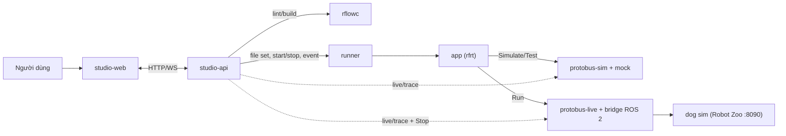

# ADR-0068: Robot Studio là web app mới (React + React Flow, FastAPI, runner sandbox); Simulate/Test chạy app thật trên broker sim + mock, Run trên broker live; mẫu kịch bản RW-A..RW-D

- **Status:** Proposed — chờ PO xác nhận
- **Date:** 2026-10-27, viết lại 2026-10-28
- **Level:** L1 Subsystem
- **Deciders:** PO; Claude Code (đề xuất)
- **Related:** ADR-0064, ADR-0066, ADR-0067; [design §7, §8](../../docs/design/M22-robotics-extension.md#7-robot-studio-adr-0068)

## Context
- **Mục tiêu cuối PO.** Kéo thả workflow thành kịch bản: nhận tín hiệu rồi di chuyển, pilot, nhảy, chào giơ chân… Tín hiệu đi đúng path RSS qua Protobus sang ROS 2.
- **Đính chính 2026-10-28.** Không dùng studio fork Sim, orchestrator, workspace, signal-gateway, trợ lý AI của stack xe (ADR-0064). Bản đầu thêm "miền Robot" vào studio hiện có; bản này thay toàn bộ.
- **Ràng buộc môi trường:**
  - máy 11 GB RAM; dev server Next.js từng làm WSL treo ⇒ chọn Vite (nhẹ) và vẫn kiểm UI trên image CI;
  - không docker.sock; port 127.0.0.1.

## Decision
1. **studio-web** (`robotics/studio/web`): React + TypeScript + Vite + `@xyflow/react` (MIT). Màn hình:
   - **Projects**;
   - **Editor:** palette từ `GET /blocks`, cây RSS, canvas, props có trình nhập theo kiểu, diagnostics lint debounce;
   - **Simulate:** tín hiệu live, Flow trace tô node, nút sự kiện, bản đồ 2D SVG, log;
   - **Test:** kịch bản timeline + kỳ vọng;
   - **Run:** chọn robot, **STOP luôn hiện**, lease, live, Flow, log, link Robot Zoo `127.0.0.1:8090`;
   - **Export.**

   Phục vụ tĩnh bằng nginx trong image.
2. **studio-api** (`robotics/studio/api`, FastAPI):
   - project lưu dạng file trên volume `sr-projects` (`project.json`, `flow.json`, `scenarios/*.json`);
   - gọi `rflowc` qua HTTP;
   - điều phối runner;
   - WebSocket cho live/trace/log;
   - chỉ studio-api ghi project.
3. **rflowc service:** `POST /lint`, `POST /build` (file set), `GET /blocks`, `GET /rss/catalog`. Không trạng thái.
4. **runner** (`robotics/runner`):
   - nhận file set; chạy app trong **process con** với uid không phải root, rlimit CPU/RAM/file;
   - chỉ ở network `sr-bus` (internal), không ra internet;
   - image có sẵn `rfrt` ⇒ không cài gói lúc chạy;
   - **mỗi robot đích một run**;
   - dừng run ⇒ SIGTERM ⇒ app ghi safeValue và trả lease; quá 3 s ⇒ SIGKILL, và broker tự safeValue khi lease mất;
   - không docker.sock.
5. **Ba chế độ, cùng một app sinh ra:**

   | Chế độ | Bus | Provider |
   |---|---|---|
   | Simulate | `protobus-sim` | mock, thời gian thực |
   | Test | `protobus-sim` | mock + kịch bản + `timeScale` |
   | Run | `protobus-live` | bridge ROS 2 → dog sim |

   UI ghi rõ chế độ. Simulate/Test **không thể** nối robot vì là broker khác, network khác.
6. **Kịch bản test `scenario.v1`:**
   - `steps` theo mốc thời gian: đặt sensor, ép kết quả lệnh, phát sự kiện;
   - `expect`: lệnh được gọi (path, args) trong cửa sổ thời gian, phase, không được gọi, log chứa…;
   - kết quả so theo thứ tự sự kiện + cửa sổ thời gian (có dung sai), không so timestamp tuyệt đối.
7. **Mẫu workflow RW-A..RW-D** (design §7) là template trong studio, đồng thời là golden của compiler và kịch bản E2E:
   - RW-A chào khi thấy marker;
   - RW-B pilot tuần tra + canh vật cản;
   - RW-C nhảy theo sự kiện;
   - RW-D pin yếu.
8. **Ngoài v0.1:** trợ lý AI, đăng nhập, đa người dùng, nhiều robot đồng thời. **Chờ PO** nếu cần AI sớm.
9. **Bắt buộc trước khi tick milestone giao diện** (tương đương AGENTS §4 bước 7, áp cho stack robot):
   - Playwright `@live` full luồng trên dog sim;
   - video nhịp người dùng (`sr demo-video`);
   - README + `docs/user-guide/robotics/` khớp UI.

## Diagram

## Alternatives considered
| Phương án | Ưu | Nhược | Vì sao loại |
|---|---|---|---|
| Miền Robot trong studio fork Sim (bản 2026-10-27) | Có sẵn UI | Trái yêu cầu độc lập | PO bác |
| Next.js | SSR, quen | Nặng RAM khi dev, không cần SSR | Vite đủ cho SPA |
| Blockly (khối xếp) thay canvas node | Dễ cho người mới | Khó biểu diễn song song/nhiều cổng kết quả; PO muốn kéo thả kiểu workflow | React Flow |
| Runner chạy container mỗi app | Cách ly mạnh | Cần docker.sock (cấm) | Process con + rlimit + network internal |
| Simulator thông dịch IR trong trình duyệt | Không cần backend | Hai đường thực thi, parity | App thật + mock |

## Consequences
- **Tích cực:**
  - Robot Studio nhẹ, tách hẳn;
  - Simulate tin được vì chạy đúng app sẽ chạy thật;
  - STOP độc lập với app (gọi thẳng broker).
- **Tiêu cực:**
  - phải viết UI từ đầu (editor props, cây RSS, Flow, Test);
  - cách ly runner yếu hơn container.

  Chấp nhận cho chạy cục bộ 1 người dùng; ghi rủi ro.
- **Module:** `robotics/studio`, `robotics/runner`.

## Implementation
| Task | Module | Milestone |
|---|---|---|
| Spike S-R5 React Flow, S-R6 runner sandbox | studio, runner | M26-T01 |
| studio-api | studio | M26-T02 |
| rflowc service | robotflow | M26-T03 |
| runner | runner | M26-T04 |
| Web: Projects + Editor | studio | M26-T05 |
| Simulate | studio | M26-T06 |
| Test + `scenario.v1` | studio, contracts | M26-T07 |
| Run + STOP + lease + Export | studio | M26-T08 |
| Mẫu RW-A..D | studio | M26-T09 |
| E2E `@live`, video, tài liệu | e2e, docs | M27 |

## Verification
- **Vitest:** editor props, lint hiển thị diagnostics, mapping cổng.
- **Playwright mock (CI):**
  - tạo từ mẫu ⇒ sửa ⇒ Simulate thấy Flow ⇒ Test PASS/FAIL đúng;
  - STOP luôn hiện;
  - run thứ hai cùng robot bị từ chối.
- **`@live` trên dog sim** (M27), PASS ×3: RW-B + RW-A kéo thả từ đầu ⇒ Run ⇒ robot đi/chào thật ⇒ STOP ⇒ Export.
- **Fault test runner:** app vượt RAM ⇒ bị giết, robot nhận safeValue; app không mở được kết nối ngoài `sr-bus`.

## Notes / Deviations
- 2026-10-28: viết lại; đổi tên file từ `ADR-0068-robot-blocks-commands-and-scenarios.md`. Bản 2026-10-27: 5 block lowering về opcode `vehicle.*`, simulator core giả lập vòng đời, toolbar trong studio fork Sim, AI biết RSS; đã bỏ theo ADR-0064.
