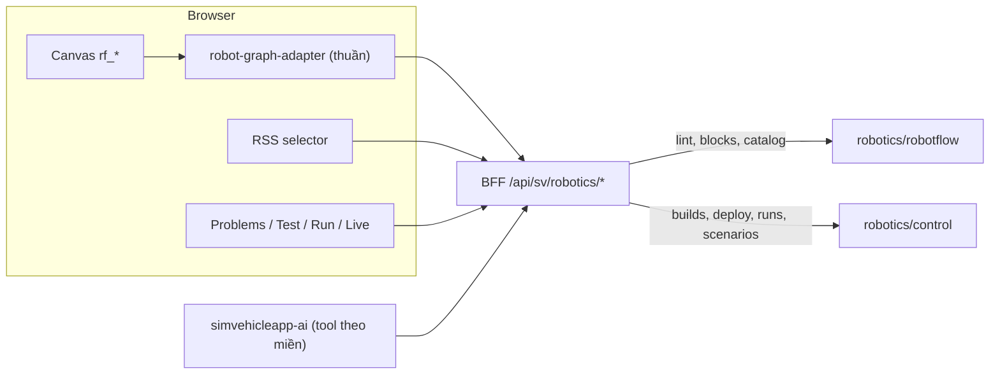

# ADR-0068: Miền `robot` trong studio hiện có — palette `rf_*`, adapter thuần sang `robotflow.v1`, BFF `/api/sv/robotics/*`, Test/Run/Live và trợ lý theo miền

- **Status:** Proposed — chờ PO xác nhận
- **Date:** 2026-11-01
- **Level:** L1 Subsystem
- **Deciders:** PO; Claude Code (đề xuất)
- **Related:** ADR-0064, ADR-0067, ADR-0069, ADR-0070; ADR-0011 (block studio), ADR-0030 (AI/WorkflowPatch), ADR-0058 (Test workbench), ADR-0060 (deploy targets), ADR-0062 (Flow); [gui-integration.md](../../docs/design/robotics/gui-integration.md)

## Context

- **PO 2026-11-01:** dùng GUI SimVehicleApp hiện có; bản Robot Studio riêng bị bác.
- **Studio hiện có** (fork Sim v0.7.13) đã có:
  - canvas ReactFlow, persistence Postgres, auth, cộng tác realtime;
  - block factory từ spec snapshot, lint runner 300 ms;
  - Test workbench, Run/Flow/Signals, deploy targets;
  - trợ lý AI (WorkflowPatch).
- Điểm gắn đã đối chiếu source `3eea2498`: [gui-integration.md §2](../../docs/design/robotics/gui-integration.md).

## Decision

1. **Miền theo workflow.**
   - Bảng mới `sv_robot_workflow_settings(workflow_id PK, profile, rss_catalog_hash, updated_at)`; có hàng ⇒ miền `robot`.
   - Miền chọn lúc tạo, chỉ đổi được khi workflow rỗng.
   - Không đổi bảng xe; workflow cũ mặc định `vehicle`.
2. **Block `rf_*`.**
   - Sinh từ snapshot `rf-block-specs.json` (từ registry `robotics/robotflow`).
   - Parity test trong CI.
   - Palette lọc theo miền; không trộn block hai miền (lint `RF1020` + adapter từ chối).
3. **Adapter thuần `lib/sv/robotics/robot-graph-adapter.ts`:**
   - chuyển canvas → `robotflow.v1`, tất định, golden test;
   - giữ id block, mọi cổng kết quả, props có kiểu, biến;
   - browser **không** compile/thông dịch.
4. **BFF `app/api/sv/robotics/*`:**
   - endpoint: `catalog`, `blocks`, `lint`, `builds`, `deployments`, `runs` (Start/Stop/SSE), `scenarios`;
   - mọi route kiểm session + quyền workspace/workflow;
   - URL dịch vụ cố định từ env, trình duyệt không chọn đích thực thi.
5. **UI:**
   - RSS path selector;
   - Problems hiển thị `RF*`;
   - Test (scenario trên mock);
   - Build/Deploy (artifact bất biến, target quan sát được);
   - Run dock (Start có xác nhận, Stop luôn hiện, Flow tô block, Signals RSS, Console);
   - nút *Mở Robot Zoo* chỉ để xem 3D, Robot Zoo không khởi chạy workflow.
6. **Trợ lý AI:**
   - tool theo miền: `rss_search`, `rss_get_signal`, `robot_blocks_list`, `robot_validate`, `robot_scenario_propose`, `robot_scenario_run` (chỉ mock);
   - `workflow_propose_patch` mang `domain`;
   - **không có tool** Arm/Start/Stop/Setpoint/Execute cho robot;
   - model cấu hình bằng `.env` (`SV_AI_PROVIDER=openai-compatible`, `SV_AI_MODEL`, `OPENAI_COMPAT_BASE_URL`, `OPENAI_COMPAT_API_KEY`); key không vào git.
7. **Export:** sidecar `simvehicleapp.robot = {profile, rssCatalogHash, scenarios}`; artifact zip gồm file set + lock + nguồn.

## Diagram

## Alternatives considered

| Phương án | Ưu | Nhược | Vì sao loại |
|---|---|---|---|
| GUI robot riêng (Robot Studio) | Tự do thiết kế | PO bác 2026-11-01; làm lại auth/persistence/canvas/AI | Trái chỉ đạo |
| Cột `domain` trong `sv_workflow_settings` | Một bảng | Cột `vss_release NOT NULL` vô nghĩa cho robot; đổi bảng xe là rủi ro hồi quy | Bảng riêng an toàn hơn |
| Nhúng Robot Zoo bằng iframe trong studio | Một màn hình | Khác origin, chồng hiệu năng WebGL lên studio | Mở tab/cửa sổ riêng; video quay hai cửa sổ |
| Cho trợ lý gọi Start/Stop robot | Tiện | Rủi ro an toàn; LLM không được ra lệnh chuyển động | Người dùng tự bấm |

## Consequences

- **Tích cực:** một GUI, dùng lại toàn bộ hạ tầng studio đã kiểm chứng.
- **Tiêu cực:**
  - nhiều điểm rẽ nhánh theo miền trong studio;
  - mọi PR sửa studio phải chạy hồi quy xe.
- **Ảnh hưởng module:**
  - `simvehicleapp-studio`: blocks, lib/sv, app/api/sv, components/sv, db migration;
  - `simvehicleapp-ai`: tools, prompt.

## Implementation

| Task | Module | Milestone |
|---|---|---|
| I01 khảo sát điểm gắn chi tiết + kế hoạch migration | studio | M26-T01 |
| Bảng miền + route settings + sidecar | studio (db, api) | M26-T02 |
| Snapshot + factory `rf_*` + parity | studio | M26-T03 |
| Adapter + golden | studio | M26-T04 |
| BFF robotics + overlay compose | studio | M26-T05 |
| RSS selector + Problems | studio | M26-T06 |
| Test, Build/Deploy, Run dock | studio | M26-T07…T09 |
| Trợ lý theo miền | simvehicleapp-ai | M26-T10 |
| E2E GUI thật | studio e2e | M26-T11 |

## Verification

- Unit/golden adapter, parity snapshot, test route BFF (401/403/404), test migration.
- **E2E Playwright trên GUI thật:**
  - soạn workflow robot bằng kéo thả → lint → Test mock → build → deploy → Start/Stop;
  - trợ lý đề xuất và người dùng Accept.
- Toàn bộ E2E xe PASS.

## Notes / Deviations
