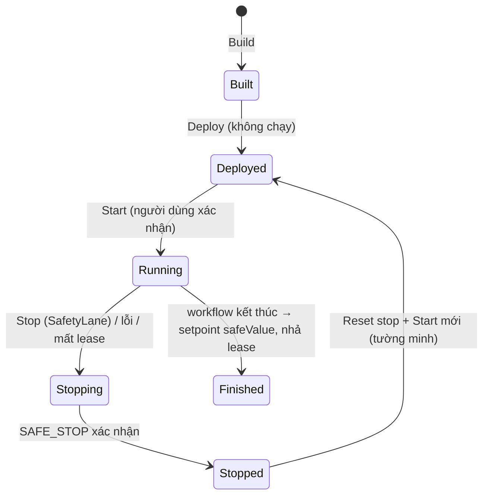

# ADR-0069: Chính sách an toàn và thực thi robotics — deploy không Arm, Start tường minh, Stop ưu tiên tuyệt đối, chỉ lệnh cấp cao, chỉ mô phỏng

- **Status:** Accepted — PO cho phép thực hiện theo tài liệu này ngày 2026-11-01
- **Date:** 2026-11-01
- **Level:** L1 Subsystem
- **Deciders:** PO; Claude Code (đề xuất)
- **Related:** ADR-0066, ADR-0067, ADR-0068; dog ADR-0003 (HAL và safety), dog ADR-0019 (kênh workflow)

## Context

- Workflow kéo thả có thể ra lệnh chuyển động.
- Repo dog quy định:
  - Brain là trọng tài an toàn duy nhất;
  - robot thật disarmed mặc định;
  - STOP trên web không phải E-stop vật lý;
  - robot thật/Jetson là Phase 2, chưa commissioning.

## Decision

1. **Chỉ mô phỏng.**
   - v0.1 chỉ hỗ trợ `mock` và `ros-sim`.
   - **KHÔNG ĐƯỢC** có đường chạy tới robot thật. Control API từ chối target không phải SIM.
2. **Deploy không chạy, không Arm.**
   - Build/Deploy chỉ tạo artifact và bản ghi.
   - Start luôn là hành động tường minh của người dùng trong GUI, có hộp xác nhận nêu robot/mode/scene.
   - Không tự Start lại sau khi restart service hay reload trang.
3. **Stop ưu tiên tuyệt đối:**
   - nút Stop luôn hiện khi có run;
   - đi `SafetyLane` của Protobus, không cần lease, không xếp hàng sau lệnh khác;
   - trạng thái "Đã dừng" chỉ hiện khi xác nhận `SAFE_STOP` thật.
   - **Operator console của dog luôn thắng workflow:** STOP hay manual takeover ở Robot Zoo thu hồi quyền workflow (dog ADR-0019).
4. **Chỉ lệnh cấp cao qua kênh dog cho phép** (`/dog1/workflow/request`):
   - **KHÔNG ĐƯỢC** gửi `cmd_vel*`, `motion/request`, `unitree/*`, lệnh khớp/motor;
   - giới hạn tốc độ của profile ≤ giới hạn Brain.
5. **Một người điều khiển:**
   - một lease mỗi robot, một run mỗi robot/mode;
   - mất lease, app chết hoặc bridge chết ⇒ về an toàn (setpoint `safeValue`, hủy command, Brain watchdog dừng).
6. **Code chạy được chỉ là code compiler sinh ra:**
   - runner kiểm hash lock;
   - trình duyệt không gửi được Python hay file tuỳ ý;
   - runner không root, `cap_drop ALL`, giới hạn RAM/PID, network chỉ tới Protobus của mode tương ứng (mock và ros tách network).
7. **AI không điều khiển robot** (ADR-0068 §6).
8. **Kiểm toán:** mọi lệnh có `request_id` xuyên suốt app → broker → bridge → dog ACK; log audit giới hạn dung lượng, không chứa secret.

## Diagram

## Alternatives considered

| Phương án | Ưu | Nhược | Vì sao loại |
|---|---|---|---|
| Deploy tự Start | Ít bấm | Robot chuyển động bất ngờ | Không an toàn |
| Stop qua cùng kênh với lệnh | Đơn giản | Kẹt sau hàng đợi khi tải cao | Stop phải độc lập |
| Cho workflow gửi `cmd_vel` trực tiếp | Linh hoạt | Bỏ qua trọng tài Brain | Trái luật dog |

## Consequences

- **Tích cực:** hành vi an toàn có thể kiểm chứng; trách nhiệm rõ giữa workflow và Brain.
- **Tiêu cực:** thêm bước xác nhận; không hỗ trợ robot thật ở v0.1.
- **Ảnh hưởng module:** control, runner, protobus, studio Run dock, repo dog (W1).

## Implementation

| Task | Module | Milestone |
|---|---|---|
| SafetyLane + lease + TTL | protobus | M23 |
| Kênh `workflow/request` + trọng tài quyền | dog repo (W1) | dog R4 / M24 |
| Runner giới hạn + mode network tách | runner | M26 |
| Hộp xác nhận Start, Stop luôn hiện | studio | M26 |

## Verification

- Test: deploy không gọi Start.
- Test: reload/restart không Start lại.
- Đo Stop p95 theo ADR-0070.
- Giết app/bridge/broker giữa lúc chạy ⇒ robot dừng (ROS thật).
- Operator STOP ở Robot Zoo thu hồi quyền workflow.
- Runner từ chối artifact sai hash.
- Không có route nào nhận code tuỳ ý.

## Notes / Deviations
