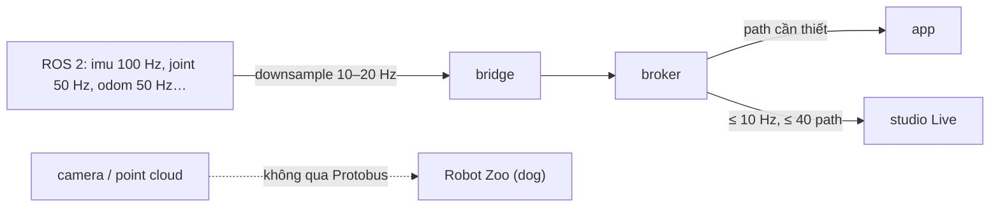

# ADR-0070: Ngân sách hiệu năng robotics đo được cho máy cấu hình thấp (profile `robot-lite`, downsample tại bridge, live ≤ 10 Hz)

- **Status:** Accepted — PO cho phép thực hiện theo tài liệu này ngày 2026-11-01
- **Date:** 2026-11-01
- **Level:** L1 Subsystem
- **Deciders:** PO; Claude Code (đề xuất)
- **Related:** ADR-0051 (image dựng sẵn, máy yếu), ADR-0053 (capacity), ADR-0066, ADR-0068; dog ADR-0018 (hiệu năng R3); [performance-and-video.md](../../docs/design/robotics/performance-and-video.md)

## Context

- **PO 2026-11-01:** "đảm bảo về hiệu năng, chạy mượt mà kể cả máy cấu hình thấp, tránh giật lag".
- **Máy dev:** WSL2, 20 CPU logic, 11 GB RAM.
- **Dữ kiện đã đo:**
  - stack xe rảnh khoảng 0,9 GB (ADR-0051);
  - dog `moderate` có cap 4,5 GiB, peak khoảng 2,0 GiB, camera 9,8 FPS, WebGL khoảng 60 FPS (dog R3).
- **Rủi ro chính:**
  - truyền dữ liệu tần số cao (IMU 100 Hz, joint 50 Hz, ảnh, point cloud) qua thêm một broker Python;
  - re-render canvas khi trace đến;
  - chạy toàn bộ stack xe không cần thiết.

## Decision

1. **Ngân sách cứng** cho hai hồ sơ DEV và LOW (4 CPU + cap 6 GiB): bảng ở [performance-and-video.md §2](../../docs/design/robotics/performance-and-video.md). Gate M27 FAIL nếu một dòng không đạt.
2. **Không truyền ảnh/point cloud qua Protobus.** Chỉ tín hiệu dẫn xuất.
3. **Downsample tại bridge** theo `maxRateHz`. Subscription ROS lười; latest-wins, không hàng đợi vô hạn.
4. **Profile compose `robot-lite`:** studio + DB + realtime + AI tuỳ chọn + robotics + dog. Không toolchain xe, không KUKSA/Velocitas/code-server.
5. **Giới hạn container:**
   - mọi container robotics có `mem_limit`, `cpus`, `pids_limit`;
   - tổng RAM thêm của robotics ≤ 768 MiB;
   - image dựng sẵn pin digest.
6. **Studio:**
   - live ≤ 10 Hz/tín hiệu, tối đa 40 path;
   - batch theo animation frame;
   - tab ẩn dừng stream;
   - trace chỉ đổi class node, không re-render toàn canvas.
7. **Không đánh đổi an toàn lấy hiệu năng.** Watchdog, TTL, độ tươi giữ nguyên ngưỡng.
8. **Spike S-R2 quyết định ngôn ngữ broker.** Nếu broker Python không đạt p95 < 20 ms ở tải chuẩn, mở ADR mới (Rust) trước khi đi tiếp M24.

## Diagram

## Alternatives considered

| Phương án | Ưu | Nhược | Vì sao loại |
|---|---|---|---|
| Forward mọi topic full rate | Đủ dữ liệu | CPU/RAM tăng mạnh, Python không theo kịp | Workflow không cần 100 Hz |
| Hiển thị camera trong studio | Một màn hình | Nhân đôi tải ảnh đã tối ưu ở Robot Zoo | Robot Zoo đã có |
| Không đặt ngân sách, tối ưu sau | Nhanh lúc đầu | Lặp lại lỗi "giật lag" phát hiện muộn | PO yêu cầu từ đầu |

## Consequences

- **Tích cực:** có tiêu chí đo khách quan; chạy được trên máy 11 GB cùng dog sim và trình duyệt.
- **Tiêu cực:**
  - không có dữ liệu tần số cao trong workflow, đây là giới hạn có chủ đích;
  - cần công cụ đo riêng.
- **Ảnh hưởng module:** protobus (bridge), studio (live), compose profile.

## Implementation

| Task | Module | Milestone |
|---|---|---|
| Spike S-R2 broker benchmark | protobus | M22 |
| Spike S-R3 canvas 150 block | studio | M22 |
| Downsample + lazy subscription | protobus bridge | M24 |
| Profile `robot-lite` + giới hạn container | robotics compose, studio overlay | M27 |
| Script đo + báo cáo DEV/LOW | robotics/scripts | M27 |

## Verification

- **Gate M27:**
  - đo toàn bộ bảng ngân sách trên DEV và LOW khi chạy RW-D 10 phút trên `ros-sim`;
  - Robot Zoo giữ ≥ 90 % FPS camera R3 trên DEV;
  - kết quả FAIL được giữ.

## Notes / Deviations

- 2026-11-01 (M22): S-R2 PASS (số ở ADR-0066 Notes). S-R4 PASS: recorder 0,463 core, camera Robot Zoo giảm 0,4 %. **S-R3 chuyển sang M26-T01** vì cần stack studio + block `rf_*`; không ảnh hưởng quyết định M23–M25.
- 2026-11-01 (M23): ngân sách "broker p95 < 20 ms" là **độ trễ chuyển tiếp** (subscriber không bị giới hạn tần số): đo 3,14 ms. Khi path cập nhật nhanh hơn `max_rate_hz` của subscriber, độ trễ gồm thời gian giữ latest-wins có chủ đích (≤ 1 chu kỳ, ví dụ 50 ms ở 20 Hz). Broker thật 1 CPU: 0,30 core, 47 MiB ở 2.000 cập nhật/s × 20 subscriber.
