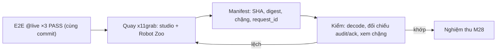

# ADR-0071: Nghiệm thu robotics bằng E2E trên stack thật và một video full luồng liên tục, có manifest đối chiếu được, không bịa

- **Status:** Proposed — chờ PO xác nhận
- **Date:** 2026-11-01
- **Level:** L1 Subsystem
- **Deciders:** PO; Claude Code (đề xuất)
- **Related:** ADR-0064…0070; M15/M21 (video xe, nhịp người dùng); [performance-and-video.md §4](../../docs/design/robotics/performance-and-video.md)

## Context

- **PO 2026-11-01:** vai trò cuối cùng là quay được video full luồng, chính xác, không bịa video.
- **Video Robot Studio của bản thử bị bác:** sai GUI, không thể làm bằng chứng.
- **AGENTS §4.7** đã yêu cầu E2E `@live` + video + README cho mọi thay đổi người dùng thấy.

## Decision

1. **Nghiệm thu sản phẩm robotics** (M28) chỉ khi đủ cả bốn điều kiện:
   1. E2E Playwright trên **GUI studio thật** + stack `ros-sim` thật (dog sim): RW-A…RW-F, ba lượt liên tiếp PASS;
   2. ngân sách hiệu năng M27 PASS;
   3. video full luồng theo quy tắc dưới;
   4. README + `docs/user-guide/robotics.md` khớp code.
2. **Nội dung video bắt buộc**, theo [performance-and-video.md §4](../../docs/design/robotics/performance-and-video.md):
   - soạn bằng kéo thả;
   - RSS selector;
   - Problems;
   - trợ lý AI thật đề xuất và người dùng Accept;
   - Test mock PASS/FAIL;
   - Build/Deploy `ros-sim`;
   - Start;
   - robot thật sự đi, cúi chào, nhảy, giơ chân vẫy trong Robot Zoo, cạnh studio;
   - Stop có xác nhận;
   - Export.
3. **Cách quay:**
   - Xvfb + hai cửa sổ trình duyệt thật;
   - `ffmpeg x11grab` toàn màn hình, một lần quay liên tục;
   - Playwright điều khiển với nhịp người dùng.
4. **Không bịa:**
   - không mock/provider giả/ảnh tĩnh trong phần Run;
   - chỉ tua nhanh đoạn chờ > 8 s, có chữ "tua nhanh ×N" trên hình;
   - không cắt lỗi;
   - không chỉnh sửa hình sau khi quay ngoài phụ đề chặng đã ghi trong manifest.
5. **Manifest** `docs/media/robotics/full-flow.manifest.json`:
   - SHA hai repo, digest image;
   - thời điểm, danh sách chặng + timestamp;
   - `request_id` mọi lệnh robot, đối chiếu được với audit Protobus + `workflow/ack` dog trong thư mục bằng chứng.
6. **Kiểm sau quay:**
   - decode toàn bộ;
   - so manifest với log;
   - xem từng chặng.
   - Sai ⇒ quay lại, không sửa video.

## Diagram

## Alternatives considered

| Phương án | Ưu | Nhược | Vì sao loại |
|---|---|---|---|
| Playwright `recordVideo` một trang | Đơn giản | Không thấy robot 3D cùng lúc | Thiếu bằng chứng điều khiển |
| Ghép hai video riêng | Chất lượng đẹp | Có thể lệch thời gian, dễ bị nghi dựng | Một lần quay liên tục trung thực hơn |
| Quay tay | Tự nhiên | Không tái lập được | Cần tái lập bằng script |

## Consequences

- **Tích cực:** bằng chứng kiểm chứng được; người xem tin được.
- **Tiêu cực:** quay tốn thời gian và tài nguyên (spike S-R4); một lỗi nhỏ buộc quay lại.
- **Ảnh hưởng module:** robotics/scripts (demo-video), studio e2e, repo dog (đọc ack/audit).

## Implementation

| Task | Module | Milestone |
|---|---|---|
| Spike S-R4 quay hai cửa sổ | robotics/scripts | M22 |
| E2E `@live` robotics | studio e2e | M28-T01 |
| `sr demo-video` + manifest + kiểm tự động | robotics/scripts | M28-T03…T04 |

## Verification

- Báo cáo M28 chứa kết quả E2E, đường dẫn video, manifest, kết quả kiểm decode/đối chiếu và danh sách chặng đã xem.

## Notes / Deviations
