# ADR Index — từ tổng quan lớn đến chức năng cụ thể

> ADR = Architecture Decision Record. Mỗi ADR ghi **một** quyết định: bối cảnh → quyết định → phương án đã loại → hệ quả → việc cần làm → cách kiểm chứng.
> Trạng thái ban đầu của tất cả: **Proposed**. Chuyển **Accepted** theo [roadmap §4](../13-implementation-roadmap.md#4-quy-tắc-chuyển-trạng-thái-adr). Template: [TEMPLATE.md](TEMPLATE.md).

> **2026-10-25: PO chấp thuận toàn bộ** ("tôi accept hết") — mọi ADR còn Proposed (0014–0062, 36 ADR) chuyển **Accepted**; các quyết định "theo uỷ quyền PO — chờ PO xác nhận" trong Notes được xác nhận. Việc còn hoãn trong M14 do agent tự phân tích và quyết định theo uỷ quyền này (ghi ở từng ADR + ROADMAP).

> Hiện có 34 ADR. Status trong từng file là nguồn kiểm prerequisite. 2026-10-03: PO chấp thuận ADR-0004/0006/0007 (Accepted) — đủ ADR cho gate M0; ADR-0002 Accepted cho release, dev được điều chỉnh bởi ADR-0009. Xem [review và bằng chứng](../../docs/reports/2026-10-03-documentation-review.md); không coi review tài liệu là chấp thuận ADR.

## 1. Cây phân cấp quyết định

```mermaid
flowchart TB
  subgraph L0["Level 0 · Hệ thống (System)"]
    A1["0001 Ghi ADR"]
    A2["0002 Meta-repo + submodules"]
    A3["0003 Baseline Sim & fork policy"]
    A4["0004 License compliance"]
    A5["0005 Docker Compose only"]
    A6["0006 Compile-first hybrid execution"]
    A7["0007 Service decomposition & contracts"]
    A8["0008 Sim refactor strategy"]
    A9["0009 Dev-phase module folders"]
  end
  subgraph L1a["Level 1 · Domain / Authoring"]
    B10["0010 VSS catalog"]
    B11["0011 Block model on canvas"]
    B12["0012 Execution semantics"]
    B13["0013 Dataflow & expression"]
    B14["0014 IR v1"]
    B15["0015 Type & unit"]
    B16["0016 Diagnostics"]
    B17["0017 Simulator"]
    B18["0018 VSS array & full datatype coverage"]
  end
  subgraph L1b["Level 1 · Codegen & Velocitas"]
    C20["0020 Backend plugin contract"]
    C21["0021 C++ runtime"]
    C22["0022 C++ codegen"]
    C23["0023 Project layout & AppManifest"]
    C24["0024 Databroker API & runtime stack"]
    C25["0025 Headless toolchain"]
    C26["0026 Workspace service"]
    C27["0027 Live run, logs, trace"]
    C28["0028 IDE code-server"]
  end
  subgraph L1c["Level 1 · Product & cross-cutting"]
    D30["0030 AI assistant & MCP"]
    D31["0031 Export & licensing"]
    D32["0032 Auth & tenancy"]
    D33["0033 Observability"]
  end
  subgraph L2["Level 2 · Mở rộng"]
    E40["0040 Python backend"]
    E41["0041 Rust feasibility"]
    E42["0042 Semantic parity testing"]
    E43["0043 gRPC service interface"]
    E44["0044 Standalone service apps"]
    E45["0045 Curated multi-VSS blocks"]
    E46["0046 Per-run stack & multi-user"]
    E47["0047 kuksa.val.v2 migration"]
    E48["0048 Quick Run interpreter (không làm)"]
    E49["0049 Filter, state machine, sub-workflow"]
    E50["0050 Kanto, IDE proxy, VSS overlay (hoãn)"]
    E51["0051 Image dựng sẵn + máy cấu hình thấp"]
    E52["0052 Mô hình VSS tuỳ biến vX.Y-name"]
    E53["0053 Vehicle app + kiểm soát tài nguyên"]
    E54["0054 Thanh hành động + UI tập trung"]
    E55["0055 Block thể hiện logic bằng hình"]
    E56["0056 Ẩn bề mặt executor Sim; menu workflow giữ dữ liệu xe"]
    E57["0057 Runtime nhiều người dùng: sandbox mỗi run + quota"]
    E58["0058 Test case + dock Test/Live + trợ lý soạn test"]
    E59["0059 Workflow dễ đọc v2: block gọn, Logic view"]
    E60["0060 Deploy target + ranh giới VSS với layer I/O"]
    E61["0061 Target WASM cho C++/Rust + sv-wasm-host"]
    E62["0062 Luồng thực thi (Flow): lý do nhánh, nguồn tín hiệu"]
  end
  A2 --> A7
  A2 --> A9
  A7 --> C20 & C26 & C25
  A6 --> B14 & B17 & C20
  A3 --> A8 --> B11
  A4 --> A8 & C28 & B12
  A5 --> C25 & C24
  C20 & C22 --> E61
  C27 & E58 --> E62
  E62 --> E61
  B10 --> B11 & B15
  B11 --> B13 --> B14
  B12 --> B14 & C21 & B17
  B14 --> C20 & B16
  B15 --> B14
  B13 --> B18
  B14 --> B18
  C20 --> C22 & E40 & E41
  B11 --> E45
  C24 --> E47
  E43 --> E44
  D32 --> E46
  E45 --> E49
  C21 --> C22
  C23 --> C26
  C24 --> C27
  C25 --> C28
  B14 --> D30
  C26 --> D31
  B17 & C27 --> E42
```

## 2. Danh sách
| ADR | Tiêu đề | Level | Milestone cần Accepted |
|---|---|---|---|
| [0001](ADR-0001-record-architecture-decisions.md) | Ghi quyết định kiến trúc bằng ADR — **Accepted** | L0 | M0 ✔ |
| [0002](ADR-0002-meta-repo-and-submodules.md) | Meta-repo + repo con độc lập (git submodule + lock) | L0 | M0 |
| [0003](ADR-0003-upstream-baseline-and-fork-policy.md) | Baseline Sim v0.7.13 & chính sách fork — **Accepted** | L0 | M0 ✔ |
| [0004](ADR-0004-license-compliance.md) | Tuân thủ license (gỡ `ee/`, clean-room Scratch, Open VSX) + [denylist opcode Scratch](scratch-opcode-denylist.md) | L0 | M0 |
| [0005](ADR-0005-docker-compose-only.md) | Docker Compose là mode chạy duy nhất — **Accepted** | L0 | M0 ✔ |
| [0006](ADR-0006-compile-first-execution-model.md) | Mô hình thực thi hybrid compile-first | L0 | M0 |
| [0007](ADR-0007-service-decomposition-and-contracts.md) | Phân rã service, tầng & contract | L0 | M0 |
| [0008](ADR-0008-sim-refactor-strategy.md) | Chiến lược refactor Sim | L0 | M1 |
| [0009](ADR-0009-dev-phase-module-folders.md) | **Dev phase: module folders + root compose (submodule khi release)** — Accepted | L0 | M0 ✔ |
| [0010](ADR-0010-vss-catalog.md) | VSS Catalog service — **Accepted** | L1 | M2 |
| [0011](ADR-0011-block-model-on-canvas.md) | Block vehicle trên canvas Sim (generic + VSS-driven) — **Accepted** | L1 | M2 |
| [0012](ADR-0012-execution-semantics.md) | Ngữ nghĩa thực thi (trigger/run/yield/policy) — **Accepted** | L1 | M3 |
| [0013](ADR-0013-dataflow-and-expression-language.md) | Dataflow bằng tham chiếu + expression language — **Accepted** | L1 | M3 |
| [0014](ADR-0014-ir-v1.md) | Canonical IR v1 | L1 | M4 |
| [0015](ADR-0015-type-and-unit-system.md) | Hệ kiểu & đơn vị | L1 | M4 |
| [0016](ADR-0016-diagnostics-catalog.md) | Catalog diagnostics — **Accepted** | L1 | M4 |
| [0017](ADR-0017-simulator.md) | Simulator IR + virtual clock | L1 | M5 |
| [0018](ADR-0018-vss-array-and-full-datatype-coverage.md) | **VSS array & full datatype coverage** (UI→expression→IR→codegen→runtime) — **Accepted** | L1 | M3/M4 |
| [0020](ADR-0020-backend-plugin-contract.md) | Backend plugin contract (`compiler-code-<lang>`) | L1 | M6 |
| [0021](ADR-0021-cpp-runtime-library.md) | Runtime C++ (strand, policies, trace) | L1 | M6 |
| [0022](ADR-0022-cpp-codegen-strategy.md) | Chiến lược sinh C++ | L1 | M6 |
| [0023](ADR-0023-velocitas-project-layout-and-manifest.md) | Layout project Velocitas & merge AppManifest | L1 | M7 |
| [0024](ADR-0024-databroker-api-and-runtime-stack.md) | Databroker API & runtime stack compose | L1 | M8 (spike M0) |
| [0025](ADR-0025-headless-velocitas-toolchain.md) | Toolchain Velocitas headless | L1 | M7 (spike M0) |
| [0026](ADR-0026-workspace-service.md) | Workspace service (single writer, atomic) | L1 | M7 |
| [0027](ADR-0027-live-run-logs-and-trace.md) | Live run, log, trace streaming | L1 | M8 |
| [0028](ADR-0028-ide-code-server.md) | IDE code-server | L1 | M9 |
| [0030](ADR-0030-ai-assistant-mcp.md) | AI assistant & MCP | L1 | M10 |
| [0031](ADR-0031-export-and-licensing.md) | Export & licensing hooks | L1 | M9 |
| [0032](ADR-0032-auth-and-tenancy.md) | Auth & tenancy | L1 | M11 |
| [0033](ADR-0033-observability.md) | Observability | L1 | M11 |
| [0040](ADR-0040-python-backend.md) | Python backend | L2 | M12 |
| [0041](ADR-0041-rust-backend-feasibility.md) | Rust backend feasibility | L2 | M13 |
| [0042](ADR-0042-semantic-parity-testing.md) | Semantic parity testing | L2 | M11 |
| [0043](ADR-0043-grpc-service-interface.md) | gRPC service interface (hoãn tới khi toolchain sinh SDK offline) | L1 | M14 |
| [0044](ADR-0044-standalone-service-apps.md) | Standalone service apps = nhiều project + MQTT (hoãn phần nhóm) | L1 | M14 |
| [0045](ADR-0045-curated-multi-vss-blocks.md) | Curated multi-VSS blocks (composite `members`) | L2 | M14 |
| [0046](ADR-0046-per-run-stack-multi-user.md) | Per-run stack & multi-user (pool tĩnh khi cần; không docker.sock) | L0 | M14 |
| [0047](ADR-0047-kuksa-val-v2-migration.md) | Chuyển `kuksa.val.v2` từng backend, signal-gateway provider, rồi nâng databroker | L1 | M14 |
| [0048](ADR-0048-quick-run-interpreter.md) | Không làm Quick Run interpreter | L2 | M14 |
| [0049](ADR-0049-filter-state-machine-subworkflow.md) | Filter (`state.filter`), state machine (desugar), sub-workflow (hoãn) | L2 | M14 |
| [0050](ADR-0050-kanto-ide-proxy-vss-overlay.md) | Hoãn Kanto, IDE reverse proxy + SSO, VSS overlay | L1 | M14 |
| [0051](ADR-0051-prebuilt-images-low-spec-deploy.md) | Image dựng sẵn qua GitHub Release (`sv pull`), venv Velocitas dùng chung, `SV_BUILD_JOBS` | L0 | M11 |
| [0052](ADR-0052-custom-vss-models.md) | Mô hình VSS tuỳ biến `vX.Y-<name>` (file riêng hoặc overlay) xuyên catalog → databroker; vss-sync project | L0 | M14 |
| [0053](ADR-0053-vehicle-app-lifecycle-and-capacity.md) | Vehicle app tự cấp phát, xoá/repair/clean, quota, ngưỡng đĩa, hàng đợi, sweeper | L0 | M16 |
| [0054](ADR-0054-editor-actions-and-focused-ui.md) | Thanh hành động có trạng thái, UI chỉ giữ phần toolchain | L1 | M16 |
| [0055](ADR-0055-block-visual-semantics.md) | Block: câu tóm tắt, màu loại, nhãn cổng/cạnh, chip dữ liệu | L2 | M16 |
| [0056](ADR-0056-sim-execution-surfaces-and-workflow-menu.md) | Ẩn Chat và "Run from/until block" (executor Sim); Download/Duplicate workflow giữ release VSS + scenario | L2 | M17 |
| [0057](ADR-0057-shared-vehicle-runtime-run-slot.md) | Runtime xe nhiều người dùng: sandbox (databroker riêng) mỗi run, quota user/host, thời hạn + extend, "My runs" | L1 | M17 |
| [0058](ADR-0058-test-workbench-scenarios-as-tests.md) | Nhiều test case có kỳ vọng mỗi workflow; dock Problems/Test/Live; Generate tests + độ phủ; trợ lý soạn test | L1 | M18 |
| [0059](ADR-0059-workflow-readability-v2.md) | Block gọn, Logic view tất định, làn theo trigger, giá trị sống, "Data from earlier blocks" | L2 | M18 |
| [0060](ADR-0060-deploy-targets-and-vehicle-io-layers.md) | Deploy: target databroker từ xa / image / Kanto (hoãn); read-only + audit; VSS là ranh giới với layer CAN | L0 | M18 |
| [0061](ADR-0061-wasm-targets-cpp-rust-and-host-runtime.md) | Target `wasm` cho backend C++ và Rust (cùng emitter), ABI `sv-wasm-abi/1` (core module wasip1 reactor, JSON), host chung `sv-wasm-host` (Wasmtime LTS, KUKSA v2, allowlist, giới hạn) | L1 | M20 |
| [0062](ADR-0062-execution-flow-trace-and-signal-testing.md) | Mô hình Flow chung cho Simulate/Test/Run, `data.eval` (lý do rẽ nhánh), `signal-update.source`, console dạng câu, giải thích case FAIL | L1 | M19 |
| [0063](ADR-0063-sub-workflow-inline-call.md) | Sub-workflow: `sv_call_workflow` gọi workflow hàm (`sv_on_call`), inline lúc compile (`expandCalls`), cấm đệ quy, ≤ 4 cấp | L1 | M21 |
| [0064](ADR-0064-robotics-independent-stack.md) | Robotics là stack độc lập `robotics/`, viết từ đầu: không dùng lại code/contract/hạ tầng stack xe (không KUKSA/Velocitas/VSS/studio fork), chỉ tham khảo; compose `sr`, CI và CLI riêng (viết lại 2026-10-28 theo PO) — **Proposed, chờ PO** | L0 | M22–M27 |
| [0065](ADR-0065-rss-robotic-signal-specification.md) | RSS v0.1: định dạng `*.rss.yaml` riêng, gốc `Robot`, kind `setpoint` (TTL, safeValue) và `command` (vòng đời chuẩn), SI REP-103, tool `rssc` tất định — **Proposed, chờ PO** | L1 | M22 |
| [0066](ADR-0066-protobus-rss-ros2-bridge.md) | Protobus tự viết: giao thức `protobus.v1` (gRPC), broker giữ TTL/vòng đời/lease/Stop, bridge ROS 2 theo mapping profile + adapter `dog-control/1`, provider mock; luật an toàn — **Proposed, chờ PO** | L0 | M22–M24 |
| [0067](ADR-0067-robotflow-language-compiler-runtime.md) | RobotFlow: `robotflow.v1`, block registry, IR `rfir.v1`, compiler `rflowc`, codegen + runtime `rfrt` bằng Python (ngôn ngữ dễ trước), mã `RF*` — **Proposed, chờ PO** | L1 | M25 |
| [0068](ADR-0068-robot-studio-run-and-scenarios.md) | Robot Studio web mới (React Flow + FastAPI + runner sandbox); Simulate/Test = app thật trên broker sim + mock, Run trên broker live; mẫu RW-A..RW-D — **Proposed, chờ PO** | L1 | M26, M27 |

## 3. Ánh xạ ADR bắt buộc của Master Plan v2
| Master Plan | ADR ở đây | Ghi chú |
|---|---|---|
| ADR-001 custom-blocks vs registry | **0011** | custom-blocks là tính năng Enterprise ⇒ không dùng |
| ADR-002 sync upstream | **0003** | |
| ADR-003 source map | **0022** §Source map + **0027** | |
| ADR-004 expression parser | **0013** | tự viết Pratt parser |
| ADR-005 versioning runtime | **0021** §Versioning | vendored MVP, Conan package P2 |

## 4. Review pass 2026-10-01 — sai lệch/khoảng trống đã sửa (research trực tiếp source, không đoán)
| ADR | Vấn đề tìm thấy | Đã sửa bằng |
|---|---|---|
| 0030 + [00](../00-research-findings.md) | **MCP TS SDK ghi sai "v2.2.0"** — package chưa từng có major version 2 | `npm view @modelcontextprotocol/sdk versions` → thật là `1.31.0` (2026-09-28); sửa cả 2 file + bắt buộc re-verify tại M10 |
| 0032 | **Mâu thuẫn**: ghi "SSO nằm trong ee/ ⇒ bị gỡ, cần ADR riêng" trong khi [11a](../11a-ee-clean-room-replacement.md) đã đúng là chỉ UI thuộc ee/ | Đọc `apps/sim/lib/auth/auth.ts`: backend là plugin MIT `@better-auth/sso@1.6.11` (cùng version `better-auth`), chỉ 1 hằng số import từ `ee/`; DB schema cũng sẵn (Apache) |
| 0022 | "Spike M6" bỏ ngỏ: path VSS trùng keyword C++ xử lý ra sao; và `.clang-format` thật dùng số nào | Đọc source `vehicle-model-generator` (`cpp_keywords.py`, `cpp_generator.py`): không escape tên member, nhưng quy tắc VSS (bắt buộc viết hoa) + keyword C++ (luôn viết thường) khiến trùng là bất khả thi về cấu trúc; đọc trực tiếp `.clang-format` của template (đã vendor sẵn trong repo) xác nhận `IndentWidth:4, ColumnLimit:100` đúng như hedge — cả hai đóng hẳn, không cần spike |
| 0023 | "Spike" bỏ ngỏ: key tuỳ biến `x-sv-managed` trong AppManifest có an toàn không | Đọc source CLI (`app-manifest.ts`) + `velocitas_lib` (Python): cả hai chỉ `JSON.parse`/`json.loads` thuần, không hề validate schema/`additionalProperties` ở bất kỳ đâu trong toolchain Velocitas |
| 0013 | Lưỡng lự "Monaco/CodeMirror" cho editor expression | `apps/sim/package.json` đã có sẵn `@monaco-editor/react`+`monaco-editor`, không có CodeMirror ⇒ chốt Monaco, không thêm thư viện |
| 0010 | Node schema VSS thiếu field `comment`; chưa có ca test thật cho `deprecation` | Tải trực tiếp `vss_rel_4.0.json`/`vss_rel_4.2.json`, liệt kê đủ key thật + ví dụ `deprecation` thật từ v4.2 (`Vehicle.Body.RefuelPosition`) |
| 0004 | "Danh sách tên opcode Scratch phổ biến" chỉ là câu nói suông, không thể implement CI | Tạo [scratch-opcode-denylist.md](scratch-opcode-denylist.md) (nguồn Scratch Wiki, không phải source code) |
| 0031 | Chưa chọn thư viện ký Ed25519 | Xác nhận `node:crypto` core hỗ trợ Ed25519 sẵn (Node ≥ 12), không cần dependency |
| 0001/0003/0005 | Status "Proposed" dù đã được thực thi/verify thật trong M0 | Bump **Accepted** kèm bằng chứng cụ thể (baseline SHA dùng thật, M0 spike report) |

- [ADR-0069](ADR-0069-robotics-deployment-and-dog-runtime-interface.md): Accepted 2026-10-29 by direct implementation instruction. ADR-0064–0068 architecture authorized; runtime gates OPEN.
- [ADR-0070](ADR-0070-protobus-independent-safety-lane.md): Accepted under PO delegation 2026-10-29; independent Safety channel, additive protocol v1.1, requires actual saturation/STOP fault evidence before acceptance.
- [ADR-0071](ADR-0071-protobus-behavior-target-ownership.md): Accepted under PO delegation 2026-10-29; protocol v1.2 adds Hold owner/safe release, bounded lease updates/revocation and absolute target deadlines. Provider fencing and actual robot safety remain separate gates.
- [ADR-0072](ADR-0072-protobus-confirmed-command-results-and-audit.md): Accepted under PO delegation 2026-10-29; protocol v1.3 explicitly confirms physical terminal results, independent STOP receipt/result and nonblocking bounded audit failure behavior.

- [ADR-0073](ADR-0073-mock-provider-and-scenario-contract.md): Accepted under PO delegation; ROS-free provider enforcement and separate typed mock scenario service, no live robot state injection.

- [ADR-0074](ADR-0074-provider-local-target-expiry-revokes-session.md): Accepted under PO delegation; actual network-flap failure requires local target expiry to revoke authority and restart provider session before explicit recovery.
