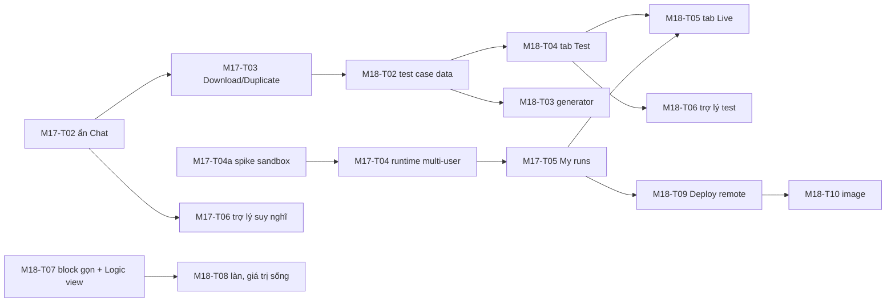

# M18 — Bàn thử nghiệm (test), workflow dễ đọc hơn, và Deploy

> PO 2026-10-15, kèm ảnh tab **Signals** (3 dòng inject) và ảnh editor workflow LKA (Running 17:44, khung **Connections**).
> Tài liệu này phân tích và ra quyết định cho từng điểm PO nêu, đối chiếu các yêu cầu trước (M15–M17) để không bỏ sót.
> ADR: [0058](../../analysis/adr/ADR-0058-test-workbench-scenarios-as-tests.md), [0059](../../analysis/adr/ADR-0059-workflow-readability-v2.md), [0060](../../analysis/adr/ADR-0060-deploy-targets-and-vehicle-io-layers.md) — Proposed.
> Kế hoạch: [phases/M18](../../analysis/phases/M18-test-workbench-readability-deploy.md).

## 0. Hiện trạng đọc từ source (2026-10-15)

| Phần | Hiện trạng | Nguồn |
|---|---|---|
| Dock dưới editor | 5 tab: Problems, Simulation timeline, Run console, Signals, Build log | `sv-config.ts` (`SV_DOCK_TABS`) |
| Signals | Mỗi tín hiệu một dòng: Current, Target, ô Inject (chữ tự do, placeholder "130, true, SLOW…"), chọn `value`/`target`, nút Set. Danh sách = prop `path` của block + tín hiệu thêm tay (gõ đúng path rồi Enter, mất khi tải lại) | `run/signals-panel.tsx`, `signals-model.ts` |
| Record | Ghi lại các lần inject theo thời gian ⇒ **ghi đè** scenario duy nhất của workflow, rồi mở tab Simulation | `signals-panel.tsx` `saveRecording` |
| Play scenario | Phát scenario đã lưu lên databroker thật qua signal-gateway `/play` | `usePlaySvScenario` |
| Scenario | **Một** scenario cho mỗi workflow (bảng `sv_workflow_scenarios`, khoá chính `workflow_id`). Soạn bằng YAML trong tab Simulation. Có `expect` (writes, publishes, trace) nhưng UI không có cách soạn kỳ vọng | `packages/db/schema.ts`, `scenario.v1.schema.json` |
| Test sinh ra | SynCode nhận `scenarios[{workflowId, scenario}]`; generator giữ **một** scenario mỗi workflow | `compiler-code-cpp/generator/src/project.ts` |
| Trợ lý | Tool: `vss_search`, `vss_get_signal`, `blocks_list`, `workflow_get`, `workflow_propose_patch`, `workflow_validate`, `workflow_simulate` (nhận scenario), `diagnostics_explain`, `project_syncode`, `run_start/stop`, `run_logs`, `signal_set`. **Không** có tool soạn/lưu scenario | `simvehicleapp-ai/src/tools.ts` |
| Khung Connections (editor bên phải) | Component của Sim: liệt kê block nối **vào** block đang chọn và output của chúng, để tham chiếu `<block.output>`. Không có lời giải thích | `editor/components/connection-blocks` |
| Block trên canvas | Header + câu tóm tắt (M16-T08) + các dòng key/value + nhãn nhánh (M16-T09) | `workflow-block.tsx` |
| Deploy | Không có. Export = zip Velocitas build được bằng `app/Dockerfile`. Kanto (OTA) hoãn ở ADR-0050 #8. Phạm vi v1 loại "firmware ECU/CAN thật", "OTA thật" (`analysis/01-requirements.md`) | ADR-0050, 01-requirements |

## 1. "Các thanh này có thật sự cần thiết hết không?"

Hiểu "các thanh" theo hai nghĩa có trong ảnh; phân tích cả hai.

**a) Năm tab của dock.** Đánh giá theo câu hỏi người dùng thực sự có trong đầu:

| Tab | Người dùng hỏi | Đánh giá |
|---|---|---|
| Problems | "Workflow có lỗi gì?" | Cần; lỗi đã hiện trên block và có badge |
| Simulation timeline | "Logic có đúng không?" (không build) | Cần, nhưng lẫn soạn scenario (YAML) với xem kết quả |
| Signals | "Bắn tín hiệu vào app thật, xem ra gì" | Cần, nhưng trùng một nửa với Simulation (cùng là "test") |
| Run console | "App thật đang làm gì?" (log, trace) | Cần; nhưng chỉ khi đang Run, và HMI/MQTT không hiện |
| Build log | "SynCode tới đâu, lỗi build gì?" | Cần khi SynCode; ngoài lúc đó gần như không ai mở |

**Quyết định (ADR-0058):** gom theo mục đích, còn **3 tab**:
- **Problems:** giữ nguyên.
- **Test:** soạn và chạy **test case**. Một test case vừa chạy được Simulate (đồng hồ ảo), vừa chạy được trên app thật (Play); kết quả pass/fail theo kỳ vọng.
- **Live:** chỉ có khi đang Run; gộp Signals, Messages (HMI/MQTT) và log/trace.

**Build log** không còn là tab thường trực: nó mở dạng drawer khi SynCode chạy hoặc lỗi, và mở lại được từ pill trạng thái (M16-T06).

**b) Các ô Inject trên mỗi dòng Signals.** Hiện mọi dòng giống nhau (ô chữ tự do + chọn value/target + Set), dù loại tín hiệu khác nhau:
- **Sensor/attribute** (vd. `IsWarning`, `Speed`) không có target. Dropdown `value/target` và cột Target "—" là thừa, dễ chọn sai.
- **Boolean** nên là công tắc; **enum** nên là dropdown giá trị cho phép (lấy từ catalog); **số** nên là ô số có đơn vị, min/max và thanh trượt.

**Quyết định:**
- ô nhập theo kiểu và loại tín hiệu, lấy từ catalog VSS (datatype, unit, min/max, allowed);
- sensor chỉ có "value"; actuator mặc định "Request (target)", "Simulate feedback (current)" nằm trong menu phụ;
- bấm Enter là Set; cột Target chỉ hiện cho actuator.

## 2. Ô "Vehicle.Cabin…" phải gõ đúng path rồi Enter

**Vấn đề:** phải nhớ path VSS đầy đủ, sai một ký tự là báo lỗi. Tín hiệu đã dùng trong biểu thức (`<Vehicle.Speed>`) cũng không tự có. Danh sách thêm tay mất khi tải lại trang.

**Quyết định:**
- **Ô tìm kiếm có gợi ý** dùng cùng tìm kiếm của panel Vehicle (`vss_search`): gõ "speed", "lane", "tốc độ"… ra danh sách có loại, kiểu và đơn vị, chọn bằng chuột hoặc phím.
- **Kéo tín hiệu từ panel Vehicle** thả vào bảng.
- **Tự thêm** mọi tín hiệu trong biểu thức/template; trước đây đã ghi ở M17-T08, nay chuyển vào M18.
- Danh sách tín hiệu đang theo dõi được **lưu theo workflow**.

## 3. Record, "Save as scenario", trợ lý soạn kịch bản test, và chạy thật

**Record dùng thế nào (hiện nay):**
1. Đang Run, bấm **Record**.
2. Inject các giá trị.
3. Bấm Save: các lần inject (theo thời gian) thành **scenario của workflow**, ghi đè bản cũ.
4. Scenario đó dùng được cho Simulate, cho Play scenario trên app thật, và thành unit test sinh ra khi SynCode.

**Khoảng trống:**
- chỉ **một** scenario/workflow;
- **không có kỳ vọng** (expect) nên chỉ "chạy" chứ không tự "kiểm đúng/sai";
- soạn bằng YAML;
- trợ lý không soạn được scenario;
- Record ghi đè mà không hỏi.

**Quyết định (ADR-0058): scenario thành *test case*.**

1. **Nhiều test case cho mỗi workflow.** Mỗi case có:
   - tên;
   - *Given* (giá trị ban đầu);
   - *When* (các bước inject theo thời gian);
   - *Then* (kỳ vọng: tín hiệu ghi ra, message HMI/MQTT, kèm khoảng thời gian cho phép).
2. **Trình soạn dạng bảng từng bước**, thay YAML; YAML vẫn giữ ở chế độ nâng cao. Ví dụ: `t=1.0 s | Speed = 60` · `t=1.5 s | IsWarning = true` · *expect* `IsEnabled = true trong 0,5 s`, `HMI "LKA: chệch làn"`.
3. **Chạy:**
   - **Simulate** (nhanh, đồng hồ ảo, không cần build) và **Play on vehicle stack** (app thật);
   - cả hai cho **pass/fail từng kỳ vọng**;
   - "Run all tests" chạy mọi case.
4. **Tạo test tự động:**
   - nút **"Generate tests"** sinh khung case từ IR: mỗi trigger, mỗi nhánh (then/else, stable/broken, ok/timeout, case-n) một case, kèm giá trị biên lấy từ điều kiện (`> 10` ⇒ 9 và 11);
   - hiện **độ phủ nhánh** (nhánh nào chưa có case).
5. **Trợ lý soạn test:** thêm tool `scenario_list`, `scenario_propose`, `scenario_run`.
   - Người dùng nói "tạo test cho workflow này" ⇒ trợ lý đề xuất test case (như WorkflowPatch: xem trước trong tab Test ⇒ Accept/Reject) và có thể chạy thử bằng Simulate để báo kết quả.
   - Trợ lý chỉ **đề xuất**; người dùng duyệt (giữ ADR-0030).
6. **Record** tạo **case mới** (không ghi đè). Khi lưu, đề xuất kỳ vọng từ những gì app đã ghi ra trong lúc ghi.
7. **SynCode** đưa **mọi** test case vào unit test sinh ra. Cần đổi contract `scenarios` (nhiều case mỗi workflow) và generator của 3 backend; conformance phải giữ nguyên.

**"Chạy thực tế kết hợp VSS với layer dưới (CAN…)":** đây là **Deploy**, khác với Test. Xem §7.

## 4. Simulation timeline và Signals rối, người dùng không biết bắt đầu từ đâu

**Nguyên nhân:**
- Hai tab cùng phục vụ việc "thử logic" nhưng khác cách nhập (YAML vs từng ô).
- Không có lời dẫn "bước tiếp theo".
- Scenario trống thì tab Simulation chỉ là ô YAML.
- Không nối với trợ lý.

**Quyết định (ADR-0058):**
- **Tab Test có trạng thái rỗng dẫn dắt:** "Workflow này chưa có test. [Generate tests] [Ask the assistant] [Record from a live run]".
- **Một luồng chính** in rõ trên tab: *1. Tạo/sinh test case → 2. Simulate → 3. (tuỳ chọn) SynCode + Play trên app thật*. Bước đang ở được tô đậm, giống "nút chính" của thanh hành động (M16-T06).
- **Prompt chung với trợ lý:** khi người dùng gõ "test workflow này" hay "kiểm tra nhánh else", trợ lý mở tab Test, đề xuất case, chạy Simulate và chỉ vào kết quả. Ngược lại, tab Test có nút "Ask the assistant" điền sẵn câu hỏi.
- **Timeline** chỉ còn là phần *kết quả* của một lần chạy: vạch thời gian, tín hiệu, kỳ vọng ✓/✕, tua lại trên canvas (badge M5). Không còn là nơi soạn.

## 5. Khung "Connections" ở góc phải dưới

**Nó là gì:**
- liệt kê các block nối **vào** block đang chọn và **dữ liệu đầu ra** của chúng (vd. `Lane departure warning` → `value`, `previous`…);
- mục đích: biết block này **đọc được dữ liệu gì** và kéo/chọn để chèn `<block.output>` vào biểu thức.

Nó hữu ích nhưng tên chung chung và không có lời giải thích.

**Quyết định (ADR-0059):**
- đổi tên thành **"Data from earlier blocks"**, có dòng giải thích;
- mỗi output hiện kiểu, đơn vị và giá trị mẫu (từ lần Simulate/Run gần nhất), bấm để chèn vào ô biểu thức đang sửa;
- block là trigger (không có đầu vào) ⇒ ghi "This block starts the workflow — it has no inputs";
- thêm phần ngược lại **"Used by"**: block nào đang dùng output của block này (chính là các chip "uses:" của M16-T09, nhìn từ phía nguồn).

## 6. Block chưa thể hiện logic một cách hình ảnh, dễ hiểu

**Đánh giá sau M16-T08/T09:** đã có câu tóm tắt và nhãn nhánh, nhưng:
- mỗi block vẫn mang nhiều dòng key/value kỹ thuật (Signal, Fire When, Severity, Error…), làm câu tóm tắt chìm đi;
- workflow có nhiều trigger không tách thành "luồng" riêng;
- không có cách nhìn **toàn bộ logic** dưới dạng câu;
- trong lúc Simulate/Run không thấy **giá trị** chảy qua các block.

**Quyết định (ADR-0059):**
1. **Chế độ block gọn (mặc định):** block chỉ còn icon + tên + câu tóm tắt + cổng có nhãn; chi tiết hiện khi chọn block hoặc bật "Details". Chế độ đầy đủ vẫn còn.
2. **Logic view:** nút chuyển giữa Canvas và Logic.
   - Logic view hiện cả workflow thành văn bản có cấu trúc, mỗi trigger một đoạn. Ví dụ:
     > **Khi** cảnh báo chệch làn bật lên:
     > **Nếu** tốc độ > 10 km/h ⇒ hiện cảnh báo HMI "LKA: chệch làn", rồi **bật** Lane Departure Detection.
     > **Ngược lại** ⇒ ghi log "LKA không kích hoạt".
   - Bấm vào một câu thì chọn block tương ứng trên canvas.
   - Sinh tất định từ graph (cùng quy tắc với câu tóm tắt), không qua LLM.
3. **Làn theo trigger:** auto layout xếp mỗi trigger một hàng ngang, trái sang phải; nhánh then lên trên, else xuống dưới; vùng nền nhạt phân biệt các luồng.
4. **Giá trị sống trên canvas:** trong lúc Simulate tua lại hoặc Run, nhãn cạnh hiện giá trị vừa đi qua (`Speed = 60`), nhánh vừa chạy sáng lên, nhánh không chạy mờ đi.
5. **"Explain this workflow"**: nút hỏi trợ lý giải thích bằng lời. Đây là phần bổ sung; Logic view tất định mới là nguồn chính.

## 7. Deploy: chạy với dữ liệu thật từ các layer phía dưới (CAN…)

**Kiến trúc xe thật (Eclipse SDV):**

```
Bus CAN / Ethernet trên xe
 └─ CAN provider (DBC ⇄ VSS mapping, vd. eclipse-kuksa/kuksa-can-provider)  ← "layer phía dưới"
     └─ KUKSA Databroker trên thiết bị (ECU/HPC/devkit)
         └─ Vehicle app do SimVehicleApp sinh ra (Velocitas, gRPC)
```

- SimVehicleApp hiện làm tầng **app**. Phần **Run** chỉ chạy app trên databroker giả lập; giá trị đến từ người dùng (Signals/Test).
- **Ranh giới hợp đồng là VSS:** app chỉ biết đường dẫn VSS. Nhờ vậy cùng một app chạy được với dữ liệu thật khi có CAN provider ánh xạ DBC → VSS, không cần sinh lại code.

**Định nghĩa PO chốt (2026-10-15):**
- **Run** = chạy app với giá trị tín hiệu VSS **giả lập để test** (inject từ UI, scenario/test case, Record), như hiện nay.
- **Deploy** = cũng chạy app, nhưng tín hiệu VSS đến từ **nhiều nguồn layer khác** (phần cứng, CAN mapping — chưa bàn tới).

Ở Deploy, các giá trị test **không hoạt động**: inject, Play scenario/test case, Record và mirror giả lập bị **server từ chối** (`SIMULATED_INPUT_DISABLED`), UI tắt các nút đó. Tab Live chỉ quan sát.

**Quyết định (ADR-0060):**
1. **Deploy là hành động riêng, khác Run:**
   - Run = thử trên stack giả lập trong SimVehicleApp;
   - Deploy = đưa app đã build tới **một target**, nơi dữ liệu đến từ layer khác.

   Nút **Deploy** trên thanh hành động (nhóm "Mở/xuất", cạnh Export) mở hộp thoại chọn target.
2. **Các target, làm theo giai đoạn:**
   - **T0 Local stack** = Run hiện nay; giữ nguyên.
   - **T1 Remote databroker:** chạy app đã build (container từ `app/Dockerfile`) **trong SimVehicleApp** nhưng nối tới một **databroker bên ngoài** do người dùng khai báo (URL, TLS, token). Đó có thể là devkit hoặc máy HIL có CAN provider thật. Dữ liệu thật đi lên từ CAN qua databroker đó. Signals/Live đọc từ databroker đó, ở chế độ chỉ đọc mặc định.
   - **T2 Container image:** build image OCI của app và đẩy lên registry đã cấu hình (kèm AppManifest), để triển khai bằng công cụ của người dùng.
   - **T3 Kanto / OTA:** triển khai lên thiết bị qua Eclipse Kanto container-management. Vẫn hoãn theo ADR-0050 #8.
3. **Mô hình "Deployment"** gắn với vehicle app: target, generation (bản build), trạng thái, thời điểm, người deploy. Trang Vehicle apps hiện app đang deploy ở đâu.
4. **An toàn:**
   - target có actuator thật ⇒ hộp thoại xác nhận nêu rõ các actuator app sẽ ghi, kèm banner "not a replacement for safety-critical (ASIL) systems";
   - mặc định **read-only** (chặn ghi actuator) cho tới khi người dùng bật rõ ràng;
   - mọi deploy được ghi log kiểm toán.
5. **Layer CAN ngoài phạm vi M18:**
   - mapping DBC ⇄ VSS, provider phần cứng, feeder là module tương lai "vehicle-io", sẽ có ADR riêng;
   - M18 chỉ chuẩn bị: target T1 nhận databroker có sẵn provider;
   - VSS tuỳ biến (ADR-0052) mô tả được tín hiệu riêng của OEM khớp với DBC.
6. **Phụ thuộc:** databroker trên thiết bị thật thường là bản mới dùng `kuksa.val.v2`. App sinh ra hiện dùng API v1 (ADR-0047 lộ trình chuyển v2), nên T1 cần kiểm tương thích phiên bản trước.

## 8. Đối chiếu các yêu cầu trước — không bỏ sót

| Yêu cầu trước | Trạng thái | Liên quan M18 |
|---|---|---|
| M16 vòng đời app, dung lượng, thanh hành động, UI tập trung, block tóm tắt | ✔ (chờ PO duyệt ADR) | Logic view và block gọn (ADR-0059) nâng tiếp T08/T09 của M16 |
| M17 ẩn Chat/Run from block, Download/Duplicate giữ dữ liệu xe, runtime nhiều người dùng, trợ lý "đang suy nghĩ" | Kế hoạch | M17-T08 (Signals) **chuyển vào M18** (ADR-0058); runtime sandbox (ADR-0057) là nền cho Play test trên app thật đồng thời |
| ADR-0046 per-run stack (pool tĩnh) | Proposed, hoãn | ADR-0057 thay quyết định 2 bằng sandbox dạng tiến trình (đã ghi ở cả hai ADR) |
| ADR-0050 Kanto | Hoãn | ADR-0060 T3, vẫn hoãn |
| ADR-0047 kuksa.val.v2 | Proposed | Điều kiện cho Deploy T1 với databroker mới |
| Rule AGENTS §4 bước 7–8 | Hiệu lực | M18 thay đổi UI nhiều ⇒ full luồng `@live`, quay lại video, cập nhật README và user guide (`test-signals.md` viết lại theo tab Test/Live) |

## 9. Giải pháp kỹ thuật chi tiết (bổ sung 2026-10-16)

### 9.1 Run và Deploy trên UI
| | **Run** | **Deploy** |
|---|---|---|
| Mục đích | Thử app với tín hiệu **giả lập** | Chạy app với tín hiệu từ **layer khác** (HW/CAN) |
| Nguồn tín hiệu VSS | Sandbox databroker riêng của run (ADR-0057); giá trị do người dùng/test đưa vào | Databroker của target, được provider phía dưới cập nhật |
| Inject / Play / Record / mirror | Có | **Bị server từ chối** (`SIMULATED_INPUT_DISABLED`) |
| Ghi actuator của app | Ghi vào sandbox | Mặc định **read-only** (proxy chặn); bật ghi phải xác nhận |
| Thời hạn | `SV_RUN_MAX_MINUTES` + Extend | Không tự hết hạn; giới hạn bằng `SV_MAX_DEPLOYMENTS_PER_WORKSPACE`; dừng thủ công |
| Pill trên thanh hành động | `Running 12:30 · ends 14:00` | `Deployed · <target> · read-only` (màu khác Run) |
| Tab Live | Tín hiệu + inject + Messages + log | Tín hiệu (chỉ xem) + Messages + log; banner "signals come from <target>" |
| "My runs" | Liệt kê run | Liệt kê cả deployment, có nhãn **DEPLOY** |

Một vehicle app có thể vừa đang Run (thử bản mới) vừa đang Deploy (bản trước) cùng lúc, vì hai bên dùng nguồn tín hiệu khác nhau. UI luôn ghi rõ generation nào đang chạy ở đâu.

### 9.2 Deploy chạy ở đâu và chặn ghi thế nào
- **App chạy trong SimVehicleApp** (sandbox tiến trình như Run, ADR-0057). Biến `SDV_VEHICLEDATABROKER_ADDRESS` của app trỏ tới **vehicle-gateway** (service mới trong compose), không trỏ thẳng ra target.
- **vehicle-gateway** là proxy gRPC (HTTP/2) theo deployment:
  - nối TLS + token tới databroker của target; app không cần biết TLS/token;
  - **lọc theo method** (danh sách cho phép, mặc định từ chối);
  - ghi audit (method, path, thời điểm, deployment).

  | API (method gRPC) | Read-only | Read-write |
  |---|---|---|
  | `sdv.databroker.v1.Broker/GetDatapoints`, `/Subscribe`, `/GetMetadata` | cho phép | cho phép |
  | `sdv.databroker.v1.Broker/SetDatapoints` (app ghi actuator) | **chặn** | cho phép, chỉ path actuator đã khai báo của app |
  | `sdv.databroker.v1.Collector/*` (vai trò provider/feeder) | **chặn** | **chặn** (app không phải provider) |
  | `kuksa.val.v1.VAL/Get`, `/Subscribe`, `/GetServerInfo` | cho phép | cho phép |
  | `kuksa.val.v1.VAL/Set`, `/StreamedUpdate` | **chặn** | cho phép theo path actuator của app |

  Danh sách method lấy từ proto đã vendored trong repo (`signal-gateway/proto/kuksa/val/v1/val.proto`, `spikes/.../sdv/databroker/v1`). Khi hỗ trợ `kuksa.val.v2` (ADR-0047) thì bổ sung `Actuate`, `BatchActuate`, `PublishValue`, `OpenProviderStream` (phải `upstream-verify` trước).
- **Tab Live ở Deploy:** signal-gateway subscribe **qua vehicle-gateway** (chỉ method đọc). Inject đi qua signal-gateway nên bị từ chối ở đó.
- **Ràng buộc tương thích (đọc source 2026-10-16):**
  - app C++ sinh ra dùng Velocitas SDK 0.7.1 với API **`sdv.databroker.v1`**, nên databroker 0.5.0 của stack phải chạy với `--enable-databroker-v1`;
  - ⇒ target phải phục vụ `sdv.databroker.v1`, hoặc chờ chuyển API theo ADR-0047;
  - **Test connection** kiểm API nào target có (`GetServerInfo` / `GetMetadata`) và báo rõ "target không phục vụ sdv.databroker.v1 — app hiện tại không chạy được".
- **Spike trước khi code** (thêm vào M18-T09): proxy HTTP/2 gRPC trong Bun/Node lọc theo method, giữ được stream hai chiều. Kiểm `node:http2` dưới Bun đủ ổn chưa; nếu không thì viết bằng Node runtime. Ghi kết quả vào ADR-0060 Notes.

### 9.3 Test case: ngữ nghĩa kỳ vọng
Đọc source: `checkExpectations` (`simulator/src/scenario.ts`) so kỳ vọng `{t, path, value}` **đúng thời điểm**. Đủ cho Simulate (tất định), nhưng không đủ cho Play trên app thật vì có độ trễ thực (gate parity đã phải cho phép lệch 150 ms).

**Quyết định (bổ sung ADR-0058), scenario v1.1 (additive):**
- `write`/`publish` thêm trường tuỳ chọn `within` (ms): chấp nhận trong `[t, t + within]`. Thiếu `within` thì giữ nguyên nghĩa cũ (đúng `t`), nên conformance C01–C45 không đổi.
- Kỳ vọng phủ định `never: [{ path, from, to }]`: không được ghi `path` trong khoảng đó. Dùng cho nhánh else ("tốc độ ≤ 10 thì **không** bật LDD").
- Kỳ vọng mặc định của UI:
  - Simulate dùng `within: 0`;
  - Play trên app thật dùng `within` mặc định 300 ms (chỉnh được);
  - kết quả ghi rõ độ lệch thực tế.
- Kỳ vọng là **tập con**: chỉ kiểm những gì khai báo. Ghi thêm thì không làm fail, trừ khi có `never`.
- Schema `scenario.v1` đang `additionalProperties: false`, nên thêm trường là **bump minor** (`scenarioVersion: 1.1.0`); reader cũ phải bỏ qua bản 1.1.

### 9.4 Generate tests: thuật toán (tất định)
1. Từ IR: liệt kê đường đi từ mỗi trigger tới hết, theo từng nhánh (then/else, stable/broken, ok/timeout, case-n, default).
2. Với mỗi điều kiện so sánh `x op c` trên tín hiệu hoặc output: sinh hai giá trị biên (`c` và `c ± bước`, bước = 1 cho số nguyên; với float dùng phần trăm nhỏ theo đơn vị); boolean dùng `true`/`false`.
3. Với Stable for / Wait until: một case giữ đủ thời gian (nhánh stable/ok) và một case phá trước hạn (broken/timeout).
4. Trigger "rises" sinh chuỗi `false → true`; "crosses above c" sinh `c − bước → c + bước`.
5. Kỳ vọng sinh từ chính simulator chạy case đó: các lần ghi và publish quan sát được. Người dùng duyệt trước khi lưu. Đây là test hồi quy "chốt hành vi hiện tại", ghi rõ trên UI.
6. Độ phủ = số nhánh có ít nhất một case đi qua / tổng nhánh; nhánh chưa phủ được đánh dấu trên canvas.

### 9.5 Trình tự thực hiện M17 → M18

- **Làm được song song:** M18-T07/T08 (readability) không phụ thuộc runtime, nên làm được song song với M17-T04/T05.
- **Bước chặn:** hai spike (M17-T04a sandbox, M18-T09 proxy) phải PASS trước task code liên quan.

### 9.6 Câu hỏi chờ PO
1. **Quota mặc định:** run `SV_MAX_RUNS_PER_USER=2`, `SV_MAX_RUNS_TOTAL=20`; deployment `SV_MAX_DEPLOYMENTS_PER_WORKSPACE=2`. Có phù hợp quy mô dự kiến không?
2. **Ai được Deploy và bật read-write:** đề xuất chỉ admin workspace.
3. **Target đầu tiên PO có thật:** devkit, HIL hay databroker giả lập chạy feeder? Target đó phục vụ API databroker nào (`sdv.databroker.v1` / `kuksa.val.v1` / `v2`)? Câu trả lời quyết định thứ tự ADR-0047 so với M18-T09.
4. **Ngôn ngữ Logic view:** cả tiếng Việt và tiếng Anh, hay theo ngôn ngữ UI?

## 10. Kiểm thử
| Khía cạnh | Kiểm thử |
|---|---|
| Test case | Unit: nhiều case/workflow, migration từ scenario cũ (một case "Default"), kỳ vọng pass/fail trong simulator; contract `scenarios` nhiều case; conformance 3 backend giữ nguyên; golden test sinh ra cho nhiều case |
| Generate tests | Unit: IR ⇒ case cho mọi nhánh, giá trị biên; độ phủ nhánh |
| Trợ lý | Tool `scenario_*` (eval fake + eval model thật của PO), proposal → Accept lưu case |
| Signals/Live | Vitest ô nhập theo kiểu/loại; tìm kiếm gợi ý; tín hiệu trong biểu thức; Messages HMI |
| Readability | Vitest Logic view (tất định, đủ 41 BlockSpec, đúng 7 golden); E2E block gọn/đầy đủ, chọn câu ⇒ chọn block; giá trị sống |
| Deploy | Unit: Deploy từ chối inject/Play/Record/mirror (`SIMULATED_INPUT_DISABLED`); target T1 (URL/TLS/token, read-only chặn ghi actuator); gate: app deploy tới một databroker "ngoài" (container riêng trong compose) có feeder giả lập ⇒ app nhận dữ liệu không qua Signals |
| AGENTS §4 bước 7 | Full luồng `@live` viết lại theo tab Test/Live + Deploy T1; quay lại video; README |
