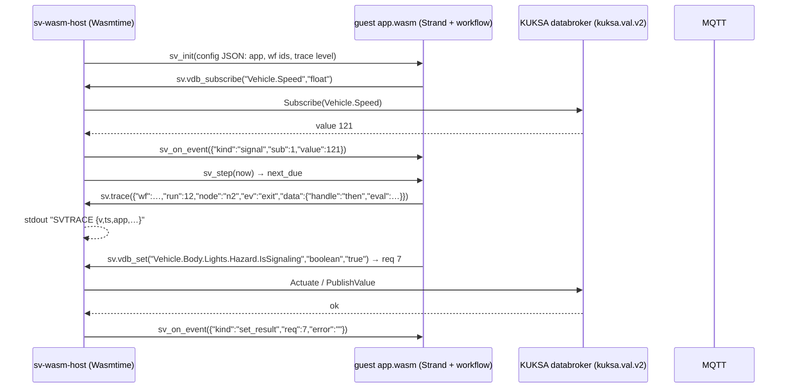

# Thiết kế M20 — Target WebAssembly cho C++ và Rust, host runtime `sv-wasm-host`

> Yêu cầu PO 2026-10-24. Quyết định: [ADR-0061](../../analysis/adr/ADR-0061-wasm-targets-cpp-rust-and-host-runtime.md). Kế hoạch: [phase M20](../../analysis/phases/M20-wasm-targets.md).
> Trạng thái: đề xuất, chờ PO xác nhận. Các con số dưới đây là dữ kiện tra ngày 2026-10-24; pin cuối cùng chốt ở spike M20-T01.

## 1. Yêu cầu
- "thêm compiler ngôn ngữ cho CPP + wasm + wasmruntime"
- "thêm compiler ngôn ngữ cho rust + wasm + wasmruntime"

Hiểu yêu cầu:
1. Từ cùng một workflow, SynCode sinh được app C++ hoặc Rust **biên dịch ra WebAssembly**.
2. Có một **runtime WASM** chạy app đó trong stack, nối với databroker/MQTT như app native.
3. Mọi thứ người dùng đang dùng với app native vẫn dùng được với app WASM: Run, Signals, Test, Play, Flow, Export, Deploy.

## 2. Dữ kiện nguồn chính thức (tra 2026-10-24)
| Thành phần | Bản | Ngày | License | Ghi chú đã kiểm |
|---|---|---|---|---|
| Wasmtime | v50.0.0 mới nhất; **v48.0.7 LTS** | 2026-10-20 / 2026-10-19 | Apache-2.0 | `docs/stability-release.md`: bản bội số của 12 là LTS, hỗ trợ 24 tháng, bản khác 2 tháng. Có C API + C++ header `wasmtime.hh` (`crates/c-api/include`) |
| WAMR | WAMR-2.4.5 | 2026-06-29 | Apache-2.0 | release có `iwasm` và `wamrc` (AOT) cho ubuntu-22.04 x86_64 |
| WasmEdge | 0.18.1 | 2026-10-22 | Apache-2.0 | phương án dự phòng |
| wasi-sdk | wasi-sdk-34 | 2026-08-25 | Apache-2.0 | README: exception C++ tắt mặc định; `<mutex>`/`<thread>` có trên mọi target nhưng không spawn thread (trừ `wasm32-wasip1-threads`, thử nghiệm). `CppExceptions.md`: bật cần `-fwasm-exceptions -mllvm -wasm-use-legacy-eh=false` + `-lunwind`. Release 34 bỏ target `wasm32-wasi`, dùng `wasm32-wasip1` |
| Rust | `wasm32-wasip1`, `wasm32-wasip2`, `wasm32-wasip3` | — | MIT/Apache-2.0 | cả ba **Tier 2** (`src/doc/rustc/src/platform-support.md`) |
| wasm-tools | v1.262.0 | 2026-10-13 | Apache-2.0 | `validate`, `strip`, `print` |
| wit-bindgen | v0.63.0 | 2026-10-14 | Apache-2.0 | dành cho ABI `/2` (component model) |
| Velocitas / KUKSA cho WASM | — | — | — | tìm GitHub 2026-10-24: **không có SDK WASM chính thức** ⇒ cần host làm cầu nối |

**Source repo (kiểm 2026-10-24):**
- Runtime Rust tách sẵn lõi (chỉ `serde_json`) và feature `host` (tokio, tonic, `kuksa-rust-sdk`, rumqttc). Lõi biên dịch ra wasm mà không cần sửa cấu trúc.
- Runtime C++: `Strand::run()` dùng `std::condition_variable::wait/wait_for`, sẽ chặn mãi trên wasip1. Nhưng `Strand::popDue` đã có, nên host bơm được. Runtime có 7 chỗ `throw`. Port `IVehicleAccess` (`Access.hpp`) và `ITraceSink` (`Runtime.hpp`) đã tách.
- Contract `backend-capabilities.v1`: `language` enum `cpp|python|rust`; `toolchain.template` + `templateSha` (40 hex) bắt buộc.

## 3. Kiến trúc


### 3.1 ABI `sv-wasm-abi/1` (bản phác, chốt ở M20-T02 trong contracts)
**Import** (module `"sv"`; mọi chuỗi là `(ptr: i32, len: i32)` UTF-8 trong bộ nhớ guest):
| Hàm | Chữ ký | Ý nghĩa |
|---|---|---|
| `now_ms` | `() -> i64` | ms đơn điệu từ lúc app khởi động (IR `now_ms`) |
| `log` | `(level: i32, msg) -> ()` | 0 debug … 3 error |
| `trace` | `(json) -> ()` | dòng trace không có `v`/`ts`/`app` (host thêm) |
| `vdb_subscribe` | `(path, type) -> i32` | id đăng ký; giá trị về qua `sv_on_event` |
| `vdb_current` | `(path, type, out_ptr, out_cap) -> i32` | giá trị cache JSON; `-1` chưa có; `>cap` là độ dài cần |
| `vdb_get` | `(path, type) -> i32` | id yêu cầu; kết quả qua `sv_on_event` |
| `vdb_set` | `(path, type, value_json) -> i32` | id yêu cầu; host kiểm allowlist và kiểu trước |
| `mqtt_subscribe` | `(filter) -> i32` | |
| `mqtt_publish` | `(topic, payload) -> i32` | 0 ok |

**Export:**
| Hàm | Chữ ký | Ý nghĩa |
|---|---|---|
| `sv_alloc` / `sv_free` | `(len) -> ptr` / `(ptr, len)` | host ghi chuỗi vào guest |
| `sv_init` | `(config) -> i32` | 0 ok |
| `sv_on_event` | `(event) -> ()` | `signal` / `get_result` / `set_result` / `mqtt` / `stop` |
| `sv_step` | `(now_ms: i64) -> i64` | chạy mọi việc đến hạn; trả hạn kế tiếp, `-1` nếu không có |
| `sv_stop` | `() -> ()` | huỷ strand, phát `app.stopping` |
| `sv_run_tests` | `(cases) -> i32` | chạy test case với MockVehicle + VirtualClock trong guest; in kết quả qua `log`; trả số case FAIL |

Bất biến:
- Guest **không** gọi import khi đang ở trong một import khác (không tái nhập).
- Host gọi `sv_step` sau mỗi `sv_on_event` và khi tới hạn.
- Không có WASI preopen; WASI chỉ dùng cho `clock` và `random` (random chỉ phục vụ allocator; runtime không dùng random, theo luật tất định).

### 3.2 Host `sv-wasm-host`
- Rust, `wasmtime` (LTS v48), tokio. Client KUKSA v2 sinh từ proto vendored trong module (luật cứng 2: không import code chéo module). rumqttc cho MQTT.
- Vòng lặp:
  1. chờ sự kiện (databroker / MQTT / tín hiệu stop) hoặc hạn kế tiếp;
  2. gọi `sv_on_event` / `sv_step`;
  3. epoch deadline mỗi lần gọi (mặc định 200 ms CPU) ⇒ vượt thì trace `error` `wasm_limit` và dừng app với mã khác 0.
- Giới hạn bộ nhớ qua `ResourceLimiter` (mặc định 64 MiB, `SV_WASM_MAX_MEMORY_MB`).
- Allowlist từ `sv-app.json` (generator sinh ra: các path đọc/ghi, topic, trace map). Ghi ngoài allowlist ⇒ `set_result` lỗi `forbidden`.
- Các chế độ:
  - `run` (mặc định);
  - `--test cases.json` (gọi `sv_run_tests`);
  - `--precompile` (ra `app.cwasm`).
- Biến môi trường giống app native: `SV_DATABROKER_ADDRESS`, `SV_DATABROKER_API`, `SV_MQTT_*`, `SV_TRACE_LEVEL`. Như vậy orchestrator và sandbox (ADR-0057) không phân biệt app native hay app WASM.

### 3.3 Guest C++
- Toolchain: `cmake -DCMAKE_TOOLCHAIN_FILE=$WASI_SDK/share/cmake/wasi-sdk.cmake`, target `wasm32-wasip1`, `-mexec-model=reactor`, `-fno-exceptions -O2`.
- Runtime:
  - `SV_RT_NO_EXCEPTIONS` thay `throw` bằng trả lỗi + trace `error`;
  - `Strand::pump(now)` cho guest (giữ `run()` cho native);
  - JSON và chuỗi dùng lại `Value.cpp`.
- Adapter: `WasmVehicleAccess`, `WasmPubSub`, `WasmTraceSink`, `WasmClock`, nằm trong `runtime/src/wasm/`.
- Generator:
  - `src/generated/**` giống target native (cùng emitter);
  - khác ở `main_wasm.cpp` (các export), `CMakeLists.txt`, `sv-app.json`;
  - test sinh ra: test case được nhúng thành JSON gọi qua `sv_run_tests`, vì gtest không chạy được trong guest.

### 3.4 Guest Rust
- `Cargo.toml` của app: `crate-type = ["cdylib"]`, `simvehicleapp-runtime` với `default-features = false, features = ["wasm"]`.
- Build: `cargo build --release --target wasm32-wasip1`.
- Feature `wasm`: `extern "C"` cho import `sv.*`, `#[no_mangle]` cho export. Không tokio. `VehicleAccess` / `PubSub` được hiện thực bằng import.

### 3.5 Toolchain `toolchain-wasm`
- Image dựa trên image toolchain của velocitas-stack (agent dùng chung), cộng thêm:
  - wasi-sdk-34 (tarball release, kiểm sha256);
  - rustup stable + `wasm32-wasip1`;
  - wasm-tools 1.262;
  - binary `sv-wasm-host`.
- Plan:
  - `build`: C++ chạy cmake/ninja, Rust chạy cargo; sau đó `wasm-tools validate` + `strip`, rồi `sv-wasm-host --precompile`;
  - `test`: `sv-wasm-host --test`;
  - `run`: `sv-wasm-host app.cwasm`.
- Compose profile `wasm` (tuỳ chọn), `SV_BACKENDS` thêm `cpp-wasm`, `rust-wasm` khi bật profile.

### 3.6 Contract và dữ liệu
- `backend-capabilities` (minor):
  ```json
  "target": {"kind": "wasm", "triple": "wasm32-wasip1", "abi": "sv-wasm-abi/1", "host": {"name": "sv-wasm-host", "version": "0.1.0"}}
  ```
  Khi `kind = wasm`: `toolchain.id = toolchain-wasm`, `template = templates/wasm-app-<lang>`, `templateSha` = git tree sha của template.
- `generation-manifest`: thêm `target`.
- Project: thêm `target: velocitas | wasm` (mặc định `velocitas`). Backend được chọn bằng `language + target`.
- Studio:
  - hộp thoại tạo project có "Runtime: Velocitas (native) / WebAssembly";
  - nhãn target trên Vehicle apps;
  - Export của project WASM gồm source + `CMakeLists`/`Cargo.toml` + `sv-app.json` + README chạy bằng `sv-wasm-host`.

### 3.7 Deploy
- Image: `FROM simvehicleapp/wasm-host:<ver>` + `COPY app.cwasm sv-app.json`. Kích thước dự kiến vài chục MB so với hàng trăm MB của app native; số thật đo ở T08.
- ECU (WAMR AOT): ngoài v1. T01 chỉ chứng minh `app.wasm` nạp và chạy được trên `iwasm` với host stub.

## 4. Kế hoạch kiểm chứng
| Kiểm | Cách | Tiêu chí |
|---|---|---|
| Conformance | C01–C45 qua `sv-wasm-host --test` cho `cpp-wasm`, `rust-wasm` | 45/45 mỗi backend |
| Parity P3 | gate `parity-p3.sh` với `SV_PARITY_LANG=cpp-wasm|rust-wasm`, `kuksa.val.v2` | 7/7 |
| Tất định | generate 2 lần; build `app.wasm` 2 lần cùng image | cùng sha |
| An toàn | path ngoài allowlist; vòng lặp vô hạn; cấp phát quá giới hạn | `forbidden`; `wasm_limit`, host không crash |
| Hiệu năng | GW-A…G: kích thước wasm, RSS host, trễ trigger → write | ghi số vào báo cáo; so với native |
| E2E `@live` | tạo project WASM → SynCode → Run → inject → hazard; Flow (M19) | PASS |

## 5. Rủi ro
| Rủi ro | Mức | Giảm thiểu |
|---|---|---|
| Runtime C++ phụ thuộc exception sâu hơn 7 chỗ `throw` (STL ném) | TB | `-fno-exceptions` biến lỗi STL thành abort ⇒ guard đầu vào; spike T01 đo |
| `std::chrono`/`steady_clock` trên WASI | Thấp | WASI p1 có `clock_time_get`; chỉ dùng `sv.now_ms` |
| JSON ABI chậm khi tần suất cao | Thấp | đo ở T08; `/2` nhị phân/WIT nếu cần |
| Tăng RAM/đĩa (toolchain mới, ~ wasi-sdk + rust) | TB | profile tuỳ chọn; image build trên CI (ADR-0051) |
| Lệch ngữ nghĩa giữa native và wasm | TB | cùng emitter; conformance + parity bắt buộc |
| Wasmtime LTS v48 hết hỗ trợ ~2028-08 | Thấp | ghi ngày EOL vào bảng pin; nâng lên LTS kế tiếp (v60) |

## 6. Ngoài phạm vi v1
- Python → WASM.
- Component model / WASI p2–p3 (ABI `/2`).
- Host WAMR trên ECU.
- Chạy trong trình duyệt.
- Nhiều app WASM trong một host.
