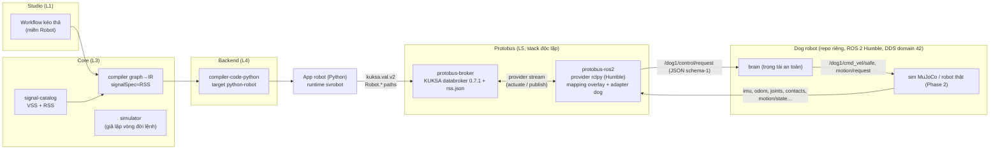
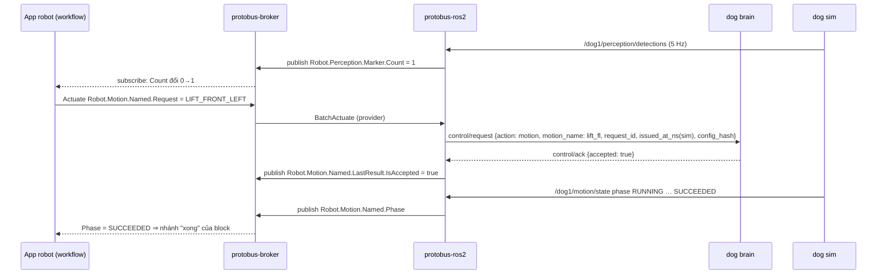

# Mở rộng Robotics: RSS, Protobus, target robot (M22–M26)

> **Trạng thái:** kế hoạch, **chưa code**. Các ADR 0064–0068 ở trạng thái **Proposed — chờ PO xác nhận**.
> **Ngày:** 2026-10-27 · **Tác giả:** Claude Code (đề xuất), PO duyệt.

## 0. Yêu cầu PO (2026-10-27, nguyên văn rút gọn)
1. Tạo một **trình biên dịch riêng** (ngôn ngữ nào cũng được, ngôn ngữ dễ trước) để có thêm **runtime kết nối robot**, không chỉ xe. Robot cũng có workflow kéo thả, có log và kịch bản.
2. Tương tự VSS path, tạo **RSS path (Robotic Signal Specification)**: định nghĩa tín hiệu robot chuẩn chỉnh, đủ dùng. Trước mắt cho **dog robot**, tham khảo repo [`ltnguyenlt2k/dog-ros2-simulation`](https://github.com/ltnguyenlt2k/dog-ros2-simulation).
3. Tạo một **protobus độc lập**, giống vai trò KUKSA trong Velocitas. Nhiệm vụ: ánh xạ tín hiệu RSS sang **ROS 2**, để giao tiếp với robot qua ROS 2.
4. **Mục tiêu cuối:** kéo thả workflow thành kịch bản, ví dụ:
   - nhận một tín hiệu rồi cho robot di chuyển;
   - workflow "pilot" cho robot;
   - nhảy, chào bằng cách giơ chân…

   Tín hiệu đi đúng path RSS, qua protobus đổi sang ROS 2, tới đúng chỗ nhận/điều khiển như thiết kế trong workflow.

## 1. Tóm tắt quyết định đề xuất
| # | Câu hỏi | Đề xuất | ADR |
|---|---|---|---|
| 1 | Robot là sản phẩm riêng hay một miền trong SimVehicleApp? | **Một miền thứ hai** (`signalSpec: RSS`) trong cùng studio/compiler/IR. Mỗi app thuộc đúng một miền. | [0064](../../analysis/adr/ADR-0064-robotics-domain-signal-spec.md) |
| 2 | "Trình biên dịch riêng" là gì? | Compiler graph→IR **dùng lại** (đã trung lập ngôn ngữ). Phần riêng là **target robot**: sinh app + **runtime robot** mới. | 0064, [0067](../../analysis/adr/ADR-0067-robot-app-target-python-first.md) |
| 3 | Ngôn ngữ nào trước? | **Python** (`python-robot`), sau đó C++/Rust (qua target WASM sẵn có rồi native). | 0067 |
| 4 | RSS viết bằng định dạng nào? | **Định dạng vspec của VSS**, gốc `Robot`. Đơn vị SI theo ROS REP-103 (m, rad, s). Thêm quy ước **lệnh** (Request/Phase/Result). | [0065](../../analysis/adr/ADR-0065-rss-robotic-signal-specification.md) |
| 5 | Protobus là gì? | Một stack **độc lập** gồm: **broker** = KUKSA databroker ghim bản, không sửa, nạp cây RSS; **provider ROS 2** mới (`protobus-ros2`, rclpy) ánh xạ RSS↔ROS 2 theo **overlay mapping** khai báo; **adapter** riêng từng robot. API cho app: `kuksa.val.v2`. | [0066](../../analysis/adr/ADR-0066-protobus-rss-ros2-bridge.md) |
| 6 | An toàn? | Protobus **chỉ** gọi giao diện điều khiển cấp cao robot cho phép (dog: envelope `control/request` qua Brain). **Không bao giờ** phát lệnh motor/`cmd_vel/safe`. Lệnh vận tốc có TTL, mất làm mới ⇒ dừng. STOP luôn được ưu tiên. Mỗi robot chỉ một app điều khiển tại một thời điểm. | 0066 |
| 7 | Block/kịch bản robot? | Block cấp cao (Di chuyển, Đi tới điểm, Thực hiện động tác, Dừng, Arm…), **lowering về opcode IR có sẵn**. Simulator giả lập vòng đời lệnh. Có mẫu workflow "pilot tuần tra", "chào khi thấy marker", "nhảy theo tín hiệu". | [0068](../../analysis/adr/ADR-0068-robot-blocks-commands-and-scenarios.md) |

## 2. Dữ kiện đã kiểm (2026-10-27, GitHub API/raw, không đoán)
### 2.1 Repo dog robot — `ltnguyenlt2k/dog-ros2-simulation` @ `9adea9be8622dade41fc3238ed3dcb26132b22c9` (2026-10-27, Apache-2.0, private)
- **Robot và runtime:**
  - robot tham khảo **Unitree Go2**, 12 khớp;
  - vật lý **MuJoCo 500 Hz**, policy ONNX/PD 50 Hz;
  - **ROS 2 Humble**, image `ros:humble-ros-base-jammy@sha256:566b87e6dfc48392189a9c32e594e84060fa9948de93b04e536f39475a1f6963`;
  - RMW **CycloneDDS**, `ROS_DOMAIN_ID=42`.
- **Tiến trình:** Compose với các service `sim`, `brain`, `render`, `slam`, `perception`, `nav2`, `gateway` (HTTP `127.0.0.1:8090`), `recorder`.
- **DDS:** `config/common/cyclonedds.xml` có `AllowMulticast=false`, peer **unicast theo tên service** (sim, brain, render, perception, slam, nav2, gateway). Một bridge bên ngoài phải vào cùng docker network và được peer thấy (spike S-R3).
- **Topic** (48 topic, nguồn `contracts/ros2/topics.json`, prefix `/dog1`). Các topic RSS v0.1 dùng:

| Topic | Type | Hz |
|---|---|---|
| `imu/data` | `sensor_msgs/Imu` | 100 |
| `joint_states` | `sensor_msgs/JointState` | 50 |
| `odom` | `nav_msgs/Odometry` | 50 |
| `foot_contacts` | `dog_interfaces/FootContacts` (`feet[4]`, `contact[4]`, `normal_force_n[4]`) | 50 |
| `battery_state` | `sensor_msgs/BatteryState` | 1 |
| `scan` | `sensor_msgs/LaserScan` | 10 |
| `perception/detections` | `vision_msgs/Detection2DArray` | 5 |
| `brain/state`, `motion/state`, `sim/state` | `std_msgs/String` JSON schema-1 | 20 / 50 / 50 |
| `control/request` → `control/ack` | String JSON schema-1 | event |

- **Đường điều khiển:**
  - Mọi lệnh từ ngoài đi qua `/dog1/control/request` dạng **JSON schema-1** (`std_msgs/String`). Ack trả về ở `/dog1/control/ack`.
  - Node **Brain** là trọng tài lệnh an toàn duy nhất, phát `/dog1/cmd_vel/safe`.
  - Action được phép: `stop`, `disarm`, `reset_stop`, `arm`, `manual` (linear ≤ 0,5 m/s, angular ≤ 0,65 rad/s), `goal`, `route`, `cancel`, `motion` (`crouch`, `bow`, `tilt`, `lift_fl`, `jump`; `stairs_round_trip` sau cờ), `motion_cancel`.
- **Envelope schema-1:**
  - Có `schema`, `config_hash` (sha256 của `runtime.json` + `courtyard.json`), `issued_at_ns` theo **đồng hồ ROS dùng sim time**, và `request_id` (UUID).
  - Brain bỏ request có `config_hash` sai. `manual` quá **0,25 s** tuổi bị từ chối, các action khác quá 1 s.
  - `manual` cần **làm mới liên tục** (deadman; command watchdog 0,2 s).
- **Mode Brain:** `DISARMED`, `MANUAL`, `AUTO`, `MOTION`, `SAFE_STOP`.
  - Động tác cần `MANUAL`, sensor khoẻ, đứng yên 4 chân, trong vùng thử courtyard ≤ 0,6 m từ spawn, scan trống ≥ 1 m.
  - Kết quả thật đến từ `/dog1/motion/state`, phase `DISPATCHED/RUNNING/RECOVERING/SUCCEEDED/CANCELLED/FAILED/REJECTED`. **ACK chỉ là được nhận vào hàng đợi, không phải thành công.**
- **Phạm vi:** robot thật/Jetson là Phase 2 của repo dog, **chưa commissioning**. Web STOP không thay E-stop vật lý.

### 2.2 Phía SimVehicleApp
- **KUKSA databroker 0.7.1** (`databroker/src/vss.rs`, tag `0.7.1` = `a79e2420b3`): gốc cây là `RootEntry(HashMap<String, Entry>)`, tên gốc tuỳ ý; "Vehicle" chỉ có trong fixture test. ⇒ **nạp được cây gốc `Robot`**. Vẫn phải xác nhận bằng spike S-R1.
- **IR v1:**
  - `signals[].path` theo pattern chung `^[A-Za-z][A-Za-z0-9_]*(\.[A-Za-z0-9_]+)+$`;
  - opcode `vehicle.read/write/...` không phụ thuộc gốc;
  - riêng compiler có regex template `<(Vehicle(?:\.…)+)>` (`compile.ts:169,172`) và kiểu `VehicleLookup` ⇒ phải tổng quát hoá.
- **Mã model:** `^v[0-9]+\.[0-9]+(-name)?$` (ADR-0052) ⇒ RSS cần một trường **spec** đi kèm release, không nhồi vào tên release.
- **Bảng đơn vị** (`core/packages/units`): **chưa có `rad`, `rad/s`**; đã có m, m/s, m/s^2, N, Nm, percent, V, A. ⇒ thêm đơn vị (additive).
- **Runtime Python** (`compiler-code-python/runtime/simvehicleapp_runtime`): lõi `runtime.py`/`strand.py`/`values.py` **không phụ thuộc Velocitas**, giao tiếp qua port `VehicleAccess`/`PubSub`; đã có client `kuksa_v2`. ⇒ target robot Python chỉ cần adapter + template mới.
- **Target WASM** (ADR-0061): `sv-wasm-host` nói thẳng `kuksa.val.v2`, không Velocitas ⇒ C++/Rust chạy với protobus gần như không cần code mới (kiểm ở M25).

### 2.3 Upstream khác
| Thành phần | Bản / license | Nguồn |
|---|---|---|
| ROS 2 Humble | EOL **05/2027**; Jazzy EOL 05/2029; Kilted EOL 11/2026; nhánh `lyrical` đã có trong `ros2/ros2` | REP-2000 (`ros-infrastructure/rep`), `ros2/ros2` branches |
| COVESA vss-tools | tag mới nhất `v4.1.1` (`cfbead206a17`), **MPL-2.0** | GitHub tags API |
| KUKSA databroker | 0.7.1, Apache-2.0, đã ghim trong BASELINE | `docs/BASELINE.md` |

## 3. Kiến trúc


**Luồng mẫu: "thấy marker đỏ ⇒ chào bằng chân".**


## 4. RSS v0.1 (chi tiết: ADR-0065)
**Nguyên tắc:**
- Định dạng **vspec của VSS**, gốc `Robot`, biên dịch ra JSON bằng **vss-tools ghim bản**, cùng định dạng KUKSA nạp được.
- Path tổng quát cho mọi robot 4 chân. Tên riêng của robot (topic, joint name, action) **không** nằm trong spec mà nằm trong **overlay mapping** của protobus.
- Đơn vị SI theo REP-103: m, rad, s, N, Nm, V, A, percent. Trục `x` tiến, `y` trái, `z` lên. Góc Euler roll/pitch/yaw.
- Không chứa luồng dữ liệu lớn (ảnh, point cloud). RSS chỉ mang giá trị rút gọn (khoảng cách nhỏ nhất, số marker…).
- **Lệnh (command pattern):**
  - `…Request` là actuator: ghi = ra lệnh;
  - `…Phase`/`…State` là sensor vòng đời;
  - `…LastResult.IsAccepted/Reason` là kết quả nhận lệnh;
  - `…ExecutionId` để đối chiếu.

**Cây v0.1** (≈ 75 leaf; bản đầy đủ có datatype/min/max/allowed sẽ là file vspec ở M22-T02):

| Nhánh | Leaf (kiểu, đơn vị, access) | Dog (ROS 2) |
|---|---|---|
| `Robot.Identity` | `Id`, `Model`, `Backend` (SIM/REAL), `ContractVersion` — attribute string | `sim/state`, `runtime.json` |
| `Robot.Connection` | `IsOnline` (bool), `IsHandshakeComplete` (bool) — sensor, **do protobus tạo** | telemetry còn tươi, đã học `config_hash` |
| `Robot.Safety` | `Mode` (string: DISARMED/MANUAL/AUTO/MOTION/SAFE_STOP), `Reason`, `IsArmed`, `IsStopLatched` — sensor | `brain/state` JSON |
| `Robot.Safety.Command` | `Request` actuator (ARM/DISARM/STOP/RESET_STOP); `LastResult.IsAccepted`, `LastResult.Reason` | `control/request` → `control/ack` |
| `Robot.Pose` | `Position.X/Y/Z` (m), `Orientation.Roll/Pitch/Yaw` (rad) — sensor, frame `odom` | `odom` (quaternion → RPY) |
| `Robot.Velocity` | `Linear.X/Y` (m/s), `Angular.Z` (rad/s) — sensor đo được | `odom.twist` |
| `Robot.Motion.Velocity` | `Linear.X` (±0,5 m/s), `Linear.Y`, `Angular.Z` (±0,65 rad/s) — **actuator**, có TTL | `manual` (Linear.Y: dog chưa hỗ trợ ⇒ unmapped) |
| `Robot.Motion.Named` | `Request` actuator (CROUCH/BOW/TILT/LIFT_FRONT_LEFT/JUMP/STAIRS_ROUND_TRIP); `Cancel` actuator bool; `Phase`, `Active`, `ExecutionId`, `Reason` sensor; `LastResult.*` | `motion`/`motion_cancel`, `motion/state` |
| `Robot.Navigation` | `Goal.X/Y` (m, frame map) actuator; `Command.Request` (GO_TO_GOAL/FOLLOW_SCENE_ROUTE/CANCEL); `State` (IDLE/ACTIVE/SUCCEEDED/FAILED/CANCELLED); `LastResult.*` | `goal`/`route`/`cancel`, `brain/state.mission` |
| `Robot.Imu` | `AngularVelocity.X/Y/Z` (rad/s), `LinearAcceleration.X/Y/Z` (m/s^2), `Orientation.Roll/Pitch/Yaw` (rad) | `imu/data` |
| `Robot.Leg.{FrontLeft,FrontRight,RearLeft,RearRight}` | `Foot.IsInContact` (bool), `Foot.ContactForce` (N); `Joint.{Hip,Thigh,Calf}.Position` (rad), `.Velocity` (rad/s), `.Effort` (Nm) | `foot_contacts` (theo `feet`), `joint_states` (theo `name`) |
| `Robot.PowerSystem.Battery` | `StateOfCharge` (percent), `Voltage` (V), `Current` (A), `IsCharging` (bool) | `battery_state` (`percentage`×100) |
| `Robot.Perception` | `Obstacle.MinDistance`, `Obstacle.FrontMinDistance` (m); `Marker.Count` (uint8), `Marker.IsDetected` (bool) | `scan` (min/sector ±30°), `perception/detections` |
| `Robot.Simulation` | `SceneId` (string), `IsPaused` (bool) — chỉ khi Backend=SIM | `sim/state` |

## 5. Protobus (chi tiết: ADR-0066)
- **`protobus-broker`:** image KUKSA databroker **đúng digest đã ghim** (không fork), `--vss /rss/rss_v0.1.json`. Port `127.0.0.1:${SV_PROTOBUS_PORT}`. API cho app là `kuksa.val.v2`.
- **`protobus-ros2`:** provider Python (rclpy, ROS 2 Humble), image dựng `FROM` **cùng digest Humble của robot**. Nó:
  1. đăng ký (claim) mọi actuator RSS có mapping qua `OpenProviderStream`;
  2. subscribe các topic ROS 2 theo overlay, áp transform, `PublishValues` lên broker (giới hạn `maxRateHz`);
  3. nhận `BatchActuate` ⇒ gọi adapter của robot;
  4. tự sinh `Robot.Connection.*`.
- **Overlay mapping** = file vspec overlay có thuộc tính mở rộng `ros2`. Tiền lệ: provider CAN của KUKSA dùng overlay VSS với thuộc tính `dbc`. Ví dụ (profile `dog-go2-sim`):
```yaml
Robot.Imu.AngularVelocity.X:
  ros2: { topic: /dog1/imu/data, type: sensor_msgs/msg/Imu, field: angular_velocity.x, qos: sensor_data, maxRateHz: 20 }
Robot.Pose.Orientation.Yaw:
  ros2: { topic: /dog1/odom, type: nav_msgs/msg/Odometry, field: pose.pose.orientation, transform: quaternion_to_yaw }
Robot.Leg.FrontLeft.Foot.IsInContact:
  ros2: { topic: /dog1/foot_contacts, type: dog_interfaces/msg/FootContacts, field: contact, select: { by: feet, equals: FL } }
Robot.Perception.Obstacle.MinDistance:
  ros2: { topic: /dog1/scan, type: sensor_msgs/msg/LaserScan, field: ranges, transform: min_finite }
Robot.Safety.Mode:
  ros2: { topic: /dog1/brain/state, type: std_msgs/msg/String, json: $.mode }
Robot.Motion.Velocity.Linear.X:
  ros2: { adapter: dog-control/1, command: manual, field: linear, refreshHz: 20, ttlMs: 300 }
Robot.Motion.Named.Request:
  ros2: { adapter: dog-control/1, command: motion, field: motion_name,
          enum: { CROUCH: crouch, BOW: bow, TILT: tilt, LIFT_FRONT_LEFT: lift_fl, JUMP: jump } }
Robot.Motion.Named.Phase:
  ros2: { topic: /dog1/motion/state, type: std_msgs/msg/String, json: $.phase }
```
- **Transform cố định, tất định, không có code tuỳ ý:** `identity`, `scale(k)`, `offset(c)`, `quaternion_to_roll|pitch|yaw`, `min_finite`, `sector_min(deg)`, `array_index(i)`, `select(by, equals)`, `json(path)`, `enum(map)`, `count`, `bool_from(expr cố định: eq/ne/in)`.
- **Adapter `dog-control/1`** (riêng repo dog):
  - học `config_hash` từ telemetry JSON của robot (`brain/state`);
  - `issued_at_ns` lấy theo `/clock` (`use_sim_time`);
  - `request_id` UUID; đối chiếu ack ở `control/ack`;
  - làm mới `manual` 20 Hz khi target còn hạn TTL;
  - `motion` chỉ khi `Mode=MANUAL`, nếu không trả `LastResult.IsAccepted=false` kèm lý do của Brain.
- **Luật an toàn** (PHẢI, xem ADR-0066 §4):
  - không phát `cmd_vel*`, LowCmd, `motion/request` hay `sim/request` trực tiếp;
  - mất làm mới ⇒ gửi vận tốc 0 một lần rồi ngừng;
  - STOP luôn đi ngay, bỏ qua hàng đợi;
  - ARM từ workflow chỉ khi profile `allowRemoteArm` (SIM: true; REAL: false);
  - một **lease điều khiển** mỗi robot.
- **Triển khai:**
  - compose profile `robot`, fragment `modules/protobus/compose.yaml`;
  - `protobus-ros2` vào **external network** của stack dog (`SV_ROBOT_NETWORK`), dùng `ROS_DOMAIN_ID` và CycloneDDS peer tới các service dog;
  - không mount docker.sock, port chỉ bind 127.0.0.1.

## 6. Compiler, IR và target (ADR-0064, 0067)
- **Thêm, không phá:**
  - `signalSpec: "VSS" | "RSS"` (mặc định VSS) trong WorkflowGraph, Scenario, Project, IR (`irVersion` 1.x minor), catalog API;
  - catalog phục vụ `/{spec}/{release}`, route cũ là alias VSS;
  - `VehicleLookup` ⇒ `SignalLookup(spec, release, paths)`; regex template theo gốc của spec.
- **Opcode giữ nguyên.** `vehicle.read/write/...` được tài liệu hoá là "thao tác kho tín hiệu", trung lập spec. Mã diagnostic cũ giữ nguyên; mã mới chỉ thêm (ADR-0068 §5).
- **Target `python-robot`** (module `compiler-code-python`, service `codegen-python-robot`):
  - cùng emitter IR→Python;
  - template project Python thuần (không Velocitas);
  - runtime `svrobot` = lõi `simvehicleapp_runtime` + adapter `KuksaV2SignalAccess` không Velocitas + `MqttPubSub` tuỳ chọn;
  - Dockerfile `python:3.12-slim` ghim digest.
- **Sau Python:** C++/Rust chạy trên robot qua target WASM sẵn có (`sv-wasm-host` trỏ protobus, allowlist path `Robot.*`), rồi mới tới native.

## 7. Block, kịch bản và mẫu workflow (ADR-0068)
**Block robot** (nhóm "Robot" trong toolbar khi project là miền RSS):

| Block | Lowering (opcode có sẵn) |
|---|---|
| **Khi tín hiệu robot đổi / khi điều kiện** | dùng lại `sv_on_signal_changed` / `sv_on_condition` với path `Robot.*` |
| **Arm / Disarm / Dừng khẩn / Reset dừng** | `vehicle.write Robot.Safety.Command.Request` |
| **Di chuyển** (tiến/lùi/quay, tốc độ, thời gian) | `control.repeat` mỗi 100 ms × `vehicle.write_many(Linear.X, Angular.Z)` hết thời gian ⇒ ghi 0. Ra handle `done`/`error`. |
| **Đi tới điểm (x, y)** | `vehicle.write_many(Goal.X, Goal.Y)` ⇒ `vehicle.write Navigation.Command.Request=GO_TO_GOAL` ⇒ `control.wait_until(State ∈ terminal, timeout)` ⇒ `control.branch` succeeded/failed/timeout |
| **Thực hiện động tác** (Ngồi/Cúi chào/Nghiêng/Giơ chân trước trái/Nhảy) | `vehicle.write Named.Request` ⇒ chờ `LastResult` ⇒ `wait_until(Phase terminal, timeout)` ⇒ nhánh |
| **Đọc trạng thái robot** (pin, tư thế, khoảng cách vật cản…) | `vehicle.read` |
| **Tuần tra** (danh sách waypoint) | `control.repeat` lồng block "Đi tới điểm" (sub-workflow ADR-0063) |

**Simulator:** profile mô phỏng vòng đời lệnh có khai báo. Ví dụ `Named.Request` ⇒ Phase DISPATCHED (+50 ms) ⇒ RUNNING ⇒ SUCCEEDED (+thời lượng theo động tác); điều kiện REJECTED khi Mode≠MANUAL. Dùng cho Simulate và Test **không cần robot**. Không mô phỏng vật lý.

**Mẫu workflow kịch bản** (template trong studio, đồng thời là golden robot RW-A..RW-D):
- **RW-A "Chào khi thấy marker":** `Marker.Count > 0` ⇒ Giơ chân trước trái ⇒ Cúi chào.
- **RW-B "Pilot tuần tra":** Arm ⇒ lặp qua 3 waypoint, mỗi điểm "Đi tới điểm". Nếu `Obstacle.FrontMinDistance < 0,5 m` ⇒ Dừng khẩn ⇒ log.
- **RW-C "Nhảy theo tín hiệu":** MQTT `robot/cmd = jump` ⇒ Thực hiện động tác Nhảy ⇒ publish kết quả MQTT.
- **RW-D "Pin yếu":** `Battery.StateOfCharge < 20` liên tục 5 s ⇒ Dừng ⇒ Ngồi ⇒ log cảnh báo.

## 8. Studio
- Tạo app chọn **Miền: Xe (VSS) | Robot (RSS)**.
  - Miền Robot: toolbar hiện cây RSS và nhóm block Robot, ẩn block riêng xe (HMI, door…).
  - Signals panel/Live/Flow chạy qua signal-gateway trỏ `protobus-broker`.
- Run: chọn **robot đích** (profile protobus). Lease điều khiển hiện rõ ai đang giữ robot. Nút **STOP robot** luôn hiện ở thanh Run.
- Link "Mở Robot Zoo" tới GUI 3D của repo dog (`127.0.0.1:8090`) để xem robot chuyển động. Studio không dựng 3D.
- Trợ lý AI: MCP tool catalog trả cây RSS; WorkflowPatch dùng block Robot. Luật cũ giữ nguyên: AI không nằm trong đường sinh code.

## 9. Spike phải làm trước khi code thật
| Spike | Câu hỏi | Tiêu chí PASS |
|---|---|---|
| S-R1 | KUKSA 0.7.1 nạp `rss.json` gốc `Robot`, actuator string có `allowed` | Get/Subscribe/Actuate `Robot.*` qua `kuksa.val.v2` |
| S-R2 | vss-tools (MPL-2.0, chỉ dùng như tool build) biên dịch vspec gốc `Robot` với `instances` và overlay `ros2` | JSON tất định, 2 lần build cùng bytes |
| S-R3 | DDS: container ngoài compose dog thấy topic khi `AllowMulticast=false` + peer theo tên | `ros2 topic echo /dog1/imu/data` từ container `protobus-ros2`. Nếu cần sửa `cyclonedds.xml` của repo dog ⇒ ghi yêu cầu cho repo dog. |
| S-R4 | Envelope dog: học `config_hash`, `issued_at_ns` sim time, ack | `arm` ⇒ Mode MANUAL; `motion bow` ⇒ Phase SUCCEEDED; `manual` 20 Hz ⇒ robot đi; ngừng làm mới ⇒ dừng ≤ 0,5 s |
| S-R5 | Provider `kuksa.val.v2` bằng Python (grpcio) | Claim actuator, nhận BatchActuate, PublishValues 50 Hz ổn định 10 phút |
| S-R6 | Message tuỳ biến `dog_interfaces` trong image bridge | Build `dog_interfaces` từ repo dog đúng SHA (Apache-2.0) và import được trong rclpy |

## 10. Lộ trình (chi tiết ở `analysis/phases/M22…M26`)
| M | Tên | Kết quả | Gate |
|---|---|---|---|
| [M22](../../analysis/phases/M22-rss-spec-and-catalog.md) | RSS v0.1 + catalog đa spec | vspec RSS, `rss_v0.1.json`, overlay dog, catalog `/{spec}/{release}`, đơn vị rad, cây RSS trong studio (chỉ đọc), S-R1, S-R2 | KUKSA nạp RSS; catalog test; 100 % topic dog trong §2.1 được ánh xạ hoặc ghi "ngoài phạm vi" có lý do |
| [M23](../../analysis/phases/M23-protobus.md) | Protobus | `protobus-broker` + `protobus-ros2` + adapter `dog-control/1` + luật an toàn + compose `robot`, S-R3..S-R6 | Live trên dog sim: đọc ≥ 20 tín hiệu; arm/manual/motion/stop qua RSS; test mất làm mới ⇒ dừng; fault test |
| [M24](../../analysis/phases/M24-robot-compiler-blocks-simulator.md) | Compiler + block + simulator miền robot | `signalSpec`, block Robot, lowering, mock vòng đời lệnh, diagnostics mới, golden RW-A..RW-D | Golden IR tất định ×2; conformance robot; không đổi golden GW-A..G |
| [M25](../../analysis/phases/M25-python-robot-target.md) | Target `python-robot` + runtime `svrobot` + Run | Codegen, toolchain, run trên protobus, trace/Flow, lease | Parity simulator ↔ app (protobus + provider mock); `@live` RW-A..RW-D trên dog sim |
| [M26](../../analysis/phases/M26-robot-studio-ux-e2e.md) | Studio miền Robot + E2E + video | Chọn miền, toolbar RSS, mẫu kịch bản, STOP/lease UI, AI biết RSS, tài liệu, video | `@live` robot full luồng + video nhịp người dùng + README/user guide |

Thứ tự bắt buộc: M22 → M23 → M24 → M25 → M26. M24 có thể chạy song song M23 sau khi M22 xong.

## 11. Rủi ro và câu hỏi mở
| # | Rủi ro / câu hỏi | Mức | Hướng xử lý |
|---|---|---|---|
| RR1 | DDS discovery giữa hai compose project (multicast tắt) | Cao | S-R3. Phương án: thêm peer `protobus-ros2` vào `cyclonedds.xml` của repo dog (PR bên repo dog), hoặc chạy bridge trong compose dog. |
| RR2 | Envelope schema-1 của dog còn "v1, typed v2 draft". Đổi sang message typed thì adapter đổi. | TB | Adapter có version (`dog-control/1`), contract test với fixture JSON thật của repo dog |
| RR3 | Humble hết hỗ trợ 05/2027 | TB | Bridge theo đúng distro của robot. ADR nâng distro khi repo dog nâng. |
| RR4 | Tốc độ cao (IMU 100 Hz, 12 khớp × 3 × 50 Hz) làm broker quá tải | TB | `maxRateHz` theo mapping (mặc định khớp 10 Hz), đo ở S-R5 |
| RR5 | An toàn: workflow ra lệnh robot ngoài ý muốn | Cao | Chỉ giao diện cấp cao qua Brain, TTL, STOP ưu tiên, lease, `allowRemoteArm`. REAL backend **ngoài phạm vi** tới khi repo dog commissioning. |
| RR6 | Repo dog là private: CI SimVehicleApp không clone được | TB | Contract test bằng fixture topic/JSON chép có ghi nguồn (Apache-2.0). Live test chạy local/self-hosted. **Chờ PO:** cấp quyền đọc cho CI hoặc public repo. |
| RR7 | Nhầm lẫn miền (path Vehicle trong app robot) | Thấp | Diagnostic `SIGNAL_SPEC_MISMATCH` (error) |

**Chờ PO xác nhận:**
1. Tên gọi "Protobus" cho stack bridge.
2. Python là ngôn ngữ đầu.
3. Danh sách động tác v0.1 = đúng 5 động tác đã kiểm của dog (+ `stairs_round_trip` sau cờ).
4. Cách xử lý RR6.
5. Có cho ARM từ workflow trên SIM theo mặc định không.

## 12. Ngoài phạm vi v0.1
- Robot thật (Go2 hardware), Jetson.
- Raw camera/point cloud qua RSS.
- Mô phỏng vật lý robot trong simulator SimVehicleApp: vật lý là việc của repo dog.
- Nhiều robot cùng lúc: kiến trúc cho phép (prefix `/dogN`, profile riêng) nhưng gate chỉ 1 robot.
- Phát lệnh trực tiếp ROS 2 từ app (bỏ qua protobus).
