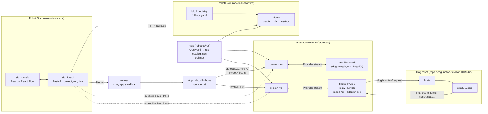
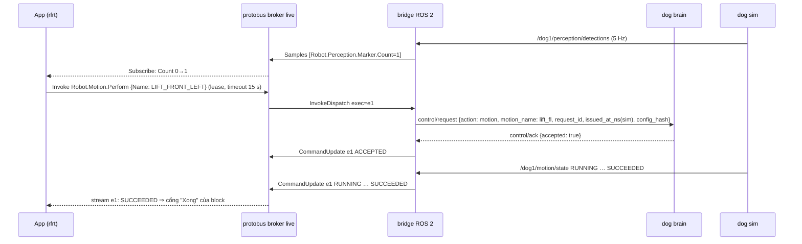

# Robotics: stack độc lập — RSS, Protobus, RobotFlow, Robot Studio (M22–M27)

> **Trạng thái:** kế hoạch, **chưa code**. ADR 0064–0068 ở trạng thái **Accepted for implementation 2026-10-29; gates OPEN**.
> **Ngày:** 2026-10-27, viết lại 2026-10-28 · **Tác giả:** Claude Code (đề xuất), PO duyệt.

## 0. Yêu cầu PO
**2026-10-27 (rút gọn):**
1. Tạo một **trình biên dịch riêng** (ngôn ngữ nào cũng được, ngôn ngữ dễ làm trước) để có thêm **runtime kết nối robot**, không chỉ xe. Có workflow kéo thả, có log và kịch bản.
2. Tương tự VSS path, tạo **RSS path (Robotic Signal Specification)**: định nghĩa tín hiệu robot chuẩn chỉnh, đủ dùng. Trước mắt cho **dog robot** (repo [`ltnguyenlt2k/dog-ros2-simulation`](https://github.com/ltnguyenlt2k/dog-ros2-simulation)).
3. Tạo một **protobus độc lập**, vai trò như KUKSA trong Velocitas: ánh xạ tín hiệu RSS sang **ROS 2** để giao tiếp với robot.
4. **Mục tiêu cuối:** kéo thả workflow thành kịch bản, ví dụ:
   - nhận một tín hiệu rồi cho robot di chuyển;
   - workflow "pilot" cho robot;
   - nhảy, chào bằng cách giơ chân…

   Tín hiệu đi đúng path RSS, qua protobus đổi sang ROS 2, tới đúng chỗ nhận/điều khiển như thiết kế trong workflow.

**2026-10-28 (đính chính, nguyên văn ý):** "luồng mới này là **độc lập, không dùng lại cái gì hiện có cả**… trước đó tôi bảo là **tham khảo thôi**… luồng này sẽ thực hiện **từ đầu và riêng biệt**."

⇒ Bản 2026-10-27 **sai ở gốc**: nó gắn robot vào studio, compiler, IR, simulator, runtime Python hiện có và dùng KUKSA làm broker. Bản này thay toàn bộ. §13 liệt kê từng điểm đã bỏ.

## 1. Nguyên tắc độc lập (ADR-0064)
| Được | Không được |
|---|---|
| Đọc tài liệu, ADR, code hiện có để **tham khảo ý tưởng** và bài học | `import`, copy, vendor, symlink code từ `modules/**` (studio fork Sim, core compiler/IR/simulator/blocks/units, orchestrator, workspace, signal-gateway, wasm-host, AI, compiler-code-*, contracts) |
| Dùng chung **git repo, GitHub Actions, quy trình** (ADR, ROADMAP, phase, gate, report) | Dùng KUKSA databroker, Velocitas, VSS hay vss-tools, image/toolchain hiện có, `scripts/sv`, helper E2E hiện có |
| Dùng **thư viện bên thứ ba** có license phù hợp (§11.3) | Dùng chung contract, schema, mã diagnostic, compose project, network, volume, port với stack xe |
| Áp các luật kỹ thuật chung: tất định, không LLM trong đường sinh code, Compose là mode chạy duy nhất, không docker.sock, port 127.0.0.1, ADR cho mọi đổi kiến trúc, mã diagnostic là API công khai | Để stack xe phụ thuộc vào stack robot hoặc ngược lại |

**Vị trí:** thư mục gốc **`robotics/`** trong repo này. Mỗi thư mục con là một module, chỉ phụ thuộc `robotics/contracts`. Có `AGENTS.md`, compose project, CI workflow và CLI riêng. Tách thành repo riêng chỉ cần `git subtree split`, không phải sửa code. **Chờ PO:** giữ chung repo (đề xuất) hay tách repo ngay.

**Tên tạm** (chờ PO):

| Tên | Thành phần |
|---|---|
| **Robot Studio** | sản phẩm |
| `sr` | CLI và compose project |
| **RSS** | đặc tả tín hiệu |
| **Protobus** | bus tín hiệu + cầu ROS 2 |
| **RobotFlow** | ngôn ngữ workflow; compiler `rflowc`, IR `rfir`, runtime `rfrt` |

## 2. Dữ kiện đã kiểm
Ngày kiểm: 2026-10-27/28, qua GitHub API/raw, không đoán.

### 2.1 Repo dog robot
`ltnguyenlt2k/dog-ros2-simulation` @ `9adea9be8622dade41fc3238ed3dcb26132b22c9` (Apache-2.0, private).
- **Robot và runtime:**
  - **Unitree Go2** mô phỏng, 12 khớp;
  - vật lý **MuJoCo 500 Hz**, policy ONNX/PD 50 Hz;
  - **ROS 2 Humble**, image `ros:humble-ros-base-jammy@sha256:566b87e6dfc48392189a9c32e594e84060fa9948de93b04e536f39475a1f6963`;
  - RMW **CycloneDDS**, `ROS_DOMAIN_ID=${DOG_ROS_DOMAIN_ID:-42}`.
- **Compose** (`deploy/compose/compose.yaml`):
  - service `sim`, `brain`, `render`, `slam`, `perception`, `nav2`, `gateway`, `recorder`, cùng network `robot`;
  - `gateway` (GUI "Robot Zoo") bind `127.0.0.1:${DOG_HTTP_PORT:-8090}`.
- **DDS** (`config/common/cyclonedds.xml`):
  - `AllowMulticast=false`, interface `eth0`;
  - `Peers` cố định theo tên service: sim, brain, render, perception, slam, nav2, gateway; `MaxAutoParticipantIndex=64`.
  - ⇒ Cầu ROS 2 của ta phải vào network `robot` và được các node dog phát hiện. Đây là spike S-R1.
- **Topic** (48 topic, nguồn `contracts/ros2/topics.json`, prefix `/dog1`). Các topic RSS v0.1 dùng:

| Topic | Type | Hz |
|---|---|---|
| `imu/data` | `sensor_msgs/Imu` | 100 |
| `joint_states` | `sensor_msgs/JointState` | 50 |
| `odom` | `nav_msgs/Odometry` | 50 |
| `foot_contacts` | `dog_interfaces/FootContacts` (`feet[4]`, `contact[4]`, `normal_force_n[4]`) | 50 |
| `battery_state` | `sensor_msgs/BatteryState` | 1 |
| `scan` | `sensor_msgs/LaserScan` | 10 |
| `perception/detections` | `vision_msgs/Detection2DArray` | 5 |
| `brain/state`, `motion/state`, `sim/state` | `std_msgs/String` JSON schema-1 | 20 / 50 / 50 |
| `control/request` → `control/ack` | String JSON schema-1 | event |

- **Đường điều khiển:**
  - Mọi lệnh từ ngoài đi qua `/dog1/control/request` (JSON schema-1). Ack ở `/dog1/control/ack`.
  - **Brain** là trọng tài an toàn duy nhất, phát `/dog1/cmd_vel/safe`.
  - Action được phép: `stop`, `disarm`, `reset_stop`, `arm`, `manual` (linear ≤ 0,5 m/s, angular ≤ 0,65 rad/s), `goal`, `route`, `cancel`, `motion` (`crouch`, `bow`, `tilt`, `lift_fl`, `jump`; `stairs_round_trip` sau cờ), `motion_cancel`.
- **Envelope schema-1:**
  - Trường: `schema`, `config_hash` (sha256 `runtime.json` + `courtyard.json`), `issued_at_ns` theo **đồng hồ ROS dùng sim time**, `request_id` (UUID).
  - Brain bỏ request sai `config_hash`. `manual` quá **0,25 s** tuổi bị từ chối, các action khác quá 1 s.
  - `manual` phải **làm mới liên tục** (command watchdog 0,2 s).
- **Mode Brain:** `DISARMED`, `MANUAL`, `AUTO`, `MOTION`, `SAFE_STOP`.
  - Động tác cần `MANUAL`, sensor khoẻ, đứng yên 4 chân, ≤ 0,6 m từ spawn, scan trống ≥ 1 m.
  - Kết quả thật ở `/dog1/motion/state`, phase `DISPATCHED/RUNNING/RECOVERING/SUCCEEDED/CANCELLED/FAILED/REJECTED`. **ACK chỉ là đã vào hàng đợi.**
- **Phạm vi:** robot thật/Jetson là Phase 2 của repo dog, **chưa commissioning**. STOP trên web không thay E-stop vật lý.

### 2.2 Upstream bên thứ ba
| Thành phần | Bản / license | Nguồn | Dùng ở |
|---|---|---|---|
| ROS 2 Humble | EOL **05/2027** (Jazzy 05/2029) | REP-2000 | cầu ROS 2, theo distro của robot |
| CycloneDDS | EPL-2.0 OR EDL-1.0 | `eclipse-cyclonedds/cyclonedds` LICENSE | RMW trong image Humble (không vendor) |
| gRPC / protobuf (Python `grpcio`) | Apache-2.0 | `grpc/grpc` | giao thức Protobus |
| FastAPI | MIT | `fastapi/fastapi` | API studio, service compiler |
| pydantic | MIT | `pydantic/pydantic` | schema/validate Python |
| React Flow (`@xyflow/react`) | MIT | `xyflow/xyflow` | canvas kéo thả |
| Vite | MIT | `vitejs/vite` | build web |

Bản cụ thể của từng thư viện được ghim ở task đầu của milestone dùng nó (skill `upstream-verify`), không ghi từ trí nhớ.

## 3. Kiến trúc tổng thể


**Hai broker tách biệt:**
- **Simulate/Test** chạy trên broker sim + provider mock, không bao giờ chạm robot.
- **Run** chạy trên broker live + bridge ROS 2.

App sinh ra **giống hệt** ở cả hai, chỉ khác địa chỉ bus. Đây là cách đạt "parity" mà không cần viết một simulator thứ hai.

**Luồng mẫu "thấy marker ⇒ giơ chân chào":**


## 4. RSS v0.1 (ADR-0065)
**Định dạng riêng** `*.rss.yaml`, không phải vspec. Tool `rssc` (Python) validate rồi biên dịch ra `rss-catalog.json` chuẩn hoá, kèm `catalogHash = sha256(canonical JSON)`.

Có định dạng riêng thì lệnh và setpoint thành **kiểu node hạng nhất**, không phải mô phỏng bằng nhiều leaf như VSS.

| Kind | Hướng | Ý nghĩa | Ví dụ |
|---|---|---|---|
| `branch` | — | Nhóm | `Robot.Leg` |
| `attribute` | robot→app | Giá trị tĩnh của phiên | `Robot.Identity.Model` |
| `sensor` | robot→app | Đo được. Có `maxAgeMs`: quá hạn ⇒ broker đánh dấu `STALE` | `Robot.Imu.AngularVelocity.Z` |
| `setpoint` | app→robot | Giá trị liên tục, **struct nguyên tử**, có `ttlMs`, `refreshHz`, `safeValue`. Hết TTL ⇒ broker tự áp `safeValue` | `Robot.Motion.Velocity {LinearX, AngularZ}` |
| `command` | app→robot | Lệnh rời rạc có **vòng đời chuẩn**, `args`, `timeoutMs` mặc định, `preconditions` tài liệu hoá | `Robot.Motion.Perform {Name}` |

**Vòng đời lệnh chuẩn** (broker quản lý, áp cho mọi robot): `PENDING → ACCEPTED | REJECTED → RUNNING → SUCCEEDED | FAILED | CANCELLED | TIMED_OUT`.

Mỗi lệnh sinh tự động các sensor `…Status.Phase`, `…Status.ExecutionId`, `…Status.Reason` để workflow đọc như tín hiệu thường.

**Quy ước:**
- Gốc `Robot`. Path chấm, PascalCase.
- `instances` cho phần lặp, ví dụ `Leg[FrontLeft, FrontRight, RearLeft, RearRight]`.
- Kiểu: `bool`, `int32`, `int64`, `uint8`, `uint32`, `float32`, `float64`, `string`, `enum`. `int64` mã hoá chuỗi thập phân trong JSON.
- Đơn vị SI theo **REP-103** (m, rad, s, m/s, rad/s, m/s², N, N·m, V, A, %). Bảng `units.yaml` riêng.
- Khung toạ độ: `x` tiến, `y` trái, `z` lên; `frame` ghi trên từng node (`base_link`, `odom`, `map`).
- Spec **tổng quát cho robot 4 chân**. Topic, tên khớp, tên action của từng robot nằm trong **mapping profile** của Protobus, không nằm trong spec.
- Không mang luồng lớn (ảnh, point cloud). Chỉ mang giá trị rút gọn.

Ví dụ:
```yaml
rss: "0.1"
root: Robot
nodes:
  Robot.Pose.Position.X: { kind: sensor, type: float64, unit: m, frame: odom, maxAgeMs: 200 }
  Robot.Motion.Velocity:
    kind: setpoint
    fields:
      LinearX:  { type: float64, unit: m/s,   min: -0.5,  max: 0.5 }
      AngularZ: { type: float64, unit: rad/s, min: -0.65, max: 0.65 }
    ttlMs: 300
    refreshHz: 20
    safeValue: { LinearX: 0, AngularZ: 0 }
  Robot.Motion.Perform:
    kind: command
    args: { Name: { type: enum, values: [CROUCH, BOW, TILT, LIFT_FRONT_LEFT, JUMP] } }
    timeoutMs: 15000
    preconditions: "Robot.Safety.Mode == MANUAL; robot đứng yên"
  Robot.Leg[FrontLeft,FrontRight,RearLeft,RearRight].Foot.IsInContact: { kind: sensor, type: bool, maxAgeMs: 200 }
```

**Cây v0.1** (≈ 80 sensor/attribute, 1 setpoint, 7 command; bản đủ ở M22-T05):

| Nhánh | Node chính | Dog (ROS 2) |
|---|---|---|
| `Robot.Identity` | `Id`, `Model`, `Backend` (SIM/REAL), `ProfileId` — attribute | `sim/state`, profile |
| `Robot.Connection` | `IsOnline`, `IsHandshakeComplete`, `LastSampleAgeMs` — sensor **do Protobus tạo** | telemetry còn tươi, đã học `config_hash` |
| `Robot.Safety` | `Mode` (enum DISARMED/MANUAL/AUTO/MOTION/SAFE_STOP), `Reason`, `IsArmed`, `IsStopLatched` | `brain/state` |
| `Robot.Safety.Arm`, `.Disarm`, `.ResetStop` | command | `control/request` arm/disarm/reset_stop |
| `Robot.Safety.Stop` | command **ưu tiên khẩn**, không cần lease | `control/request` stop |
| `Robot.Pose` | `Position.X/Y/Z` (m), `Orientation.Roll/Pitch/Yaw` (rad), frame `odom` | `odom` (quaternion → RPY) |
| `Robot.Velocity` | `Linear.X/Y` (m/s), `Angular.Z` (rad/s) — đo được | `odom.twist` |
| `Robot.Motion.Velocity` | **setpoint** `{LinearX, AngularZ}` | `manual` (làm mới 20 Hz) |
| `Robot.Motion.Perform` | command `{Name}` | `motion` / `motion_cancel`, `motion/state` |
| `Robot.Navigation.GoTo` | command `{X, Y}` (m, frame map) | `goal`, `brain/state.mission` |
| `Robot.Navigation.FollowRoute` | command `{RouteId}` | `route` |
| `Robot.Imu` | `AngularVelocity.X/Y/Z`, `LinearAcceleration.X/Y/Z`, `Orientation.Roll/Pitch/Yaw` | `imu/data` |
| `Robot.Leg[4]` | `Foot.IsInContact`, `Foot.ContactForce` (N); `Joint[Hip,Thigh,Calf].Position/Velocity/Effort` | `foot_contacts`, `joint_states` |
| `Robot.PowerSystem.Battery` | `StateOfCharge` (%), `Voltage`, `Current`, `IsCharging` | `battery_state` |
| `Robot.Perception` | `Obstacle.MinDistance`, `Obstacle.FrontMinDistance` (m); `Marker.Count`, `Marker.IsDetected` | `scan`, `perception/detections` |
| `Robot.Simulation` | `SceneId`, `IsPaused`, `TimeNs` — chỉ khi Backend=SIM | `sim/state`, `/clock` |

## 5. Protobus (ADR-0066)
Bus tín hiệu **tự viết** theo RSS. Giao thức riêng **`protobus.v1`** (gRPC + protobuf), file `.proto` ở `robotics/contracts`.

### 5.1 Giao thức
**`service Bus`** (cho app và studio):

| RPC | Ý nghĩa |
|---|---|
| `Describe` | `robotId`, `profileId`, `rssVersion`, `catalogHash`, trạng thái provider |
| `Get(paths)` | Giá trị hiện tại, kèm `sourceTimeNs`, `brokerTimeNs`, `quality` (OK/STALE/NONE) |
| `Subscribe(paths, minIntervalMs)` → stream | Chỉ gửi khi giá trị đổi, giới hạn tần số |
| `AcquireLease(client, ttlMs)` / `RenewLease` / `ReleaseLease` | **Một lease điều khiển** mỗi robot |
| `SetTarget(lease, path, struct)` | Ghi setpoint. Broker gắn hạn = now + `ttlMs` |
| `Invoke(lease, path, args, timeoutMs)` → stream `CommandUpdate` | Lệnh có vòng đời |
| `Cancel(lease, executionId)` | Huỷ lệnh |
| `Stop(reason)` | **Không cần lease**, đi trước mọi thứ |

**`service Provider`** (cho bridge/mock), `Attach` stream hai chiều:
- provider gửi: `Hello{providerId, profileId, catalogHash, claims}`, `Samples` (theo lô), `CommandUpdate`;
- broker gửi: `SetTargetDispatch`, `InvokeDispatch`, `CancelDispatch`, `StopDispatch`, `SafeValueDispatch`.

### 5.2 Broker (Python 3.12, asyncio, `grpcio`)
Broker giữ các bất biến sau, có test cho từng điều.

| Bất biến | Cách thực hiện |
|---|---|
| Kiểu dữ liệu | Path, kind, kiểu, min/max, enum được kiểm theo catalog. Sai ⇒ lỗi `PB_*` (mã công khai, chỉ thêm) |
| Khớp spec | `catalogHash` của provider và app phải khớp broker, nếu không ⇒ từ chối `PB_CATALOG_MISMATCH` |
| TTL setpoint | Hết `ttlMs` mà không làm mới ⇒ áp `safeValue` một lần |
| Vòng đời lệnh | Broker giữ state machine và timeout (`TIMED_OUT` ⇒ gửi Cancel xuống provider) |
| Lease | Mất lease (hết hạn/app chết) ⇒ `safeValue` mọi setpoint + Cancel mọi lệnh của lease đó |
| Stop | Đi thẳng tới provider, bỏ qua hàng đợi. Kết quả chốt (latch) phản ánh ở `Robot.Safety.IsStopLatched` |
| Provider offline | Lệnh mới ⇒ `REJECTED(PROVIDER_OFFLINE)`; `Robot.Connection.IsOnline=false` |
| Audit | Mọi lệnh/setpoint/stop ghi JSONL (thời gian, client, path, kết quả) |

Mục tiêu hiệu năng (đo ở spike S-R4): ≥ 5 000 sample/s vào, 4 subscriber, p95 trễ trong broker < 5 ms, ổn định 30 phút. Không đạt ⇒ viết lại broker bằng Rust **sau cùng `.proto`** (ADR mới), app không đổi.

### 5.3 Bridge ROS 2 (`protobus-ros2`)
rclpy, image `FROM` **đúng digest Humble của robot**. Bridge kết nối broker live làm provider.
- **Mapping profile** `profiles/dog-go2-sim/mapping.yaml`, schema riêng `mapping.v1`:
```yaml
profile: dog-go2-sim
rss: "0.1"
adapter: dog-control/1
ros: { domainId: 42, namespace: /dog1, useSimTime: true }
sensors:
  Robot.Imu.AngularVelocity.X: { topic: imu/data, type: sensor_msgs/msg/Imu, field: angular_velocity.x, qos: sensor_data, maxRateHz: 20 }
  Robot.Pose.Orientation.Yaw:  { topic: odom, type: nav_msgs/msg/Odometry, field: pose.pose.orientation, transform: quaternion_to_yaw }
  Robot.Leg.FrontLeft.Foot.IsInContact: { topic: foot_contacts, type: dog_interfaces/msg/FootContacts, field: contact, select: { by: feet, equals: FL } }
  Robot.Perception.Obstacle.FrontMinDistance: { topic: scan, type: sensor_msgs/msg/LaserScan, field: ranges, transform: { sector_min: 30 } }
  Robot.Safety.Mode: { topic: brain/state, type: std_msgs/msg/String, json: $.mode }
setpoints:
  Robot.Motion.Velocity: { command: manual, fields: { LinearX: linear, AngularZ: angular } }
commands:
  Robot.Motion.Perform: { command: motion, args: { Name: { field: motion_name, enum: { CROUCH: crouch, BOW: bow, TILT: tilt, LIFT_FRONT_LEFT: lift_fl, JUMP: jump } } },
                          result: { topic: motion/state, json: $.phase } }
  Robot.Safety.Stop: { command: stop, priority: emergency }
```
- **Transform là danh sách đóng, tất định, không chạy code tuỳ ý:** `identity`, `scale(k)`, `offset(c)`, `quaternion_to_roll|pitch|yaw`, `min_finite`, `sector_min(deg)`, `array_index(i)`, `select(by, equals)`, `json(path)`, `enum(map)`, `count`, `compare(eq|ne|lt|gt, c)`.
- **Adapter `dog-control/1`:**
  - học `config_hash` từ `brain/state`;
  - `issued_at_ns` theo `/clock`;
  - `request_id` UUID; đối chiếu `control/ack`;
  - setpoint `manual` làm mới 20 Hz khi broker còn hạn TTL;
  - ánh xạ phase `motion/state` và `brain/state.mission` về vòng đời chuẩn.

### 5.4 Provider mock (`protobus-mock`)
Python thuần, không ROS. Dùng cho Simulate, Test và CI.
- Mô hình động học unicycle (vận tốc → pose) và pin giảm tuyến tính.
- **Profile vòng đời lệnh** khai báo: điều kiện nhận (ví dụ `Mode == MANUAL`), thời lượng từng phase lấy từ số đo dog thật ở M24.
- **API kịch bản:** đặt/nhảy giá trị sensor theo mốc thời gian, ép lệnh `REJECTED`/`FAILED`. Tab Test dùng API này.
- `timeScale` để chạy nhanh hơn thời gian thực trong Test.
- Có cùng mapping profile ID ⇒ app không biết mình đang chạy trên mock.

### 5.5 Luật an toàn (PHẢI)
1. Bridge **không bao giờ** phát `cmd_vel*`, LowCmd, `motion/request`, `sim/request`. Chỉ được publish `control/request`. Có test tĩnh allowlist publisher.
2. Setpoint hết TTL ⇒ `safeValue` (vận tốc 0) một lần rồi ngừng. Brain dog còn watchdog 0,2 s riêng.
3. `Stop` luôn đi ngay, không cần lease, bỏ qua hàng đợi.
4. `Arm` từ workflow chỉ khi profile có `allowRemoteArm: true`. SIM mặc định true (chờ PO), REAL luôn false.
5. Một lease điều khiển mỗi robot.
6. Backend REAL **ngoài phạm vi** tới khi repo dog commissioning.

## 6. RobotFlow: ngôn ngữ, compiler, runtime (ADR-0067)
### 6.1 Chọn ngôn ngữ "dễ trước": Python cho cả toolchain và app đầu tiên
| Tiêu chí | Python | TypeScript | C++ | Rust |
|---|---|---|---|---|
| Viết compiler (parse, type check, sinh code) | Dễ, nhanh | Dễ | Khó | Trung bình |
| App sự kiện/bất đồng bộ (chờ, timeout, song song) | `asyncio` có sẵn | có sẵn | thủ công | `tokio`, khó hơn |
| Hệ sinh thái ROS 2 | `rclpy` (cùng ngôn ngữ với bridge) | không chính thức | `rclcpp` | không chính thức |
| Không cần bước build ⇒ chạy/sửa nhanh | Có | Cần bundler | Cần CMake | Cần cargo |
| Hiệu năng cho lệnh cấp cao 20–50 Hz | Đủ | Đủ | Thừa | Thừa |

⇒ Compiler `rflowc`, runtime `rfrt`, broker, mock, API studio đều **Python 3.12**. Riêng bridge dùng Python 3.10 của Humble. Web dùng TypeScript.

Sau v0.1, backend thứ hai (C++ hoặc Rust) chỉ cần thêm một emitter và một runtime nói `protobus.v1`. IR và block giữ nguyên.

### 6.2 Định dạng workflow `robotflow.v1`
```json
{ "schema": "robotflow.v1", "rss": { "version": "0.1", "catalogHash": "sha256:…" }, "profile": "dog-go2-sim",
  "nodes": [ { "id": "n1", "block": "rf.on_condition", "v": 1, "props": { "when": "Robot.Perception.Marker.Count > 0", "forMs": 0 }, "ui": { "x": 80, "y": 40 } } ],
  "edges": [ { "from": ["n1", "next"], "to": ["n2", "in"] } ] }
```
Trường `ui` chỉ cho canvas: compiler bỏ qua, không tính vào hash.

### 6.3 Block registry (nguồn duy nhất cho compiler và palette)
Mỗi block là `robotflow/blocks/<id>.block.yaml`. File chứa:
- `id`, `version`, `category`;
- tiêu đề vi/en;
- cổng vào/ra (`in`, `next`, `done`, `failed`, `timeout`, `rejected`);
- props có kiểu: `rss-path` lọc theo kind, `number+unit`, `enum`, `duration`, `expression`, `waypoints`;
- `semantics` (văn bản);
- tên quy tắc lowering.

Studio lấy registry qua `GET /blocks` của service compiler, không có bản sao thứ hai.

| Nhóm | Block v0.1 |
|---|---|
| Khởi động | Khi bắt đầu · Khi tín hiệu đổi · Khi điều kiện đúng (giữ `forMs`) · Định kỳ · Khi có sự kiện (nút trong studio hoặc HTTP cục bộ) |
| Robot | Arm · Disarm · **Dừng khẩn** · Reset dừng · **Di chuyển** (tiến/lùi/quay, tốc độ, thời gian) · **Đi tới điểm** (x, y) · **Tuần tra** (danh sách waypoint, số vòng) · **Thực hiện động tác** (Ngồi/Cúi chào/Nghiêng/Giơ chân trước trái/Nhảy) · Huỷ lệnh |
| Luồng | Nếu/Không thì · Chờ · Chờ đến khi (có timeout) · Lặp (n lần / mãi mãi) · Song song · Gán biến · Đọc tín hiệu |
| Nhật ký | Ghi log (mức info/warn/error, có nội suy giá trị) |

Mọi block ra lệnh robot đều có timeout và đủ cổng kết quả. Compiler từ chối workflow có cổng kết quả bỏ trống ở chỗ bắt buộc.

### 6.4 Biểu thức
Ngữ pháp riêng, nhỏ, an toàn:
- literal có đơn vị (`0.5 m/s`, `20 %`, `2 s`);
- path RSS, biến;
- `+ - * /`, so sánh, `and/or/not`;
- hàm `abs`, `min`, `max`, `clamp`.

Parser Pratt viết tay. Kiểm kiểu và chiều đơn vị. Không có `eval`, không gọi hàm tuỳ ý.

### 6.5 Compiler `rflowc` và IR `rfir.v1`
| Stage | Kiểm |
|---|---|
| S0 | Schema, giới hạn kích thước |
| S1 | Cấu trúc: cổng hợp lệ, cạnh treo, vòng chỉ được tạo qua block Lặp |
| S2 | Props theo registry, migration version block |
| S3 | RSS: path tồn tại, kind đúng block, `catalogHash` khớp |
| S4 | Kiểu và đơn vị biểu thức |
| S5 | Luồng: reachability, lệnh có timeout, "Lặp mãi" phải có chờ |
| S6 | An toàn: tốc độ trong min/max, thời gian Di chuyển ≤ giới hạn profile, Arm cần `allowRemoteArm`, cảnh báo nếu workflow điều khiển chuyển động mà không có nhánh Dừng |

Sau S6:
1. Sinh **IR** `rfir.v1`, gồm các behavior (trigger + chính sách đồng thời `queue|drop|restart`) và câu lệnh `log`, `wait`, `wait_until`, `set_target`/`hold`, `invoke`, `cancel`, `stop`, `if`, `loop`, `parallel`, `assign`, `read`. Mỗi câu lệnh mang `src.nodeId` để trace.
2. Chuẩn hoá, tính `irHash`.
3. **Codegen Python** tất định: `app/flow.py`, `app/main.py`, `rflow.lock.json` (catalogHash, irHash, bản rfrt).

Không LLM, không timestamp, cùng input ⇒ cùng bytes.

**Diagnostics:** catalog riêng `robotics/contracts/diagnostics.v1.json`, mã công khai, chỉ thêm:

| Dải mã | Nhóm |
|---|---|
| `RF1xxx` | cấu trúc |
| `RF2xxx` | props |
| `RF3xxx` | RSS |
| `RF4xxx` | kiểu/đơn vị |
| `RF5xxx` | luồng |
| `RF6xxx` | an toàn |

### 6.6 Runtime `rfrt` (Python 3.12)
| Thành phần | Việc |
|---|---|
| `BusClient` | protobus.v1: Get/Subscribe/SetTarget/Invoke/Stop, tự kết nối lại |
| Behavior engine | Trigger, chính sách đồng thời, huỷ cây tác vụ |
| `Hold` setpoint | Làm mới theo `refreshHz` của catalog. Ra khỏi block hoặc lỗi ⇒ ghi `safeValue` |
| Lệnh | Invoke + chờ phase + timeout ⇒ Cancel, rẽ nhánh theo kết quả |
| Lease | Xin lúc khởi động nếu có block điều khiển; tự gia hạn; mất lease ⇒ dừng mọi behavior điều khiển |
| Trace | JSON lines `{t, nodeId, event, data}` ra stdout ⇒ Flow/log trong studio |
| Sự kiện | Nhận `on_event` từ runner qua stdin JSON lines |
| Tắt máy | SIGTERM ⇒ safeValue ⇒ trả lease ⇒ thoát |

## 7. Robot Studio (ADR-0068)
**Web app mới viết từ đầu** (`robotics/studio`). Không dùng studio fork Sim.
- **studio-web** (React + TypeScript + Vite + React Flow), các màn hình:
  1. **Projects:** tạo từ trống hoặc từ mẫu RW-A..RW-D.
  2. **Editor:**
     - palette từ registry;
     - cây RSS lọc theo kind;
     - canvas kéo thả;
     - panel props có trình nhập theo kiểu (chọn path RSS, số có đơn vị, waypoint);
     - diagnostics cập nhật khi sửa (lint có debounce).
  3. **Simulate:**
     - chạy trên broker sim + mock;
     - bảng tín hiệu live;
     - Flow trace tô sáng node đang chạy;
     - nút sự kiện;
     - bản đồ 2D vị trí robot (SVG);
     - log.
  4. **Test:**
     - kịch bản có timeline: đặt giá trị sensor, ép kết quả lệnh;
     - kỳ vọng: lệnh X được gọi trước t, phase Y, không gọi Z;
     - chạy nhanh bằng `timeScale`.
  5. **Run:**
     - chọn robot đích (profile live);
     - **nút STOP robot luôn hiện**;
     - trạng thái lease, tín hiệu live, Flow, log;
     - link mở **Robot Zoo** `127.0.0.1:8090` để xem 3D.
  6. **Export:** zip project sinh ra kèm `rflow.lock.json`.
- **studio-api** (FastAPI):
  - lưu project dạng file trên volume (`project.json`, `flow.json`, `scenarios/*.json`);
  - gọi service compiler;
  - điều phối runner;
  - WebSocket cho tín hiệu live, trace, log.
- **rflowc service:** `POST /lint`, `POST /build` (trả **file set**, không ghi đĩa), `GET /blocks`, `GET /rss/catalog`.
- **runner:**
  - chạy app của file set trong process con: uid không phải root, giới hạn CPU/RAM bằng rlimit, chỉ thấy network bus;
  - image có sẵn `rfrt` nên **không pip install lúc chạy**;
  - **mỗi robot một run**;
  - không mount docker.sock.
- **Ngoài phạm vi v0.1:** trợ lý AI, đa người dùng, đăng nhập (chạy cục bộ 127.0.0.1). Chờ PO nếu muốn AI ở v0.2.

**Mẫu workflow** (template trong studio, đồng thời là golden RW-A..RW-D):
- **RW-A "Chào khi thấy marker":** Khi `Marker.Count > 0` ⇒ Giơ chân trước trái ⇒ Cúi chào ⇒ log.
- **RW-B "Pilot tuần tra":** Khi bắt đầu ⇒ Arm ⇒ Tuần tra 3 waypoint ×2 vòng. Song song: Khi `Obstacle.FrontMinDistance < 0.5 m` ⇒ Dừng khẩn ⇒ log error.
- **RW-C "Nhảy theo lệnh":** Khi có sự kiện `jump` ⇒ Nhảy ⇒ rẽ nhánh theo kết quả ⇒ log.
- **RW-D "Pin yếu":** Khi `Battery.StateOfCharge < 20 %` giữ 5 s ⇒ Huỷ nhiệm vụ ⇒ Ngồi ⇒ log warn.

## 8. Triển khai (Compose riêng)
| Service | Image | Port (127.0.0.1) | Network |
|---|---|---|---|
| `studio-web` | build riêng (nginx tĩnh) | `${SR_WEB_PORT:-3300}` | `sr-front` |
| `studio-api` | Python 3.12 | `${SR_API_PORT:-3301}` | `sr-front`, `sr-bus` |
| `rflowc` | Python 3.12 | — | `sr-front` |
| `runner` | Python 3.12 + rfrt | — | `sr-bus` (internal) |
| `protobus-sim` + `protobus-mock` | Python 3.12 | `${SR_BUS_SIM_PORT:-55600}` (debug) | `sr-bus` |
| `protobus-live` + `protobus-ros2` (profile `live`) | Python 3.12 / Humble digest | `${SR_BUS_LIVE_PORT:-55610}` | `sr-bus` + external `${SR_ROBOT_NETWORK}` (network `robot` của dog) |

- Compose project `sr`, file `robotics/compose.yaml`. Không dính tới compose root của stack xe.
- CLI `robotics/scripts/sr`: `build`, `up`, `down` (**không bao giờ `-v`**), `smoke`, `precheck`, `demo-video`.
- CI: workflow riêng `.github/workflows/robotics.yml`, lọc theo `robotics/**`. Test live trên dog chạy local (repo dog private, xem RR6).

## 9. Spike phải làm trước khi code thật
| Spike | Câu hỏi | Tiêu chí PASS | Milestone |
|---|---|---|---|
| S-R1 | DDS: container ngoài compose dog có thấy topic khi multicast tắt và peer cố định theo tên không | `ros2 topic echo /dog1/imu/data` từ container bridge. Nếu cần thêm peer vào `cyclonedds.xml` của dog ⇒ ghi yêu cầu cho repo dog | M22 |
| S-R2 | Build `dog_interfaces` (repo dog đúng SHA) trong image `FROM ros:humble…@sha256:566b87e6…` | `from dog_interfaces.msg import FootContacts` chạy được; có NOTICE Apache-2.0 | M22 |
| S-R3 | Envelope dog: học `config_hash`, `issued_at_ns` sim time, ack | arm ⇒ Mode MANUAL; motion bow ⇒ SUCCEEDED; manual 20 Hz ⇒ robot đi; ngừng làm mới ⇒ dừng ≤ 0,5 s; đo thời lượng 5 động tác | M22 |
| S-R4 | Broker Python asyncio gRPC có đủ nhanh không | ≥ 5 000 sample/s, 4 subscriber, p95 < 5 ms, 30 phút không rò bộ nhớ | M23 |
| S-R5 | React Flow: 200 node, node tuỳ biến có cổng định kiểu, bàn phím, build trong container | FPS kéo ≥ 30; build tĩnh < 2 phút; RAM build < 2 GB | M26 |
| S-R6 | Runner sandbox không docker.sock: process con, đổi uid, rlimit, chỉ thấy network bus | App không mở được socket ra ngoài `sr-bus`; vượt RAM ⇒ bị giết sạch, robot nhận safeValue | M26 |

## 10. Lộ trình (chi tiết ở `analysis/phases/M22…M27`)
| M | Tên | Kết quả chính | Gate |
|---|---|---|---|
| [M22](../../analysis/phases/M22-robotics-foundation-and-rss.md) | Nền móng `robotics/` + RSS v0.1 | khung thư mục, AGENTS, compose, CI, CLI `sr`; schema RSS; `rssc`; RSS v0.1 Go2; truy vết topic; spike S-R1..S-R3 | `rssc` tất định ×2; 100 % topic §2.1 được ánh xạ hoặc ghi "ngoài phạm vi"; 3 spike có kết luận |
| [M23](../../analysis/phases/M23-protobus-core.md) | Protobus core | `protobus.v1`, broker, provider mock, `pbctl`, S-R4 | Unit + fault test bất biến §5.2; perf S-R4 PASS |
| [M24](../../analysis/phases/M24-protobus-ros2-bridge.md) | Bridge ROS 2 + adapter dog | image Humble, engine mapping, `dog-control/1`, luật an toàn, compose `live` | Live dog sim: ≥ 20 tín hiệu; arm/manual/motion/stop; dừng ≤ 0,5 s; fault test; 30 phút |
| [M25](../../analysis/phases/M25-robotflow-compiler-runtime.md) | RobotFlow compiler + runtime | schema, block registry, biểu thức, `rflowc`, codegen Python, `rfrt`, CLI build/run headless | Golden RW-A..D ×2 tất định; conformance C-R01..C-R12 trên broker sim + mock; RW-A..D headless trên dog sim |
| [M26](../../analysis/phases/M26-robot-studio.md) | Robot Studio | API, service compiler, runner, web (Editor/Simulate/Test/Run/Export), mẫu, S-R5, S-R6 | Vitest + E2E mock; STOP/lease có test |
| [M27](../../analysis/phases/M27-robotics-e2e-video-docs.md) | E2E live + video + tài liệu | Playwright `@live` full luồng trên dog, video nhịp người dùng, README + user guide, soak 30 phút | `@live` PASS ×3; video mới; tài liệu khớp UI |

Thứ tự: M22 → M23 → (M24 ∥ M25) → M26 → M27. M25 chỉ cần broker sim + mock (M23), nên chạy song song với M24.

## 11. Rủi ro và câu hỏi mở
| # | Rủi ro / câu hỏi | Mức | Hướng xử lý |
|---|---|---|---|
| RR1 | DDS discovery khi multicast tắt, peer theo tên | Cao | S-R1. Phương án: PR bên repo dog thêm peer `protobus-ros2`, hoặc repo dog include service bridge. |
| RR2 | Envelope schema-1 của dog còn "v1, typed v2 draft" | TB | Adapter có version (`dog-control/1`); contract test bằng fixture JSON thật |
| RR3 | Humble EOL 05/2027 | TB | Bridge theo distro robot; ADR nâng khi repo dog nâng. Broker/app không dính ROS nên không ảnh hưởng. |
| RR4 | Broker Python không đủ nhanh | TB | S-R4; `maxRateHz` theo mapping; phương án Rust cùng `.proto` |
| RR5 | Workflow ra lệnh robot ngoài ý muốn | Cao | §5.5 + lint S6 + STOP luôn hiện; REAL ngoài phạm vi |
| RR6 | Repo dog private ⇒ CI không clone được | TB | CI dùng mock + fixture có nguồn; live chạy local. **Chờ PO:** cấp quyền đọc cho CI? |
| RR7 | **Khối lượng lớn vì làm lại từ đầu:** studio, compiler, runtime, broker đều mới | Cao | Phạm vi v0.1 hẹp: 1 robot, 1 ngôn ngữ, ~25 block, không AI/đa người dùng; mỗi milestone có gate riêng |
| RR8 | Máy 11 GB RAM: dog (MuJoCo, nav2, slam) + stack `sr` cùng lúc | TB | Dog profile tối thiểu (không RViz); đo RAM ở M24; build image trên CI |
| RR9 | Hai sản phẩm có trải nghiệm khác nhau (studio xe và Robot Studio) | Thấp | Chấp nhận theo yêu cầu PO; ghi rõ trong README |

**Chờ PO xác nhận:**
1. Giữ `robotics/` trong repo này (đề xuất) hay tách repo ngay.
2. Tên tạm: Robot Studio, `sr`, RobotFlow, Protobus.
3. Python là ngôn ngữ đầu, cho cả toolchain và app.
4. Danh sách động tác v0.1 = đúng 5 động tác đã kiểm của dog (`stairs_round_trip` để sau).
5. Cách xử lý RR6.
6. Cho `Arm` từ workflow trên SIM theo mặc định.
7. Thêm luật cứng cho stack robot vào AGENTS §2:
   - "robotics/ và modules/ không phụ thuộc nhau";
   - "bridge chỉ publish `control/request`".
8. Trợ lý AI cho Robot Studio: ngoài v0.1 hay cần ngay.

## 12. Ngoài phạm vi v0.1
- Robot thật, Jetson, backend REAL.
- Ảnh/point cloud qua RSS.
- Mô phỏng vật lý trong Robot Studio: vật lý là việc của repo dog; mock chỉ là động học + vòng đời.
- Nhiều robot cùng lúc: kiến trúc cho phép (một broker live mỗi robot, profile riêng) nhưng gate chỉ 1 robot.
- App gọi ROS 2 trực tiếp, bỏ qua Protobus.
- Backend ngôn ngữ thứ hai (C++/Rust), trợ lý AI, đa người dùng.

## 13. Bản 2026-10-27 đã bỏ những gì
| Bản cũ (sai) | Bản mới |
|---|---|
| Robot là "miền thứ hai" `signalSpec: RSS` trong studio/compiler/IR hiện có | Stack `robotics/` riêng, không chung code/contract |
| Broker = KUKSA databroker 0.7.1, API `kuksa.val.v2` | Broker tự viết, giao thức `protobus.v1` |
| RSS viết bằng vspec, build bằng vss-tools | Định dạng `*.rss.yaml` riêng, tool `rssc`, có kind `setpoint`/`command` |
| Thêm `rad` vào bảng đơn vị core, `SignalLookup`, `SIGNAL_SPEC_MISMATCH` | Bảng đơn vị và catalog diagnostics `RF*`/`PB*` riêng |
| Block robot lowering về opcode `vehicle.*` có sẵn, simulator core giả lập vòng đời | Block registry + IR `rfir.v1` riêng; Simulate = app thật trên broker sim + provider mock |
| Target `python-robot` trong `compiler-code-python`, runtime `svrobot` dựa trên `simvehicleapp_runtime` | Compiler `rflowc` + runtime `rfrt` mới |
| C++/Rust qua `sv-wasm-host` | Backend thứ hai sau v0.1, emitter + runtime mới nói `protobus.v1` |
| Toolbar miền Robot trong studio fork Sim, orchestrator/workspace/signal-gateway, trợ lý AI | Robot Studio web mới + studio-api + runner; AI ngoài v0.1 |


## 14. Review thiết kế 2026-10-28

Xem [review M22–M27](../reports/robotics-plan-review-2026-10-28.md). Các đề xuất chưa thay thế Decision của ADR, chưa được PO xác nhận. Next: xử lý R01–R05 trước khi đóng băng contracts; đồng bộ R06–R08 vào phase và gate.


## 15. Authorized cross-repository integration 2026-10-29

[ADR-0069](../../analysis/adr/ADR-0069-robotics-deployment-and-dog-runtime-interface.md) resolves R01–R08 and overrides conflicting details in this design. User authorizes both repositories. Separate sim/live networks and runners; monotonic safety time; no replay after reconnect; timeScale=1; explicit Deploy then Start in Robot Zoo. Full complex-workflow acceptance and video remain OPEN.
