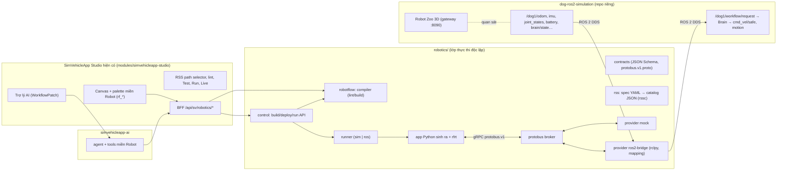

# Robotics — thiết kế tổng thể (M22–M28)

> **Trạng thái:** kế hoạch, **chưa có code**. Baseline thiết kế ngày 2026-11-01.
> ADR: [0064](../../../analysis/adr/ADR-0064-robotics-architecture-shared-gui-independent-execution.md) · [0065](../../../analysis/adr/ADR-0065-rss-robotic-signal-specification.md) · [0066](../../../analysis/adr/ADR-0066-protobus-signal-broker-and-ros2-bridge.md) · [0067](../../../analysis/adr/ADR-0067-robotflow-compiler-and-python-runtime.md) · [0068](../../../analysis/adr/ADR-0068-robotics-domain-in-existing-studio.md) · [0069](../../../analysis/adr/ADR-0069-robotics-safety-and-execution-policy.md) · [0070](../../../analysis/adr/ADR-0070-robotics-performance-budget-low-spec.md) · [0071](../../../analysis/adr/ADR-0071-robotics-acceptance-and-honest-video.md).
> Chi tiết: [RSS v0.1](rss-v0.1.md) · [Protobus](protobus.md) · [RobotFlow compiler/runtime](robotflow.md) · [Tích hợp GUI hiện có](gui-integration.md) · [Hiệu năng và video](performance-and-video.md).
> Phase: [M22](../../../analysis/phases/M22-robotics-foundation-rss.md) … [M28](../../../analysis/phases/M28-robotics-e2e-video-docs.md). Repo robot: [dog-ros2-simulation R4](https://github.com/ltnguyenlt2k/dog-ros2-simulation/blob/main/docs/r4/README.md).

## 0. Yêu cầu PO (nguyên văn, 2026-10-27; nhắc lại 2026-11-01)

| ID | Yêu cầu | Diễn giải đã chốt |
|---|---|---|
| R1 | Trình biên dịch riêng, ngôn ngữ nào dễ làm trước; thêm một runtime để kết nối robot, không chỉ xe; workflow kéo thả có log và kịch bản | Compiler **RobotFlow** riêng (không dùng compiler xe), sinh **Python** trước; runtime **rfrt**; log có cấu trúc + kịch bản test (scenario) |
| R2 | RSS path (Robotic Signal Specification) tương tự VSS path; định nghĩa đầy đủ, chuẩn chỉnh tín hiệu robot; trước mắt dog robot, tham khảo repo dog-ros2-simulation | **RSS v0.1**: định dạng cây tín hiệu `Robot.*`, kiểu/đơn vị/giới hạn/độ tươi; catalog chung + profile `dog-go2-sim` lấy từ ROS 2 contract thật của repo dog |
| R3 | Protobus độc lập, tương tự KUKSA của Velocitas; nhiệm vụ mapping tín hiệu RSS sang ROS 2 để giao tiếp với robot qua ROS 2 | **Protobus**: broker tín hiệu riêng (gRPC `protobus.v1`) + provider **ROS 2 bridge** đọc mapping khai báo RSS ↔ topic/field ROS 2; provider mock để chạy không cần ROS |
| R4 | Kéo thả workflow thành kịch bản (nhận tín hiệu → điều khiển dog di chuyển, pilot, nhảy, chào/giơ chân…); tín hiệu đi đúng path RSS → Protobus → ROS 2 → robot nhận/điều khiển đúng như design | Workflow kéo thả **trong GUI SimVehicleApp hiện có** (miền "Robot"), deploy và Run trên Protobus + dog ROS 2 sim, quan sát trong GUI và Robot Zoo 3D |
| R5 (2026-11-01) | Hiệu năng: mượt trên máy cấu hình thấp, không giật lag | Ngân sách đo được: [ADR-0070](../../../analysis/adr/ADR-0070-robotics-performance-budget-low-spec.md) |
| R6 (2026-11-01) | Vai trò cuối: quay video full luồng, chính xác, không bịa | Gate video: [ADR-0071](../../../analysis/adr/ADR-0071-robotics-acceptance-and-honest-video.md) |
| R7 (2026-11-01) | Dùng AI cho canvas với endpoint PO cung cấp | Trợ lý hiện có (`simvehicleapp-ai`) thêm năng lực miền Robot; cấu hình qua `.env` (không commit key) |

### Bài học từ lần làm trước (để không lặp lại)

Bản thử 2026-10-27 → 2026-11-01 (lưu ở tag `archive/robotics-attempt-2026-11-01`, đã gỡ khỏi `main` ngày 2026-11-01) sai ở ba điểm:

1. **Làm code khi PO chỉ yêu cầu plan** (yêu cầu gốc: "chưa cần thực hiện code").
2. **Hiểu "độc lập" thành "GUI riêng"**: tạo *Robot Studio* web mới. PO đính chính 2026-11-01: phải dùng **GUI SimVehicleApp hiện có**; "độc lập" áp dụng cho **các lớp thực thi** (RSS, Protobus, compiler, runtime), không phải sản phẩm/giao diện thứ hai.
3. **Bản plan đầu dùng KUKSA làm broker**, trái R3 ("protobus độc lập").

Quy tắc chống lặp: ADR-0064 §Decision 1–3 và AGENTS.md luật 11–13.

## 1. Kiến trúc



**Ranh giới:**

- **Một GUI duy nhất** cho tác giả workflow: studio hiện có. Robotics thêm *miền* (domain) `robot` cạnh `vehicle`, không thêm web app.
- **Lớp thực thi robotics độc lập** trong thư mục `robotics/`: không import, không copy code từ `modules/**` và ngược lại; không dùng KUKSA, Velocitas, VSS cho robot.
- Studio nói chuyện với robotics **chỉ qua HTTP contract có version** (BFF `/api/sv/robotics/*` → `robotics/control`, `robotics/robotflow`). Không compile, không thông dịch hành vi robot trong trình duyệt.
- Robot dog là repo riêng; chỉ giao tiếp qua **ROS 2** (yêu cầu R3). Repo dog bổ sung kênh lệnh workflow có trọng tài an toàn (dog ADR-0019).

## 2. Luồng dữ liệu đầu–cuối (ví dụ R4)

Workflow "Chào khi thấy marker đỏ, tránh pin yếu":

```text
[Khi bắt đầu] → [Arm (MANUAL)] → [Chờ đến khi Robot.Perception.Marker.IsDetected == true]
  → [Nếu Robot.PowerSystem.Battery.StateOfCharge >= 20 %]
       ├ then → [Thực hiện động tác WAVE_FRONT_LEFT] → [Ghi log "Đã chào"] → [Đi tới (1.5, 0.0) m]
       └ else → [Ghi log "Pin yếu"] → [Disarm]
```

1. **Thiết kế:** người dùng kéo block `rf_*` trên canvas studio; chọn path qua *RSS path selector* (cây `Robot.*` từ catalog). Lint 300 ms sau lần sửa cuối qua BFF → `robotflow /lint`.
2. **Build:** BFF gửi workflow (`robotflow.v1`, adapter thuần từ trạng thái canvas) → `robotics/control /builds` → compiler sinh **file set Python tất định** + `rflow.lock.json` (hash nguồn, catalog, profile, IR, runtime).
3. **Deploy:** gắn bản build với một *target* (mode `mock` hoặc `ros-sim`) đã quan sát thật; **deploy không bao giờ Arm hay Start**.
4. **Run:** người dùng bấm Start trong GUI → runner chạy app → app đăng ký với Protobus:
   - `Subscribe(Robot.Perception.Marker.IsDetected, Robot.PowerSystem.Battery.StateOfCharge)`;
   - `Execute(Robot.Motion.Perform, {Name: WAVE_FRONT_LEFT})` → Protobus → bridge tra mapping → publish JSON request lên `/dog1/workflow/request` (envelope schema-1: `request_id`, `issued_at_ns` theo đồng hồ sim ROS, `config_hash`) → Brain kiểm điều kiện → `/dog1/motion/request` → sim chạy động tác;
   - kết quả thật đọc từ `/dog1/motion/state` (`DISPATCHED → RUNNING → RECOVERING → SUCCEEDED`), không coi ACK là thành công.
5. **Quan sát:** GUI hiển thị block đang chạy, log có cấu trúc, giá trị RSS sống; Robot Zoo 3D (repo dog) cho thấy robot thật sự giơ chân.
6. **Stop:** nút Stop trong GUI đi **làn an toàn riêng** của Protobus → `stop` → Brain `SAFE_STOP`, độc lập với app.

## 3. Thành phần và module (đường dẫn dự kiến)

| Thành phần | Thư mục | Ngôn ngữ | Vai trò | Milestone |
|---|---|---|---|---|
| Contracts | `robotics/contracts/` | JSON Schema, proto3 | `rss-spec.v1`, `rss-catalog.v1`, `mapping.v1`, `robotflow.v1`, `rfir.v1`, `block.v1`, `scenario.v1`, `protobus.v1.proto`, catalog lỗi `diagnostics.v1.json` | M22–M25 |
| RSS tool | `robotics/rss/` | Python 3.12 | `rssc`: kiểm tra spec YAML, xuất catalog JSON + `catalogHash`, tài liệu tham chiếu | M22 |
| Protobus broker | `robotics/protobus/broker` | Python 3.12 asyncio + grpcio | Lưu giá trị hiện tại, subscribe có giới hạn tần số, setpoint TTL, command lifecycle, làn Stop | M23 |
| Provider mock | `robotics/protobus/mock` | Python | Mô hình động học đơn giản cho Simulate/Test không cần ROS | M23 |
| Provider ROS 2 bridge | `robotics/protobus/ros2` | Python + rclpy (Humble, cùng distro dog) | Đọc `mapping.v1` của profile; ROS → RSS (telemetry), RSS → ROS (command/setpoint) | M24 |
| RobotFlow compiler | `robotics/robotflow/` | Python 3.12 | Registry block, parse biểu thức + đơn vị, lint/diagnostics, IR `rfir.v1`, codegen Python | M25 |
| Runtime | `robotics/rfrt/` | Python 3.12 (wheel) | Scheduler hành vi, client Protobus, log/trace có cấu trúc | M25 |
| Control API | `robotics/control/` | Python (FastAPI) | Build bất biến, deploy, Start/Stop, log/live, scenario; chỉ nhận gọi nội bộ từ BFF | M26 |
| Runner | `robotics/runner/` | Python | Chạy app sinh ra (không root, giới hạn tài nguyên), một run mỗi robot/mode | M26 |
| GUI miền Robot | `modules/simvehicleapp-studio/apps/sim/{blocks/robot,lib/sv/robotics,app/api/sv/robotics}` | TypeScript | Palette, adapter canvas → `robotflow.v1`, RSS selector, Test/Run/Live | M26 |
| Trợ lý AI | `modules/simvehicleapp-ai` | TypeScript | Tool theo miền (RSS search, block, lint robotics) | M26 |

## 4. Chế độ chạy

| Mode | Provider | Dùng cho | Có ROS? |
|---|---|---|---|
| `mock` | `protobus-mock` | Simulate, Test (scenario), CI | Không |
| `ros-sim` | `protobus-ros2` + dog sim (MuJoCo, Nav2, SLAM) | Run thật trên mô phỏng, E2E, video | Có |
| `ros-real` | — | **Ngoài phạm vi** (robot thật là Phase 2 của repo dog, chưa commissioning) | — |

## 5. Phạm vi v0.1

**Trong phạm vi:**

- Một robot `dog1` (Unitree Go2 mô phỏng).
- Catalog RSS v0.1 theo [rss-v0.1.md](rss-v0.1.md).
- Khoảng 25 block RobotFlow.
- Codegen Python.
- Hai mode `mock`/`ros-sim`.
- GUI miền Robot trong studio hiện có, gồm palette, lint, Test, Run, Live, trợ lý AI, Export.

**Ngoài phạm vi v0.1 (backlog, có ADR riêng khi mở):**

- Nhiều robot.
- Target C++.
- Robot thật hoặc Jetson.
- Dữ liệu ảnh hoặc point cloud trong workflow (chỉ dùng tín hiệu dẫn xuất).
- Chỉnh sửa cộng tác realtime cho thao tác robot (realtime collaboration chỉ dùng để soạn).
- Bản đồ và path planning trong workflow (dùng Nav2 của dog).

## 6. Spike phải làm trước khi code (M22)

| Spike | Câu hỏi | Tiêu chí PASS |
|---|---|---|
| S-R1 | Bridge ROS 2 ngoài compose dog có được các node dog (CycloneDDS unicast, `AllowMulticast=false`, peers cố định) phát hiện không? | Bridge nhận `/dog1/odom` ≥ 45 Hz trong 60 s; publish request thấy ACK; nếu không ⇒ dog thêm peer `protobus-ros2` (dog W1) |
| S-R2 | Broker Python có đủ nhanh trên máy yếu? | 300 tín hiệu, tổng 2.000 cập nhật/s vào, 20 subscriber: p95 trễ < 20 ms, CPU < 0,5 core, RSS < 150 MiB (ADR-0070) |
| S-R3 | Canvas studio với 150 block `rf_*` | Kéo thả ≥ 50 FPS, lint p95 < 400 ms trên máy dev (11 GB RAM) |
| S-R4 | Quay video hai cửa sổ thật (GUI + Robot Zoo) | `ffmpeg x11grab` 1600×900 @ 25 fps, CPU recorder < 1,5 core, không làm rớt ngân sách camera Robot Zoo > 10 % |

## 7. Rủi ro và câu hỏi mở

| ID | Rủi ro | Giảm thiểu |
|---|---|---|
| RR1 | `/dog1/control/request` chỉ cho **một** publisher (`/dog_gateway`) theo contract dog ⇒ bridge không được publish vào đó | Kênh mới `/dog1/workflow/request` + trọng tài quyền điều khiển trong Brain (dog ADR-0019) |
| RR2 | Pin trong sim là **hằng số 0,92** ⇒ kịch bản "pin yếu" không thử được trên ROS | Dog W3: mô hình xả pin + stimulus chỉ ở SIM; trên `mock` thì scenario điều khiển |
| RR3 | Chưa có động tác "chào/vẫy chân" (chỉ có `crouch, bow, tilt, lift_fl, jump`) | Dog ADR-0020: thêm `wave_fl`, `sit`, `stand`; mỗi động tác phải qua kiểm định vật lý trong sim |
| RR4 | `issued_at_ns` phải theo **đồng hồ sim ROS** (`use_sim_time=true`); request cũ > 1 s (manual > 0,25 s) bị từ chối | Bridge lấy thời gian từ `/clock`, kiểm tra lag; test RR4 ở M24 |
| RR5 | RAM máy dev 11 GB: studio + Postgres + robotics + dog sim + trình duyệt + recorder | Profile `robot-lite`: không bật toolchain C++/Velocitas/KUKSA; đo ở M27 |
| RR6 | Model AI là model reasoning: có `reasoning_content` + `content`; cần `max_tokens` đủ lớn | Đã thử 2026-11-01: tool calling OK, trả lời ngắn ~0,9 s; cấu hình timeout/max tokens ở M26 |
| RR7 | Khối lượng lớn (broker, compiler, runtime mới) | Thứ tự gate cứng M22→M28; mỗi milestone có gate kỹ thuật riêng |

## 8. Thuật ngữ

- **RSS**: Robotic Signal Specification — cây tín hiệu robot, vai trò như VSS cho xe.
- **Protobus**: broker tín hiệu RSS độc lập, vai trò như KUKSA Databroker cho xe.
- **Provider**: tiến trình cung cấp/thực thi tín hiệu cho Protobus (mock, ros2-bridge).
- **RobotFlow**: ngôn ngữ workflow robot (`robotflow.v1`) + compiler `rflowc` + IR `rfir.v1`.
- **rfrt**: runtime Python chạy app sinh ra.
- **Setpoint**: tín hiệu điều khiển liên tục có TTL (ví dụ vận tốc), tự về `safeValue` khi hết hạn.
- **Command**: lệnh rời rạc có vòng đời (`ACCEPTED/RUNNING/SUCCEEDED/FAILED/REJECTED/CANCELLED/TIMED_OUT`).
