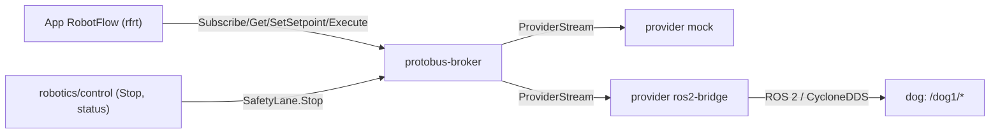

# Protobus — broker tín hiệu RSS và cầu ROS 2

> Quyết định: [ADR-0066](../../../analysis/adr/ADR-0066-protobus-signal-broker-and-ros2-bridge.md), an toàn: [ADR-0069](../../../analysis/adr/ADR-0069-robotics-safety-and-execution-policy.md), hiệu năng: [ADR-0070](../../../analysis/adr/ADR-0070-robotics-performance-budget-low-spec.md). Trạng thái: **thiết kế**, chưa có code.

## 1. Vai trò (so với KUKSA)

| | KUKSA Databroker (xe) | Protobus (robot) |
|---|---|---|
| Mô hình tín hiệu | VSS | RSS |
| Ai viết code | Eclipse (Rust) | Dự án này (Python v0.1) |
| Ghi giá trị | `actuator` target/current | `setpoint` có TTL + `safeValue`; `command` có vòng đời |
| Provider | feeder/provider tuỳ ý | `mock`, `ros2-bridge` (mapping khai báo) |
| An toàn | không có khái niệm | lease người điều khiển, làn Stop riêng, hết TTL ⇒ giá trị an toàn |
| Wire | gRPC `kuksa.val.v2` | gRPC `protobus.v1` (proto riêng) |

Protobus **không** dùng lại code, proto hay image của KUKSA. Chỉ tham khảo ý tưởng broker + provider.

## 2. Thành phần



- **broker** (`protobus-broker`):
  - lưu giá trị hiện tại của mọi node RSS (bộ nhớ, không DB);
  - chia sẻ cho subscriber với **giới hạn tần số theo subscriber**;
  - quản lý lease, TTL, command lifecycle;
  - ghi audit có giới hạn (ring buffer + file xoay vòng).
- **provider**: tiến trình đăng ký với broker là chủ của một tập path (theo profile). Mỗi path có đúng **một** provider chủ.
- **Làn Stop**: endpoint gRPC riêng (`SafetyLane`) trên listener riêng, thread pool riêng. Lệnh Stop không xếp hàng sau telemetry hay command thường.

## 3. Wire API `protobus.v1` (proto3, phác thảo)

```proto
service Broker {
  rpc GetCatalog(GetCatalogRequest) returns (Catalog);                 // catalogHash + node metadata
  rpc Get(GetRequest) returns (GetResponse);                           // giá trị + captureTime + quality
  rpc Subscribe(SubscribeRequest) returns (stream SubscribeResponse);  // paths, maxRateHz (≤ ngân sách), onChangeOnly
  rpc AcquireControl(AcquireRequest) returns (Lease);                  // một lease điều khiển / robot
  rpc RenewControl(Lease) returns (Lease);
  rpc ReleaseControl(Lease) returns (Empty);
  rpc SetSetpoint(SetpointRequest) returns (SetpointAck);              // lease + path + fields; TTL theo catalog
  rpc Execute(CommandRequest) returns (stream CommandUpdate);          // ACCEPTED → RUNNING → terminal
  rpc Cancel(CancelRequest) returns (CommandUpdate);
}
service SafetyLane {
  rpc Stop(StopRequest) returns (StopResult);       // không cần lease; luôn chấp nhận; trả kết quả xác nhận thật
  rpc StopState(Empty) returns (stream StopResult);
}
service Provider {
  rpc Attach(stream ProviderMessage) returns (stream BrokerMessage);   // đăng ký path, đẩy giá trị, nhận lệnh
}
```

**Ngữ nghĩa bắt buộc:**

- `Subscribe.maxRateHz`:
  - broker gộp mẫu (latest-wins), không xếp hàng vô hạn;
  - subscriber chậm bị đánh dấu `lagged` thay vì làm chậm broker.
- `SetSetpoint`:
  - cần lease còn hạn;
  - **broker tự hạ về `safeValue` sau `ttlMs`** nếu không được làm mới;
  - provider nhận giá trị kèm `deadline`.
- `Execute`:
  - terminal là một trong `SUCCEEDED/FAILED/REJECTED/CANCELLED/TIMED_OUT`;
  - provider phải chứng minh kết quả từ trạng thái vật lý (ví dụ `motion/state`), không từ ACK;
  - mất provider khi lệnh đang chạy ⇒ `FAILED` + yêu cầu Stop.
- **Lease:**
  - một lease điều khiển mỗi robot;
  - lease mất (app chết, hết hạn 1 s không renew) ⇒ broker ghi `safeValue` cho mọi setpoint + hủy command đang chạy.
- **Mỗi mẫu:** `captureTime` (thời gian nguồn), `receiveTime`, `quality`. Broker **không bịa** giá trị khi nguồn im lặng: quá `maxAgeMs` ⇒ `STALE`.

Mã lỗi công khai `PB1xxx` trong `robotics/contracts/diagnostics.v1.json` (chỉ thêm, không đổi tên).

## 4. Provider ROS 2 bridge và mapping

### 4.1 Mapping khai báo (`mapping.v1`)

Mỗi profile robot có `robotics/protobus/profiles/<profile>/mapping.json`. Bridge **không chứa logic riêng cho dog** ngoài các *transform* đóng được đặt tên:

```json
{
  "schema": "mapping.v1",
  "profile": "dog-go2-sim",
  "rosNamespace": "/dog1",
  "requestEnvelope": { "topic": "workflow/request", "ackTopic": "workflow/ack", "schema": 1,
                       "clock": "ros_sim_time", "configHash": "from:brain/state.config_hash" },
  "sensors": [
    { "path": "Robot.Pose.Position.X", "topic": "odom", "type": "nav_msgs/msg/Odometry",
      "field": "pose.pose.position.x", "qos": "reliable/5", "maxRateHz": 20 },
    { "path": "Robot.Pose.Orientation.Yaw", "topic": "odom", "type": "nav_msgs/msg/Odometry",
      "transform": { "fn": "quat_to_yaw", "field": "pose.pose.orientation" }, "maxRateHz": 20 },
    { "path": "Robot.Safety.Mode", "topic": "brain/state", "type": "std_msgs/msg/String",
      "transform": { "fn": "json_field", "field": "mode" } }
  ],
  "commands": [
    { "path": "Robot.Motion.Perform", "request": { "action": "motion", "motion_name": "$arg.Name|lower_map" },
      "argMap": { "Name": { "LIFT_FRONT_LEFT": "lift_fl", "WAVE_FRONT_LEFT": "wave_fl" } },
      "result": { "topic": "brain/state", "transform": { "fn": "motion_terminal", "correlate": "request_id" } } }
  ],
  "setpoints": [
    { "path": "Robot.Motion.Velocity", "request": { "action": "manual", "linear": "$LinearX", "angular": "$AngularZ" },
      "publishHz": 20 }
  ],
  "stop": { "request": { "action": "stop" }, "confirm": { "path": "Robot.Safety.Mode", "equals": "SAFE_STOP", "withinMs": 500 } }
}
```

**Transform đóng v0.1:**

| Nhóm | Transform |
|---|---|
| Lấy trường | `field`, `json_field` |
| Hướng (từ quaternion) | `quat_to_roll`, `quat_to_pitch`, `quat_to_yaw` |
| Mảng và tên | `array_index`, `joint_by_name` |
| Đơn vị và giá trị | `scale` (ví dụ ×100 cho %), `enum_map`, `min_finite` (cho scan) |
| Điều kiện và sự kiện | `count_where`, `exists_where`, `freshness`, `motion_terminal`, `mission_terminal` |

Thêm transform = đổi contract `mapping.v1` (ADR).

### 4.2 Bảng mapping profile `dog-go2-sim` (tóm tắt)

| RSS | Hướng | ROS 2 (`/dog1/…`) | Type | Rate nguồn → vào broker |
|---|---|---|---|---|
| `Robot.Pose.*`, `Robot.Velocity.*` | ROS→RSS | `odom` | `nav_msgs/Odometry` | 50 → 20 Hz |
| `Robot.Imu.*` | ROS→RSS | `imu/data` | `sensor_msgs/Imu` | 100 → 20 Hz |
| `Robot.Leg.*.Joint.*` | ROS→RSS | `joint_states` | `sensor_msgs/JointState` | 50 → 10 Hz |
| `Robot.Leg.*.IsInContact/ContactForce` | ROS→RSS | `foot_contacts` | `dog_interfaces/FootContacts` | 50 → 20 Hz |
| `Robot.PowerSystem.Battery.*` | ROS→RSS | `battery_state` | `sensor_msgs/BatteryState` | 1 → 1 Hz |
| `Robot.Safety.*`, `Robot.Motion.State.*`, `Robot.Navigation.Mission.*`, `Robot.Simulation.SceneId` | ROS→RSS | `brain/state` | `std_msgs/String` (JSON schema-1) | 20 → on-change |
| `Robot.Velocity.Commanded.*` | ROS→RSS | `cmd_vel/safe` | `geometry_msgs/TwistStamped` | 20 → 10 Hz |
| `Robot.Perception.Marker.*` | ROS→RSS | `perception/detections` | `vision_msgs/Detection2DArray` | 10 → on-change |
| `Robot.Obstacle.MinRange` | ROS→RSS | `scan` | `sensor_msgs/LaserScan` | 10 → 10 Hz |
| `Robot.Safety.Arm/Disarm/Stop/ResetStop` | RSS→ROS | `workflow/request` → `workflow/ack` | `std_msgs/String` | event |
| `Robot.Motion.Velocity` | RSS→ROS | `workflow/request {manual}` | `std_msgs/String` | 20 Hz khi lease + setpoint còn hạn |
| `Robot.Motion.Perform/Cancel` | RSS→ROS | `workflow/request {motion / motion_cancel}`; kết quả `brain/state.motion` | `std_msgs/String` | event |
| `Robot.Navigation.GoTo/FollowRoute/Cancel` | RSS→ROS | `workflow/request {goal / route / cancel}`; kết quả `brain/state.mission` | `std_msgs/String` | event |

**Ràng buộc từ dog (đã đọc code 2026-11-01):**

- `/dog1/control/request` chỉ có **một** publisher hợp lệ (`/dog_gateway`). Bridge **không** publish vào đó; dùng kênh `workflow/request` (dog ADR-0019).
- **Envelope schema-1** gồm `request_id` (UUID), `issued_at_ns` theo **đồng hồ ROS dùng sim time**, và `config_hash` khớp `CONFIG_HASH` của dog.
- **Brain bỏ request cũ:** request > 1 s bị bỏ, riêng `manual` > 0,25 s.
- **Watchdog manual 0,2 s** ⇒ setpoint vận tốc phải làm mới 20 Hz.
- **Chỉ publish lệnh cấp cao.** Không bao giờ publish `cmd_vel`, `cmd_vel_nav`, `motion/request`, `unitree/*` hay lệnh motor.

### 4.3 Kết nối DDS

- CycloneDDS của dog: `AllowMulticast=false`, `NetworkInterface eth0`, peers cố định theo tên service, `ROS_DOMAIN_ID=${DOG_ROS_DOMAIN_ID:-42}`.
- Bridge chạy image ROS 2 **Humble** (cùng distro dog), gia nhập network `robot` của compose dog bằng network external, với file cyclonedds riêng liệt kê peers dog.
- Spike S-R1 xác định có cần thêm peer `protobus-ros2` phía dog không (dog W1).

## 5. Provider mock

- Mô hình động học 2D:
  - tích phân vận tốc → pose;
  - pin xả theo tham số;
  - động tác là state machine có thời lượng cố định.
- Cung cấp **cùng tập path** với profile `dog-go2-sim`.
- Có API *scenario* để đặt giá trị theo dòng thời gian (dùng cho Test, ADR-0068 §5).
- Không chạy ROS ⇒ khởi động < 2 s, RAM < 80 MiB.

## 6. Kiểm chứng

| Gate | Nội dung |
|---|---|
| M23 | Unit/contract cho broker: TTL → safeValue, lease mất → safe, command lifecycle, Stop khi broker đang bão hòa telemetry (p99 < 50 ms), subscriber chậm không làm chậm broker; benchmark S-R2 |
| M24 | Bridge với dog sim thật: so khớp giá trị RSS với ROS (≥ 30 path, sai số theo kiểu); Arm → velocity → Stop; động tác JUMP + LIFT_FRONT_LEFT thành công vật lý; request cũ bị từ chối; mất bridge ⇒ dog dừng do watchdog; soak 30 phút |
